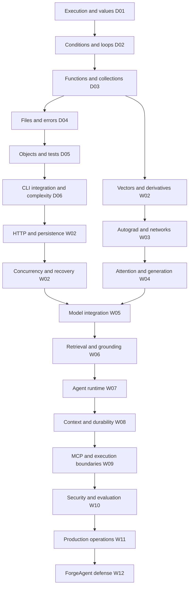

# Concept dependencies

The machine-readable schedule is [build-progress.json](docs/build-progress.json).
Its conservative edges require the preceding lesson. This prevents unsupported
skips; finer concept edges will replace the chain as later chapters are audited.
Weeks 1–6 currently have authored instruction.

An arrow means the destination needs the source's demonstrated competence.
It does not imply every intermediate topic is already authored. A complete
concept-to-lesson coverage matrix is a planned deliverable; the current matrix
records only concepts actually taught.
