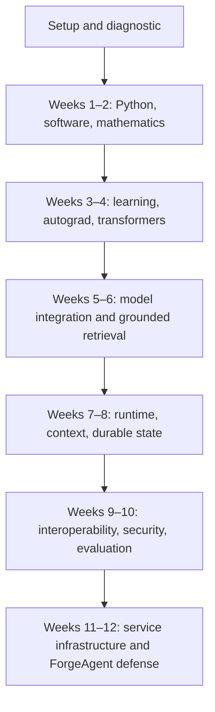

# How to follow the program

**Begin now:** [setup](START_HERE.md) → [diagnostic](assessments/diagnostic/README.md)
→ [Week 1](curriculum/week-01/README.md). Days are separate documents under
`curriculum/week-NN/day-NN/README.md`. Read them in order; pass the gate before
following the next link. Week numbering is the whole-program number, 01–12.
Day numbering restarts at 01 each week. The unique global identifier D01–D72
is recorded in the manifest, so Week 2 / Day 1 is D07.

This diagram describes the intended route. Weeks 1–4 are authored. Current
availability must not be inferred from a planned box in the diagram.

| Week | Build toward | Exit evidence | Availability |
|---|---|---|---|
| 1 | Local document-search CLI | Correct counts, stable search, visible failures, tests | [Ready checkpoint](curriculum/week-01/README.md) |
| 2 | Async storage-backed API and math routines | Transactions, cancellation, vector/derivative traces | [Ready checkpoint](curriculum/week-02/README.md) |
| 3 | Mini-autograd and tiny neural models | Analytic versus numerical gradients, honest evaluation scope | [Available](curriculum/week-03/README.md) |
| 4 | Tiny decoder transformer | Shape/mask tests and reproducible CPU generation | [Available](curriculum/week-04/README.md) |
| 5 | Reliable model adapter | Typed outputs, bounded retries, streaming/cancellation tests | Planned |
| 6 | Retrieval and grounded answers | Fixed queries, relevance metrics, citation checks | Planned |
| 7 | Framework-free runtime | Tool validation, transitions, stopping budgets | Planned |
| 8 | Resumable context-aware runtime | Crash/restart, idempotency, provenance and memory tests | Planned |
| 9 | MCP and constrained execution | Negotiation, discovery, denied-operation tests | Planned |
| 10 | Reliability/security benchmark | Frozen grading, adversarial tasks, repeated-trial results | Planned |
| 11 | Authenticated service | Ownership, workers, telemetry, container recovery | Planned |
| 12 | Integrated ForgeAgent | Functional/adversarial benchmark and technical defense | Planned |

## A normal instructional day

Allocate 45 minutes to closed-book recall and prerequisite checks, 90 minutes
to the chapter and hand traces, 75 minutes to reconstructing the worked example,
120 minutes to the independent lab, 60 minutes to experiments/debugging, and
60 minutes to the exam and notes. This is 7.5 focused hours; take breaks outside
those blocks. It is a suggested budget, not a measured requirement. If you
cannot explain the result, extend the session or add another day. Do not skip
remediation to preserve a calendar.

On the seventh day, perform the weekly review, take the exam independently,
inspect reference solutions afterward, and reconstruct failed mechanisms from
their contracts. Recheck one previous week's skill without looking at it.
Each two-week phase needs a cumulative gate; [Phase 1](assessments/phase-examinations/phase-01.md) is authored, [Phase 2](assessments/phase-examinations/phase-02.md) is also authored, while the remaining four exams are planned.
The intended learning levels and evidence are in [COMPETENCY_FRAMEWORK](COMPETENCY_FRAMEWORK.md).

## When to move, skip, or pause

Move when the day's explicit implementation, explanation, and exam gates pass.
Skip only by producing equivalent unseen-input evidence from the diagnostic;
vocabulary recognition is insufficient. Pause for remediation when your code
passes public checks but you cannot trace why it works. If you finish Week 4
before further chapters exist, use review exercises and delayed reconstruction;
the later titles are not substitutes for missing instruction.

Complete beginners may need 1–3 extra weeks on Python, 1–2 on engineering/math,
and 2–4 on ML/transformer foundations. These are estimates and are not guarantees
of either minimum or maximum time. Assess demonstrated competence continuously.
