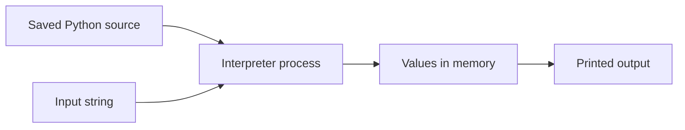

# Day 1 — Programs, values, and execution

## 1. Learning objectives

Explain what happens between saving a Python file and observing its output.
Distinguish a file, an interpreter, a running process, an expression, a value,
and a name. Predict the result of a short sequence of assignments. Independently
write a text summary reporting character and whitespace-word counts. Required
competency: Level 3 (independent implementation), with a Level 2 execution trace.

## 2. Required prerequisites

No programming or mathematics beyond counting is assumed. Complete
[environment setup](../../../START_HERE.md) first. A terminal is a program that
accepts written commands. A directory is a named container of files. Your
terminal's current directory determines how a relative path is interpreted.
`datasets/sample-data/agents.txt` starts at the repository root; it will not
resolve from an unrelated directory. A command beginning with `python` asks
an interpreter to execute Python, whereas `cd` changes the shell's directory.
Do not type shell commands inside a Python prompt showing `>>>`.

## 3. Problem motivation

A coding agent eventually reads source files and computes observations. Before
trusting its decisions, we need predictable software that transforms inputs into
outputs. Even counting characters teaches a critical distinction: the text on
disk, the Python object in memory, and the printed representation are different
things. Without that distinction, a beginner may edit a file that is never run,
count quotes that are only syntax, or assume a printed answer was saved.

Our first problem is deliberately small: given text, compute two descriptive
numbers without changing the text. Small examples make mistaken mental models
visible before a network API introduces additional uncertainty.

## 4. Intuitive explanation

Imagine a recipe stored in a notebook. The notebook is not dinner; someone must
follow the instructions. A `.py` file is the recipe, the interpreter performs
its instructions, and the operating system gives that running activity a
process. Memory holds the values being used. When the process ends, those
ordinary in-memory values disappear unless explicitly written somewhere.

A name is a label attached to a value. In `text = "read files"`, the quotes tell
Python to create a string; they are not characters inside the string. The `=`
symbol binds a name. It does not assert mathematical equality. In `count = count
+ 1`, Python first computes the right side using the previous binding, then
binds the name to the new integer. If `count` has never been bound, it fails.

## 5. Deep technical explanation

For the CPython implementation used by most beginner installations, source is
parsed and compiled to bytecode, which an interpreter executes. Other Python
implementations can use different machinery. You do not need to memorize
bytecode instructions, but you do need to understand that syntax is checked
before that module's top-level statements execute. A missing quote is different
from a valid expression that later divides by zero.

An **expression** computes a value: `2 + 3` computes the integer 5. A **statement**
performs an action: assignment binds a name. `print(2 + 3)` evaluates its argument
then writes text to standard output, the process's normal output stream. Its
return value is `None`, Python's explicit no-value object. `print` is a function;
parentheses supply arguments. A function is reusable behavior named by a value.
For today use supplied functions; Day 3 explains how to define your own.

Basic values include integers (`3`), floating-point numbers (`0.5`), Boolean
values (`True`), strings (`"agent"`), and `None`. The operation `+` means numeric
addition for numbers and concatenation for strings. Python does not silently
make `"3" + 4` into a sensible number. Use `int("3")` if conversion is required,
and recognize that `int("three")` fails. A type constrains supported operations.

`len(text)` counts Unicode code points, which are the units Python strings
index. It does not count UTF-8 bytes or necessarily user-perceived characters:
an accented letter can be represented by one code point or a letter plus a
combining mark. We postpone encoding mechanics to Day 4. `text.split()` returns
a list, an ordered collection of substrings separated by runs of whitespace.
Whitespace includes ordinary spaces, tabs, and newlines. A dot accesses behavior
associated with the string: `split` is a method. Empty text splits to an empty
list. Taking the length of that list counts its entries.

## 6. Mathematical foundations

Let a string contain n code points. Its length is n, including whitespace. Let
w be the number of nonempty runs of non-whitespace code points. The summary is
the pair (n, w). This is a convention for words, not a linguistic definition.

For `"A  b\n"`, the sequence is A, space, space, b, newline: n = 5. Splitting
produces `['A', 'b']`: w = 2. A newline is one code point even though `\n` uses
two written symbols inside a Python literal. For empty input, n = w = 0. Check
both boundaries; an implementation that returns spaces + 1 predicts a word for
empty text and overcounts repeated spaces.

## 7. Architecture and execution diagrams



Source supplies instructions; input supplies data. Intermediate values live in
memory. Printing transfers a representation to an output stream. There is no
arrow back to the source file: running a program does not rewrite its recipe.

## 8. Implementation from first principles

Run this as a new file, `learner-work/day01_example.py`, from the repository root.
The ignored `learner-work` directory is yours to create with your file manager.

```python
text = "Tools read files."
characters = len(text)
words = text.split()
word_count = len(words)
report = {"characters": characters, "words": word_count}
print(report)
assert report == {"characters": 17, "words": 3}
```

Input is one string. Intermediate data are two integers and a list. Output is
a dictionary, a mapping from keys to values, printed as a Python representation.
The assertion checks a claim and raises an error if it is false. Dictionaries
are introduced thoroughly in Day 3; for now the braces pair each label with its
computed number using a colon. Commas separate entries. No files or network
connections are opened. The code assumes the input is a string; changing it to
an integer makes `len` fail. That failure is informative, not a reason to return
a fabricated count. Later lessons put validation at input boundaries.

## 9. Worked execution walkthrough

Python binds `text` to a string of length 17. `len` produces 17 and binds
`characters`. `split` scans the text and creates `['Tools', 'read', 'files.']`;
notice the period remains. `len(words)` is 3. Constructing the report reads the
two integer bindings; printing shows `{'characters': 17, 'words': 3}`. The assert
compares dictionaries and passes. Execution ends. If a later statement rebinds
`text` to `"new"`, it does not retroactively recalculate `characters`. A program
runs statements in order; assignments are not spreadsheet formulas.

## 10. Independent laboratory

Open the [Week 1 lab contract](../../../labs/week-01/README.md), Day 1. Copy
[summary.py](../../../labs/week-01/starter/summary.py) to your work directory.
The supplied `def` and `return` wrap the result for the test harness; treat that
wrapper as supplied syntax until Day 3. Replace its baseline result by a
computed dictionary. Input: any string. Output: exactly the two required keys
and integer counts. Do not print inside the function, change the input, or
count punctuation as separators.

Run `python labs/week-01/checks.py --day 1 --module learner-work/week-01/summary.py`.
Deliver the function, a five-step trace of `"A  b\n"`, and tests for empty text
and text containing only spaces. Acceptance requires correct counts on all
these inputs and a verbal explanation of characters versus whitespace words.

## 11. Experiments

Hold the letters fixed and replace a single space with five spaces. Predict
which count changes, then run it. Repeat with a tab and newline. Record text
using `repr(text)`, which makes escape sequences visible, together with both
counts. Next compare `"é"` with `"e\u0301"`. They look similar but have lengths
1 and 2. This shows why the measurement definition must precede interpretation.
No performance conclusions are justified by these tiny examples.

## 12. Failure analysis

Reproduce a `NameError` by using `word_count` before assignment. Read the final
traceback line for the kind of error and the file/line above it for location.
Fix the ordering and rerun the same input. Reproduce a `TypeError` with
`len(12)`; the object does not support the requested operation. Fix the input
rather than hiding the exception. A syntax error such as an unclosed quote is
detected before normal execution; inspect punctuation near the reported line.
If the output never changes, confirm the saved filename and run command match.

## 13. Engineering tradeoffs

A precisely defined simple word count is easy to reproduce and test. A language-
aware tokenizer handles more linguistic cases but requires additional rules
and may change counts across versions. Python dictionaries make labeled results
readable, while a bare pair is shorter but easier to swap accidentally. For a
tiny program, clarity matters more than reducing a few allocations. Do not
introduce model inference to solve a deterministic counting problem.

## 14. Real-world connection

Document ingestion pipelines measure text before indexing or sending it to a
model. Character counts can detect unexpectedly empty documents, but they do
not equal model tokens or predict exact API bills. Our program provides an
inspectable baseline. No claim is made about proprietary coding-agent internals.

## 15. Common misconceptions

“Python remembers my variable next run”: a new process starts fresh. “Assignment
means the two sides remain equal”: it binds a computed value at that instant.
“Strings include their quotes”: quotes delimit the literal. “A successful run
means the answer is correct”: an incorrect constant can run perfectly.

## 16. Technical examination

1. Concept: distinguish source file, process, and output using this example.
2. Trace: predict `x = 2; y = x + 3; x = 10` and give final x and y.
3. Code: implement the lab without using a fixed answer.
4. Debug: why does spaces + 1 fail on `"a  b"` and empty text?
5. Design: define whether punctuation should separate words before choosing an algorithm.

Answers and grading are separate in [Week 1 solutions](../../../solutions/examinations/week-01.md).

## 17. Daily mastery gate

Pass the public contract and two independent edge cases. Trace an unseen
three-assignment example without running it. Score at least 4/5 examination
points; the independent implementation is mandatory. Explain one limitation of
our word definition. Reading the page alone does not satisfy the gate. Record
evidence in [progress](../../../PROGRESS_TRACKER.md).

## 18. Resources

[Python 3.12 tutorial, introduction](https://docs.python.org/3.12/tutorial/introduction.html),
Python Software Foundation: numbers and text, 25 minutes after this lesson.
It is supplemental practice, not a beginner prerequisite. The
[resource record](../../../docs/resource-verification.md) states what was verified.

## 19. Revision and retention

Tomorrow, closed book, explain assignment and reconstruct the counting example.
Three days later, predict results for whitespace-only text. One week later,
write the summary from its contract without opening the solution. Keep a note
of an incorrect prediction and the evidence that corrected it. Recall precedes
rereading so familiarity does not masquerade as understanding.

## 20. Next lesson connection

[Day 2](../day-02/README.md) adds conditions and loops so a program can process
many pieces of text and deliberately choose which to retain. Today's distinction
between an input and its representation prevents confusion when we normalize
capitalization and punctuation.
