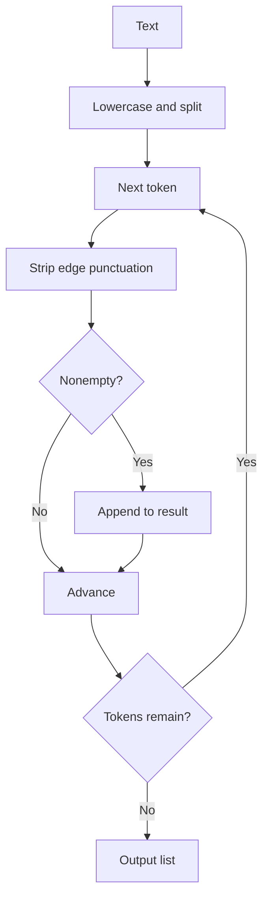

# Day 2 — Decisions, repetition, and text normalization

## 1. Learning objectives

Predict Boolean expressions and branch selection. Trace `for` and `while`
loops, including zero iterations. Explain mutation versus rebinding. Normalize
whitespace-separated tokens according to an explicit policy without changing
the input. Required competency: Level 3 independent implementation.

## 2. Required prerequisites

[Day 1](../day-01/README.md): strings, values, names, expressions, `split`, lists,
and execution order. If `x = x + 1` still looks like mathematical equality,
retrace Day 1 before continuing. A list is an ordered sequence. Its first
position has index 0; an empty list has no valid index. Today we iterate over
values rather than assuming a first element exists.

## 3. Problem motivation

Document search fails when `Agent` and `agent` are treated as unrelated words.
It also fails if punctuation-only input becomes a search term. We need a
repeatable policy to clean tokens. That requires both repetition (apply the
same rule to each candidate) and selection (keep only nonempty results).
Without an explicit policy, different stages can normalize differently and
silently lose matches. Model-generated text also needs these ordinary
programming checks before it can safely drive later operations.

## 4. Intuitive explanation

A branch is a fork in a road: test a condition and follow one path. A loop is
walking a row of mailboxes and doing the same action at each. The instruction
is written once even when there are many mailboxes. A `for` loop follows a
known collection; a `while` loop repeats until a condition becomes false.
A while loop needs a reason it will eventually stop.

To clean a word, first make capitalization consistent, then remove punctuation
from its edges. A token made only of dots becomes empty and should be discarded.
A hyphen inside a word stays because our current contract says it stays.
Normalization is a design choice, not an automatic discovery of meaning.

## 5. Deep technical explanation

Comparisons such as `count > 0` and `name == "agent"` produce Boolean values.
Use `==` to compare and `=` to assign. `and`, `or`, and `not` combine conditions.
Python short-circuits: `text != "" and text[0] == "a"` does not index empty
text because the first operand already determines failure. In general Python
`and` and `or` return selected operands, not necessarily a Boolean; keep beginner
conditions explicitly Boolean when this distinction could confuse a reader.

An `if` block starts after a colon and uses consistent indentation. With
`if/elif/else`, the first true branch runs. Independent `if` statements are
different: several can execute. `for token in tokens` asks for each next value
until exhaustion. If the iterable is empty, the body runs zero times. A `while`
loop tests before each iteration. `break` exits the innermost loop; `continue`
skips the rest of its current iteration. Prefer a simple conditional when it
makes the loop's state easier to follow.

Strings are immutable: `text.lower()` returns text with lowercase mapping; it
does not mutate the original string. A list is mutable: `result.append(value)`
changes that list and returns `None`. Thus `result = result.append(value)` is a
bug: it replaces the list binding with `None`. Assignment aliases objects:
`other = result` binds another name to the same list. Appending through either
name is visible through both. Rebinding `other = []` attaches that name to a
new list without clearing the old one.

`strip(".,!?")` removes any sequence of these characters at the two edges. It
does not remove a specific whole substring, internal punctuation, or every
Unicode punctuation mark. `lower()` and `casefold()` are different policies;
casefold supports more caseless matching, such as mapping German sharp s to
`ss`. The final project adopts casefold plus a Unicode word-run rule; this lab
uses the simpler policy specified below. Policies must be tested independently.

## 6. Mathematical foundations

A useful loop invariant is a statement true before and after every iteration.
After processing k input tokens, the output contains exactly the nonempty
cleaned versions of the first k tokens, in the same order. Initially k = 0
and the output is empty, so the invariant holds. One iteration either appends
the cleaned token or discards an empty result, preserving the claim. When all
m tokens have been processed, the invariant proves the full output contract.

Termination follows because each iteration consumes one token from a finite
list. A corresponding while loop might use `i < m` and increment i; forgetting
the increment destroys this argument. This small proof pattern will later
support bounded agent execution loops.

## 7. Architecture and execution diagrams



The result list is the only mutable accumulator. The advance step makes progress;
there is no path that reprocesses the same token indefinitely.

## 8. Implementation from first principles

```python
text = " AGENT,  tool! ... a-b "
result = []
for token in text.lower().split():
    cleaned = token.strip(".,!?")
    if cleaned != "":
        result.append(cleaned)
print(result)
assert result == ["agent", "tool", "a-b"]
assert text == " AGENT,  tool! ... a-b "
```

Input is a string; output is an ordered list. `cleaned` is rebound per iteration.
The original string is immutable and never rebound. The `if` controls append,
not iteration: even discarded tokens count as progress. This code accepts all
strings but makes no claim about natural-language segmentation. Processing
cost grows with total input length; intermediate lowercase and split results
also require space. We have chosen clarity over streaming to keep every state
observable.

## 9. Worked execution walkthrough

Lowercase and split yield `['agent,', 'tool!', '...', 'a-b']`. Start with `[]`.
`agent,` becomes `agent`, passes the condition, and is appended. `tool!` becomes
`tool` and is appended. `...` becomes empty, so the output stays unchanged.
`a-b` remains `a-b` and is appended. The iterator is exhausted; printing shows
the three-token result. A zero-token input takes the same path through setup
and finish but never enters the body. No special empty-input branch is needed.

## 10. Independent laboratory

Implement [Day 2 normalize](../../../labs/week-01/README.md) in the runnable
[starter](../../../labs/week-01/starter/normalize.py). Contract: lowercase,
whitespace-split, strip only `.,!?` from edges, omit empties, preserve order.
Return a fresh list; do not mutate input or print inside the function. Include
empty input, punctuation-only input, internal punctuation, and repeated tokens.
Run `python labs/week-01/checks.py --day 2 --module learner-work/week-01/normalize.py`.
Submit code, a state table after each token, and your own counterexample to an
incorrect normalization policy. The public tests and exact policy must pass.

## 11. Experiments

Change `strip` to `replace(".", "")` and test `"v1.2"` and `"..."`. Measure
which outputs differ, not execution speed. Then change `lower` to `casefold`
and test `"Straße STRASSE"`. Finally, remove the nonempty check and count how
many empty entries punctuation produces. Record the invariant violated by each
change. An experiment supports a claim only for the policy and inputs tested.

## 12. Failure analysis

Create the append-assignment bug and observe that the second append fails
because `result` is `None`. Inspect the first incorrect state, not just the
last exception. Fix it by using append as a statement. Create a while loop that
never updates its counter on paper; identify why it cannot terminate before
running it. If you accidentally run an endless loop, interrupt with Ctrl+C.
Inconsistent indentation may fail to parse or change which statements repeat;
compare blocks visually and rerun the smallest reproducing case.

## 13. Engineering tradeoffs

`for` communicates finite collection traversal and avoids manual counters.
`while` is appropriate when termination depends on changing external state,
but requires explicit progress and limits. Mutating one accumulator is simple
and efficient; repeated list concatenation copies earlier output and can become
quadratic. A concise comprehension may be idiomatic later, but an explicit loop
is easier to trace while learning. Normalization can improve recall while
merging meaningful distinctions; case-sensitive source identifiers may need a
different search policy than prose.

## 14. Real-world connection

Search ingestion and query processing must apply compatible normalization.
Reliable agent harnesses likewise separate “observe a value” from “decide the
next transition.” A finite token loop is not an AI agent, but it teaches the
progress and stopping arguments an agent runtime will need.

## 15. Common misconceptions

“`strip` removes the given substring”: it removes a set of characters at edges.
“`lower` changes my string”: it returns a string value. “One `if` matches every
condition”: a chained branch stops at the first true condition. “Loops always
run at least once”: both `for` over an empty list and `while False` run zero times.

## 16. Technical examination

1. Explain why comparing values and binding names require different operators.
2. Trace output after every iteration on `"... A,a! ?"`.
3. Implement the exact normalization contract independently.
4. Diagnose `items = items.append("x")` and show a corrected trace.
5. Defend a normalization policy for searching case-sensitive Python names.

Use the [separate answers](../../../solutions/examinations/week-01.md) after attempting.

## 17. Daily mastery gate

Public tests pass. Predict zero-iteration behavior and explain an invariant
without reading this page. Score at least 4/5 exam points including the coding
point. Demonstrate and correct the append-assignment bug. If unable, reconstruct
a two-token trace and retry with an unseen punctuation example.

## 18. Resources

[Python tutorial, control flow](https://docs.python.org/3.12/tutorial/controlflow.html):
sections 4.1–4.4, 25 minutes; supports branch/loop practice. The
[data structures chapter](https://docs.python.org/3.12/tutorial/datastructures.html)
section 5.1 clarifies list methods, 15 minutes. Both are free PSF references.

## 19. Revision and retention

Tomorrow reconstruct the normalizer from its contract. In three days predict
aliasing after `a = []; b = a; b.append(1)`. After a week explain why removing
an element from the collection being traversed can skip candidates; demonstrate
on a copy rather than changing the collection under iteration.

## 20. Next lesson connection

[Day 3](../day-03/README.md) packages loops as reusable functions and builds a
dictionary counter. Normalization then becomes one explicit transformation
feeding a second transformation, instead of one monolithic script.
