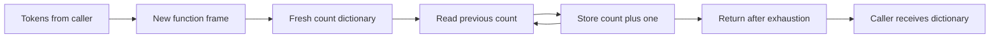

# Day 3 — Functions, collections, and counting

## 1. Learning objectives

Define functions with parameters and return values. Trace local scopes and
mutable arguments. Choose among lists, tuples, dictionaries, and sets. Implement
a token frequency counter and explain its invariant and expected complexity.
Required competency: Level 3 independent implementation.

## 2. Required prerequisites

[Day 2](../day-02/README.md) teaches loops, branches, mutable lists, and string
normalization; [Day 1](../day-01/README.md) teaches assignment and values. Predict
a two-token loop before proceeding. You need only counting and addition for the
mathematics below. A “contract” means a precise agreement on accepted input,
returned output, and failures, not a particular Python keyword.

## 3. Problem motivation

Copying a normalization loop into ingestion, querying, and reporting produces
three places that can disagree. A function names a behavior and makes its
boundary testable. Search also needs a better representation than raw tokens:
counts associate each distinct token with how often it occurred. Without an
appropriate data structure, every query requires repeated scans and hidden
state can make identical calls return different answers.

## 4. Intuitive explanation

A function is a small workshop: it receives materials (arguments), follows
instructions, and hands back a result (return value). Its local labels do not
normally leak into the caller. A dictionary is a labeled set of drawers: a key
selects a value. A list is a sequence of slots. A tuple is an immutable sequence,
useful for one record with several positions. A set answers “is this member
present?” and removes duplicates. Choose based on the questions the program
must answer, not whichever syntax is shortest.

## 5. Deep technical explanation

`def count_tokens(tokens):` creates a function object and binds its name. It
does not execute the function body. Calling `count_tokens(["a"])` creates a
local execution frame, binds the parameter `tokens` to the supplied list,
executes statements, and returns when reaching `return` or the end. Falling
through returns `None`. Printing and returning are independent: printing is an
observable side effect; returning passes a value to the caller.

Python passes object references by assignment. Rebinding a parameter does not
rebind the caller's name. Mutating the referenced list does affect that list.
Avoid the misleading slogans “everything is copied” and “everything is passed
by reference.” Trace the actual objects instead. Local assignments ordinarily
create local names. Reading a local before assigning it can raise
`UnboundLocalError`. Do not solve this by making all state global; make inputs
and results explicit.

Lists preserve sequence and allow mutation. Tuples preserve sequence but cannot
replace their own elements; a tuple can still contain a mutable list. Dictionary
keys must be hashable: strings and integers qualify; lists do not. Dictionaries
preserve insertion order in modern Python, but insertion order is not alphabetical
order or relevance rank. A set stores unique hashable members and has no index-
based sequence contract. If output order matters, sort explicitly.

For counting, the dictionary key is a token and its value is an integer.
`counts.get(token, 0)` returns the existing count or zero without inserting it.
Then assignment stores one more. Create `counts = {}` inside every call.
A mutable default argument such as `counts={}` is created when the function is
defined, not anew for every call, and can accidentally retain earlier data.
We will deliberately reproduce that defect during debugging.

## 6. Mathematical foundations

For token sequence t₁, …, tₙ, define C(w) = Σᵢ 1[tᵢ = w], where the bracket is
1 when the equality is true and 0 otherwise. Example: `["a", "b", "a"]` gives
C(a) = 1 + 0 + 1 = 2 and C(b) = 0 + 1 + 0 = 1. The sum over distinct keys is n.

After processing k entries, the dictionary contains exactly the counts over
those first k entries. For the next token, incrementing just its count adds
exactly its new contribution. Initially all counts are zero and finally k = n,
so the algorithm computes C. If the dictionary starts with previous-call counts,
the base case is false, explaining the shared-default bug mathematically.

A hash table ordinarily offers average constant-time lookup and insertion under
ordinary hashing assumptions. The loop is then expected O(n), with O(v) stored
entries for v distinct tokens. These are growth descriptions, not seconds.
They ignore the cost of hashing/comparing arbitrary-length strings; count total
text length when that cost matters.

## 7. Architecture and execution diagrams



The repeated edge represents one update per token. Return occurs only after
exhaustion; placing it inside the loop would truncate the computation.

## 8. Implementation from first principles

```python
def count_tokens(tokens):
    counts = {}
    for token in tokens:
        previous = counts.get(token, 0)
        counts[token] = previous + 1
    return counts

source = ["agent", "tool", "agent"]
result = count_tokens(source)
assert result == {"agent": 2, "tool": 1}
assert source == ["agent", "tool", "agent"]
assert count_tokens([]) == {}
print(result)
```

Input is a sequence of hashable tokens; the lab supplies strings. Output is a
new dictionary. The body mutates only its new dictionary, not the input list.
An unhashable token fails when used as a key; no broad exception handler masks
that contract violation. Inputs already normalized are assumed; this function
does not quietly invent a second normalization policy. The separation lets us
test normalization and counting independently.

## 9. Worked execution walkthrough

On call, bind `tokens` to the source list and create `{}`. For `agent`, `.get`
returns 0; store 1. For `tool`, `.get` returns 0; store 1. For the final `agent`,
it returns 1; store 2. The sum of counts is now 3. Return the dictionary and
bind `result` in the caller. Local names leave their active frame, but the
returned dictionary remains reachable through `result`. A second empty call
creates a different dictionary and returns `{}` rather than earlier counts.

## 10. Independent laboratory

Implement `count_tokens` from the [Day 3 contract](../../../labs/week-01/README.md)
using [the starter](../../../labs/week-01/starter/counts.py). Accept a list of
strings; count exact tokens; do not mutate it or retain state between calls.
Deliver the function, a trace, tests for repeated/empty input, and a test where
you mutate one returned dictionary before calling again.
Run `python labs/week-01/checks.py --day 3 --module learner-work/week-01/counts.py`.
Acceptance requires a fresh correct result each call and a correct explanation
of whether two names can refer to the same mutable object.

## 11. Experiments

Compare the counter with a slow alternative that calls `tokens.count(token)`
for every token. Generate lists of 100, 1,000, and 10,000 tokens with a fixed
vocabulary. Use `time.perf_counter()` around many repetitions; record median
durations, interpreter version, and list size. Predict expected linear versus
quadratic work before measuring. Small noisy timings do not refute a growth
argument. Also measure how dictionary size changes when all tokens are unique
versus identical. State that elapsed time is not a direct memory measurement.

## 12. Failure analysis

Put `return counts` inside the loop: multi-token input returns prematurely and
empty input returns `None`. Fix indentation and test both boundaries. Next
write a toy function with a dictionary default, call it twice, and observe
accumulated state. Allocate inside the function or use a `None` default and
allocate explicitly. Finally try a list as a key; diagnose hashability rather
than converting all inputs to strings and silently changing their meaning.

## 13. Engineering tradeoffs

A pure transformation is easy to test and replay, but copying very large data
can cost memory. A mutable accumulator is efficient when ownership is local.
A dictionary supports arbitrary keys and sparse vocabulary; a fixed array can
be faster for a small known alphabet but requires a mapping and reserved size.
A set answers membership but discards frequency, so it cannot implement this
contract. Sorting output costs extra time and is appropriate only when a
presentation or ranking contract requires it.

## 14. Real-world connection

Token-frequency maps underlie sparse retrieval. Later BM25 needs document term
counts, corpus statistics, and a scoring formula; today's count alone is not
BM25. Agent state also uses dictionaries, but implicit shared dictionaries
between sessions can leak information. Explicit ownership learned here becomes
a reliability and security requirement in a service.

## 15. Common misconceptions

“Functions run when defined”: their bodies run when called. “Print returns the
printed object”: its return value is `None`. “A tuple makes everything inside
immutable”: nested mutable objects remain mutable. “A dictionary's order is a
ranking”: insertion history is unrelated to a scoring policy.

## 16. Technical examination

1. Explain printing versus returning with a caller that needs a count.
2. Trace aliases after `a = []; b = a; a = []; b.append(2)`.
3. Implement counting without mutating input or using `collections.Counter`.
4. Diagnose state leaking across repeated function calls.
5. Choose a set, dictionary, or list for membership, counts, and ordered events; justify each.

Reference answers are in [the separate examination solution](../../../solutions/examinations/week-01.md).

## 17. Daily mastery gate

Pass the contract and cross-call independence test. Reconstruct the invariant
without notes and predict the aliasing example. Score at least 4/5 with coding
mandatory. If a failure remains, reduce it to two calls or two tokens and trace
objects before trying a larger dataset.

## 18. Resources

[Python control flow, defining functions](https://docs.python.org/3.12/tutorial/controlflow.html#defining-functions),
section 4.9, 25 minutes.
[Python data structures](https://docs.python.org/3.12/tutorial/datastructures.html),
sections 5.3–5.5, 25 minutes. Free PSF references; outcome: distinguish collection
semantics and recognize function parameter behavior.

## 19. Revision and retention

Tomorrow write a counter without notes. Three days later explain the mutable-
default bug from a two-call trace. One week later recover the count invariant
and compare dictionary counting with repeated full-list scans. Keep predictions
separate from observed outputs in your notebook.

## 20. Next lesson connection

[Day 4](../day-04/README.md) moves input from an in-memory string to files and
packages reusable functions in modules. Functions let filesystem errors remain
separate from deterministic counting, so an operational failure cannot silently
look like an empty corpus.
