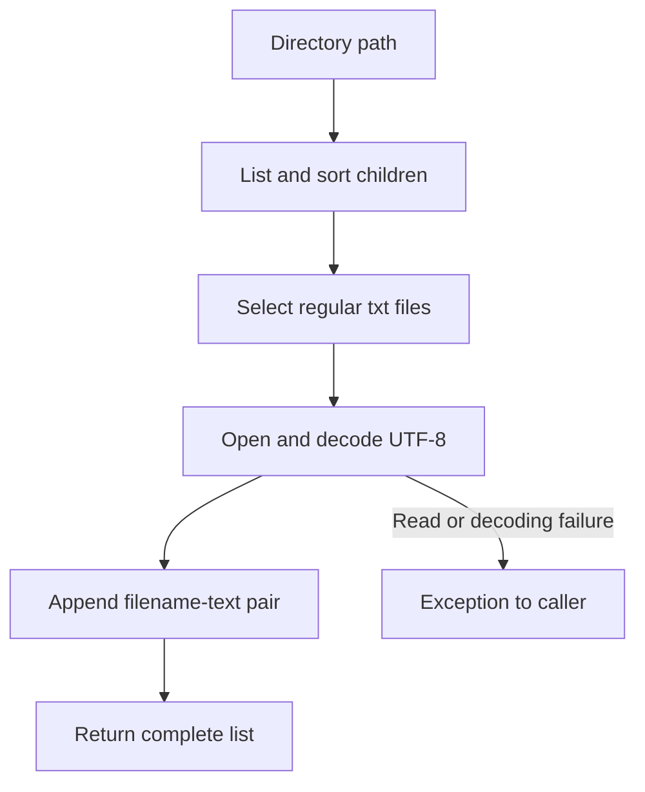

# Day 4 — Files, exceptions, and modules

## 1. Learning objectives

Read small local UTF-8 files using explicit paths and resource lifetimes. Explain
bytes versus text, exceptions versus normal empty results, and modules versus
packages. Implement a sorted loader with documented failure behavior. Required
competency: Level 3 independent implementation.

## 2. Required prerequisites

[Day 3](../day-03/README.md): functions, lists, tuples, dictionaries, return values,
and local state. [Day 1](../day-01/README.md): working directories and code points.
Before continuing, implement counting over a supplied list. Today's loader will
return a list of `(filename, text)` tuples, not yet the typed records of Day 5.

## 3. Problem motivation

In-memory examples cannot inspect a real repository. Files introduce failures
that pure arithmetic does not: missing paths, denied access, invalid encodings,
and input larger than available memory. Search must distinguish a valid empty
folder from failure to read a folder. Returning `[]` for both would let a later
agent wrongly conclude there is no evidence. We therefore make failure visible
and keep file access separate from counting.

## 4. Intuitive explanation

A path is an address, not a file's contents. Opening that address gives a handle,
a resource used to read data. The handle should be closed after use, just as a
borrowed library item must be returned. A text encoding is an agreement for
turning byte sequences into characters. The same bytes cannot always be read
under every agreement. An exception is an explicit signal that an operation
cannot produce its promised ordinary result.

A module is a Python file holding definitions. A package groups modules under
a common import name. Importing a function lets several programs use the same
behavior; copying its source creates several diverging versions instead.

## 5. Deep technical explanation

`Path` from the standard-library `pathlib` module represents filesystem paths
and joins them in a platform-appropriate way. `Path("data") / "a.txt"` means a
child path, not string division. Relative paths depend on the process's working
directory. `path.name` gives the last component and `.suffix` its final suffix.
`iterdir()` visits immediate children; `rglob` is recursive. Choose explicitly.
A suffix is a naming convention, not proof of safe content.

Binary reads yield `bytes`. Text reads decode bytes into a `str`. UTF-8 uses a
variable number of bytes per Unicode code point. ASCII letters use one byte;
`é` uses two in UTF-8. A decoder must reject invalid byte sequences or use an
explicit error policy. Silently replacing invalid bytes changes evidence, so
our loader uses strict decoding. `read_text(encoding="utf-8")` opens, reads,
and closes the file. For manual streaming, `with path.open(...) as handle`
ensures close occurs even if an exception leaves the block.

Exceptions propagate up the call stack until handled. A `try` block surrounds
operations expected to fail; an `except UnicodeDecodeError` handles that specific
condition. Catch only where you can make a meaningful policy decision. A loader
cannot decide whether its caller should retry or show an error, so the small
lab loader propagates failures. The final CLI translates expected operational
errors into a message and status 2. An unexpected programming bug should retain
its traceback rather than be disguised as a file error.

Import executes a module's top-level statements when first loaded in a process
and stores it in the module cache. Definitions belong at top level; demonstrations
belong under `if __name__ == "__main__":` when they should run only as a script.
Running `python -m forgeagent.cli` locates the module as part of a package, which
allows its relative imports. Running `python forgeagent/cli.py` directly changes
that import context and is not the documented entry point. An `__init__.py`
marks our regular package. Third-party packages are not required this week.

## 6. Mathematical foundations

If selected files have byte sizes b₁, …, bₘ, fully reading them costs at least
proportional to B = Σᵢ bᵢ bytes of I/O. Keeping all decoded texts also uses space
growing with total content, with representation overhead. Sorting m filenames
requires O(m log m) comparisons; comparing long names is not constant cost.
For files of 8, 0, and 12 bytes, B = 20. An empty file adds one document record
but zero content bytes. Directory traversal and metadata costs still exist.

The project later uses a per-file limit L: read at most L + 1 bytes. If the
length is greater than L, reject; otherwise decode. Reading the extra byte
makes “exactly at the limit” distinguishable from “more input remains.” A
pre-read size check alone races with file growth and cannot enforce the bound.

## 7. Architecture and execution diagrams



The caller receives a complete result or an exception. The diagram has no
failure-to-empty-list edge: that distinction is part of correctness.

## 8. Implementation from first principles

```python
from pathlib import Path
from tempfile import TemporaryDirectory


def load_texts(root):
    root = Path(root)
    if not root.is_dir():
        raise NotADirectoryError(str(root))
    documents = []
    for path in sorted(root.iterdir()):
        if path.is_file() and path.suffix == ".txt":
            text = path.read_text(encoding="utf-8")
            documents.append((path.name, text))
    return documents


with TemporaryDirectory() as directory:
    root = Path(directory)
    (root / "b.txt").write_text("café", encoding="utf-8")
    (root / "a.txt").write_text("", encoding="utf-8")
    assert load_texts(root) == [("a.txt", ""), ("b.txt", "café")]
print("loader example passed")
```

Input is a directory path, output a sorted list of pairs. The context manager
creates a temporary directory and deletes it after the example, including on
failure. Only the test setup writes; the loader reads. Errors are propagated.
This instructional implementation follows links through `is_file()` and has no
size cap: use only trusted small fixtures. The integrated project tightens the
policy. Safe behavior comes from an explicit threat model, not a `.txt` suffix.

## 9. Worked execution walkthrough

Create a temporary directory and write b then a. Listing order is unspecified,
so sort before selecting. For a, read zero bytes, decode to empty text, append
`('a.txt', '')`. For b, UTF-8 decoding turns the stored bytes into `café`; append
the pair. Return two entries. If a new `bad.txt` contains byte `0xff`, decoding
raises and no successful list is returned. Some local work happened before
failure, but callers never receive it as an apparently complete corpus.

## 10. Independent laboratory

Use [Day 4 starter](../../../labs/week-01/starter/loader.py) and its
[contract](../../../labs/week-01/README.md). Read only immediate lowercase `.txt`
files as UTF-8; do not recurse; return filename/text tuples in sorted order.
An empty directory returns `[]`; a missing directory raises an `OSError`
subclass; invalid UTF-8 raises `UnicodeDecodeError`. Do not swallow failures.
Run `python labs/week-01/checks.py --day 4 --module learner-work/week-01/loader.py`.
Submit code, a temporary fixture with a nested ignored file, and a decoding
failure test. Acceptance requires all contracts and no leaked open handles.

## 11. Experiments

Write `"é"` in UTF-8, compare `len(text)` with `len(text.encode("utf-8"))`, and
explain 1 versus 2. Add a nested `.txt` file and compare immediate and recursive
traversal. Add `.TXT` and document the case policy; do not assume all operating
systems treat filenames the same. Measure corpus byte size and number of
selected files separately: both influence performance differently.

## 12. Failure analysis

Run from the wrong directory and observe a missing relative path. Confirm the
current directory rather than hardcoding a machine-specific absolute path.
Create invalid UTF-8 with `write_bytes(b"\xff")`; verify the decoding exception.
Try the same loader on a regular file path; require a directory error. On a
permission error, do not tell a learner to disable all permissions. Use an
owned temporary directory and preserve the failure as evidence. Test errors
you can reproduce on the current platform and disclose skipped platform cases.

## 13. Engineering tradeoffs

Loading all files simplifies later pure search but uses corpus-sized memory.
Streaming lowers memory and can yield partial results before a failure, which
requires a different completeness contract. Propagating exceptions preserves
information; catching at a UI boundary improves usability. Recursive traversal
improves coverage but can include secrets, dependencies, or huge trees. A
production coding agent needs an explicit workspace and exclusion policy.

## 14. Real-world connection

Retrieval pipelines ingest text and preserve provenance. A path supplies the
first provenance identifier, but file contents can change; future designs need
hashes or revision identifiers for reproducibility. A path alone does not prove
that a citation still supports a generated answer. None of today's loader
behavior provides an operating-system sandbox.

## 15. Common misconceptions

“Opening a file means I read it”: obtaining a handle and consuming bytes are
different operations. “Every byte sequence is valid UTF-8”: some are invalid.
“Catching every exception is robust”: it can hide evidence and programming bugs.
“Sorting happens automatically”: filesystem listing order is not a stable API.

## 16. Technical examination

1. Explain path, bytes, text, and encoding using a non-ASCII example.
2. Trace output order when b is created before a.
3. Implement the loader and a malformed-file test.
4. Diagnose why `except Exception: return []` creates false evidence.
5. Defend streaming versus complete-batch loading for a search corpus.

Answers: [examination solutions](../../../solutions/examinations/week-01.md).

## 17. Daily mastery gate

Pass the loader tests including empty, nested, missing, and invalid-encoding
cases. Explain why an empty result differs from an unreadable corpus. Score
at least 4/5 with independent coding mandatory. Trace what cleanup occurs if a
read fails inside a `with` block. Revisit Day 3 if exceptions obscure normal
function return behavior.

## 18. Resources

[Python input/output](https://docs.python.org/3.12/tutorial/inputoutput.html#reading-and-writing-files),
section 7.2, 25 minutes, explicit encodings and resource management.
[Python exceptions](https://docs.python.org/3.12/tutorial/errors.html), sections
8.1–8.4, 25 minutes, recognizing and handling failures. Both are free PSF sources.

## 19. Revision and retention

Tomorrow draw the bytes-to-text boundary without notes. In three days reproduce
a decoding failure and explain why returning zero documents is incorrect. In
one week reconstruct a loader from the contract in a fresh file and test from
a different working directory.

## 20. Next lesson connection

[Day 5](../day-05/README.md) replaces positional records with named typed objects
and formalizes tests. Once the loader contract is explicit, tests can check it
without needing a model, a database, or a live service.
