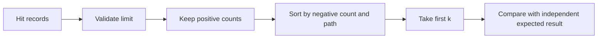

# Day 5 — Objects, types, debugging, and tests

## 1. Learning objectives

Define and instantiate a class, distinguish attributes from local variables,
and use a dataclass for explicit records. Explain type hints versus runtime
validation. Write meaningful automated tests and debug by locating the first
incorrect state. Implement deterministic hit ranking. Required competency: Level 3.

## 2. Required prerequisites

[Day 3](../day-03/README.md): functions, tuples, mutation, and dictionaries.
[Day 4](../day-04/README.md): modules and exceptions. You must be able to read a
traceback and distinguish a failed operation from an empty successful result.
Today introduces the test-framework class syntax; no prior OOP is assumed.

## 3. Problem motivation

A pair `('a.txt', 2)` works, but readers can confuse which position is the path.
As an agent runtime grows, unlabeled records become difficult to inspect.
Named objects give state an explicit structure. Automated tests then encode
observable contracts so a refactor cannot silently reverse the ranking order
or let one caller mutate another caller's results. Tests must check behavior,
not merely that the program runs without an exception.

## 4. Intuitive explanation

A class is a description for a kind of object; an instance is one particular
object built from that description. A `Hit` instance holds a path and a count.
Attributes name those fields. A method is a function accessed through an object.
Ordinary instance methods receive the instance as the first parameter, called
`self` by convention. This is a local parameter name, not a global magic object.

A test is an executable claim with a setup, an action, and an independently
chosen expected result. Think of a scale checked with a known weight: reading
any number is insufficient; the number must match the known reference.

## 5. Deep technical explanation

A basic class can define `__init__(self, path, count)` and assign `self.path`
and `self.count`. Calling the class creates an instance and initializes it.
The assignments store per-instance attributes, unlike a shared class-level
mutable list. A method such as `label(self)` can return `self.path`. Inheritance
lets one class extend another; it is useful for `unittest.TestCase`, but not
required merely to store data. Prefer composition of small records and functions
before inventing hierarchies.

`@dataclass` is a decorator: it transforms a class after its definition. The
standard dataclasses module can generate initialization, representation, and
field-based equality. `frozen=True` prevents ordinary field rebinding and helps
communicate value semantics. It does not deeply freeze nested lists, enforce
permission boundaries, or validate types. A frozen `Hit` with string and integer
fields is easy to reason about because both fields are themselves immutable.

A hint like `count: int` documents the expected type and supports external static
analysis. Python normally does not reject `Hit("a", "wrong")` on that basis.
Runtime validation belongs at boundaries receiving untrusted data. Python
booleans are integer subclasses, so `isinstance(True, int)` is true. If limits
must be genuine integers, use an explicit policy such as `type(limit) is int`.
This is a deliberately strict contract, not a universal rule for every library.

Unit tests exercise one small behavior. Integration tests verify assembled
components. Regression tests preserve a past bug's expected behavior. A fixture
is known input and setup, such as a temporary document directory. Use real small
files for file semantics; later network tests will use mocks rather than paid
calls. `unittest` discovers `test*.py` modules and runs methods starting with
`test`. `assertEqual` reports a mismatch; `assertRaises` expects a specific failure.
Do not rely on bare Python `assert` for security enforcement: optimization can
remove it. Bare asserts are acceptable in these didactic examples and contract
checks, which must not be run with `python -O`.

## 6. Mathematical foundations

A ranking policy is a total ordering rule for relevant results. Define the sort
key of a hit as (-c, p), where c is its frequency and p its path. Ascending
lexicographic comparison first compares negative frequencies; larger counts
therefore come first. If counts tie, compare paths ascending. Example:
`('b', 2), ('a', 2), ('z', 4)` have keys `(-2,'b'), (-2,'a'), (-4,'z')`, so the
output paths are z, a, b. Keeping the first k gives at most k results.

Filtering m hits is O(m); sorting is O(m log m) comparisons, assuming bounded
key-comparison costs. Returning zero results should be immediate after sorting
or optimized before sorting, but input validation must still occur. Correctness
of a zero limit is an explicit boundary, not Python's treatment of negative slices.

## 7. Architecture and execution diagrams



Validation defines which requests are meaningful. Filtering removes nonmatches;
sorting defines relevance and ties. The final test observes the public result,
not the internal names or exact loop structure.

## 8. Implementation from first principles

```python
from dataclasses import dataclass
import unittest


@dataclass(frozen=True)
class Hit:
    path: str
    count: int


def rank(hits: list[Hit], limit: int = 5) -> list[Hit]:
    if type(limit) is not int or limit < 0:
        raise ValueError("limit must be a nonnegative integer")
    positive = [hit for hit in hits if hit.count > 0]
    return sorted(positive, key=lambda hit: (-hit.count, hit.path))[:limit]


class RankingTests(unittest.TestCase):
    def test_tie_and_filter(self):
        hits = [Hit("b", 2), Hit("x", 0), Hit("a", 2)]
        self.assertEqual(rank(hits, 1), [Hit("a", 2)])
        self.assertEqual(len(hits), 3)

    def test_bad_limit(self):
        with self.assertRaises(ValueError):
            rank([], -1)


suite = unittest.defaultTestLoader.loadTestsFromTestCase(RankingTests)
result = unittest.TextTestRunner().run(suite)
if not result.wasSuccessful():
    raise SystemExit(1)
```

The comprehension is a compact filter equivalent to appending positive hits
in a loop. `lambda` creates a small anonymous function for the sort key; it is
equivalent to a named function returning that pair. `sorted` allocates a result
rather than changing the caller's list. The test subclass inherits assertion
methods; `self.assertEqual` compares actual with independently specified expected
objects. No external dependency or network is involved.

## 9. Worked execution walkthrough

The runner discovers two test methods. In the first, limit 1 passes validation.
Filter drops x. Keys are `(-2,'b')` and `(-2,'a')`; a precedes b. Slicing yields
one hit, equal by dataclass fields to `Hit('a',2)`. Original input still has
three entries. In the second test, limit -1 raises before any sort. The
`assertRaises` context catches the expected exception and the test passes.
A different exception would fail the test, as would returning silently.

## 10. Independent laboratory

Implement [Day 5](../../../labs/week-01/README.md) from its
[starter](../../../labs/week-01/starter/rank.py). Preserve the frozen record;
filter nonpositive counts, sort deterministically, and validate limits including
Boolean and fractional values. Do not mutate the input. Return `[]` for zero
limit. Run `python labs/week-01/checks.py --day 5 --module learner-work/week-01/rank.py`.
Deliver code and tests for ties, zero, invalid limits, and empty input. Include
one test that fails when the sort direction is reversed, demonstrating that it
actually detects the intended defect.

## 11. Experiments

Remove the secondary sort key and reverse the input list. Observe how ties now
depend on arrival order because Python sorting is stable. Reintroduce the path
key and verify identical output across permutations. Change `sorted` to
in-place `.sort()` and inspect the caller's list. Construct `Hit('a','2')` and
explain why hints did not reject it; do not confuse static expectations with
runtime enforcement. Record outputs and state changes, not just “it works.”

## 12. Failure analysis

A test that uses the implementation itself to compute the expected value is
circular. Replace it with a manually derived two-hit answer. A test that only
checks length can miss reversed order; inspect values too. If no tests run,
check discovery paths and names before celebrating a green command. Reproduce
a wrong tie order, locate the first wrong key, fix it, and keep the smallest
counterexample as a regression test. Use `breakpoint()` to pause a script and
inspect variables; in the debugger `p expression` prints and `n` steps to the
next line. Avoid logging document contents or secrets just to inspect control flow.

## 13. Engineering tradeoffs

Named records improve readability over positional tuples with a small amount
of ceremony. Frozen records reduce accidental mutation but do not replace
validation. Unit tests are fast and precise; integration tests catch wiring
problems but can make root causes less local. A test per implementation line
is brittle. A test per meaningful contract boundary remains useful through
refactoring. Static checking helps find type misuse but cannot prove semantic
ranking quality.

## 14. Real-world connection

Typed tool requests and observations later benefit from explicit records, but
model-supplied JSON still needs runtime validation. Agent evaluations also need
independent expected outcomes. A trajectory that completes without throwing an
exception can still choose the wrong tool or violate authorization.

## 15. Common misconceptions

“Type hints enforce types”: not ordinarily at runtime. “Frozen means secure”:
it restricts ordinary assignment, not adversarial execution. “Tests prove all
inputs correct”: they supply finite evidence. “A green run with zero discovered
tests is success”: check the count and scope.

## 16. Technical examination

1. Explain class, instance, attribute, and method with a hit record.
2. Trace the sort keys for counts 0, 2, 2, and 4.
3. Implement and test ranking without looking at the reference.
4. Diagnose why a negative slice accepts an invalid limit silently.
5. Defend records plus pure functions versus a mutable global ranking object.

Answers: [separate solutions](../../../solutions/examinations/week-01.md).

## 17. Daily mastery gate

Pass all public contracts and demonstrate a mutation-detecting and tie-order
test. Score at least 4/5 with coding mandatory. Explain how to distinguish a
type mismatch from a semantic error. Show that a deliberately reversed sort
fails your test before restoring the correct code.

## 18. Resources

[Python classes](https://docs.python.org/3.12/tutorial/classes.html), sections
9.2–9.4, 30 minutes, object and namespace semantics.
[Python unittest](https://docs.python.org/3.12/library/unittest.html#basic-example),
basic example and assert methods, 25 minutes. Both free PSF references.

## 19. Revision and retention

Tomorrow reconstruct the ranking key without notes. In three days explain why
hints are not validators. In one week implement a new record for an execution
observation and test its field equality; avoid adding behavior until required.

## 20. Next lesson connection

[Day 6](../day-06/README.md) assembles loading, counting, ranking, and error
handling into a CLI, verifies the public process contract, and tracks changes
with Git. Today's tests make that integration reviewable rather than hopeful.
