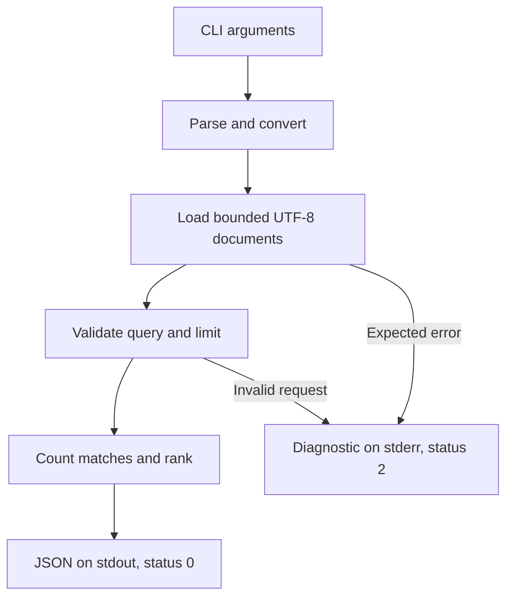

# Day 6 — Git, complexity, and the document-search CLI

## 1. Learning objectives

Compose pure and effectful functions into a predictable CLI. Explain command
arguments, stdout, stderr, and exit status. Use Git to inspect and checkpoint
one logical change. Analyze the baseline's complexity and limitations. Deliver
a tested document search tool as ForgeAgent milestone 1. Required competency:
Level 3 implementation plus Level 4 debugging evidence.

## 2. Required prerequisites

[Day 4](../day-04/README.md) covers files, modules, exceptions, and UTF-8;
[Day 5](../day-05/README.md) covers record types, sorting, and tests. Days
[1](../day-01/README.md), [2](../day-02/README.md), and
[3](../day-03/README.md) supply execution, iteration, and counting. Reconstruct
at least the counter and tie-order key before integrating them.

## 3. Problem motivation

A function in a notebook is inconvenient for another program to call. A CLI
provides a small process-level interface that humans and scripts can share.
Its contract includes both successful data and failures. A downstream program
must not parse an error message as if it were a search result. Version control
then makes changes inspectable and recoverable. An agent that edits code
without a clear diff or reproducible tests makes the same integration mistakes
as a beginner, only faster.

## 4. Intuitive explanation

Think of a service counter with two channels: completed forms go into an output
tray (stdout), while problem notices go to a separate channel (stderr). An exit
status is the short signal saying whether processing succeeded. A successful
search with no matches produces an empty list and status 0. An unreadable input
produces an error message and status 2. Those outcomes must remain distinct.

Git is a local history of snapshots. A commit records selected changes with a
message. It does not upload files by itself. A remote is another repository
that can exchange commits. You can learn and use the local workflow without
creating an account or publishing your work.

## 5. Deep technical explanation

The shell splits a command into arguments and starts a Python process. Running
`python -m forgeagent.cli datasets/sample-data agents --limit 5` supplies a root,
a query, and an option. `argparse` describes their syntax, converts values, and
prints usage for malformed arguments. `main(argv=None)` allows unit tests to
supply an argument list directly. A `__main__` wrapper converts its return code
to a process status through `SystemExit`.

The integrated reference pipeline uses `Document(path,text)` records from the
loader and `Hit(path,count)` records from search. Query normalization must yield
exactly one token. Zero or multiple tokens are rejected, rather than inventing
an undocumented AND/OR semantics. Each document is counted; positive hits are
sorted by `(-count,path)` and sliced by limit. The loader visits `.txt` and
`.md` recursively, rejects discovered symbolic links, reads at most a per-file
byte bound plus one, and decodes strictly as UTF-8. This is deliberately a
stronger contract than Day 4's immediate trusted-fixture exercise.

The project tokenizer uses regular expressions, a compact pattern language.
In `r"[^\W_]+"`, the raw-string prefix preserves the backslash for the pattern
engine. `\W` means non-word characters; the negated class excludes non-word
characters and underscore, leaving Unicode alphanumeric runs. `+` requires one
or more consecutive matches. `casefold()` precedes matching. Thus `a-b` yields
two project tokens, whereas Day 2 preserved the internal hyphen. Matching the
same policy on documents and queries is essential. This policy is lexical,
not model tokenization or language-aware word segmentation.

JSON is a text format for exchanging values such as objects, arrays, strings,
numbers, booleans, and null. Its object keys and strings use double quotes;
a Python dictionary printed with single quotes is not JSON. `json.dumps`
serializes values; `json.loads` parses. Keeping success stdout to one JSON value
makes the process composable. Logging writes diagnostic information to stderr;
log event metadata rather than entire sensitive files. Catch expected read,
decode, and validation failures at the CLI boundary. Let unexpected defects
retain their traceback so tests can expose them.

Git has a working tree (files being edited), an index (selected changes), and
committed history. `git status` shows their differences. `git diff` inspects
unstaged changes; `git diff --staged` inspects what the next commit will record.
`git add path` selects changes and `git commit` records them. `.gitignore`
avoids accidentally tracking generated environments or secrets, but does not
remove previously tracked files. Inspect staged contents before committing.
Avoid destructive reset/clean commands while learning; a corrective new commit
preserves the reasoning trail.

## 6. Mathematical foundations

Let B be bytes loaded, N total normalized tokens, M matching documents, and P
filesystem entries visited. A rough single-query cost is traversal over P,
text processing over B/N, then O(M log M) hit sorting. Unicode hashing and path
comparison have their own length costs; this expression is a useful model, not
an exact runtime prediction. Stored documents require memory proportional to
corpus text; each document's temporary counter adds its vocabulary size.
Sorting all hits to keep five is simple but can be improved with a bounded heap
if measurements justify it. An inverted index changes repeated-query work
substantially but introduces storage and update consistency problems.

If every query reprocesses the corpus, q queries incur approximately q times
the text-processing work. Doubling corpus size should roughly double the scan
component under similar conditions, not necessarily total elapsed time. Disk
caches, allocation, and interpreter overhead can dominate small measurements.

## 7. Architecture and execution diagrams



Each arrow is a call/return data boundary. The search function need not know
whether its caller is a CLI or later an agent tool. This separation is the
first step toward reusable tool interfaces, not yet an agent runtime.

## 8. Implementation from first principles

The complete implementation is in [documents.py](../../../forgeagent/documents.py)
and [cli.py](../../../forgeagent/cli.py); no omitted pseudocode is needed to run
it. Read one function at a time after tracing this composition:

```python
import json
from pathlib import Path
from forgeagent.documents import load_documents, search

root = Path("datasets/sample-data")
documents = load_documents(root)
hits = search(documents, "agents", limit=5)
payload = [{"path": hit.path, "count": hit.count} for hit in hits]
encoded = json.dumps(payload, ensure_ascii=False)
assert json.loads(encoded) == [{"path": "agents.txt", "count": 2}]
print(encoded)
```

Input is a directory and one query string. Output is a JSON array of path/count
objects. The comprehension converts records to a serialization contract. The
functions raise specific failures; the full CLI catches them. The composition
above intentionally lets a missing fixture raise so the example's test fails
visibly. Run it from the repository root.

## 9. Worked execution walkthrough

For query `agents`, load agents.txt and python.txt in stable order. The first
text casefolds to tokens containing `agents` twice; the second contains none.
Search creates one `Hit('agents.txt',2)`, sorts a one-item list, and serializes
one object. The process exits 0. For `agents tools`, normalization produces two
terms, so search raises `ValueError`; the full CLI logs a diagnostic and exits
2 with no success JSON. For `missing`, search returns `[]` and exits 0. No model
request or tool loop exists yet: these are deterministic process transitions.

## 10. Independent laboratory

Implement [Day 6](../../../labs/week-01/README.md) using the
[CLI starter](../../../labs/week-01/starter/cli.py). Compose your earlier work
or the documented project functions. Accept root, query, and integer limit;
stdout must be valid JSON only. Operational failure goes to stderr with status
2; successful no-match is status 0. Require deterministic ties, invalid-query
rejection, and no modification of input files. Run the public Day 6 check and
`python -m unittest discover -s tests -v` for reference integration behavior.
For your own CLI, reproduce the subprocess contracts in the integration tests
with its entry point. Deliver source, captured status/stdout/stderr for success
and failure, and a Git diff containing only intended changes.

## 11. Experiments

Create deterministic corpora with 10, 100, and 1,000 small files. Time at least
five runs at each size using `time.perf_counter`; report the median, byte size,
file count, Python version, and whether the first run differs. Repeat one query
versus several queries. Compare the measurements to the cost model before
proposing an index. Next change the tie key intentionally and inspect both test
failures and `git diff`. Restore the correct policy without deleting history.

## 12. Failure analysis

Debug invalid JSON caused by mixing progress prints into stdout. Parse captured
stdout with `json.loads`; route diagnostics to logging/stderr. Reproduce a missing
folder and verify nonzero status, not an empty successful result. Reproduce a
byte limit exactly at and one beyond the bound; the first must pass and second
must fail. If a direct script run breaks relative imports, use the documented
`-m` invocation instead of editing `sys.path` in product code. If Git shows an
API key staged, remove it from the index before committing and avoid printing it.

## 13. Engineering tradeoffs

A CLI is easy to run locally and isolate in tests, but a long-lived API avoids
process startup overhead. Full scans simplify correctness but become costly
for repeated queries. Rejecting links narrows accidental escape paths, but a
check-then-open sequence still races with concurrent filesystem mutation.
Our CLI therefore assumes an owned, stable workspace. A real agent execution
boundary needs OS-level isolation, permissions, and authorization; pathname
checks alone cannot provide those properties.

## 14. Real-world connection

Repository-aware systems need evidence acquisition before editing. This CLI
is a small reusable evidence source and later can become a typed read tool.
Public coding-agent designs often separate model decisions from tools, but
this lesson makes no undocumented claim about any proprietary implementation.
An inspectable diff and reproducible tests support human review of both human-
and agent-authored code.

## 15. Common misconceptions

“Nonempty output means success”: diagnostics are output too; check status and
channel. “Valid JSON means correct”: shape and semantic meaning still need checks.
“Git commit publishes”: commits are local until pushed. “A path check is a
sandbox”: it cannot constrain process capabilities or stop concurrent races.

## 16. Technical examination

1. Explain stdout, stderr, exit status, and why empty search is successful.
2. Trace a two-document tied search with limit 1.
3. Integrate and run the CLI without changing document contents.
4. Diagnose why printing a debug line breaks a downstream JSON parser.
5. Defend full scans versus an index using a repeated-query workload.

Use [weekly exam](../../../assessments/weekly/week-01.md) and
[separate answers](../../../solutions/examinations/week-01.md) after your attempt.

## 17. Daily mastery gate

All reference integration contracts pass; your CLI reproduces the documented
process behavior on unseen fixtures. Score at least 4/5 with coding mandatory.
Show one intentional failing regression followed by the corrected passing run.
Explain the link-race limitation without claiming it has been solved. Review
and record a coherent diff before calling milestone 1 complete.

## 18. Resources

[Python unittest](https://docs.python.org/3.12/library/unittest.html), test discovery
and assertions, 20 minutes. [uv project guide](https://docs.astral.sh/uv/guides/projects/),
project execution and lockfiles, 20 minutes. Official Git and argparse resources
are listed as pending verification in the resource ledger; the essential workflow
is taught here without relying on those external pages.

## 19. Revision and retention

On review day reconstruct the CLI diagram from memory and explain every failure
edge. In three days run your program from a subprocess and parse its output.
In one week defend the normalization and traversal policies against a new
requirement; change tests only when the requirement intentionally changes.

## 20. Next lesson connection

The [Week 1 review](../weekly-review.md) requires integration and remediation.
Week 2 will turn process contracts into HTTP contracts and store state in
SQLite before adding concurrency. Week 2 continues in [its own week directory](../../week-02/README.md);
use the [roadmap](../../../ROADMAP.md) to see availability and required gates.
