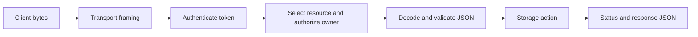

# Day 7 — HTTP, JSON, schemas, and trust boundaries

## 1. Learning objectives

Trace a client request through a server into an application response. Distinguish
transport, syntax, schema, semantics, authentication, and authorization. Validate
a bounded JSON document without executing its contents. Design a small resource
API and reproduce invalid-input failures. Required competency: Level 3.

## 2. Required prerequisites

[Week 1 / Day 6](../../week-01/day-06/README.md) teaches CLI process contracts and
JSON. [Day 4](../../week-01/day-04/README.md) teaches encoding and exceptions;
[Day 5](../../week-01/day-05/README.md) teaches hints versus runtime validation.
You should independently parse a JSON payload and explain stdout versus stderr.
The network does not make these boundaries disappear: it adds more layers.

## 3. Problem motivation

A CLI runs on the caller's machine. A server lets a different process request
work, possibly on another machine. This changes trust: a caller can submit
unexpected data, claim another user's identity, disconnect, or send an incomplete
message. An agent service must not assume valid JSON is a valid instruction.
We start with a document-storage API, not a model, so failures can be reproduced
without stochastic output or paid infrastructure.

## 4. Intuitive explanation

A client sends an envelope to a service desk. The address selects the desk;
the method says what action is requested; headers describe the envelope; the
body contains the form. The desk returns another envelope with a status and
body. Authentication asks who submitted it. Authorization asks what that
identity may do. A correctly filled form can still request something forbidden.
A server's response confirms only what its contract promises, not that a remote
caller received and understood it.

## 5. Deep technical explanation

An IP address identifies a network destination; a port selects a listening
endpoint there. DNS can translate a hostname into addresses. TCP provides an
ordered byte stream between endpoints. A byte stream has no application-message
boundaries, so protocols need framing. HTTP/1.1 uses request/status lines,
headers, and rules for body length. Later HTTP versions use different framing
while preserving core method/status semantics. HTTPS adds TLS protection for
transport and peer verification; plain HTTP does not hide bearer secrets.

A URL such as `http://127.0.0.1:8765/documents/notes` identifies scheme, address,
port, and path. Loopback refers to the local machine. `GET /documents/notes`
asks for a representation. `PUT` supplies the desired representation at that
resource and is designed to be idempotent: repeating the same request has the
same intended resource effect. `POST` has resource-specific processing semantics
and is not generally safe to retry. REST-style design uses resources, methods,
and representations consistently; an HTTP endpoint is not automatically a
complete REST architecture.

Headers are named metadata. HTTP field names are case-insensitive; normalize
names at the parser boundary. `Content-Type` declares how to interpret the body.
`Content-Length` counts bytes, not Python code points. A status in 2xx signals
success; 4xx indicates a request-related failure; 5xx a server failure. In our
small API 200 returns a representation, 400 rejects malformed document data,
401 requires authentication, 404 reports an unavailable route/document, 415
rejects media type, and 503 reports temporary storage unavailability.

Decoding bytes to text is not parsing JSON; parsing JSON is not checking the
schema. A schema defines permitted keys and types. Semantic validation checks
application meaning: a structurally valid path may still be outside a permitted
workspace. Authorization compares an authenticated identity with operation and
resource policy. The API must derive ownership from trusted authentication
configuration, not an `owner` field supplied by the body. Model-generated text
is data under exactly these same rules.

The reference accepts exactly `{"text": "..."}`, rejects unknown/duplicate keys,
invalid UTF-8, oversized input, and non-finite numeric constants. Python's JSON
decoder accepts some extensions by default; we explicitly narrow the contract.
A byte bound limits input size but is not a full parser resource sandbox. Deeply
nested input can still fail; the application converts that into a 400 response.
The token map is a local teaching mechanism, not production identity management.

## 6. Mathematical foundations

Suppose the body is `{"text":"é"}` with no extra spaces. Count ASCII characters
and UTF-8 separately: there are 12 code points but 13 bytes, since é takes two
bytes. `Content-Length` must be 13. A receiver reading 12 bytes truncates the
representation even though the text looked short enough. Always compute length
after encoding the exact outgoing payload.

Let L be a body-byte limit. Accept n bytes only when n ≤ L; read at most L plus
bounded framing. If header limits and body limits are independent, a bound on
body alone does not bound the whole request. Our teaching transport caps header
and body sizes separately and closes after one request. Production HTTP parsing
requires more rules than this subset demonstrates.

## 7. Architecture and execution diagrams



Each arrow crosses a contract. Storage arrives tomorrow; today focus on the
JSON boundary. Authentication is not delegated to text inside the payload.

## 8. Implementation from first principles

```python
import json
from forgeagent.api import decode_document

wire = json.dumps({"text": "café"}, ensure_ascii=False).encode("utf-8")
assert decode_document(wire) == "café"
assert len(wire) > len(wire.decode("utf-8"))
try:
    decode_document(b'{"text": 7}')
except ValueError:
    print("rejected wrong field type")
else:
    raise AssertionError("schema validation did not run")
```

[api.py](../../../forgeagent/api.py) contains the complete validator. Inputs are
bytes, outputs text or a validation exception. Its object-pairs hook rejects
duplicate fields instead of choosing the first or last silently. Validate before
storage, because a write cannot be undone merely by finding an error afterward.
No network is needed for this example; transport and application validation can
be tested independently.

## 9. Worked execution walkthrough

A client serializes the text, encodes UTF-8, and declares the actual byte length.
The server frames that many bytes, identifies the owner from a token, and routes
the request. The validator checks byte length, decodes text, parses one JSON
value, checks exact keys and field type, then checks text length. It returns
the string, which the future storage call can persist. Change text to an integer:
JSON parsing succeeds, but schema validation rejects before persistence. Remove
the token: authentication fails even if the body is otherwise perfect.

## 10. Independent laboratory

Implement `validate_document(body)` using the [Week 2 starter](../../../labs/week-02/README.md).
Accept only bounded UTF-8 bytes containing one object with exactly a string
`text` field. Use the lab's 4096-byte and 2000-code-point limits. Reject empty
bytes, scalar JSON, duplicates, unknown fields, wrong types, invalid encoding,
and non-finite extensions. Return the string; never evaluate it as Python.
Run `python labs/week-02/checks.py --day 1 --module learner-work/week-02/validation.py`.
Submit a validation table and a request diagram as well as code. No socket or
external network is necessary for acceptance.

## 11. Experiments

Hold text fixed while switching JSON `ensure_ascii` between true and false;
measure wire byte lengths and decoded equality. Send a valid object with an
extra owner field; require rejection rather than trust. Compare duplicate-key
behavior of bare `json.loads` with the stricter validator. Predict the security
implication before measuring: two components choosing different duplicate values
can disagree about what request was authorized.

## 12. Failure analysis

If a request appears truncated, compare declared length with encoded bytes,
not visible character count. If malformed JSON is accepted, determine whether
the parser or schema step was skipped. Never use `eval` to parse external input:
it executes Python expressions. A JSON string containing code is still text,
not authorization to execute it. Verify invalid input leaves storage untouched.
If an unauthenticated request succeeds, check the identity boundary independently
from payload validation; a stricter schema will not repair missing authentication.

## 13. Engineering tradeoffs

Manual validation makes the mechanism visible for one tiny schema; a schema
library improves consistency as contracts grow but cannot establish semantic
truth or authorization. Rejecting unknown fields prevents ambiguity but makes
forward evolution stricter. A versioned endpoint can support intentional changes.
A local bearer-token map is simple to test; production needs secret rotation,
secure transport, ownership rules, and operational controls taught later.

## 14. Real-world connection

Model APIs and tool servers accept structured requests across trust boundaries.
A syntactically valid model tool call can name a forbidden resource. Request
validation, authorization, and evidence interpretation remain application
responsibilities. Our API illustrates their separation without claiming to
replicate any provider's private infrastructure.

## 15. Common misconceptions

“JSON is safe because it is data”: parsing still consumes resources and fields
can request harmful operations. “HTTPS means authorized”: encryption and access
policy solve different problems. “HTTP success means my task is correct”: status
has contract-specific meaning. “Headers and body are interchangeable”: trusted
identity must not be copied from an arbitrary client assertion.

## 16. Technical examination

1. Explain IP, port, TCP byte stream, HTTP message, and JSON body.
2. Derive the byte length of a non-ASCII payload after encoding.
3. Implement strict document validation and its failure tests.
4. Debug a validator accepting duplicate keys or wrong field types.
5. Explain why a client-supplied owner field cannot establish identity.

Use [separate answers](../../../solutions/examinations/week-02.md) after attempting.

## 17. Daily mastery gate

Pass validation contracts and two original malformed-input cases. Trace bytes →
text → value → validated data without confusing the steps. Score 4/5 including
independent implementation. Show a valid schema cannot authorize another owner's
document. Reading an RFC without a working validator is insufficient.

## 18. Resources

[IETF RFC 9110](https://www.rfc-editor.org/rfc/rfc9110.html), terminology, methods,
and status codes: 35 minutes of targeted reference reading after this chapter.
[Python JSON](https://docs.python.org/3.12/library/json.html), decoding hooks and
untrusted-input caution: 20 minutes. Both are primary references, verified for
this checkpoint; they supplement the original explanation above.

## 19. Revision and retention

Tomorrow reconstruct the layers from a malformed request. Three days later,
explain authentication versus authorization using two owners. One week later,
write a new validator for a different small schema without copying this one.
Connect the answer to Week 1's explicit type and error contracts.

## 20. Next lesson connection

[Day 8](../day-02/README.md) stores validated text in SQLite. Today's boundary
ensures that persistence receives a known value shape; transactions then protect
state changes from partial failure. Neither layer substitutes for the other.
