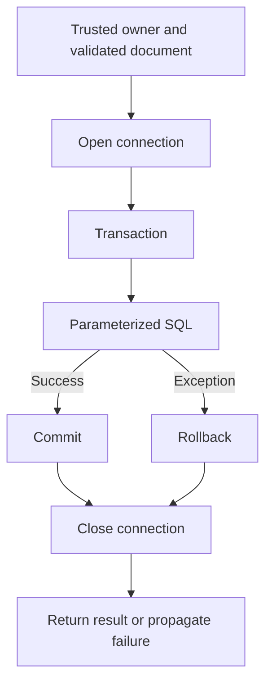

# Day 8 — SQLite, SQL, and transactions

## 1. Learning objectives

Model a table with keys and ownership, insert and select rows using parameterized
SQL, and explain commit, rollback, isolation, and connection lifetime. Demonstrate
persistent document state after reopening storage and owner-scoped lookup.
Required competency: Level 3 independent implementation.

## 2. Required prerequisites

[Day 7](../day-01/README.md): request validation and trusted identity.
[Week 1 / Day 4](../../week-01/day-04/README.md): files, cleanup, and exceptions;
[Day 3](../../week-01/day-03/README.md): dictionaries and function boundaries.
A database is not assumed knowledge: the next sections introduce its representation
and operations from scratch. You need only equality and counting for the examples.

## 3. Problem motivation

Python dictionaries vanish when their process ends. Saving ad hoc JSON after
every mutation can leave a partial write and makes simultaneous updates difficult.
A database manages structured records and transactional changes. An agent will
need durable task state, but first we must understand the simpler case of owner-
scoped document text. Otherwise “resume” can mean reading corrupt or another
user's state rather than recovering a coherent computation.

## 4. Intuitive explanation

A table resembles a spreadsheet with named columns and rows, but it also has
rules. A key identifies which row a request means. A transaction is a bundle of
changes accepted together or rejected together, like moving money between two
accounts: subtracting without adding would create a broken intermediate result.
Commit confirms the bundle; rollback discards its changes. SQLite stores its
state locally and does not require a separate database server.

## 5. Deep technical explanation

Our `documents` table has owner, identifier, and text columns, all required.
`PRIMARY KEY(owner, identifier)` makes the pair unique: two owners can each have
`notes`, but one owner cannot have two rows with that identifier. A key is a
constraint, not merely a comment. `CREATE TABLE IF NOT EXISTS` initializes the
table. `INSERT ... VALUES (?, ?, ?)` writes values. `SELECT text FROM documents
WHERE owner=? AND identifier=?` retrieves the matching row. `fetchone()` gives
one result tuple or `None`. Empty text is `""`, distinct from no row.

SQL is a language for declaring database operations. Its values must not be
assembled with string interpolation. If an identifier contains quotes or SQL
syntax, a parameter placeholder treats it as data. Concatenation could instead
change query structure. Parameterization prevents that class of injection; it
does not authorize the resulting operation. Ownership must still be included
in every scoped query. A query by identifier alone is incorrect even if it uses
a placeholder safely.

The reference `put` uses an upsert: insert a new pair or update that pair's text
on key conflict. Repeating the same owner/id/text writes the same logical state.
This supports idempotent resource updates, but it is not general exactly-once
execution. Concurrent different texts for one key still require a conflict policy;
our small service uses the last successful write. A production editing agent
may need revision checks to reject stale overwrites.

SQLite transactions provide atomic state changes and isolate concurrent operations
under its locking rules. Durability depends on database configuration, filesystem,
and hardware assumptions; do not promise survival of every physical failure.
The Python reference explicitly uses `autocommit=False`, introduced in Python
3.12, rather than relying on changing defaults. Entering the connection context
commits on normal exit and rolls back on exception. That context does not close
the connection, so `contextlib.closing` separately ensures the resource closes.
Each method creates its own connection to avoid sharing one connection across
worker threads later. Short-lived transactions reduce lock duration.

A database operation can fail because of locking, unavailable storage, or invalid
constraints. Do not retry every failure. A constraint error usually needs input
or logic correction. Retrying a locked database may be appropriate with a finite
budget; the current reference uses a one-second connection timeout and surfaces
an operational failure to the API. The async boundary introduced tomorrow must
not mistake that blocking wait for nonblocking work.

## 6. Mathematical foundations

A composite key is an ordered pair (o, i). Equality requires both components:
(o₁, i₁) = (o₂, i₂) only if o₁ = o₂ and i₁ = i₂. Thus (`alice`,`notes`) and
(`bob`,`notes`) identify different rows. Omitting the first component changes
the question and can return another owner's data.

For an atomic two-row update, the allowed visible outcomes are both old values
or both committed new values, never just one committed change from the bundle.
This is a state invariant, not a statement that CPU execution happens instantly.
A rollback experiment proves the expected logical behavior in the tested case;
it does not benchmark power-loss recovery. Keyed indexes usually avoid a full
row scan for exact lookup; actual query cost still depends on storage and plans.

## 7. Architecture and execution diagrams



Transaction and connection are different lifetimes. A rollback must happen
before releasing the connection; closing alone is not the success policy.

## 8. Implementation from first principles

```python
from pathlib import Path
from tempfile import TemporaryDirectory
from forgeagent.storage import DocumentStore

with TemporaryDirectory() as directory:
    database = Path(directory) / "documents.sqlite3"
    first = DocumentStore(database)
    first.put("alice", "notes", "agents inspect evidence")
    reopened = DocumentStore(database)
    assert reopened.get("alice", "notes") == "agents inspect evidence"
    assert reopened.get("bob", "notes") is None
    reopened.put("alice", "notes", "")
    assert reopened.get("alice", "notes") == ""
print("persistent owner-scoped storage passed")
```

The [complete source](../../../forgeagent/storage.py) is short enough to read
line by line. Inputs are owner/id/text values assumed already validated at the
application boundary. Output is text or `None`; `put` returns no data. SQL
parameters separate values from query structure. The file-backed database
survives creating a new store object. We reject `:memory:` for this store because
each new connection would otherwise open a separate transient database.

## 9. Worked execution walkthrough

Initialization creates a schema and commits. `put` opens a connection, binds
three values, inserts one keyed row, commits, and closes. A second object opens
the same database file. Alice's exact pair matches and returns text. Bob's pair
matches no row and returns `None`. Updating Alice to empty text still leaves a
row, so subsequent lookup returns `""`, not `None`. A handler using `if not text`
to mean missing would incorrectly turn an existing empty document into 404.

## 10. Independent laboratory

Implement `Store(path)` with `put(owner,id,text)` and `get(owner,id)` in the
[Week 2 lab](../../../labs/week-02/README.md). Use a file database, composite key,
parameterized values, explicit commit/rollback, and closed connections. Test
reopening, empty text, quoted text, owner separation, and repeated writes.
Run `python labs/week-02/checks.py --day 2 --module learner-work/week-02/storage.py`.
Deliver schema, source, tests, and a separate transaction experiment that inserts
a row then raises before commit; the row must be absent after rollback.

## 11. Experiments

Write the same key twice and inspect row count versus changed content. Write
identical identifiers under two owners and verify isolation. Store text containing
`"'); DROP TABLE documents; --"` through a placeholder and show it remains literal
text. In a temporary database deliberately fail a two-write transaction and
inspect both rows afterward. Record transaction outcomes, not merely exception names.

## 12. Failure analysis

If data disappears on reopen, check whether you used a new in-memory database
or forgot to commit. If a connection remains open, distinguish transaction context
exit from actual close. If an empty document returns not found, compare `is None`
with truthiness. If another owner's data is visible, inspect the WHERE clause,
not just the authentication code. Repair ownership filtering and retain the
cross-owner regression; SQL placeholders alone never fixed that defect.

## 13. Engineering tradeoffs

SQLite keeps deployment simple and supports local durable state; many writers
or remote multi-node access may justify a server database. Per-call connections
simplify thread ownership but add overhead. Long transactions can preserve a
larger invariant while holding locks longer. A last-write policy is simple but
can overwrite concurrent edits; version checks add coordination and clearer
conflict behavior. Measure workload and define consistency requirements before
choosing infrastructure.

## 14. Real-world connection

Agent checkpoints and event histories later need transactional writes. A database
can atomically store a state transition, but it cannot atomically guarantee an
unrelated external command executed once. That future failure window is why
idempotency and reconciliation matter. Today's storage is a document component,
not yet an agent execution journal.

## 15. Common misconceptions

“Commit closes the connection”: resource lifetime is separate. “A placeholder
authorizes a query”: it prevents value interpolation from becoming SQL syntax.
“Empty text is no row”: those are different results. “Persisted means exactly
once”: repeated external effects require additional design.

## 16. Technical examination

1. Explain table, row, column, primary key, connection, and transaction.
2. Trace two same-id writes under different owners.
3. Implement persistent put/get and rollback evidence.
4. Diagnose a truthiness check that hides empty text.
5. Defend short per-call transactions versus one process-wide connection.

[Answers](../../../solutions/examinations/week-02.md) remain separate.

## 17. Daily mastery gate

Pass storage contracts, reopen evidence, rollback experiment, and cross-owner
tests. Score 4/5 including implementation. Explain why a successful write must
commit and why an API must derive owner from authenticated state. If rollback
is unclear, draw old and allowed new states before touching concurrency.

## 18. Resources

[Python sqlite3](https://docs.python.org/3.12/library/sqlite3.html), tutorial,
parameter placeholders, connection context manager, and transaction-control
sections: 45 minutes. Primary PSF documentation, explicitly version 3.12. Read
it after learning the local table model; its tutorial assumes database vocabulary.

## 19. Revision and retention

Tomorrow reconstruct a parameterized lookup and its composite key. Three days
later reproduce rollback without consulting the example. One week later explain
the difference between durable internal state and an external side effect.
Connect to Day 4's distinction between errors and normal empty values.

## 20. Next lesson connection

[Day 9](../day-03/README.md) serves multiple requests using asynchronous I/O.
SQLite calls are blocking, so we must preserve connection ownership and avoid
stalling the event loop while they execute.
