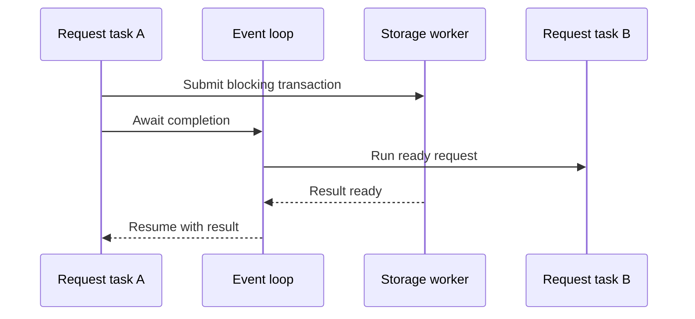

# Day 9 — Processes, threads, and asynchronous I/O

## 1. Learning objectives

Distinguish concurrency from parallel execution. Trace coroutine creation,
scheduling, suspension, and completion. Use structured tasks and move blocking
storage work off the event loop. Assemble an async application boundary without
pretending cancellation stops a running thread. Required competency: Level 3.

## 2. Required prerequisites

[Day 8](../day-02/README.md): transactions and per-call database connections.
[Day 7](../day-01/README.md): client/server request lifecycle.
[Week 1 / Day 3](../../week-01/day-03/README.md): functions and local state.
Understand sequential calls first: a normal call completes or raises before the
caller proceeds. This lesson changes when work can overlap, not its contract.

## 3. Problem motivation

A server handling a slow request sequentially can make every other caller wait.
Network and disk operations spend time waiting for resources. Concurrency lets
other work progress during that wait. But adding `async` to a function name does
not transform blocking calls. If a database operation blocks the event-loop
thread, unrelated tasks stall. If many requests share mutable state without
coordination, the service may corrupt state even while appearing faster.

## 4. Intuitive explanation

A cook can start rice, chop vegetables while it simmers, then return when the
rice is ready. That is concurrency: overlapping progress. Two cooks chopping
at once add parallel execution. An event loop resembles one cook switching at
explicit waiting points. A thread is another execution context within a process;
a process has a stronger separation of address space and resource ownership.
Neither arrangement magically decides who owns a shared cutting board.

## 5. Deep technical explanation

Calling an `async def` function produces a coroutine object. Its body does not
run to completion simply because it was called. `await coroutine` runs it within
the current async control flow and suspends the caller as needed. To overlap
independent operations, create tasks. `asyncio.TaskGroup` owns its child tasks:
on normal exit it waits for them; on a child failure it cancels the remaining
children and reports failures, potentially as an exception group. Children must
cooperate with cancellation for cleanup to finish.

The event loop schedules ready tasks, runs one until it yields control, and
waits for I/O readiness when no task can proceed. Cooperative does not mean
switching after every Python statement. A long CPU loop with no await can starve
all other tasks. `time.sleep` blocks the executing thread. `await asyncio.sleep`
suspends the current task and allows others to run. Using an async function
that internally calls blocking code still blocks.

`asyncio.to_thread(function, ...)` runs a blocking function in a worker thread
and returns an awaitable result. The reference creates a SQLite connection
inside each blocking method, so a connection is used in its creating thread.
Do not create a connection on the event-loop thread then casually share it with
workers. Threads share the process's memory; transaction boundaries and database
locking still matter. In ordinary GIL-enabled CPython, threads are useful for
blocking I/O but do not generally make pure Python CPU work run faster on multiple
cores. CPython builds and native libraries can differ; this is not a universal
claim about every implementation. Processes are an alternative for CPU work,
with serialization and coordination overhead.

The reference `DocumentAPI.dispatch` authenticates and validates synchronously,
then awaits the blocking storage call through `to_thread`. Results become typed
response records. The transport adapter uses async stream reads, framed body
lengths, deadlines, and one response per connection. Its small HTTP/1.1 subset
is educational; a production parser handles a much larger standard surface.
A `read(n)` can return fewer bytes than n on a stream, so `readexactly(n)` is
needed where framing promises exactly n bytes. Draining a writer respects
buffer backpressure rather than assuming writes reached a peer immediately.

Cancellation of the task awaiting `to_thread` does not forcibly stop the worker.
A timed-out write may still commit. Closing over that uncertainty is a serious
engineering error. Our PUT operation is logically idempotent for identical
values, but a caller must still inspect/reconcile state after an uncertain
outcome. This is why asynchronous syntax, transactions, and idempotency are
separate mechanisms rather than substitutes.

## 6. Mathematical foundations

Let two independent I/O operations wait for durations a and b. Sequential time
is approximately a + b plus overhead. Ideal overlapping time is approximately
max(a,b) plus overhead, provided no shared bottleneck serializes them. With
40 ms and 60 ms waits, the ideal comparison is about 100 ms versus 60 ms.
This is a latency model, not a performance guarantee or evidence of CPU parallelism.

If arrival rate exceeds service capacity, queued requests grow. A finite worker
pool limits active blocking work but does not by itself bound every upstream
queue. Our demo has time and per-message size bounds but no production admission
control; overload behavior remains a known limitation. Measure active tasks,
queue wait, and completion latency separately before increasing concurrency.

## 7. Architecture and execution diagrams



Submitting does not transfer the database connection from the loop: the worker
creates its own. The event loop stays available during the blocking transaction.

## 8. Implementation from first principles

```python
import asyncio


async def fetch(label):
    await asyncio.sleep(0)
    return label.upper()


async def main():
    async with asyncio.TaskGroup() as group:
        first = group.create_task(fetch("a"))
        second = group.create_task(fetch("b"))
    assert [first.result(), second.result()] == ["A", "B"]
    print("both owned tasks completed")


asyncio.run(main())
```

The zero sleep creates an explicit scheduling opportunity; no real network is
used. Tasks are owned by the group and read only after group completion. Input
labels are immutable strings; output order here is explicitly first then second,
not whatever happened to complete first. For actual storage use
[the API adapter](../../../forgeagent/api.py) and
[transport demo](../../../forgeagent/http_demo.py). Neither relies on an agent framework.

## 9. Worked execution walkthrough

`asyncio.run` creates a loop for main. Main enters a group, creates two tasks,
then waits at group exit. Each task reaches its await and yields, later returns
an uppercase label, and becomes completed. Only after both complete do we read
results and assert the specified order. In the API, substitute a storage-worker
await for the zero sleep: the task pauses, other requests can proceed, then the
storage result resumes the original handler. A child error would take a different
cleanup path, not fabricate a successful label.

## 10. Independent laboratory

Implement `async collect(operations)` in the [Week 2 lab](../../../labs/week-02/README.md).
Input is a list of zero-argument async callables. Start them concurrently under
a TaskGroup and return their results in input order. Empty input returns an
empty list. A child failure must propagate and cancel siblings rather than
returning a partial success list. Run
`python labs/week-02/checks.py --day 3 --module learner-work/week-02/concurrent.py`.
Submit source, an event-based test proving overlap without fragile timing,
and a sibling-cleanup trace on failure. Do not use sleeps as the only proof.

## 11. Experiments

Compare two sequential awaits with grouped tasks using fixed short waits. Record
elapsed time over multiple runs and explain why scheduling overhead matters.
Replace one async wait with `time.sleep` and run a heartbeat task; observe its
loss of progress. Then move the blocking call to a thread and observe the
heartbeat again. Keep experiments local and small; elapsed improvement does not
establish thread safety or cancellation of underlying work.

## 12. Failure analysis

A “coroutine was never awaited” warning means you created work without executing
or scheduling it. Add the correct await/task ownership, not a warning filter.
If the server stops responding during database contention, inspect blocking work
on the loop thread. If task failures disappear, look for unowned tasks whose
exceptions were never observed. If a canceled request still changes state, check
whether a worker or external service continued after the caller stopped waiting.
Reconcile state instead of assuming the transaction rolled back.

## 13. Engineering tradeoffs

Sequential execution is easiest to reason about and appropriate for dependent
tasks. Async I/O overlaps waiting with modest thread overhead but requires
cooperative cancellation and disciplined effects. Threads integrate blocking
libraries but share memory and cannot be safely killed at arbitrary points.
Processes improve isolation and some CPU workloads but add startup/serialization
cost. Choose by workload and failure requirements, not an assumption that async
always means faster.

## 14. Real-world connection

Agent services wait on model streams, tools, and storage. Independent read tools
may overlap; a write followed by its verification is dependent and cannot simply
be parallelized. The same event-loop discipline supports responsive cancellation,
though the external operation's cancellation semantics still need separate design.

## 15. Common misconceptions

“Async runs on many cores”: concurrency and parallelism differ. “Calling a
coroutine starts it”: it must be awaited/scheduled. “Cancel means undo”: work in
threads or remote systems may continue. “A lock around everything makes it fast”:
it can restore sequential throughput while adding coordination cost.

## 16. Technical examination

1. Explain process, thread, coroutine, task, and event loop.
2. Trace two tasks through first await and completion.
3. Implement ordered concurrent collection and failure cleanup.
4. Diagnose an async handler that calls blocking `time.sleep`.
5. Choose a design for two independent reads followed by one dependent write.

Use [separate solutions](../../../solutions/examinations/week-02.md).

## 17. Daily mastery gate

Pass ordered-collection contracts, prove overlap with events, and demonstrate
sibling cleanup. Score 4/5 including independent coding. Explain why a canceled
thread-backed write has an uncertain outcome. If you cannot distinguish waiting
from running, retrace a sequential example before adding tasks.

## 18. Resources

[Python coroutines/tasks](https://docs.python.org/3.12/library/asyncio-task.html),
creating tasks, TaskGroup, cancellation, and to_thread: 45 minutes.
[Python streams](https://docs.python.org/3.12/library/asyncio-stream.html), readexactly,
drain, and connection close: 25 minutes. Primary PSF documentation for Python 3.12.

## 19. Revision and retention

Tomorrow reconstruct a TaskGroup without notes. Three days later reproduce the
unawaited-coroutine warning and fix ownership. One week later explain why
transactions and cancellation do not imply undoing a remote tool side effect.
Connect to Day 8's atomic-state boundary.

## 20. Next lesson connection

[Day 10](../day-04/README.md) adds finite timeouts, selective retries, cancellation,
and deterministic fault injection. Concurrency without those limits can merely
accumulate more stuck work.
