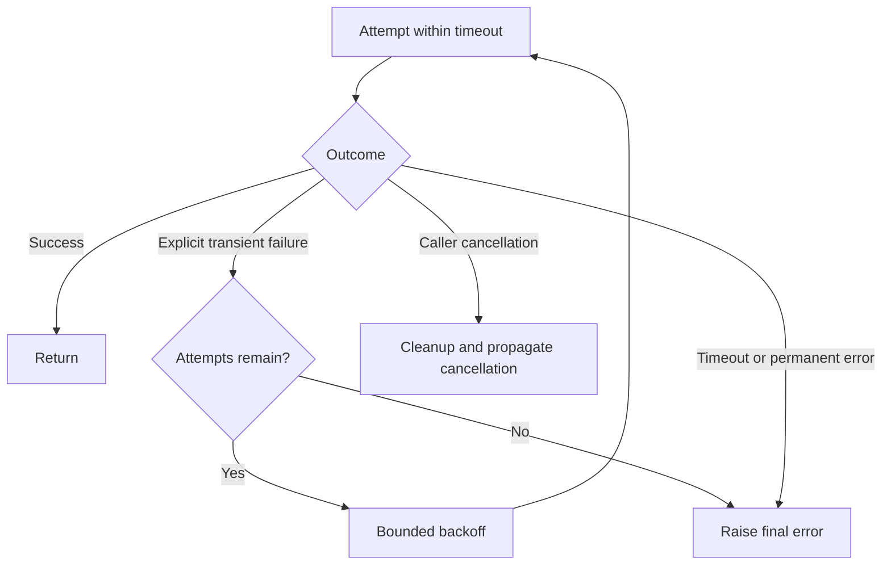

# Day 10 — Timeouts, retries, cancellation, and mocks

## 1. Learning objectives

Separate permanent failure, explicitly transient failure, timeout, and cancellation.
Implement bounded selective retries with exponential backoff, inject deterministic
failure and sleep behavior, and explain uncertain side effects. Required
competency: Level 3 implementation with Level 4 debugging evidence.

## 2. Required prerequisites

[Day 9](../day-03/README.md): tasks and cooperative cancellation.
[Day 8](../day-02/README.md): transactional state versus external effects.
[Week 1 / Day 5](../../week-01/day-05/README.md): tests and fixtures. Be able to
explain why a canceled `to_thread` await does not terminate the worker. This
lesson assumes no probability theory yet; reliability calculations with explicit
assumptions are introduced tomorrow.

## 3. Problem motivation

A network request may never return, a temporary failure may succeed on another
attempt, or a permanent validation error may never improve. Retrying everything
wastes time and can repeat harmful effects. A long-running agent needs limits
and honest outcome states. We implement a deliberately narrow policy: only an
adapter-labeled `TransientError` is retryable; timeout and cancellation propagate.
This makes assumptions visible instead of hiding them in a generic retry library.

## 4. Intuitive explanation

If a shop is briefly busy, returning later can help. If the address is invalid,
trying it ten times will not help. If you sent a payment and lost the receipt,
not knowing the result is different from knowing it failed. A timeout means you
stopped waiting; it does not prove the shop did nothing. A cancellation means
your caller no longer wants to wait, so the default is to stop retrying and
cooperate with cleanup.

## 5. Deep technical explanation

A timeout limits waiting for one operation. A deadline is an absolute time by
which a larger task must finish. Repeated per-attempt timeouts do not establish
a small total duration unless attempt count and backoff are also bounded.
`asyncio.timeout` cancels the protected task at its limit and turns that
cancellation into `TimeoutError` outside the context. The operation must cooperate;
a CPU loop or cancellation-suppressing coroutine can defeat prompt termination.
An outer caller can still cancel the retry task, and that cancellation must not
be converted into a retryable service error.

Our `retry` function accepts an async zero-argument operation, positive attempt
count, finite positive timeout, finite nonnegative base delay, and an injected
async sleep. Each loop iteration creates a timeout scope and awaits a fresh
operation call. If it raises `TransientError`, retry only when attempts remain.
Sleep between attempts, not after success or final failure. Other exceptions,
including `TimeoutError` and `CancelledError`, propagate. A provider adapter
might map a particular server error to `TransientError`, but must decide whether
the operation is safe to repeat. A message saying “try again” is not sufficient
authorization to repeat an effectful command.

Exponential backoff spaces retries increasingly: base delay times powers of two.
Many clients retrying together can synchronize; random jitter reduces that
coordination in production, but deterministic no-jitter behavior makes this
first mechanism easy to test. Jitter and server `Retry-After` handling need their
own contracts, maxima, and tests before adding them. Do not let a delay overflow
or become an unbounded sleep under arbitrary configuration.

A mock substitutes a controlled collaborator for a real dependency. A fake
operation can fail the first two calls and return on the third. An injected
sleep can append requested delays to a list without actually waiting. This
tests policy rather than wall-clock chance. For cancellation, coordinate with
an `asyncio.Event` so a test knows the operation has started, then cancel the
task and verify cleanup. Fault injection changes one known assumption and
observes whether the expected boundary holds. It is not a random hunt for green tests.

## 6. Mathematical foundations

Let A be maximum attempts, t the per-attempt timeout, and d the initial delay.
There are at most A−1 sleeps. Delays are d, 2d, 4d, …, d·2^(A−2). Their sum is
d(2^(A−1)−1), from the finite geometric-series identity. For A=3, d=0.05 seconds,
sleeps total 0.15 seconds. A cooperative worst-case wait estimate is A·t plus
that delay sum plus scheduling and cleanup overhead. With t=1, about 3.15 seconds
before overhead. This is not a hard real-time guarantee.

Timeouts do not prove rollback. Model two events: effect committed E and caller
received acknowledgment R. A network failure can give E=true and R=false. A
retry policy that treats not-R as not-E repeats effects. An idempotent key or
state-reconciliation protocol is needed to reduce that uncertainty; exceptions
alone cannot establish exactly-once effects.

## 7. Architecture and execution diagrams



The absence of a timeout-to-retry edge is intentional. Altering that policy
requires a justification about side effects, not only availability.

## 8. Implementation from first principles

```python
import asyncio
from forgeagent.async_ops import retry, TransientError


async def main():
    calls = 0
    delays = []

    async def operation():
        nonlocal calls
        calls += 1
        if calls < 3:
            raise TransientError("temporary fixture failure")
        return "ready"

    async def fake_sleep(seconds):
        delays.append(seconds)

    result = await retry(operation, attempts=3, base_delay=0.1, sleep=fake_sleep)
    assert result == "ready" and calls == 3
    assert delays == [0.1, 0.2]
    print("finite selective retry passed")


asyncio.run(main())
```

`nonlocal` permits updating the enclosing function's `calls` binding; without it,
assignment would create a local variable and reading it first would fail. The
fake sleep makes policy deterministic and fast. Inputs and outputs match the
[complete retry implementation](../../../forgeagent/async_ops.py). The function
owns retry scheduling, not the operation's business semantics or authorization.

## 9. Worked execution walkthrough

Attempt zero fails transiently; two attempts remain, so record delay 0.1.
Attempt one fails transiently; one attempt remains, so record 0.2. Attempt two
returns `ready`; return immediately with no trailing sleep. Now change the first
failure to `ValueError`: one call occurs, no sleep, and the exception propagates.
Cancel while the operation awaits an event: cancellation propagates rather than
creating another attempt. These three paths distinguish recovery from stubborn repetition.

## 10. Independent laboratory

Implement selective retry from the [Week 2 contract](../../../labs/week-02/README.md)
in the retry starter. Retry only the starter's `TransientError` class. Validate
attempt/time settings, preserve the last error, and inject sleep. Test success,
transient-then-success, exhaustion, permanent failure, timeout, and cancellation.
Run `python labs/week-02/checks.py --day 4 --module learner-work/week-02/recovery.py`.
Deliver a state trace and an explanation of why a timed-out write is not
necessarily safe to retry. Public checks are only the minimum; cleanup evidence
is part of acceptance.

## 11. Experiments

Change attempts from 1 to 4 and record calls and fake delays for always-transient
input. Compare the observed sum with the geometric formula. Wrap a never-set
event in a short timeout; assert the error kind and cleanup flag rather than
requiring an exact elapsed millisecond. Simulate an operation that records an
effect then raises transiently; show how retries duplicate effects without an
idempotency design. Do not use an actual payment or external command.

## 12. Failure analysis

An infinite retry loop lacks a strictly decreasing remaining-attempt budget.
Trace the counter and make final failure explicit. A swallowed cancellation often
comes from catching `BaseException` too broadly; allow cancellation to propagate.
A slow test may be using real backoff sleeps; inject a fake for policy tests.
A flaky cancellation test may cancel before the operation starts; synchronize
with an event. A false exactly-once claim may conflate response receipt with
effect completion; reproduce the effect-before-error failure window.

## 13. Engineering tradeoffs

Retry increases availability for some transient failures while increasing load,
latency, and possible duplicate effects. Exponential delay reduces retry pressure
but can exceed user latency budgets. A total deadline limits the whole task;
per-attempt timeouts isolate individual waits. Mocks make tests reproducible but
cannot prove a real provider has the same behavior. Keep separate optional
integration checks after the deterministic policy is correct.

## 14. Real-world connection

Model APIs may fail during streaming after partial output or charge before a
client sees completion. Tool execution can mutate state before an acknowledgment.
Agent harnesses therefore need operation-specific recovery and budget accounting.
Today's retry loop deliberately avoids claiming a universal provider policy.

## 15. Common misconceptions

“More retries means more reliable”: repeated bad requests can worsen an outage.
“Timeout means failure with no effect”: the outcome may be unknown. “Cancellation
is an ordinary retryable error”: the caller has requested stopping. “Mock success
proves production behavior”: it proves only the tested collaborator contract.

## 16. Technical examination

1. Distinguish timeout, deadline, cancellation, and transient failure.
2. Derive delay count/sum for four attempts at base 0.1 seconds.
3. Implement the retry contract with fake sleep.
4. Debug a swallowed cancellation and show a deterministic regression.
5. Design recovery for a write that may have committed before timeout.

[Answers](../../../solutions/examinations/week-02.md) are separate.

## 17. Daily mastery gate

Pass all public paths and independently test timeout and cleanup. Score 4/5
including implementation. Derive the delay sum and explain an uncertain-effect
trace. Demonstrate that cancellation does not cause a retry. Do not progress
with an implementation that merely “eventually returns” without finite limits.

## 18. Resources

[Python tasks](https://docs.python.org/3.12/library/asyncio-task.html), cancellation,
timeouts, and TaskGroup behavior: 35 minutes. This primary reference explains
runtime mechanics; it does not choose application-level idempotency policy.
[HTTP semantics](https://www.rfc-editor.org/rfc/rfc9110.html), idempotent methods:
15 minutes targeted reading after the local uncertain-outcome example.

## 19. Revision and retention

Tomorrow derive the geometric delay sum without notes. Three days later rebuild
the event-based cancellation test. One week later explain why a read and a
shell command need different recovery policies. Connect to Day 8 transactions
and Day 9 thread cancellation limits.

## 20. Next lesson connection

[Day 11](../day-05/README.md) introduces vectors and probability. Vectors enable
similarity and neural computation; probability provides the language for
reliability estimates while forcing independence assumptions into the open.
