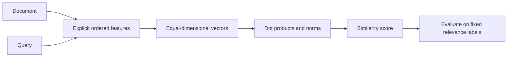

# Day 11 — Vectors, matrices, similarity, and probability

## 1. Learning objectives

Read vector/matrix notation, compute dot products and matrix-vector products by
hand and code, distinguish magnitude from direction, and interpret cosine
similarity cautiously. Compute elementary and conditional probabilities and
state independence assumptions in reliability estimates. Required competency:
Level 3 implementation plus Level 2 numerical traces.

## 2. Required prerequisites

[Week 1 / Day 3](../../week-01/day-03/README.md): lists, loops, and functions.
[Day 10](../day-04/README.md): repeated attempts and finite budgets. Arithmetic
prerequisites are addition, multiplication, division, negatives, and square roots.
A square root of a nonnegative number is the nonnegative value whose square is
that number; √25 = 5 because 5×5 = 25. Powers mean repeated multiplication for
integer exponents. No calculus or machine learning is assumed today.

## 3. Problem motivation

Search eventually needs more than exact word counts. Numeric representations
let us compare documents, but numbers alone do not guarantee semantic meaning.
A similarity calculation can be mathematically correct and operationally useless
if its features are poorly chosen. Reliability estimates have a parallel problem:
a probability formula can be correct under independence while the actual failures
are correlated. Today teaches both the mechanisms and their assumptions.

## 4. Intuitive explanation

A vector is an ordered list of coordinates. If the coordinates count mentions
of “agent” and “test,” `[3,1]` describes three agent mentions and one test mention.
A matrix is a rectangular table of numbers; one row per document stores several
such vectors. A dot product combines corresponding coordinates into one number.
A probability describes how much of the possible outcome space satisfies an
event under an explicit model; it is not a guarantee about one future run.

## 5. Deep technical explanation

An n-dimensional real vector x has coordinates x₁ through xₙ. Dimensions must
have shared meanings and ordering before vectors can be compared. Dot product
x·y = Σᵢ xᵢyᵢ multiplies matching coordinates then sums. The Euclidean norm
||x|| = √(x·x) measures length. Cosine similarity divides dot product by both
norms, comparing direction rather than overall scale. It is undefined for a
zero vector: no direction exists. Reject or define an explicit fallback rather
than silently dividing by zero. For real vectors, exact cosine lies between −1
and 1; floating-point arithmetic can introduce small numerical deviations.

A matrix A of shape m×n has m rows and n columns. Multiplying it by an n-vector
produces an m-vector: output coordinate j is the dot product of row j with x.
Shape is a contract. Multiplying rows of inconsistent lengths by zip would
silently discard extra entries, so check dimensions before computing. Later a
neural layer uses this same operation plus a bias; a transformer uses batches
of matrix operations. These are not different kinds of magic arithmetic.

Cosine says aligned coordinates agree in direction, not that two statements
are both true. Sparse term-count features align exact words. Learned embeddings
can align other patterns learned during training, which still do not establish
factual support. A vector index optimizes finding candidates; it does not create
authoritative evidence or verify citations.

For probability, define a sample space Ω of possible outcomes, events as subsets,
and a probability assignment P. A finite equally likely model gives event
probability as favorable outcomes divided by total outcomes. General distributions
need not be uniform. Values are nonnegative, P(Ω)=1, and mutually exclusive
events add. P(not A)=1−P(A). Conditional probability is P(A|B)=P(A∩B)/P(B)
when P(B)>0. Independence means P(A∩B)=P(A)P(B), not merely that events have
different names or happened at different times.

Example: in ten fixed evaluation tasks, six succeed, so observed success fraction
is 0.6. That is an empirical proportion on this sample, not proof that every
future request succeeds with probability 0.6. Task selection, distribution change,
and shared outages matter. If independent attempts each fail with probability
p, all r fail with p^r, so at least one succeeds with 1−p^r. If failures share
a permanent invalid schema, independence is implausible and repeated attempts
may have identical outcomes. Report assumptions alongside the number.

## 6. Mathematical foundations

Take x=[3,4] and y=[0,5]. Dot product is 3×0+4×5=20. Norms are √(9+16)=5
and √25=5. Cosine is 20/(5×5)=0.8. Scaling y to [0,50] makes dot product 200
but cosine remains 0.8: numerator and denominator scale together. Negating y
changes cosine to −0.8. A zero query vector cannot be ranked by cosine without
a defined special policy.

For A=[[1,2],[3,4]] and x=[2,1], row one gives 1×2+2×1=4; row two gives
3×2+4×1=10. Output is [4,10], a 2-vector. A 2×3 matrix cannot multiply a
2-vector under this definition because each row needs three coordinates.

Suppose P(failure)=0.2 and three attempts are independent. All fail with
0.2×0.2×0.2=0.008; at least one succeeds with 0.992. Now suppose 10% of requests
are permanently invalid and otherwise each attempt independently fails with
probability 0.1. Overall eventual failure is 0.1+0.9×0.1³=0.1009, much larger
than cubing the marginal one-attempt failure probability. Conditional structure
changes the estimate. Reliability claims must model shared causes.

## 7. Architecture and execution diagrams



Feature choice supplies meaning. Arithmetic supplies a score. Evaluation checks
whether that score serves the retrieval objective. No arrow converts score
directly into truth.

## 8. Implementation from first principles

```python
import math
from forgeagent.math_basics import dot, cosine, matvec

x = [3.0, 4.0]
y = [0.0, 5.0]
assert dot(x, y) == 20.0
assert math.isclose(cosine(x, y), 0.8)
assert math.isclose(cosine(x, [0.0, 50.0]), 0.8)
assert matvec([[1, 2], [3, 4]], [2, 1]) == [4.0, 10.0]
failure = 0.2
assert math.isclose(1 - failure ** 3, 0.992)
print("shape-checked arithmetic passed")
```

[Source](../../../forgeagent/math_basics.py) implements these mechanisms with
plain loops/comprehensions and `math.fsum`. The latter improves summation accuracy
for ordinary finite inputs. The vector functions assume moderate finite numeric
coordinates; extreme overflow and arbitrary nonnumeric types are outside this
small teaching contract. Softmax validation comes tomorrow. Dot products cost
O(n); an m×n matrix-vector product costs O(mn), with one output per row.

## 9. Worked execution walkthrough

Dot checks two nonempty vectors have equal length. Multiply coordinate pairs,
then sum to 20. Cosine reuses dot to find both squared norms, takes roots, checks
for a zero denominator, and divides. Matvec traverses rows in order, applying
the same validated dot function. The probability calculation uses multiplication
of three independent failure chances; the complement gives eventual success.
The program cannot infer whether independence is justified—you must supply and
critique the model.

## 10. Independent laboratory

Implement dot, cosine, and matvec from the [Week 2 contract](../../../labs/week-02/README.md).
Use Python arithmetic, not NumPy; validate equal nonempty dimensions and reject
zero-vector cosine. Test aligned, orthogonal, opposite, zero, and malformed-shape
inputs. Run `python labs/week-02/checks.py --day 5 --module learner-work/week-02/vectors.py`.
Also submit a hand-computed two-row product and a probability example with shared
failure causes. Acceptance requires the numerical and explanatory evidence,
not just agreement with a library output.

## 11. Experiments

Scale one vector by 10 and measure dot and cosine; predict the difference first.
Permute feature order in only one input and observe why compatibility matters.
Create two terms with conflicting semantic meanings but identical count vectors;
show a high score cannot establish relevance. For reliability compare an
independent coin-like simulation with a fixture where all attempts share one
permanent failure flag. Fix the random seed if simulating and report sample
size; a seeded simulation illustrates assumptions, not production reliability.

## 12. Failure analysis

A dimension mismatch hidden by zip returns a plausible wrong answer; reproduce
with [1,2] and [3] and require rejection. A zero norm causes undefined cosine;
handle it deliberately. A probability above 1 signals a broken model or formula.
If repeated attempts do not improve success, inspect permanent failures and
shared dependencies before increasing attempt count. Do not repair bad reliability
estimates by discarding inconvenient tasks from the benchmark.

## 13. Engineering tradeoffs

Dot product preserves magnitude and may overrank long documents. Cosine removes
scale but loses information sometimes useful for scoring. Handwritten loops
teach shape and cost but optimized libraries are preferable for large numerical
workloads after the mechanism is understood. Empirical metrics are observable
but sample-dependent; probabilistic models generalize only under assumptions.
Use both, with uncertainty and a fixed test set.

## 14. Real-world connection

Embeddings, attention, and neural layers all use vector products. Agent benchmark
reports also need denominators, repeated trials, and correlations. A similarity
score is not a calibrated correctness probability, and repeated-trial success is
not the same quantity as single-attempt quality. Today's small examples make
those distinctions concrete before model APIs obscure them.

## 15. Common misconceptions

“Vectors are positions only”: they can encode any ordered numerical features.
“Cosine 0.9 means 90% true”: it is a geometric score. “Different requests are
independent”: they may share a model, outage, schema, or dataset flaw. “A matrix
is any nested list”: rectangular shape is part of the definition.

## 16. Technical examination

1. Explain vector, norm, matrix shape, event, and conditional probability.
2. Compute cosine for [1,0] and [1,1], and a two-row matrix product.
3. Implement validated dot/cosine/matvec from their specifications.
4. Diagnose silent dimension truncation and zero-vector division.
5. Critique a 99.2% reliability claim based on three correlated attempts.

[Answers](../../../solutions/examinations/week-02.md) are separate.

## 17. Daily mastery gate

Pass numerical/shape contracts, derive the examples by hand, and score 4/5 with
implementation mandatory. Explain one similarity-versus-truth counterexample
and one independence failure. If algebra notation is unclear, rewrite every
symbol as a loop variable before adding more mathematics.

## 18. Resources

[MIT geometry of linear equations](https://ocw.mit.edu/courses/18-06sc-linear-algebra-fall-2011/pages/ax-b-and-the-four-subspaces/the-geometry-of-linear-equations/),
Gilbert Strang, optional 45 minutes, connects coordinate operations with geometric
interpretation. [MIT probability models and axioms](https://ocw.mit.edu/courses/6-041sc-probabilistic-systems-analysis-and-applied-probability-fall-2013/pages/unit-i/lecture-1/),
John Tsitsiklis, optional 45 minutes, reinforces events and probability models.
The session pages were verified; linked videos were not watched in full. Essential
teaching and exercises remain local. See [the ledger](../../../docs/resource-verification.md).

## 19. Revision and retention

Tomorrow reconstruct dot and norm without notes. In three days derive a new
conditional-probability table. One week later explain why a retrieval score and
empirical task-success fraction answer different questions. Connect to Day 10's
operation-specific retry policy.

## 20. Next lesson connection

[Day 12](../day-06/README.md) teaches rates of change, composition, optimization,
logarithms, and normalized exponential scores. Those foundations enable Week 3
learning algorithms and Week 4 attention without unexplained formulas.
