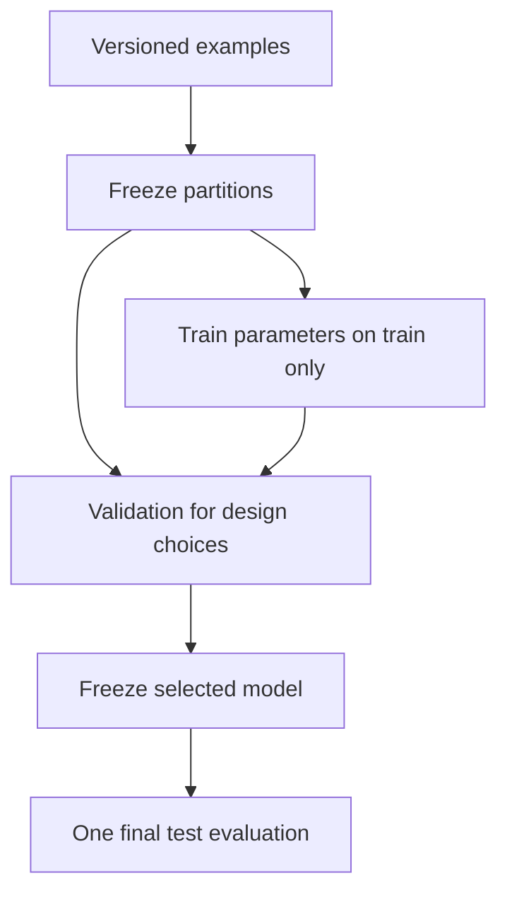

# Day 13 — Datasets, splits, regression, and inference

## 1. Learning objectives

Explain machine learning as parameter selection from examples. Distinguish a
feature, label, parameter, prediction, training, and inference. Construct disjoint
train/validation/test partitions and implement a scalar linear predictor. Trace
where information enters a model and identify evaluation leakage. Required
competency: Level 3 independent implementation.

## 2. Required prerequisites

[Day 12](../../week-02/day-06/README.md) establishes gradients, scalar functions,
and optimization; [Day 11](../../week-02/day-05/README.md) establishes vectors,
probability, and matrix shapes. Reconstruct dot product and square-loss descent
before continuing. Python records and fresh local state come from
[Day 5](../../week-01/day-05/README.md). No statistical training library is required.

## 3. Problem motivation

A hand-written rule cannot anticipate every variation in text, but a model can
learn some regularities from examples. The engineering challenge is to measure
whether those regularities work on new inputs. A program that memorizes every
training answer can report perfect training accuracy while being useless outside
that list. We therefore define the data boundary before optimizing parameters.
For agents, this same boundary protects evaluation from task memorization.

## 4. Intuitive explanation

Imagine estimating delivery time from distance. Distance is an input feature;
observed delivery time is the target label. A line with adjustable slope and
intercept predicts time. Training adjusts the line using examples; inference
uses the chosen line without adjusting it. Practice problems help choose the
line. A validation set helps choose learning settings. A final test set is a
separate examination, not another source of hints for changing the model.

## 5. Deep technical explanation

Represent a supervised example as an identifier, feature tuple, and target.
The identifier tracks provenance and overlap; it is not automatically a feature.
For scalar regression predict y-hat = wx+b, where x is an observed feature and
w,b are learned parameters. Regression predicts numerical values. Classification
predicts categories, often through scores or probabilities. Converting a numerical
prediction into a category requires an additional decision rule and evaluation.

Training is an algorithm that reads a permitted partition and selects parameters.
Inference applies fixed parameters to an input. Parameters are not training
examples themselves, but can encode or memorize properties of those examples.
Hyperparameters such as learning rate or hidden width are choices outside the
parameter update; selecting them using validation data still uses information
from that partition. Repeatedly inspecting test results and changing design
turns the test into another validation set, regardless of its filename.

Split before fitting transformations. If a normalization mean includes test
features, it has already used information outside training. If duplicates or
near-identical repository tasks cross splits, identifier disjointness alone may
not prevent leakage. Group related examples before splitting when future use
requires generalizing to new groups. For forecasting, train on earlier time
periods instead of randomly mixing future observations into training.

The educational splitter shuffles a copied list with a local random generator,
then takes 60%, 20%, and the remainder. A seed makes this procedure repeatable
for a fixed input order. It does not make the partition representative or remove
all leakage. The function rejects duplicate identifiers and tiny datasets with
fewer than five rows. For serious evaluation, freeze a partition manifest and
record data provenance rather than reshuffling until metrics look attractive.

## 6. Mathematical foundations

With w=2 and b=1, x=3 gives y-hat=2×3+1=7. Changing b to 2 shifts every prediction
by one; changing w to 3 changes this prediction by x=3. For n=10 rows, the
splitter uses floor(.6n)=6 training rows and floor(.8n)=8 as the second boundary,
giving 6/2/2. Floor means the greatest integer no larger than the argument.
Disjoint identifier sets should have pairwise empty intersections, and their
union should equal all original identifiers. These are exact invariants, not
statistical guarantees. Held-out error estimates generalization only to inputs
sufficiently related to the sampling process; they cannot guarantee performance
under arbitrary deployment shift.

## 7. Architecture and execution diagrams



The test result has no optimization arrow back into the selected model. If it
does influence redesign, disclose that use and obtain a fresh test for a new
unbiased assessment. Production monitoring remains necessary after this diagram.

## 8. Implementation from first principles

```python
from forgeagent.learning import Example, split_examples, predict

rows = [Example(str(i), (float(i),), 2.0*i+1) for i in range(10)]
parts = split_examples(rows, seed=7)
ids = {name: {row.identifier for row in group} for name, group in parts.items()}
assert not ids['train'] & ids['test']
assert not ids['validation'] & ids['test']
assert sum(len(group) for group in parts.values()) == 10
assert predict(3, weight=2, bias=1) == 7
assert len(rows) == 10
print({name: len(group) for name, group in parts.items()})
```

The complete [learning module](../../../forgeagent/learning.py) uses immutable
example records and copies before shuffling. Inputs are identified rows; output
is three lists. The predictor is pure arithmetic. Validation failures are
explicit exceptions. This example knows the generating line for verification;
real unknown relationships must be learned and checked empirically.

## 9. Worked execution walkthrough

Create ten examples with one feature each. The splitter first checks size and
unique IDs, copies references to immutable records, shuffles locally, then slices
at 6 and 8. No original row order changes. Build identifier sets and check
intersections. Predict on x=3 by multiplying feature by slope then adding bias.
No learning occurred in that last call: supplying known parameters demonstrates
inference, while tomorrow's optimizer will choose them from training observations.

## 10. Independent laboratory

Implement `partition(rows, seed)` from the [Week 3 contract](../../../labs/week-03/README.md).
Use a copied shuffled list, unique IDs, fixed 60/20/remainder boundaries, and
explicit rejection for fewer than five rows or duplicate IDs. Deliver partition
invariants, a no-mutation test, a repeated-seed test, and a written leakage
counterexample involving two related repository tasks. Run the day-1 public
check with your module. Keep reference source closed during implementation.

## 11. Experiments

Change only the seed and measure partition sizes and ID membership. Sizes remain
fixed while membership changes. Then reverse input order with the same seed and
observe membership; reproducibility requires input order as well as seed. Create
duplicate-content rows with different IDs and explain why the ID check misses
semantic leakage. Record the grouping policy you would use before any metric
is computed, rather than choosing one after seeing attractive results.

## 12. Failure analysis

If rows disappear, inspect slice boundaries and union coverage. If the caller's
list changes, look for in-place shuffle instead of shuffling a copy. If validation
and test share examples, check identity overlap and duplicated content. If a
model performs suspiciously well, remove target-derived features and review
preprocessing fit scope. A passing disjoint-ID test cannot repair a label that
was accidentally included as an input feature.

## 13. Engineering tradeoffs

Random splits are simple for independent identically distributed examples but
can misrepresent temporal or repository-group generalization. Small test sets
are cheap but uncertain. A fixed seed supports debugging while multiple predefined
splits can measure variability; repeatedly selecting a favorable seed biases
the result. Preserve simplicity while making the intended deployment population
and contamination risks explicit.

## 14. Real-world connection

Agent benchmarks need separation between development tasks and held-out tasks.
A fixture already visible in training instructions can test regression behavior,
but cannot honestly claim unseen-task performance. Our tiny synthetic dataset
teaches data discipline; it provides no evidence about real coding-agent quality.

## 15. Common misconceptions

“Training and inference are both asking the model”: only training here updates
parameters. “A seed guarantees fairness”: it guarantees a repeatable procedure.
“Different IDs mean different knowledge”: near duplicates can leak answers.
“Good test results permit unlimited tuning”: tuning consumes the test boundary.

## 16. Technical examination

Explain feature versus parameter. Predict a new line output by hand. Implement
the partition contract. Diagnose duplicate task leakage. Defend random versus
time/group splitting for a repository benchmark. The five items are graded
separately in [Week 3 answers](../../../solutions/examinations/week-03.md).

## 17. Daily mastery gate

Pass partition checks and two independent edge tests. Trace a prediction and
partition without executing them. Score at least 4/5, including implementation.
Explain why identifier disjointness is necessary but insufficient. Record the
input ordering and seed with your evidence; do not mark completion from reading.

## 18. Resources

[Google ML Crash Course: dividing datasets](https://developers.google.com/machine-learning/crash-course/overfitting/dividing-datasets),
Google, free, 25 minutes after this lesson. Outcome: distinguish partition roles
and compare the official examples with your own leakage counterexample. The
resource ledger records retrieval limits; essential instruction remains here.

## 19. Revision and retention

Tomorrow reconstruct split invariants closed book. In three days explain how
preprocessing can leak without shared row IDs. In one week implement a group
split for a tiny hand-labeled repository fixture and justify what future population
it represents. Revisit the distinction between a measurement and its assumptions.

## 20. Next lesson connection

[Day 14](../day-02/README.md) defines error and derives parameter updates. We now
know which examples those updates may read and which examples must remain outside
optimization. That boundary precedes every more complex model in this phase.
