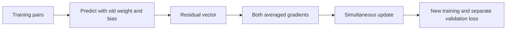

# Day 14 — Loss functions and gradient descent

## 1. Learning objectives

Compute residuals and mean squared error, derive gradients for scalar linear
regression, implement a simultaneous full-batch update, and compare training
with validation loss. Use finite differences to diagnose a wrong gradient.
Required competency: Level 3 independent implementation and numerical explanation.

## 2. Required prerequisites

[Day 13](../day-01/README.md) supplies examples, parameters, and split roles.
[Day 12](../../week-02/day-06/README.md) supplies derivatives and chain rule.
Be able to derive d(x²)/dx=2x and explain why training may not access test labels.
No optimization library is needed; Python arithmetic is the mechanism.

## 3. Problem motivation

A line with arbitrary parameters rarely predicts targets accurately. We need
an objective that orders candidate parameter settings and an update rule that
uses it. “Looks close” is not reproducible. Squared error provides a concrete
objective, but its sensitivity to outliers and feature scale creates practical
tradeoffs. An optimizer that reduces the wrong objective can run perfectly
while solving the wrong problem.

## 4. Intuitive explanation

For each example, draw the vertical gap between predicted and observed value.
That gap is the residual. Squaring makes positive and negative gaps both costly;
averaging makes results comparable across equally sampled dataset sizes. The
gradient tells which small parameter changes most increase this average, so
subtracting a scaled gradient attempts to reduce it. This direction is local,
not a promise that any step size will improve the result.

## 5. Deep technical explanation

For n observations, predict y-hatᵢ=wxᵢ+b and residual rᵢ=y-hatᵢ−yᵢ. The mean
squared error L=(1/n)Σrᵢ² measures average squared target units. Mean absolute
error instead averages |rᵢ| and penalizes large deviations less aggressively.
Choose the objective by what errors mean, not by whichever yields a smaller
numeric value; the scales of different losses are not directly comparable.

Full-batch descent computes gradients over every training example before updating
parameters. A stochastic update uses one sampled example; a minibatch uses a
subset. Smaller batches can introduce noisy gradients but reduce work per step.
This lesson uses full batches so each arithmetic contribution is inspectable.
The weight and bias gradients must be computed at the same old parameter values.
Updating weight first and recomputing bias residuals creates a different algorithm.

A learning rate controls update magnitude. Large input magnitudes can create
large weight gradients and demand smaller rates. Scaling features using training-
only statistics can improve conditioning, but changes the parameter interpretation
and requires saving the transformation for inference. Repeated loss reduction
on training is necessary evidence about optimization, not sufficient evidence
about generalization. Keep validation predictions out of the gradient calculation.

A useful debug baseline is a constant predictor: set weight to zero and choose
bias from training targets. If a learned line cannot outperform a simple baseline,
inspect data alignment, gradient signs, rate, and feature usefulness before
adding neural layers. More parameters amplify implementation errors rather than
explain them away. Always preserve the data split and metric definitions.

## 6. Mathematical foundations

Using the chain rule, ∂L/∂w=(2/n)Σrᵢxᵢ and ∂L/∂b=(2/n)Σrᵢ. The residual changes
by xᵢ per unit w and by one per unit b. The outer square contributes 2rᵢ. Sum
contributions and divide by n. Update w′=w−η∂L/∂w and b′=b−η∂L/∂b simultaneously.

For x=[1,2], y=[3,5], w=b=0, residuals are [-3,-5]. Loss=(9+25)/2=17. Weight
gradient is (2/2)(−3×1−5×2)=−13; bias gradient is −8. With η=.1, new w=1.3
and b=.8. Predictions become [2.1,3.4], residuals [-.9,-1.6], and loss
(.81+2.56)/2=1.685. This example demonstrates one improving step; it does not
prove .1 converges on every dataset.

A central-difference check perturbs w while holding b fixed: approximately
[L(w+h,b)−L(w−h,b)]/(2h). Compare with −13 at the initial point. Repeat for bias.
A mismatch can expose missing division by n, a reversed residual sign, or updates
using inconsistent parameter versions.

## 7. Architecture and execution diagrams



Validation loss is measured after the update but has no edge into gradient
computation. Stop at a predetermined finite step budget and retain measurements,
even if the results are disappointing. Do not silently remove hard examples.

## 8. Implementation from first principles

```python
import math
from forgeagent.learning import predict, mse, regression_step
from forgeagent.math_basics import derivative

xs, ys = [1.0, 2.0], [3.0, 5.0]
weight, bias = regression_step(xs, ys, 0.0, 0.0, rate=0.1)
assert math.isclose(weight, 1.3) and math.isclose(bias, 0.8)
assert math.isclose(mse([predict(x,weight,bias) for x in xs], ys), 1.685)
check = derivative(lambda w: mse([predict(x,w,0) for x in xs],ys),0)
assert math.isclose(check,-13,rel_tol=1e-6)
print(weight,bias)
```

The [reference](../../../forgeagent/learning.py) validates nonempty aligned lists,
computes all residuals once, then computes two gradients and returns two new
numbers. It does not mutate input or store hidden optimizer state. Expected
work per step is O(n); storing residuals costs O(n). A streaming accumulation
could reduce temporary memory, at the cost of a less visible intermediate trace.

## 9. Worked execution walkthrough

Start at zero parameters, compute predictions [0,0], then residuals [-3,-5].
Compute weighted residual sum −13 and unweighted sum −8. Multiply each by 2/n,
which equals one for two examples. Subtract scaled gradients, obtaining 1.3
and .8. Only then evaluate the new loss. The finite-difference helper evaluates
two neighboring weight values independently and agrees with the analytic derivative.
A bias perturbation must keep weight fixed to check a partial derivative.

## 10. Independent laboratory

Implement `step(xs, ys, w, b, rate)` from the [Week 3 lab](../../../labs/week-03/README.md).
Return simultaneous new parameters using full-batch mean squared error gradients.
Reject empty/mismatched data or nonpositive/non-finite rate. Deliver the hand
trace above, numerical checks for both parameters, and a finite training run
on a fixed synthetic line. Run the day-2 contract with your own module, and
report validation loss without using it in the update.

## 11. Experiments

Multiply all x values by ten while retaining targets; compare gradient magnitudes
and loss trajectories under the same rate. Next compare rates .001,.01,.1 on a
fixed scaled dataset, recording loss per step and any divergence. Add one large
target outlier and compare MSE with absolute error numerically. Keep partition,
seed, and step count fixed so you can attribute changes to the manipulated factor.
Never report only the best run without the predeclared selection rule.

## 12. Failure analysis

If loss grows on the tiny example, inspect the subtraction sign before tuning.
If changing dataset size changes update magnitude unexpectedly, inspect averaging.
If gradients pass one coordinate check but not another, verify both use old
parameters. If validation improves only after moving its examples into training,
you changed the evaluation problem. Preserve the failing trace and add a regression
test rather than masking it with a more complex optimizer.

## 13. Engineering tradeoffs

Squared error is smooth and gives simple gradients but emphasizes outliers.
Absolute error is more robust to large residuals but has a nondifferentiable
point at zero. Full batches are deterministic for a fixed order and data but
expensive on large corpora. Minibatches improve iteration throughput while
introducing sampling noise and reproducibility choices. Start with the simplest
correct mechanism and justify later optimization with measurements.

## 14. Real-world connection

Loss optimization is the source of model parameters, while agent inference
normally consumes already-trained parameters. Application quality can improve
without retraining through better evidence, tools, and evaluation. Learning the
training mechanism helps identify which failures prompting cannot reliably fix.
No model-scale training performance is claimed from this small exercise.

## 15. Common misconceptions

“A lower training loss proves a better application”: held-out behavior may worsen.
“Gradient descent means change every parameter one at a time”: the specified
batch update is simultaneous. “A tiny learning rate always solves everything”:
it can make progress impractically slow. “Loss units equal original error units”:
MSE uses squared units.

## 16. Technical examination

Define residual and loss. Derive both gradients. Independently implement one
step. Debug a sequential parameter-update defect. Defend MSE versus absolute
error under corrupted labels. Use [reference criteria](../../../solutions/examinations/week-03.md)
after recording your attempt; explanations must include a numerical case.

## 17. Daily mastery gate

Pass the update contract, gradient checks, and invalid-input cases. Reproduce
one hand calculation closed book and score at least 4/5 including coding.
Demonstrate that a deliberately reversed update fails your regression test.
Document training and validation results separately, even if both are poor.

## 18. Resources

[Google linear-regression loss](https://developers.google.com/machine-learning/crash-course/linear-regression/loss),
free, 25 minutes, compares error objectives.
[Google gradient descent](https://developers.google.com/machine-learning/crash-course/linear-regression/gradient-descent),
free, 20 minutes review. Prerequisites: today's residual and derivative derivations.
Outcome: interpret an update and loss curve without hiding behind a library.

## 19. Revision and retention

Tomorrow derive gradients from a new two-example dataset. In three days recreate
the finite-difference check with bias perturbed separately. In one week explain
why feature scaling affects optimization while train-only fitting protects data
boundaries. Connect update budgets to Week 2's finite-loop discipline.

## 20. Next lesson connection

[Day 15](../day-03/README.md) composes affine layers and nonlinear activations.
The same residual-and-gradient reasoning remains relevant, but manual derivatives
soon become cumbersome, motivating a computational graph and automatic differentiation.
