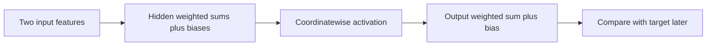

# Day 15 — Layers, activations, and forward propagation

## 1. Learning objectives

Compute an affine layer with explicit dimensions, distinguish parameters from
activations, and explain why stacked linear maps remain linear without a
nonlinearity. Implement a two-layer forward pass, compare tanh and ReLU, and
count trainable parameters. Required competency: Level 3 independent implementation.

## 2. Required prerequisites

[Day 14](../day-02/README.md): prediction, loss, and parameter updates.
[Day 11](../../week-02/day-05/README.md): matrix-vector products and shape checks.
[Day 12](../../week-02/day-06/README.md): derivative and composition. Trace a
2×2 matrix-vector product before continuing. The term neural network is introduced
here as a parameterized composition, not assumed biological background.

## 3. Problem motivation

A scalar line cannot represent every relationship. XOR illustrates a simple
limitation: matching signs versus opposing signs cannot be separated by one
straight boundary in two input dimensions. A hidden representation plus a
nonlinearity can express richer functions. More expressive does not mean more
reliable: it adds parameters, optimization sensitivity, and overfitting risk.
We first inspect the forward mechanism before trying to train it.

## 4. Intuitive explanation

A layer is a bank of adjustable weighted sums. Each output combines all input
coordinates and adds a bias. An activation changes that output through a fixed
nonlinear function. Stacking layers lets later sums operate on transformed
features. Hidden does not mean secret reasoning; it simply means intermediate
values rather than observed input or final output. A hidden unit's number is
not automatically a human-readable concept or a causal explanation.

## 5. Deep technical explanation

For input x of width d and output z of width h, store weights W as h rows of d
values and bias b as h values. Compute zⱼ=ΣᵢWⱼᵢxᵢ+bⱼ. The affine map includes
bias; a strictly linear map has no nonzero offset. In common engineering language
“linear layer” often includes bias, so read the actual contract. Parameters are
stored across examples; activations are computed anew for each example.

Apply a nonlinearity coordinatewise. ReLU(z)=max(0,z), with derivative one for
positive z and zero for negative z; at zero this educational implementation
chooses zero as a convention. Tanh(z)=(e^z−e^(−z))/(e^z+e^(−z)) maps to (−1,1)
and derivative 1−tanh²(z). Use `math.tanh` for numerical stability rather than
directly evaluating large exponentials. Near saturation its derivative becomes
small, which can slow learning through deep chains.

A two-layer network computes hidden h=activation(W₁x+b₁) then output
W₂h+b₂. If activation is identity, substitution gives W₂W₁x+W₂b₁+b₂, another
affine map. Merely stacking affine maps therefore does not create the nonlinear
expressivity sought. Hidden width controls how many intermediate features exist;
it is not an automatic measure of intelligence or correctness.

Initialization matters because identical hidden-unit parameters can receive
identical gradient updates and remain redundant. Small independently initialized
weights break symmetry; scale affects activation variance and saturation. The
educational MLP uses a local seeded generator and scales by input-width square
root for modest values. This is a simple inspectable choice, not a proof of
optimal initialization across architectures.

Do not conflate output scores, probabilities, and categorical decisions. A scalar
output can support regression; a classifier needs a loss/decision contract. For
XOR we use targets −1 and +1 and train squared error later, interpreting the
sign only for a small demonstration. That is distinct from calibrated binary
probability estimation.

## 6. Mathematical foundations

Let x=[1,2], W₁=[[1,−1],[0,2]], b₁=[0,−1]. The affine outputs are [−1,3]. ReLU
produces h=[0,3]. With W₂=[[2,1]], b₂=[.5], output is 2×0+1×3+.5=3.5.
Every dimension is visible: 2 input coordinates → 2 hidden coordinates → 1 output.

Parameter count for d inputs, h hidden units, and o outputs is hd+h+oh+o.
For d=2,h=4,o=1 that is 8+4+4+1=17. Count scalars, not Python container objects.
A weight matrix of shape 4×2 is eight parameters, not four. Forward compute
scales approximately O(hd+oh), excluding activation costs; retaining activations
for differentiation adds memory beyond parameter storage.

For XOR inputs (−1,−1),(−1,1),(1,−1),(1,1), assign matching signs −1 and opposing
signs +1. No single affine score with a sign threshold can satisfy all four:
the positive pair requires biases above both opposing linear contributions,
while the negative pair imposes incompatible constraints. A nonlinear hidden
representation can resolve this; today's task is computation, not a blanket
claim every training run will find it.

## 7. Architecture and execution diagrams



Edges carry numerical arrays with declared widths. The activation is the source
of nonlinearity; the loss belongs after output. Do not insert target values into
hidden inputs, which would leak the answer rather than learn a useful function.

## 8. Implementation from first principles

```python
from forgeagent.learning import affine

inputs = [1,2]
hidden_raw = affine(inputs, [[1,-1],[0,2]], [0,-1])
hidden = [max(0,value) for value in hidden_raw]
output = affine(hidden, [[2,1]], [0.5])
assert hidden_raw == [-1,3]
assert hidden == [0,3]
assert output == [3.5]
print(output)
```

The [learning module](../../../forgeagent/learning.py) checks row widths and bias
count before multiplying. Inputs and outputs are lists of numbers. It allocates
fresh results and does not mutate weights. The higher-level MLP in the same
module uses Value parameters for tomorrow's autograd; do not let that future
abstraction obscure the ordinary weighted sums shown here.

## 9. Worked execution walkthrough

Read input coordinate one and two. Hidden row one computes 1−2+0=−1; row two
computes 0+4−1=3. ReLU clips only the negative value. The output row combines
the retained positive activation and bias, producing 3.5. Changing the first
hidden weight may not immediately change output because that unit remains
inactive; this piecewise behavior will matter when tracing gradients. A shape
mismatch must fail before zip silently truncates a row.

## 10. Independent laboratory

Implement `forward(x,w1,b1,w2,b2)` with ReLU hidden units from the
[Week 3 contract](../../../labs/week-03/README.md). Return the output list,
validate matrix/bias shapes, and leave inputs/parameters unchanged. Deliver a
hand trace for the example, a different hidden width, a negative-activation test,
and parameter-count calculation. Run the day-3 public contract. Do not import
a neural-network framework or the reference affine helper in the assessed code.

## 11. Experiments

Replace ReLU with identity and numerically compare the two-layer result with
one composed affine map. Then use tanh and vary input magnitude from .1 to 100,
recording activations and analytic derivative magnitudes. Hold weights fixed.
Initialize two hidden rows identically and observe identical outputs across
examples. These experiments isolate mechanism; they do not measure a trained
model's generalization or establish that wider always means better.

## 12. Failure analysis

A transposed matrix can accidentally pass when dimensions are square; test a
2-input/3-hidden case to expose orientation. Missing bias shifts every output;
use nonzero biases in fixtures. Reusing an input list as output can mutate later
computations; check unchanged caller values. If every ReLU unit is inactive,
inspect inputs/biases before assuming the gradient engine is broken. Saturated
tanh can be numerically valid but produce nearly zero local derivatives.

## 13. Engineering tradeoffs

ReLU is simple and avoids positive-side saturation but can leave inactive units
with zero derivative. Tanh is smooth and signed but saturates. Wider layers add
capacity and cost, with more overfitting opportunities. Explicit lists make
mechanics visible; optimized tensor libraries become appropriate after shape,
ownership, and arithmetic are understood. Choose clarity for a toy demonstration,
then profile before changing implementation technology.

## 14. Real-world connection

Transformer feed-forward sublayers use affine transformations and nonlinearities,
though real systems may use different activations, gating, and normalization.
The transferable idea is explicit shape-preserving composition, not that this
tiny two-layer example reproduces an LLM. Hidden activations are computed state,
whereas later agent memory is an application storage design.

## 15. Common misconceptions

“More linear layers create nonlinear behavior”: composition remains affine.
“Hidden units are explanations”: interpretations require evidence. “Parameters
and activations are the same state”: they have different lifetimes. “Any matrix
orientation works”: input/output widths define a concrete layout contract.

## 16. Technical examination

Explain affine versus linear. Trace the numerical network. Implement validated
forward propagation. Debug a transposed nonsquare matrix. Defend activation
choices under saturation and inactive-unit constraints. Use
[separate criteria](../../../solutions/examinations/week-03.md) after an independent attempt.

## 17. Daily mastery gate

Pass forward and shape tests, derive the 17-parameter count, and reproduce a
nonsquare trace. Score 4/5 including coding. Demonstrate a fixture detecting
an intentionally transposed matrix. Explain why adding parameters alone cannot
establish reliability, then record the corrected failure and delayed review.

## 18. Resources

[PyTorch autograd tutorial](https://docs.pytorch.org/tutorials/beginner/basics/autogradqs_tutorial.html),
PyTorch, free, optional 25 minutes after today's arithmetic and tomorrow's graph.
It illustrates the layer/loss connection with a tensor library; no PyTorch install
is required here. The linked moving documentation is reference reading, not a
pinned runtime dependency or a claim of matching its displayed release.

## 19. Revision and retention

Tomorrow reconstruct the weighted-sum loops without notes. In three days derive
the equivalent affine map for identity activation. In one week compare hidden
activation state with persisted application state, and identify which values
must be retained for backpropagation rather than future agent-session recall.

## 20. Next lesson connection

[Day 16](../day-04/README.md) records operations as a graph and applies the chain
rule backward. Today's explicit forward pass tells us exactly which local
operations and saved values that graph must contain.
