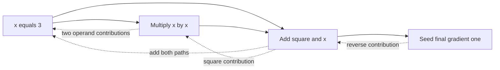

# Day 16 — Chain rule, computational graphs, and mini-autograd

## 1. Learning objectives

Represent scalar arithmetic as a directed acyclic computational graph. Derive
local pullbacks for addition, multiplication, powers, and nonlinear functions.
Implement reverse topological propagation with gradient accumulation and verify
shared-subexpression behavior numerically. Required competency: Level 3 independent
implementation, with Level 4 debugging of missing gradient contributions.

## 2. Required prerequisites

[Day 15](../day-03/README.md) makes every forward-layer operation explicit.
[Day 12](../../week-02/day-06/README.md) derives the chain rule and finite differences.
[Week 1 Day 3](../../week-01/day-03/README.md) supplies functions, references, and
sets. A graph is introduced below; no graph-algorithm background is assumed.
Reproduce the derivative of (3x+1)² before proceeding to automation.

## 3. Problem motivation

A network may reuse one parameter in many operations. Hand-deriving one large
formula is error-prone and repeated finite differences require many forward
runs. Automatic differentiation records small operations and combines their
known local derivatives. The main engineering danger is losing contributions
when a value feeds multiple paths. A program that computes forward values
correctly can still silently train with incorrect gradients.

## 4. Intuitive explanation

Draw a receipt for each arithmetic operation: its inputs, output, and rule for
sending influence backward. Start with one unit of influence at the final loss.
Pass influence toward inputs in reverse dependency order. If two routes meet
at the same input, add their contributions. Think of tributaries joining a
river: replacing one flow with another loses water, just as assigning instead
of accumulating gradients loses an entire path's derivative.

## 5. Deep technical explanation

A computational graph has nodes for values and directed edges from an input
to the operation result depending on it. The graph is acyclic because each
new result depends on already-created nodes. A topological ordering visits
parents before children. Reverse that order for backpropagation so every
consumer contribution reaches a node before its own pullback runs.

Our Value object stores data, grad, parent references, operation label, and a
pullback function. Operator methods compute forward data immediately and create
one new result. Their closures retain references to operands and result. Addition
sends output.grad to both inputs; multiplication sends other.data times output.grad
to each respective input. Constant scalar powers use p*x^(p−1). Log requires
positive input; division is multiplication by a reciprocal. ReLU selects derivative
zero at exactly zero, a convention at a nondifferentiable point.

The visited set in topological traversal prevents processing a shared node
more than once. It must not erase the two operand roles inside a multiply:
for x*x the same object contributes through both positions. The local pullback
therefore performs two += operations even if operand identities match. Parent
iteration uses an ordered tuple; visited tracks membership, not execution order.
This helps keep floating-point accumulation reproducible for a fixed graph.

`backward()` in our implementation clears the reachable graph's gradients,
sets the root gradient to one, and runs pullbacks in reverse topological order.
Calling it twice recomputes the same gradients rather than doubling them. This
is an explicit contract that differs from libraries that accumulate across
calls. Full-batch training builds one scalar total loss before backward. Do
not assume a loop of separate backward calls accumulates a batch here.

The graph holds forward values used by derivatives. Changing parameter data
before backward can invalidate those saved assumptions. Build a new forward
graph after every parameter update, and update only after backward has finished.
This scalar engine is inspectable, not production-efficient: each arithmetic
operation allocates Python objects and closures. Large recursive graphs can
also exceed Python recursion depth. The learning workloads are deliberately small.

## 6. Mathematical foundations

Let a=x*x and y=a+x. At x=3, a=9 and y=12. Seed dy/dy=1. Addition gives
dy/da=1 and one direct contribution dy/dx=1. Multiplication contributes x from
each operand role, totaling 3+3=6. Accumulation yields dy/dx=1+6=7.

For a shared intermediate a=x*x and y=a+a, addition gives a.grad=2, not 1.
Then multiplication gives x.grad=2x*a.grad=4x, which is 12 at x=3. If an
implementation overwrites a.grad, it returns 6 and can appear correct on graphs
without sharing. These fixtures are therefore essential rather than decorative.

With V graph nodes and E operand references, traversal and propagation cost
O(V+E), assuming constant-cost scalar operations. Finite differences for P
parameters require approximately 2P forward evaluations. Reverse mode gets
all gradients of one scalar loss in one backward traversal, at the cost of
retaining intermediate graph state. That output/input ratio motivates its use.

## 7. Architecture and execution diagrams



Solid edges describe forward dependence; dotted edges describe derivative flow.
The diagram has two logical roles for x in multiplication even when drawn as
one shared value node. Count operand roles in the pullback, not visual arrows alone.

## 8. Implementation from first principles

```python
from forgeagent.autograd import Value
from forgeagent.math_basics import derivative

x = Value(3)
y = x*x + x
y.backward()
assert y.data == 12 and x.grad == 7
numerical = derivative(lambda z: z*z+z,3)
assert abs(numerical-x.grad) < 1e-5
y.backward()
assert x.grad == 7
print(x)
```

[autograd.py](../../../forgeagent/autograd.py) contains the full engine. Read
add and multiply before nonlinear operations. Inputs are scalar Value objects
or numeric constants wrapped by operator methods; output is a new Value.
`backward` mutates gradients only. Unsupported log domains raise explicitly.
The example checks a shared leaf and our reset-on-backward semantics.

## 9. Worked execution walkthrough

Construct x, then multiply to create an intermediate with parents (x,x), then
add x to create y. Traversal visits x once, then multiply, then add. Clear
three gradient fields. Set y.grad=1. Add increments intermediate.grad and x.grad.
Multiply then increments x.grad twice, bringing it to 7. No parameter data
changes. Repeating backward first clears gradients, so the result remains 7.
Only a later optimizer step changes data and demands a fresh graph.

## 10. Independent laboratory

Implement a minimal `Scalar` with addition, multiplication, and backward using
[Week 3 contracts](../../../labs/week-03/README.md). Support numeric constants,
shared leaves, shared intermediate nodes, and repeatable reset semantics.
Deliver topology trace, local derivative reasoning, finite-difference checks,
and a test that fails if += becomes assignment. Run the day-4 contract. Add
powers/nonlinearities only after the core two operations pass; the full reference
is separate so you can reconstruct the central mechanism independently.

## 11. Experiments

Compare x*x+x with x*x alone, then a+a with the shared a=x*x. Record every
node's gradient and the analytic expected result. Deliberately replace += with
= in a disposable copy and observe which tests expose lost paths. Compare
numerical derivative error over several h values. Measure graph-node growth
as you repeat a fixed expression; distinguish graph size from number of unique
parameters and do not extrapolate toy timings to tensor-library training.

## 12. Failure analysis

Wrong gradients only on repeated operands usually indicate overwritten contributions.
Wrong gradients everywhere may indicate missing root seed or reversed traversal.
Correct first call but doubled second call violates this engine's reset contract.
A correct derivative before data mutation but incorrect one after suggests
forward/backward state inconsistency. Diagnose the smallest scalar graph first,
not a full network. Preserve operation labels and parents for inspection rather
than logging every training-example value into production traces.

## 13. Engineering tradeoffs

Reverse mode is efficient for many inputs and one scalar loss, but retains
intermediates. Forward mode has different input/output tradeoffs. Symbolic
calculus rewrites formulas; numerical differences approximate them; automatic
differentiation applies exact local rules to the executed program, subject to
floating-point arithmetic. Scalar objects maximize teaching visibility while
batch tensors provide practical performance. Understand the mechanism before
claiming a framework is doing something fundamentally different.

## 14. Real-world connection

Tensor autograd systems scale these principles with vectorized kernels, storage
management, and richer operation rules. Agent-runtime state graphs are different:
a tool call need not be differentiable and an agent's execution history is not
normally backpropagated. Similar diagrams do not imply the same mathematical semantics.

## 15. Common misconceptions

“Autograd estimates gradients with tiny perturbations”: not this reverse-mode
engine. “A node used twice should be visited twice”: visit once after all
contributions, but account for every operand role. “A gradient is a parameter”:
it is a computed rate used to update a parameter later.

## 16. Technical examination

Define a computational graph and topological order. Derive gradients for shared
a+a. Implement the two-operation engine. Debug overwrite instead of accumulation.
Defend reverse mode versus finite differences for a scalar loss with many
parameters. Use [separate criteria](../../../solutions/examinations/week-03.md) afterward.

## 17. Daily mastery gate

Pass shared-node and reset tests, compare at least three analytic/numerical
derivatives, and score 4/5 including coding. Draw the first incorrect node in
an intentionally broken pullback. A correct forward value alone cannot pass
this gate; the derivative is the assessed behavior.

## 18. Resources

[Karpathy micrograd](https://github.com/karpathy/micrograd), free MIT-licensed
reference, 30 minutes comparison after implementing your version.
[PyTorch autograd tutorial](https://docs.pytorch.org/tutorials/beginner/basics/autogradqs_tutorial.html),
25 minutes, illustrates larger-library semantics. Compare accumulation contracts
explicitly. No source copying or PyTorch installation is required for these labs.

## 19. Revision and retention

Tomorrow reconstruct a multiplication pullback without notes. In three days
explain the shared-node counterexample. In one week derive log/exp local rules
and check them numerically on valid domains. Keep a drawing of object identity
so algebraic names do not hide shared references.

## 20. Next lesson connection

[Day 17](../day-05/README.md) trains the network from Day 15 using this engine.
We can now compute all parameter gradients, but evaluation discipline must
still determine whether the resulting model learned useful behavior.
