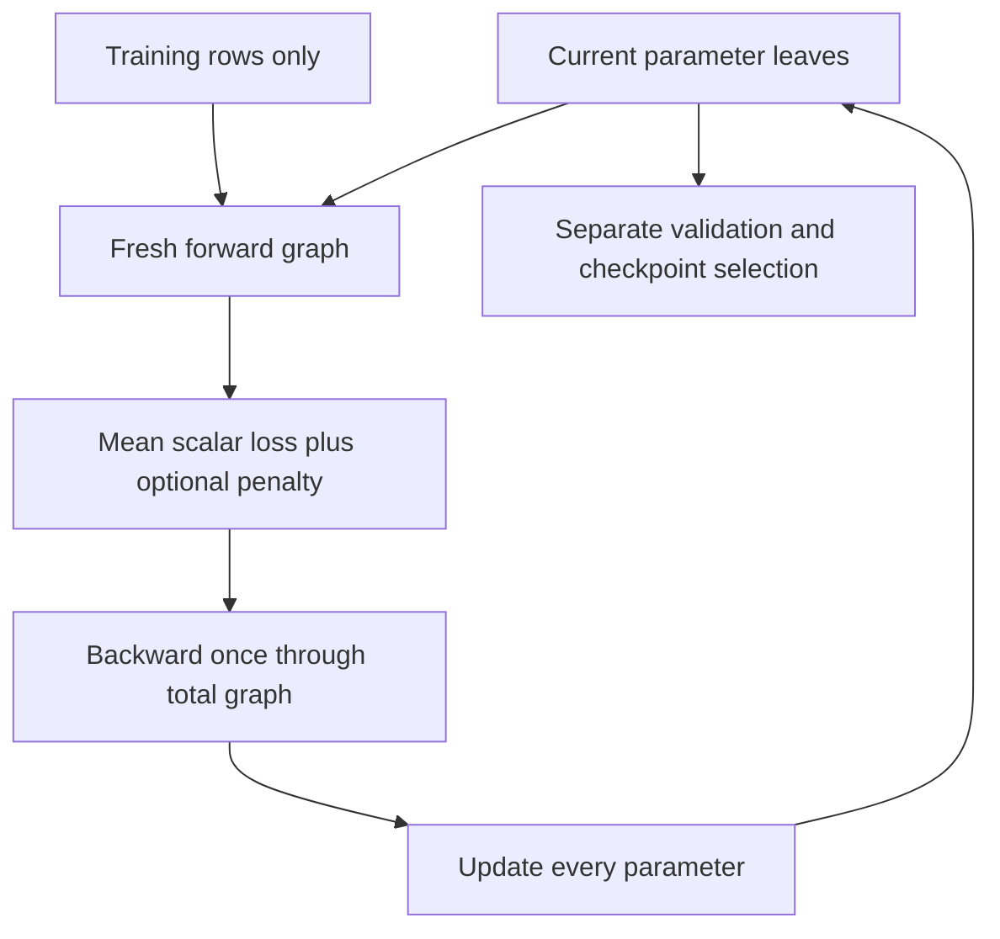

# Day 17 — Backpropagation, neural networks, and generalization

## 1. Learning objectives

Connect a parameterized forward pass, scalar loss, backward graph, and optimizer
update into a finite training loop. Explain generalization, overfitting,
regularization, and validation-based model selection. Train and inspect a tiny
XOR network while stating what its success does and does not demonstrate.
Required competency: Level 3, with debugging/adaptation evidence.

## 2. Required prerequisites

[Day 16](../day-04/README.md): reverse-mode accumulation and reset semantics.
[Day 15](../day-03/README.md): affine/nonlinear layers.
[Day 13](../day-01/README.md): partition roles. Be able to derive a multiplication
pullback and count MLP parameters. If backward is still unexplained magic,
return to a shared scalar graph before running a training loop.

## 3. Problem motivation

A correct derivative engine is not yet a trained model. We must enumerate all
parameters, construct the intended loss, update at the right time, and assess
behavior outside fitting. Bugs can leave half the parameters unchanged or
reuse a stale graph. A falling training curve can also be entirely legitimate
while validation worsens. These require different diagnoses: implementation
correctness and statistical generalization are separate questions.

## 4. Intuitive explanation

The forward pass proposes answers, loss measures their errors, backward assigns
local change signals, and the optimizer takes one controlled step. Repeat on
permitted examples. Overfitting resembles memorizing practice answers without
learning transferable structure. Regularization restricts some ways of fitting,
not by guaranteeing truth but by preferring certain simpler or less extreme
parameter settings under the chosen model and data assumptions.

## 5. Deep technical explanation

The reference network has two inputs, four tanh hidden units, and one scalar
output. All seventeen parameters are Value leaves. Each training step constructs
predictions for four XOR rows and combines their squared errors into one mean
loss. One backward call then reaches every parameter used by that total graph.
Only afterward does the loop subtract learning-rate times gradient from each
parameter's data. The next step reconstructs the forward graph.

Enumerating parameters is an explicit architectural responsibility. Omitting
biases or one layer can produce a partially trained model that looks plausible.
A parameter-gradient check perturbs one leaf, recomputes the entire forward loss,
and compares its finite difference to the current backward result. Restore the
original value after each perturbation. Do not perturb after backward and then
run old pullbacks as if their saved forward assumptions remained unchanged.

Generalization concerns performance on a target population beyond fitted rows.
Overfitting is consistent with optimization working correctly: the model fits
training-specific noise or patterns that do not transfer. Validation can choose
hidden width, learning rate, stopping time, or regularization. Test data must
remain outside those decisions. The four-row XOR demonstration intentionally
uses its entire tiny truth table to show expressivity/optimization; it is not a
credible held-out generalization benchmark. Label that limitation explicitly.

L2 regularization adds λΣθ² to the objective for selected parameters. Its
additional gradient is 2λθ. Define whether biases are included and whether
normalization by parameter count is used; these choices change the coefficient's
meaning. Regularization can reduce extreme weights but can also underfit.
Early stopping selects a checkpoint from validation loss, requiring saved
parameter values rather than a reference to a mutable model object that continues
changing. Dropout is another technique, but requires distinct training/inference
behavior; it is not necessary for this minimal CPU demonstration.

Repeated seeds reveal optimization variability. A deterministic fixture is useful
for regressions, while a reliability claim needs a predeclared repeated-trial
protocol. Do not select only the best seed and call it typical. Record the
architecture, data, rate, steps, seed, and metric definition alongside results.
These habits will transfer directly to stochastic agent evaluations.

## 6. Mathematical foundations

For network fθ and four rows, L=(1/4)Σ(fθ(xᵢ)−yᵢ)². The output derivative for
row i is (2/4)(fθ(xᵢ)−yᵢ). Backward multiplies this by each downstream local
derivative and accumulates shared-parameter paths. A tanh hidden unit contributes
1−h²; its weight contribution also multiplies the corresponding input coordinate.
This is the chain rule across exactly the operations traced yesterday.

If a parameter θ=.5 has data-gradient .2, λ=.1 adds 2×.1×.5=.1, yielding total
.3. With rate .05, the update is .5−.05×.3=.485. Compare with .49 without the
penalty. The shrinkage interpretation depends on this squared-penalty convention;
other normalization choices require a different numeric coefficient.

Training compute grows with rows times forward/backward graph work times steps.
Full-batch graph memory retains all row computations until backward. A larger
batch or wider hidden layer increases memory and time even when the source code
still fits in a few lines.

## 7. Architecture and execution diagrams



Validation measures without contributing gradients. Checkpointing here means
saving numerical parameter values; durable agent task checkpoints taught later
have additional event/effect semantics and cannot be equated with model weights.

## 8. Implementation from first principles

```python
from forgeagent.learning import train_xor

model, losses = train_xor(steps=300, rate=0.1, seed=7)
assert len(model.parameters()) == 17
assert losses[-1] < losses[0]
rows = [([-1,-1],-1),([-1,1],1),([1,-1],1),([1,1],-1)]
for features, target in rows:
    score = model(features).data
    assert (score > 0) == (target > 0)
print("finite XOR demonstration passed")
```

The [complete training loop](../../../forgeagent/learning.py) uses only our scalar
engine. Inputs are explicit hyperparameters and fixed educational data; outputs
are a model and measured training-loss history. No GPU, framework, or remote
inference is involved. The assertions describe this seeded demonstration,
not every seed, dataset, or architecture. The final history entry is measured
before the final update, a reporting detail worth documenting.

## 9. Worked execution walkthrough

Initialize distinct seeded weights and zero biases. For each of four feature
pairs, compute hidden weighted sums, tanh activations, output, and squared residual.
Add losses, divide by four, and call backward once. Traverse the graph, gathering
all row contributions into shared parameter leaves. Read each gradient, update
its parameter data, discard the old loss graph, and rebuild next iteration.
After the finite budget, inspect signs for all four truth-table entries.

## 10. Independent laboratory

Implement `update(parameters, rate)` and a finite training loop from the
[Week 3 lab](../../../labs/week-03/README.md). You may use the supplied Value/MLP
as already-mastered components; do not delegate the loop. Validate positive finite
rate, update every leaf once after backward, and preserve the gradient values
for inspection. Add one finite-difference parameter check and an optional L2
term with its analytic derivative. Run the day-5 public contract; report the
XOR exercise as optimization evidence, not a held-out accuracy result.

## 11. Experiments

Hold data fixed and compare five predefined seeds at the same rate and step
budget. Record final loss and sign accuracy for every run. Add L2 strengths
0,.001,.1 and measure weight norm and training loss separately. On a separate
noisy synthetic regression split, track train/validation curves; do not tune
on the test set. Distinguish a regularization effect from simply reducing the
number of effective updates. Save numerical snapshots when testing early stopping.

## 12. Failure analysis

If no learning occurs, verify parameters are reached by the loss graph and all
appear in the update list. If loss changes unpredictably, inspect graph reuse
and whether parameters mutate before backward. If a saved “best model” changes
later, copy numeric values rather than aliasing a mutable object. If training
improves while validation worsens, implementation may be correct but overfitting;
use the declared selection rule and retain the unfavorable evidence.

## 13. Engineering tradeoffs

A full-batch toy loop is easy to inspect but scales poorly. Gradient accumulation
can lower peak memory when explicitly implemented; our engine resets on backward,
so separate calls need deliberate aggregation. Regularization trades fitting
capacity against an inductive preference and introduces tuning choices. Early
stopping needs checkpoint storage and validation discipline. Reproducibility
supports debugging while repeated runs reveal variability; neither replaces
an honest data boundary or sound metric.

## 14. Real-world connection

LLM pretraining uses much larger parameter/data systems, but forward/loss/backward/
update remain core concepts. Most agent infrastructure does not retrain a model
for every task. It improves reliability through retrieval, tool policies, state,
and evaluation. This distinction helps engineers choose whether a failure calls
for model changes or application changes.

## 15. Common misconceptions

“Autograd updates weights”: it computes gradients; the optimizer updates data.
“Training success on XOR proves generalization”: this exercise fits a tiny known
table. “Regularization guarantees better validation”: it can hurt too. “A model
reference is a frozen checkpoint”: mutable parameter objects keep changing.

## 16. Technical examination

Explain the four training stages. Trace one regularized scalar update. Implement
a parameter update loop. Debug a stale graph or omitted bias. Defend validation
selection and repeated seeds without test contamination. Reference criteria are
[separate](../../../solutions/examinations/week-03.md).

## 17. Daily mastery gate

Pass update and seeded XOR checks, verify one parameter numerically, and score
4/5 including independent loop implementation. Identify the scope of every
reported metric and show a real failing-and-fixed training defect. Do not
claim held-out performance from the four fitted XOR examples.

## 18. Resources

[Google dataset partition guide](https://developers.google.com/machine-learning/crash-course/overfitting/dividing-datasets),
20 minutes review of evaluation boundaries.
[PyTorch autograd tutorial](https://docs.pytorch.org/tutorials/beginner/basics/autogradqs_tutorial.html),
25 minutes comparison after the custom loop. Both free; compare their semantics
with the explicitly documented reset behavior of our teaching engine.

## 19. Revision and retention

Tomorrow reconstruct the optimizer order without notes. In three days implement
a scalar L2 penalty and check its derivative. In one week explain why passing
implementation tests and good generalization are distinct evidence. Connect
mutable model checkpoint bugs to Week 1's aliasing lesson.

## 20. Next lesson connection

[Day 18](../day-06/README.md) turns observed character transitions into a language
model. This introduces conditional prediction, likelihood, and generation before
the transformer adds learned context representations in Week 4.
