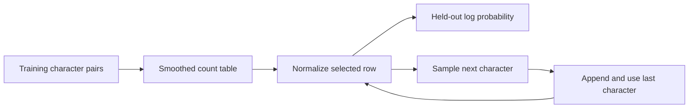

# Day 18 — Character language models and evaluation

## 1. Learning objectives

Define a language model as a conditional distribution over possible next symbols.
Implement smoothed character bigram counts, normalized next-character probabilities,
negative log-likelihood evaluation, and seeded generation. Explain limited context,
unseen events, perplexity, and the difference between fluent samples and measured
quality. Required competency: Level 3 independent implementation.

## 2. Required prerequisites

[Day 13](../day-01/README.md): partition boundaries.
[Day 11](../../week-02/day-05/README.md): conditional probability and finite events.
[Day 12](../../week-02/day-06/README.md): logarithms and normalization.
[Week 1 Day 3](../../week-01/day-03/README.md): frequency dictionaries. You should
compute a three-entry normalized distribution and explain why log requires
positive input. No neural-network framework is necessary today.

## 3. Problem motivation

A language model does not need to begin as a giant neural network. Counting
which characters follow each other reveals the core next-symbol prediction
problem. It also exposes a fundamental failure: an unseen transition receives
zero probability and infinite log penalty unless we define a policy. A small
baseline makes these assumptions measurable before transformer complexity.
Generated examples alone can hide a model that assigns poor probability to
most held-out text.

## 4. Intuitive explanation

Imagine one table per current character. Its entries count possible following
characters. To predict, normalize a row into probabilities. To generate, choose
a following character according to that row, append it, and repeat. A bigram
model remembers only the immediately previous character. It cannot distinguish
two histories ending in the same character, even if their meanings are opposite.
Smoothing gives every vocabulary transition a little initial weight so unseen
but possible events remain representable.

## 5. Deep technical explanation

Fix a vocabulary before evaluating. This teaching model uses a sorted tuple of
known characters and rejects unknown ones. In real systems an unknown token,
byte vocabulary, or explicit fallback can extend coverage. Do not silently add
test characters to a learned vocabulary and claim an unchanged evaluation
contract. Our tiny fixtures may declare the alphabet externally as task metadata,
which is distinct from learning frequencies on test content.

For each adjacent training pair (cᵢ,cᵢ₊₁), increment the current-character row's
following-character count. Add positive smoothing α to every vocabulary entry
at initialization. The denominator includes every possible following character,
not only observed ones. Prediction returns a distribution with nonnegative
entries summing to one. Training mutates counts; inference reads them without
updating. Calling fit twice deliberately adds more observations, a contract
that must be documented when replaying ingestion.

Evaluation on text of length n uses n−1 adjacent transitions; the first character
is conditioned on rather than predicted by this model. Compute mean negative
log probability over those transitions. This differs from evaluating a full
sequence with a start-symbol distribution. A boundary token or explicit initial
model would extend it. Avoid transitions across unrelated documents unless
that is an intentional model choice; concatenating files creates artificial
boundary pairs.

Generation samples rather than trains. A local seeded random generator makes
a particular sampling procedure repeatable. A greedy rule chooses the most
likely next character and can enter repetitive loops. Stochastic sampling explores
lower-probability paths but cannot create dependencies absent from the model.
Neither smooth-looking output nor a fixed seed establishes semantic understanding,
factual grounding, or permission to execute generated text.

Negative log-likelihood allows a fixed held-out comparison against uniform or
unigram baselines. Compare identical vocabularies, boundary conventions, and test
units. Character-level perplexity is not numerically interchangeable with token-
level perplexity because different tokenizers create different prediction events.
Model quality also depends on the target population; a model of repeating toy
text is not an engineering evaluation of useful writing or coding ability.

## 6. Mathematical foundations

Vocabulary is {a,b}; training text `abab` contains transitions a→b twice and
b→a once. With α=1, row a has counts a:1,b:3, so P(b|a)=3/4. Row b has a:2,b:1,
so P(a|b)=2/3. Held-out `aba` has probabilities 3/4 and 2/3. Their product is
1/2. Mean NLL is −[ln(3/4)+ln(2/3)]/2=−ln(1/2)/2≈.34657.

Perplexity is exp(mean NLL), here √2≈1.4142. It is an effective uncertainty
measure under this event definition, not a percentage accuracy. A uniform two-
character predictor has NLL ln2≈.6931 and perplexity 2. This particular test
prefers the bigram model. It does not justify choosing α after seeing test results.

Storing all vocabulary-pair counts costs O(V²); fitting n characters costs O(n)
updates after initialization. A sparse representation can reduce storage for
large vocabularies, but smoothing normalization then needs careful handling of
unseen entries. The dense two-level dictionary is chosen for inspectability.

## 7. Architecture and execution diagrams



The count table receives training updates only. Generation follows the sampling
loop without an edge back into fitting. Evaluation reads a fixed model and
reports the predeclared event denominator.

## 8. Implementation from first principles

```python
import math
from forgeagent.learning import BigramModel

model = BigramModel('ab', alpha=1).fit('abab')
assert model.distribution('a') == {'a':0.25,'b':0.75}
assert math.isclose(model.nll('aba'), -math.log(0.5)/2)
assert model.generate('a',count=8,seed=7) == model.generate('a',count=8,seed=7)
assert len(model.generate('a',count=8)) == 9
print(model.distribution('b'))
```

[BigramModel](../../../forgeagent/learning.py) contains initialization, fitting,
normalization, log evaluation, and generation. The count parameter means appended
characters, so output includes the starting character plus count more. Unknown
training characters reject before any count mutation; evaluation rejects too-
short or unknown text. These operational contracts are separate from model quality.

## 9. Worked execution walkthrough

Initialize each of four pair counts to one. Fit reads three pairs and increments
only a→b, b→a, a→b. To evaluate `aba`, select row a then probability of b, followed
by row b then probability of a. Add negative logs and divide by two. To generate,
read the last character, sample a next one using that row, append, and repeat
until the finite count budget is exhausted. The model state remains unchanged.

## 10. Independent laboratory

Implement `distribution(text, vocabulary, current, alpha)` from the
[Week 3 lab](../../../labs/week-03/README.md). Initialize every possible next
symbol, count adjacent pairs, normalize the selected row, and reject unknown
symbols/invalid smoothing. Deliver the hand table, normalization tests, a case
with no observations for the selected row, and a held-out NLL calculation.
Run the day-6 public contract. Add seeded generation only after the conditional
distribution is independently correct; do not inspect the reference prematurely.

## 11. Experiments

Compare α=.1,1,10 on fixed training and validation text; record average NLL and
row probabilities. Strong smoothing moves predictions toward uniform. Compare
training and held-out NLL, preserving the test boundary. Generate twenty seeded
samples rather than selecting one attractive sample, and report repeated-character
loops. Then construct two histories sharing the final character but needing
different next symbols; show the bigram model must predict identically.

## 12. Failure analysis

Probabilities not summing to one usually indicate a wrong denominator or missing
smoothing mass. Infinite NLL can arise from zero probability without smoothing.
A denominator of n instead of n−1 silently changes the metric. Unexpectedly
strong test results may reflect fit called on test text or accidental document
boundary leakage. If generation changes counts, inspect shared mutable row
objects and keep inference read-only. Reproduce each defect on two characters.

## 13. Engineering tradeoffs

Bigram counts are cheap, transparent, and useful baselines, but limited to one
character of context. Larger n-grams add context while rapidly increasing sparse
state and unseen combinations. Neural models share learned representations and
can use longer context, at higher training and operational complexity. Smoothing
improves coverage while weakening sharp estimates. Choose comparisons by held-out
metrics and application requirements, not by entertaining samples alone.

## 14. Real-world connection

Autoregressive LLMs also predict the next token conditionally, but their context
representation and training scale differ substantially. A next-token distribution
is not an agent policy by itself; an application must interpret outputs, validate
tools, enforce budgets, and evaluate effects. Today's count model is educational,
not a substitute for a modern language model or a grounded answer system.

## 15. Common misconceptions

“Generation is training”: sampling does not update these counts. “Perplexity is
accuracy”: it measures assigned probability under defined units. “Smoothing
learns unseen meaning”: it allocates prior mass. “A fluent sample proves quality”:
it can be unrepresentative and says nothing about grounding or authorization.

## 16. Technical examination

Define a conditional language model. Derive the two-character table and NLL.
Implement smoothed distribution. Debug n versus n−1 normalization. Defend a
count baseline against a larger model for reproducibility and scope. Use
[separate answers](../../../solutions/examinations/week-03.md) after your attempt.

## 17. Daily mastery gate

Pass distribution and invalid-input tests, derive NLL by hand, and score 4/5
including coding. Explain an explicit context limitation and demonstrate read-
only inference. Then complete [Week 3 review](../weekly-review.md) before the
next week; passing a language-model sample alone cannot satisfy the gate.

## 18. Resources

[Google dataset guidance](https://developers.google.com/machine-learning/crash-course/overfitting/dividing-datasets),
15 minutes review for model-evaluation boundaries. [Attention Is All You Need](https://arxiv.org/abs/1706.03762),
Vaswani et al., free, optional abstract/architecture preview for Week 4. The
paper is not required to understand today's original count-model explanation.
No unverified video transcript is used as essential instruction.

## 19. Revision and retention

Tomorrow reconstruct a smoothed row without notes. In three days compute NLL
for a new three-character string. In one week compare character and model-token
evaluation units and explain why changing tokenization invalidates a direct
perplexity comparison. Connect the finite generation budget to prior loop invariants.

## 20. Next lesson connection

Week 4 starts with tokenization (see the [roadmap](../../../ROADMAP.md)), then learned
embeddings and attention. We will replace the bigram's one-character state with
an explicit causal context representation while preserving the next-symbol
prediction and evaluation contracts established today.
