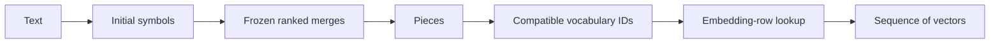

# Day 19 — Tokens, byte pair encoding, and embeddings

## 1. Learning objectives

Distinguish text characters, UTF-8 bytes, model token pieces, integer token IDs,
and embedding vectors. Implement deterministic pair merging and reversible toy
BPE. Trace an embedding lookup and explain vocabulary/version compatibility.
Required competency: Level 3 independent implementation, including boundary tests.

## 2. Required prerequisites

[Day 18](../../week-03/day-06/README.md) introduces conditional next-symbol models.
[Day 11](../../week-02/day-05/README.md) introduces vectors and dimensions;
[Day 4](../../week-01/day-04/README.md) distinguishes bytes and decoded text.
Be able to count character transitions and explain why changing prediction units
changes perplexity comparisons. Tokenization is taught here, not assumed knowledge.

## 3. Problem motivation

A character vocabulary is compact but creates long sequences; a whole-word
vocabulary can be huge and fail on unseen words. Subword schemes balance vocabulary
size and sequence length. Applications also need the exact model tokenizer for
context limits and accounting. A regex word count is not a reliable model-token
count. Passing incompatible IDs to embedding rows can produce meaningless values
without any obvious type error.

## 4. Intuitive explanation

Imagine replacing frequently adjacent letter tiles with one larger tile. Keep
a ranked list of allowed replacements and apply it consistently to future text.
Each resulting tile receives an integer ID. An embedding table then looks up
a row of numbers for that ID. The ID is an address, not a magnitude: token 100
is not semantically twice token 50. Learned row coordinates become useful through
training, not because the arbitrary integer ordering already encodes meaning.

## 5. Deep technical explanation

Byte pair encoding repeatedly finds a frequent adjacent pair in a training
symbol sequence and merges occurrences without overlap. Training chooses the
merge list; encoding applies the frozen list in rank order. Ties need a policy
for reproducibility. Our educational version starts from Unicode characters,
counts pairs over one sequence including whitespace, and breaks frequency ties
lexicographically. This is not a production byte-level tokenizer or an estimate
of any provider's token counts. Production systems may pretokenize, normalize,
reserve special IDs, or represent bytes to ensure coverage.

At each merge pass scan left to right. If the next two symbols match the pair,
append their concatenation and advance by two; otherwise append one symbol and
advance by one. For `aaa`, merging (a,a) yields [aa,a], not two overlapping aa
pieces. A later merge can combine pieces created by earlier ranks. Encoding
unseen text still preserves its character pieces in this toy representation;
constructing a fixed numeric vocabulary with unknown pieces requires an explicit
unknown or byte fallback policy. Do not hide that missing production feature.

An embedding matrix E has V rows and d columns. Token ID t selects E[t], a
d-vector; algebraically this equals multiplying E-transpose by a V-dimensional
one-hot vector with one at t. Lookup avoids materializing that sparse vector.
Only accessed rows receive direct lookup contributions in this step's backward
graph, though shared model losses and optimizer behavior affect overall training.
Our decoder accepts integer IDs already mapped into a fixed vocabulary.

Embeddings are learned parameters, while the tokenizer's merge vocabulary is
separately fitted/configured. Save tokenizer version, ID assignment, model weights,
and special-token conventions together. Retokenizing with a different merge list
can change sequence length and numeric IDs. A model's learned positional table
also bounds accepted context positions; shorter tokenization can fit more text
but does not create unlimited reasoning or factual accuracy.

## 6. Mathematical foundations

Start `abab` as [a,b,a,b]. Pair (a,b) appears twice; (b,a) once. Merge (a,b)
to get [ab,ab]. A second pass merges (ab,ab) into [abab]. Encoding with only
the first merge yields two pieces; decoding concatenates them back to `abab`.
This roundtrip proves reconstruction under this policy, not linguistic quality.

For E=[[.1,.2],[.3,.4],[.5,.6]], token ID 1 selects [.3,.4]. The table has
Vd=3×2=6 parameters. A sequence of n tokens creates n embedding rows in its
activation representation, while the table still has Vd parameters. A simple
BPE implementation making r full scans of length at most n costs roughly O(rn)
plus pair-count bookkeeping; optimized trainers use more elaborate update structures.

## 7. Architecture and execution diagrams



Each representation has a different contract. Piece strings and numeric IDs are
not interchangeable. The ID map must match the embedding table trained with it.
Text reconstruction is checked before interpreting later numerical outputs.

## 8. Implementation from first principles

```python
from forgeagent.tokenization import learn_merges,encode,decode

merges = learn_merges('abab',steps=1)
assert merges == [('a','b')]
pieces = encode('abab',merges)
assert pieces == ['ab','ab']
assert decode(pieces) == 'abab'
assert decode(encode('café!',merges)) == 'café!'
embeddings = [[.1,.2],[.3,.4],[.5,.6]]
assert embeddings[1] == [.3,.4]
print(pieces)
```

[tokenization.py](../../../forgeagent/tokenization.py) implements left-to-right
nonoverlapping merges. Inputs are text and a finite merge count; output is a
ranked pair list or piece list. Empty text roundtrips to empty. Negative merge
count rejects. Numeric ID-map compatibility is illustrated explicitly rather
than pretending this toy string-piece tokenizer supplies provider-compatible IDs.

## 9. Worked execution walkthrough

Count three adjacent pairs, select (a,b), scan from index zero, consume a/b,
then consume the second a/b. Two merged pieces remain. Encoding follows the
same single frozen merge, and decoding joins pieces exactly. Embedding lookup
then uses a declared ID map, not alphabetical guesses at runtime. Changing the
map without changing rows can keep array shapes valid while silently changing
which learned representation each piece receives.

## 10. Independent laboratory

Implement `merge(symbols,pair)` and `encode(text,merges)` from the
[Week 4 lab](../../../labs/week-04/README.md). Require left-to-right nonoverlap,
rank-ordered application, unchanged caller lists, empty/Unicode roundtrips, and
explicit preservation of whitespace. Run the day-1 contract with your own
module. Deliver a hand trace for `aaa`, a two-rank example, and a table mapping
three pieces to embedding rows. Do not use an external tokenizer to hide the
assessed merging mechanism.

## 11. Experiments

Vary merge count on fixed text and record piece count and distinct piece vocabulary.
Test one training-like string and one unrelated string without refitting merges.
Compare character, byte, regex-word, and toy-piece counts on non-ASCII text;
explain why none automatically equals a hosted model's usage. Reorder merge ranks
and find a changed encoding while preserving reconstruction. The measured
tradeoff is representation length, not language-model quality or monetary cost.

## 12. Failure analysis

Overlapping merges duplicate characters; use `aaa` to reproduce and check decode
against input. Sorting merges alphabetically after training destroys rank semantics.
Dropping whitespace may preserve words but break source-code reconstruction.
A mismatched ID map can produce plausible vectors with wrong meaning; version
and compare tokenizer/model metadata. If an embedding index is out of range,
reject it instead of wrapping modulo vocabulary size and silently substituting
an unrelated token.

## 13. Engineering tradeoffs

Character tokens simplify coverage but lengthen contexts. Whole-word tokens can
shorten familiar text but expand vocabulary and unknown-word problems. Subword
merging balances these costs, with training-data and normalization choices.
A larger embedding vocabulary raises parameter/memory cost. Exact tokenizer
compatibility matters more for application accounting than an attractive average
characters-per-token heuristic. For retrieval, a separate lexical tokenizer may
remain useful if its role is explicitly distinguished.

## 14. Real-world connection

Provider APIs meter and limit model tokens, not Python words. Coding systems
must preserve source bytes/text faithfully when inspecting or patching code,
even if a model tokenizer uses a different internal representation. The toy
algorithm teaches merging and compatibility without asserting undocumented
provider vocabulary details.

## 15. Common misconceptions

“A token is a word”: it may be a subword, byte fragment, special symbol, or
other unit. “An ID is an embedding”: it indexes an embedding. “Reversible means
semantically good”: reconstruction and useful learned representation are different.
“Tokenizer training updates model weights”: these are separate fitting mechanisms.

## 16. Technical examination

Explain all five representations. Trace nonoverlapping merges on `aaa`. Implement
ranked encoding. Debug an incompatible ID map. Defend vocabulary-size versus
sequence-length tradeoffs using measured counts. Use [separate answers](../../../solutions/examinations/week-04.md)
after the independent attempt.

## 17. Daily mastery gate

Pass roundtrip, overlap, rank-order and no-mutation tests. Trace one unseen
merge sequence and embedding lookup without code. Score 4/5 including implementation.
Explain why toy token counts cannot be reported as provider charges. Record a
reproduced compatibility failure and its correction.

## 18. Resources

[Hugging Face BPE chapter](https://huggingface.co/learn/llm-course/en/chapter6/5),
free, 35 minutes, compare ranked merging after implementing independently.
[Original transformer paper](https://arxiv.org/html/1706.03762v7), embedding section,
15 minutes optional. The resource ledger records full-text versus abstract access.
No installed Hugging Face runtime is required for this chapter.

## 19. Revision and retention

Tomorrow reconstruct the ID-to-vector boundary closed book. In three days derive
an overlapping-pair counterexample. In one week compare tokenizer compatibility
with JSON schema compatibility: both can preserve apparent shape while changing
meaning. Keep exact representation/version assumptions in technical notes.

## 20. Next lesson connection

[Day 20](../day-02/README.md) adds position vectors and separate query/key/value
projections. Embeddings provide token content; positions and attention roles
allow the decoder to build a context-dependent representation from that content.
