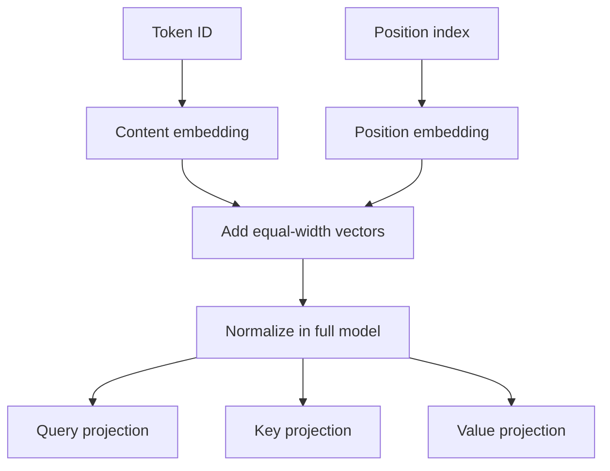

# Day 20 — Positions, queries, keys, and values

## 1. Learning objectives

Explain why token content alone does not encode order. Construct learned position
additions, project hidden vectors into queries/keys/values, and trace dimensions
and parameter ownership. Distinguish attention's comparison representation from
the payload it mixes. Required competency: Level 3 independent implementation.

## 2. Required prerequisites

[Day 19](../day-01/README.md): token IDs and embedding rows.
[Day 15](../../week-03/day-03/README.md): affine maps and explicit matrix orientation.
[Day 11](../../week-02/day-05/README.md): dot products and shape checks. Be able
to multiply a nonsquare matrix by a vector and distinguish a stored parameter
from the activation computed using it. Attention is introduced progressively;
full masking and normalization follow tomorrow.

## 3. Problem motivation

A collection of token vectors does not by itself distinguish “tests follow edits”
from “edits follow tests.” Order changes meaning and allowed dependencies.
Attention also needs a way to compare the current location with other locations
without directly averaging token IDs. We therefore add position information and
learn separate comparison and payload projections. Treating names such as query
as magical reasoning labels prevents understanding their simple numerical role.

## 4. Intuitive explanation

Think of each token wearing a name badge and a seat number. Adding a position
vector combines content with location. A query is the current location's search
pattern, keys are patterns other locations advertise, and values are numerical
payloads to combine after comparison. The analogy is useful only to locate roles:
all three are learned vector transformations, not literal database search terms
or guaranteed human-readable questions and answers.

## 5. Deep technical explanation

For token tᵢ at position i, the toy decoder forms hᵢ=E[tᵢ]+P[i], where both rows
have model width d. E and P are learned matrices. The same token at two positions
shares its content row but receives different position rows. Learned absolute
positions have a finite table; our implementation rejects context beyond its
configured length. Silently wrapping positions would create untrained aliases.
The original transformer paper describes a different sinusoidal positional
scheme; other designs use rotary or relative positions. Those are alternatives,
not required internals of our educational model.

The decoder normalizes hᵢ before projection, following its documented pre-normalized
architecture. It computes qᵢ=Wq*norm(hᵢ), kᵢ=Wk*norm(hᵢ), vᵢ=Wv*norm(hᵢ).
All three matrices are distinct learned parameters. In our row-per-output
implementation each is d×d, producing d-vectors subsequently split into heads.
More generally query/key width must agree for dot comparison, while value width
can differ if the output projection accommodates it. The toy uses equal widths
to keep shapes visible.

The same projection matrices are reused at every token location, so training
accumulates their contributions across positions. Position parameters differ
by position. Token rows differ by ID. These sharing choices determine what
state grows with vocabulary, context, and sequence length. Activations q,k,v are
computed per sequence and do not become additional learned parameters.

Queries and keys are compared later through scaled dot products. Values supply
what gets weighted by the resulting distribution. Using identical matrices for
all three is mathematically possible but constrains the learned representation.
Using raw token IDs in dot products instead makes arbitrary vocabulary numbering
matter as a metric and does not implement the intended learned mechanism.

## 6. Mathematical foundations

Let token embedding e=[1,0] and position p=[0,1], giving h=[1,1]. For today's
isolated projection exercise omit normalization explicitly so arithmetic stays
small. Wq=[[1,0],[0,2]] gives q=[1,2]; Wk=[[0,1],[1,0]] gives k=[1,1];
Wv=[[1,1],[1,−1]] gives v=[2,0]. A later attention score q·k=3 compares roles,
but the payload available to mix is v, not k. Omitting normalization here is
a declared exercise simplification; the full model includes it.

Three dense d×d matrices contain 3d² scalar parameters, excluding biases.
For d=4 this is 48. Sequence length n creates 3nd projection activations.
Computing all dense projections is O(nd²). Position addition itself is O(nd).
These costs differ from the O(n²) pairwise comparisons tomorrow, so a claim
that “attention is quadratic” does not describe every operation in a decoder.

## 7. Architecture and execution diagrams



The three outgoing projections receive the same hidden input but use different
parameter matrices. They are not three requests to a language model. The
normalization box is explained from first principles in Day 22.

## 8. Implementation from first principles

```python
from forgeagent.learning import affine

embedding, position = [1,0], [0,1]
hidden = [a+b for a,b in zip(embedding,position)]
q = affine(hidden,[[1,0],[0,2]],[0,0])
k = affine(hidden,[[0,1],[1,0]],[0,0])
v = affine(hidden,[[1,1],[1,-1]],[0,0])
assert q == [1,2] and k == [1,1] and v == [2,0]
print(q,k,v)
```

Inputs are equal-width vectors and explicit matrices; outputs are role-specific
vectors. The [full decoder](../../../forgeagent/transformer.py) performs lookup,
position addition, normalization and projections with Value objects so gradients
remain visible. Its `_check_token` rejects noninteger or out-of-vocabulary IDs
and exhausted context. It does not silently crop history or reuse position rows.

## 9. Worked execution walkthrough

Look up token row and position row separately. Add coordinatewise to get [1,1].
Each query row multiplies the same hidden coordinates, giving [1,2]. Key rows
swap coordinates, giving [1,1]. Value rows sum/difference coordinates, giving
[2,0]. All outputs have width two. In the full model, normalize before applying
these learned matrices; do not compare the isolated fixture's numeric result
with a normalized forward pass and call the difference a bug.

## 10. Independent laboratory

Implement `project(embedding,position,wq,wk,wv)` from the
[Week 4 contract](../../../labs/week-04/README.md). Add equal-width vectors and
apply row-per-output projections without normalization for this isolated task.
Require matching input dimensions and equal query/key widths, and return q,k,v.
Deliver a nonsquare example, parameter count, unchanged-input test and mismatch
rejection. Run the day-2 public check. Explain exactly where this helper fits
into the full pre-normalized model rather than pretending it is an entire layer.

## 11. Experiments

Hold the token fixed and change position; record projected values. Then hold
position fixed and change token. Swap key and value matrices and observe which
later calculation would change. Set all positions to zero and compare sequences
with permuted tokens, discussing what order information remains from causal
structure versus content encoding. Parameter-controlled experiments illuminate
dependence; they do not prove that a trained model learns a particular semantic role.

## 12. Failure analysis

Identical q,k,v under deliberately different fixture matrices suggests aliased
matrix storage or projection reuse. A shape mismatch hidden by zip can drop
coordinates; validate before arithmetic. Different positions producing identical
content-only vectors may mean position addition was omitted. Context overflow
must fail explicitly. If a cache is reused across model updates, stored projections
become stale even though their dimensions remain valid; versioning matters later.

## 13. Engineering tradeoffs

Learned absolute positions are straightforward but impose a fixed table and
extrapolation limits. Other position schemes support different generalization
and inference properties with more implementation detail. Separate Q/K/V maps
increase parameter count but decouple comparison and payload. Bias-free maps
simplify our model; adding biases is a legitimate extension requiring new
parameter counts and gradient tests. Optimize after preserving shape contracts.

## 14. Real-world connection

Context-sensitive representations are central to transformers, while application
context engineering decides which text reaches that model. These are different
layers of responsibility. Adding relevant evidence to an agent prompt does not
edit the model's projection matrices. No proprietary attention or positional
implementation is inferred from public product names.

## 15. Common misconceptions

“Query means the user's text question”: here it is a computed vector per token.
“Keys are database identifiers”: they are learned comparison vectors. “Position
addition changes token IDs”: it changes activations after lookup. “Every transformer
uses this position method”: architectures differ and must be documented.

## 16. Technical examination

Explain content versus position. Compute all three projections. Implement shape-
checked projection. Diagnose accidental Q/K/V aliasing. Defend equal versus
different key/value widths under an output contract. Compare with
[separate answers](../../../solutions/examinations/week-04.md) after your attempt.

## 17. Daily mastery gate

Pass projection/no-mutation/boundary tests, derive 3d², and score 4/5 including
coding. Trace an unseen matrix fixture and explain where normalization was
intentionally omitted. Record a position-related failure and show the corrected
state rather than simply reporting a successful run.

## 18. Resources

[Attention Is All You Need](https://arxiv.org/html/1706.03762v7), sections 3.2,
3.4, and 3.5, free, 35 minutes targeted reading after this chapter. Distinguish
the paper's architecture from our one-block pre-normalized decoder. The paper
provides primary context; original local derivations teach the necessary mechanism.

## 19. Revision and retention

Tomorrow draw Q/K/V roles from memory and annotate every width. In three days
reconstruct embedding-plus-position lookup. In one week explain which stored
objects are parameters and which are per-request cache state. Connect to earlier
ownership and stale-state failures in database and neural training examples.

## 20. Next lesson connection

[Day 21](../day-03/README.md) compares queries with permitted keys, normalizes
scores, and mixes values across multiple heads. Today's role and dimension
contracts prevent attention from becoming an unexplained matrix formula.
