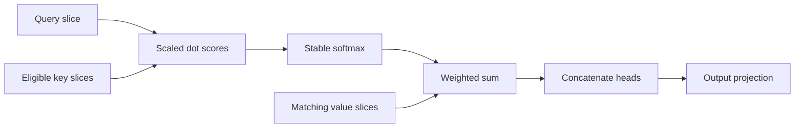

# Day 21 — Scaled attention, causal masks, and multiple heads

## 1. Learning objectives

Compute scaled dot-product attention, apply a causal dependency constraint before
normalization, and explain independent head subspaces and output projection.
Implement an inspectable attention head and demonstrate that future tokens
cannot change an earlier output. Required competency: Level 3 independent code
with explicit numerical and information-flow reasoning.

## 2. Required prerequisites

[Day 20](../day-02/README.md): Q/K/V roles and dimensions.
[Day 12](../../week-02/day-06/README.md): stable softmax.
[Day 16](../../week-03/day-04/README.md): differentiable scalar operations.
Reproduce a dot product and normalized exponential distribution before adding
masking. The mask controls which information may contribute, not just the order
in which Python happens to execute the calculation.

## 3. Problem motivation

A decoder predicting the next token must not see future answers during training.
Without a causal constraint it can exploit target-containing future context and
show misleadingly low loss. Attention also needs a stable way to distribute
weight among permitted locations. Multiple heads allow distinct learned subspaces,
but concatenating outputs requires a declared shape contract. This lesson tests
information flow, not merely whether matrix multiplication completes.

## 4. Intuitive explanation

At one position, compare its query with each eligible key. Convert comparison
scores into shares adding to one, then average the eligible values by those
shares. A causal rule closes the doors to future seats before shares are
calculated. Several heads repeat this process on different coordinate slices;
join their results and mix through an output projection. Heads are numerical
subspaces, not independent agents or guaranteed interpretable specialists.

## 5. Deep technical explanation

For one head, query q and each key kⱼ have width dₕ. Compute sⱼ=(q·kⱼ)/√dₕ.
Normalize eligible scores with stable softmax, then output Σⱼpⱼvⱼ. If query/key
coordinates have comparable independent unit variance, unscaled dot-product
variance grows roughly with dₕ; dividing by √dₕ controls that initial scale.
Those assumptions motivate the factor; they are not guaranteed descriptions
of every trained activation distribution.

For position i in causal self-attention, eligible positions are j≤i, including
itself. A matrix implementation commonly assigns forbidden logits −infinity
before softmax. Our scalar implementation instead passes only the permitted
prefix to attention, avoiding numerical infinities in the graph while preserving
the same dependency. A padding mask is a different constraint removing artificial
padding positions. If every location is masked, normalization has no valid
support and requires an explicit policy; do not silently divide by zero.

Masking after softmax without renormalizing leaves allowed weights summing to
less than one. Even if you renormalize afterward, care is needed around numerical
underflow and gradient paths. The clearest rule is eligibility before normalization.
The test must perturb future content and compare earlier outputs, not just look
for a triangular-looking array in source code.

For H heads and width d divisible by H, split projected Q/K/V into H slices of
width dₕ=d/H. Each head attends independently over eligible locations. Concatenate
H result slices into width d, then apply a learned d×d output projection.
The toy model uses shared full-width projection matrices whose row blocks supply
the head-specific projections. This is equivalent to independent head matrices
under the same layout, not a claim that all heads share one identical query.

For n positions, pairwise scores have approximately Hn² entries in a full matrix
view. Causal eligibility halves the leading pair count but leaves quadratic
growth. Scalar streaming attention can avoid materializing a full score matrix
while still doing the comparisons. Optimized attention kernels improve memory
traffic and numerical implementation; they do not automatically remove every
quadratic computation or fix application-level context quality.

## 6. Mathematical foundations

Use one-dimensional q=[1], keys [[0],[1]], values [[2],[6]]. Scale is √1=1,
so scores [0,1], probabilities [1/(1+e),e/(1+e)]≈[.26894,.73106]. Output is
2×.26894+6×.73106≈4.92423. If only the first location is eligible, softmax over
[0] is [1], output 2. The future value 6 has no contribution or gradient path.

For d=4,H=2, each head has width two and concatenation returns width four.
The output projection keeps that width. A mask allowing only n(n+1)/2 causal
pairs gives 6 pairs at n=3: one for position zero, two for one, three for two.
Changing the last input must leave outputs at earlier positions unchanged,
assuming positionwise normalization/FFN and no other future-dependent operation.

## 7. Architecture and execution diagrams



Eligibility is upstream of S: a forbidden key/value is absent from the calculation.
The weights and payload lists must remain aligned. Permuting keys without values
silently changes which payload each score selects.

## 8. Implementation from first principles

```python
import math
from forgeagent.autograd import Value
from forgeagent.transformer import attention,TinyDecoder

result = attention([Value(1)],[[Value(0)],[Value(1)]],[[Value(2)],[Value(6)]])
expected = (2+6*math.e)/(1+math.e)
assert math.isclose(result[0].data,expected)
model = TinyDecoder(3,width=4,heads=2,context=4,seed=7)
first,second = model([0,1,2]),model([0,1,0])
for i in (0,1):
    assert all(math.isclose(a.data,b.data) for a,b in zip(first[i],second[i]))
print("weighted values and causal invariance passed")
```

[transformer.py](../../../forgeagent/transformer.py) checks nonempty aligned
head dimensions, shifts logits before exponentials, and returns differentiable
Value outputs. The complete decoder slices keys/values to each permitted prefix.
Inputs are numeric vector roles, not text. Empty support is rejected; incompatible
head count is rejected in decoder construction.

## 9. Worked execution walkthrough

Compute two dot products, scale, subtract maximum one, exponentiate [−1,0],
normalize, then multiply each probability by its matching value. The decoder
at position zero supplies only one key/value; at position one it supplies two.
Perturbing token two cannot enter either earlier prefix, so their outputs agree.
At the last position the changed token may affect its own embedding, projections,
and attention result, which is allowed by causality.

## 10. Independent laboratory

Implement `attend(q,keys,values)` on ordinary floats using the
[Week 4 contract](../../../labs/week-04/README.md). Require aligned nonempty equal-
width vectors, scaled scores, stable normalization, and correctly mixed values.
Deliver the numerical fixture, single-key behavior, malformed-shape rejection,
and a causal-wrapper test where future values are deliberately altered. Run
the day-3 contract. Explain why an all-forbidden row cannot be treated as an
ordinary softmax distribution.

## 11. Experiments

Increase head width with fixed random-coordinate generation and compare score
magnitudes before/after scaling; record the distributional assumptions. Remove
the causal prefix restriction in a disposable copy and rerun the future-perturbation
test. Change values while holding keys fixed to isolate payload effects. Compare
one versus multiple heads under the same total width, documenting parameter
layout rather than claiming one is universally better from one toy sample.

## 12. Failure analysis

Future-token leakage indicates a wrong mask direction, omitted restriction, or
a supposedly positionwise operation mixing sequence positions. Masking only
values can still let future keys alter normalization. Misaligned key/value
order produces valid-looking but wrong outputs. Overflow indicates missing
score shifting. Shape checks must reject empty rows before normalization;
catching the resulting divide-by-zero and returning zero hides an undefined case.

## 13. Engineering tradeoffs

Dense attention exposes all allowed comparisons but grows quadratically in
sequence length. Windowed or sparse patterns reduce work and restrict access to
distant evidence. More heads at fixed width create smaller subspaces; they do
not linearly multiply independent model capacity. Explicit scalar operations
teach correctness, while optimized tensor kernels are necessary at practical
scale. Preserve causality tests when changing the implementation.

## 14. Real-world connection

Autoregressive generation depends on training-time causal consistency. Repository
text can be far apart, so long-context access and evidence selection affect
coding applications, but an attention weight does not verify source reliability.
Application-level prompt injection remains possible even when the attention mask
is mathematically correct. These are different trust problems.

## 15. Common misconceptions

“Mask means hide after averaging”: eligibility affects normalization first.
“A head is an agent”: it is a learned projection subspace. “High attention proves
causal explanation”: interpretability requires more evidence. “Quadratic cost
means every decoder operation is quadratic”: projections and feed-forward layers
have different scaling.

## 16. Technical examination

Explain scaled comparison and payload mixing. Derive the one-dimensional fixture.
Implement attention with checks. Debug a mask applied after normalization. Defend
an evidence-preserving windowed alternative for a fixed context budget. Use
[separate criteria](../../../solutions/examinations/week-04.md) after your attempt.

## 17. Daily mastery gate

Pass value-mixing, shape, and stable-score contracts. Demonstrate a failed-then-
fixed future-perturbation test. Score 4/5 including coding, and derive output
for one unseen two-key example. State explicitly which information paths a
causal mask excludes and which application security risks it leaves open.

## 18. Resources

[Original transformer paper](https://arxiv.org/html/1706.03762v7), section 3.2,
35 minutes targeted reading. [PyTorch scaled attention documentation](https://docs.pytorch.org/docs/2.15/generated/torch.nn.functional.scaled_dot_product_attention.html),
20 minutes optional comparison of masking conventions. That versioned reference
is not an installed dependency. Verify mask polarity when translating between
APIs rather than relying on the name alone.

## 19. Revision and retention

Tomorrow draw a three-position causal dependency table. In three days reconstruct
scaled mixing without source. In one week explain why the same future-perturbation
invariant must survive a cache optimization. Connect dependency tests with Week
2's distinction between permitted inputs and syntactically valid requests.

## 20. Next lesson connection

[Day 22](../day-04/README.md) places attention inside a decoder block with residual
paths, normalization, and feed-forward transformations. Causality must remain
true across the whole block, not only the isolated head.
