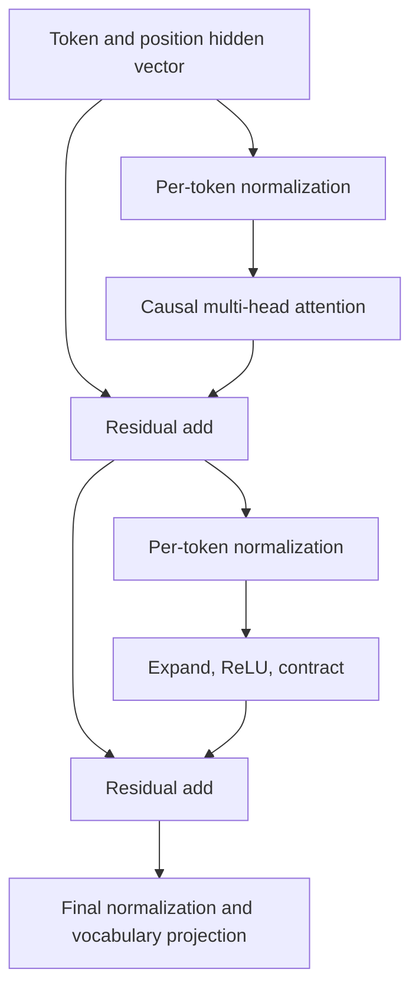

# Day 22 — Decoder blocks, residuals, and normalization

## 1. Learning objectives

Assemble a one-block causal decoder from token/position lookup, normalization,
attention, residual additions, and a positionwise feed-forward network. Derive
layer normalization and residual gradients, count simplified parameters, and
trace a full forward graph. Required competency: Level 3 independent mechanism
implementation plus architectural explanation.

## 2. Required prerequisites

[Day 21](../day-03/README.md): causal multi-head attention.
[Day 15](../../week-03/day-03/README.md): affine/nonlinear layers.
[Day 16](../../week-03/day-04/README.md): chain rule through shared paths.
Mean, squared deviation and square root were taught in prior numerical work;
today combines them into a per-token normalization. No framework layer is needed.

## 3. Problem motivation

Attention mixes locations, but a useful decoder also transforms each location
and preserves a stable route for information through stacked operations. Without
explicit shape discipline, a residual addition can silently truncate vectors.
Without normalization, activation scale can make training harder. These are
engineering and numerical mechanisms, not guarantees that a network learns
correct reasoning. We assemble and test the block rather than only drawing it.

## 4. Intuitive explanation

A residual connection adds a computed correction to the current representation.
Instead of forcing each sublayer to recreate everything, it can refine a carried
state. Normalization recenters and rescales a token's coordinate values before
processing. The feed-forward network changes features at one token position,
while attention shares information among eligible positions. Keeping these roles
separate helps trace where a causal or shape error could enter.

## 5. Deep technical explanation

Our pre-normalized block computes u=h+Attention(norm(h)), then
v=u+FFN(norm(u)), followed by a final normalization before vocabulary projection.
Attention uses the causal prefix rule and output projection already taught.
The FFN expands model width d to 2d, applies ReLU, then contracts to d. Expansion
ratio two is a toy choice; the architecture is documented rather than assumed
identical to a named commercial model. All residual additions require equal
width and alignment of positions.

For one d-vector x, layer normalization computes mean μ=(1/d)Σxᵢ, variance
σ²=(1/d)Σ(xᵢ−μ)², then normalized coordinate (xᵢ−μ)/√(σ²+ε). Variance here uses
d, not the d−1 sample-statistics correction. It is a deterministic normalization
of this vector, not estimation from an external dataset. ε>0 avoids division
by zero for constant coordinates. The toy omits learned gain γ and offset β;
standard LayerNorm often applies γᵢ times normalized coordinate plus βᵢ.

Normalization is per token across its feature coordinates. Computing mean across
all sequence positions would mix future content into earlier training activations
and violate the intended causal boundary. A tensor implementation must therefore
choose axes deliberately. Its shape can look valid even when its information
flow is wrong. Test future perturbation across the full model, not just attention.

Residual addition creates a direct derivative path plus the sublayer derivative:
for y=x+f(x), dy/dx=1+f′(x) in one dimension, or identity plus Jacobian for vectors.
It can help optimization but does not guarantee gradients never vanish/explode.
Pre-normalization and post-normalization place operations differently and have
different training properties. We use pre-normalization for a small inspectable
example, while the original transformer paper uses a different arrangement.

The complete decoder outputs one vocabulary-logit vector per input position.
It has no encoder or cross-attention. It uses learned absolute positions,
multiple causal heads, a ReLU FFN, untied input/output embeddings, no dropout,
and no biases in linear projections. These simplifications still implement
the central decoder mechanism; omitted options are explicit limitations, not
features silently supplied by an external framework.

## 6. Mathematical foundations

For x=[1,3], μ=2 and variance=[1+1]/2=1. With ε=.00001, normalized output is
approximately [−.999995,.999995]. For [2,2], variance is zero and normalized
output is [0,0]. Adding a constant to all coordinates preserves normalized
values up to floating-point effects; multiplying by a positive scalar is only
approximately scale-invariant when ε is non-negligible.

Without biases/gains, a model with vocabulary V, context C and width d has
Vd token embeddings + Cd positions + 4d² Q/K/V/output matrices + 4d² FFN
matrices + Vd vocabulary projection = 2Vd+Cd+8d². For V=3,C=6,d=4 this is
24+24+128=176 scalar parameters. Head count partitions width and does not add
another independent factor to this layout's projection parameter total.

## 7. Architecture and execution diagrams



Direct arrows around sublayers carry the residual state. The final vocabulary
projection changes width from d to V; it is outside residual additions and
produces scores rather than normalized probabilities.

## 8. Implementation from first principles

```python
import math
from forgeagent.autograd import Value
from forgeagent.transformer import normalize,TinyDecoder

normalized = normalize([Value(1),Value(3)])
assert math.isclose(normalized[0].data,-1/math.sqrt(1.00001))
assert abs(sum(value.data for value in normalized)) < 1e-10
model = TinyDecoder(3,width=4,heads=2,context=6)
assert len(model.parameters()) == 176
logits = model([0,1,2])
assert len(logits) == 3 and all(len(row)==3 for row in logits)
print("one complete causal decoder block executed")
```

[transformer.py](../../../forgeagent/transformer.py) contains every operation,
using the scalar autograd engine instead of a transformer framework. `__call__`
forms content/position rows and Q/K/V lists; `_finish` mixes heads, adds both
residuals, applies FFN and final output projection. Inputs are bounded valid
integer IDs. Outputs are Value logits with full differentiable dependencies.

## 9. Worked execution walkthrough

For each ID, add the corresponding content/position rows, normalize, then project
Q/K/V. At position i, attend only to prefix keys/values. Concatenate heads,
project and add the original hidden vector. Normalize that residual, expand,
apply ReLU, contract, and add the second residual. Final normalization and
vocabulary projection yield V scores. Repeat for each position. The output
at an early position remains independent of later input tokens.

## 10. Independent laboratory

Implement `layer_norm(vector,epsilon=1e-5)` from the
[Week 4 lab](../../../labs/week-04/README.md). Use population variance, require
nonempty finite vector and positive finite epsilon, return fresh normalized
values, and handle a constant vector. Deliver [1,3] and constant traces, a
translation-invariance test, and a diagram annotating dimensions throughout the
full block. Run the day-4 check. Then reconstruct a residual FFN from prior
lab components without using a prebuilt transformer block.

## 11. Experiments

Vary epsilon over 1e-1,1e-5,1e-9 on nearly constant vectors and measure output
variance; do not assume exact unit variance with finite epsilon. Normalize
across features versus positions in a disposable fixture and perturb the last
token; identify which axis leaks future information. Remove one residual path
and compare gradients on a fixed graph. Report observed behavior rather than
generalizing from one seed to every training architecture.

## 12. Failure analysis

NaN on a constant vector points to missing epsilon or a wrong variance formula.
An unexpected parameter count can reveal omitted matrices or accidental sharing.
Future leakage despite a triangular attention prefix can arise from normalization
across time. Wrong logits with valid dimensions may arise from residuals added
to the wrong representation. Trace the first divergent intermediate and use a
single position before debugging the whole sequence.

## 13. Engineering tradeoffs

Residuals preserve a direct path but add state that must stay aligned. Normalization
improves scale handling while introducing domain/epsilon choices. Learned gains
and biases add flexibility and parameters; omitting them keeps the toy compact.
A larger FFN can increase representational capacity and compute. Scalar autograd
maximizes visibility but cannot match tensor-kernel throughput. The point is a
correct mechanism with measurable limits, not a production inference competitor.

## 14. Real-world connection

Transformer decoders reuse these compositional patterns at far larger scale,
with architecture-specific variations. Application engineers benefit from knowing
why context length, hidden width, and caching consume resources. They still must
handle provider interfaces, evidence and tool authorization outside the network;
a normalized hidden vector does not make application state trustworthy.

## 15. Common misconceptions

“Normalization is across the batch by definition”: different normalizers use
different axes. “Residual means copy the output twice”: it adds input to correction.
“Every decoder has an encoder”: decoder-only models do not. “A complete toy block
matches a commercial LLM”: scale, data, details and operational machinery differ.

## 16. Technical examination

Explain pre-normalization and residual paths. Derive the [1,3] normalization
and parameter count. Implement the normalization contract. Debug wrong-axis
future leakage. Defend adding learned gains/biases as an extension with changed
counts/tests. Use [separate criteria](../../../solutions/examinations/week-04.md) afterward.

## 17. Daily mastery gate

Pass normalization and domain tests, derive 176 parameters, trace every block
boundary, and score 4/5 including coding. Demonstrate full-model causal invariance.
Explicitly distinguish toy omissions from central mechanisms actually implemented.
Do not pass solely because the final logits have the expected array length.

## 18. Resources

[Original transformer paper](https://arxiv.org/html/1706.03762v7), sections 3.1–3.4,
35 minutes targeted reading. Compare residual/normalization placement with the
local documented architecture. [PyTorch autograd tutorial](https://docs.pytorch.org/tutorials/beginner/basics/autogradqs_tutorial.html),
15 minutes review of backward mechanics. No external runtime install is needed.

## 19. Revision and retention

Tomorrow reconstruct block order without source. In three days compute normalization
on a new short vector, explaining population variance and epsilon. In one week
trace which parameter/activation quantities scale with V,C,d,n. Connect wrong-
axis leakage with earlier train/test data-boundary failures.

## 20. Next lesson connection

[Day 23](../day-05/README.md) attaches next-token targets and cross-entropy,
then trains the tiny decoder on CPU. A complete forward architecture is now
available, so the remaining training loop can be explained operation by operation.
