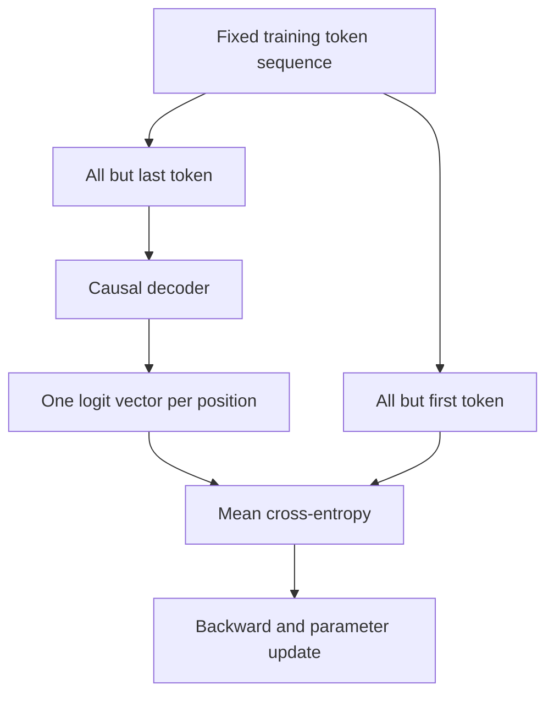

# Day 23 — Cross-entropy, training, and autoregressive generation

## 1. Learning objectives

Align input prefixes with next-token labels, derive categorical cross-entropy
and its logit gradient, implement stable log-sum-exp loss, and train the tiny
decoder for a finite CPU budget. Separate teacher-forced training from recursive
generation and report toy loss honestly. Required competency: Level 3 implementation
with a worked alignment and gradient trace.

## 2. Required prerequisites

[Day 22](../day-04/README.md): full differentiable decoder.
[Day 17](../../week-03/day-05/README.md): fresh-graph training loops.
[Day 12](../../week-02/day-06/README.md): logs and stable softmax.
[Day 18](../../week-03/day-06/README.md): conditional NLL and prediction units.
Reconstruct backward-before-update order and explain why test data cannot choose
training settings before continuing.

## 3. Problem motivation

A decoder producing plausible-shaped logits is not yet learning next-token
prediction. Off-by-one target alignment can train identity copying; an absent
mask can expose future labels; direct probability logs can underflow. All three
can yield confusing losses. We need a precise objective and invariants before
celebrating a decreasing curve. A tiny predictable sequence provides an inexpensive
fixture for verifying the training mechanism.

## 4. Intuitive explanation

At each position, ask the model to place probability on the next symbol. Training
shows it the correct earlier symbols, then scores its next-symbol prediction.
Generation feeds back what it actually chose, so mistakes can change all later
context. Cross-entropy charges more when the correct next symbol had low probability.
It does not reward factual truth or safe actions unless those properties are
represented by the data and objective in a meaningful way.

## 5. Deep technical explanation

Given sequence [a,b,c,a,b,c], inputs are [a,b,c,a,b] and targets [b,c,a,b,c].
Output at input position i predicts target i, which is original sequence position
i+1. The causal prefix includes the current input token but excludes later
inputs. The target is supplied to the loss, not added to the hidden state.
Teacher forcing uses known prefixes at all training positions, permitting parallel
position computations under a causal mask. Recursive generation instead samples
one token, appends it, and computes the next step from that new history.

For logits z over V categories, pᵢ=exp(zᵢ)/Σexp(zⱼ). A one-hot target y chooses
one correct category t; categorical cross-entropy is −Σyᵢlnpᵢ=−lnpₜ.
Compute it stably as logsumexp(z)−zₜ rather than taking log of a probability
that might have rounded to zero. With m=max(z), logsumexp is
m+lnΣexp(zⱼ−m). The detached maximum used for numerical shifting is acceptable
because the shift algebraically cancels; the resulting expression retains the
intended derivatives for finite logits.

Our scalar `cross_entropy` rejects empty logits, invalid target indices, and
non-finite logits. The decoder averages one loss per position. Its training
helper creates a fresh graph, backpropagates once, updates each parameter, and
records pre-update loss. A finite eight-step demonstration verifies operation
and some optimization progress. It is not a general language model evaluation,
a performance benchmark, or evidence of useful coding ability.

Training and validation need identical tokenizer, vocabulary and masking conventions.
Learning a repeating three-symbol pattern does not establish transfer to prose.
A held-out sequence drawn from the same trivial rule may measure pattern recall
but still says little about real-world distribution. Document exactly what a
benchmark measures rather than labeling every excluded row broadly “generalization.”

## 6. Mathematical foundations

Cross-entropy L=lnΣexp(zⱼ)−zₜ. Differentiate with respect to zₖ:
∂L/∂zₖ=exp(zₖ)/Σexp(zⱼ)−1[k=t]=pₖ−yₖ. Thus every category gets a signal,
not only the correct one. For two equal logits [0,0] and target 1, probabilities
are [.5,.5], loss ln2≈.6931, gradients [.5,−.5]. Moving the first down and the
second up reduces loss locally.

For logits [1000,1001], choose m=1001. Shifted exponentials are [e⁻¹,1].
Target 1 loss is ln(1+e⁻¹)≈.31326. No exp(1000) is needed. The positive target's
gradient is p₁−1≈−.26894; the other is .26894. A finite-difference check should
agree for each logit. Averaging n position losses divides each contribution by n,
so forgetting that factor changes effective learning-rate scale.

## 7. Architecture and execution diagrams



Targets enter only at loss. A separate generation loop takes model output back
to the next input; it does not use the known future training target as feedback.
The distinction is visible in both control flow and permitted information.

## 8. Implementation from first principles

```python
import math
from forgeagent.autograd import Value,cross_entropy
from forgeagent.transformer import train_toy

logits = [Value(1000),Value(1001)]
loss = cross_entropy(logits,1)
loss.backward()
assert math.isclose(loss.data,math.log1p(math.exp(-1)))
assert math.isclose(logits[0].grad,-logits[1].grad)
model,history = train_toy(steps=8,rate=0.05,seed=7)
assert len(history)==8 and history[-1] < history[0]
print("stable loss and finite decoder training passed")
```

[Autograd loss](../../../forgeagent/autograd.py) and
[decoder training](../../../forgeagent/transformer.py) contain the full mechanisms.
No framework supplies the block, backward graph, optimizer loop or label alignment.
The CPU example is intentionally small. Inputs are finite in-vocabulary sequences;
outputs are measured training losses and learned Value parameters, not an externally
validated model-quality score.

## 9. Worked execution walkthrough

Read the fixed pattern, shift it into five input/target pairs, and run the causal
forward graph. At each position shift logits by their maximum, sum exponentials,
take log and subtract the target logit. Average five scalar losses. Backward
sends p−y through vocabulary projection, normalization, FFN, attention and lookup
parameters. Update after all contributions are complete. Rebuild the graph next
iteration; retaining old key/value caches across updates would be invalid.

## 10. Independent laboratory

Implement `loss(logits,target)` on ordinary floats from the
[Week 4 contract](../../../labs/week-04/README.md). Use stable log-sum-exp, validate
finite nonempty logits and integer target bounds, and test equal/translated
scores. Deliver analytic p−y and numerical coordinate checks. Then implement
one decoder training step using already-mastered Value/model components, showing
fresh forward and correctly shifted targets. Run the day-5 contract; importing
the reference loss does not satisfy independent implementation.

## 11. Experiments

Intentionally align targets with current input rather than next token in a
disposable experiment. Record why low loss would now measure the wrong problem.
Remove the causal restriction and show future-perturbation tests fail regardless
of loss. Sweep three predefined rates over the same short budget and record
all histories. Compare direct log-softmax arithmetic with log-sum-exp on extreme
logits; numerical stability is a correctness property, not just a speed optimization.

## 12. Failure analysis

Unnaturally easy training may indicate identity targets or future leakage.
NaN/overflow can indicate direct exponentiation or divergent parameters; inspect
one stable-loss fixture first. A gradient scaled by sequence length may reveal
sum versus mean mismatch. Different cached/full training results can reflect
stale projections rather than ordinary floating-point noise. If loss is recorded
after an update using an old graph, label it honestly or recompute with new parameters.

## 13. Engineering tradeoffs

Teacher forcing enables efficient training but generation operates on its own
predictions, so errors can compound. Full scalar graphs maximize visibility and
consume substantial overhead. A tiny synthetic pattern makes regression checks
fast but cannot substitute for held-out application evaluation. Mean loss normalizes
by prediction count; other weighting policies are legitimate only when explicitly
defined and consistently applied across comparisons.

## 14. Real-world connection

Next-token pretraining supplies a broad prediction objective, while instruction
tuning and preference methods change the data or optimization signals. None
eliminates the need for tool validation and grounding in an agent application.
We do not infer a provider's private training data or post-training pipeline
from the public existence of a next-token model.

## 15. Common misconceptions

“Training predicts the current token”: labels are shifted forward. “Teacher
forcing permits looking at the future”: the mask still forbids it. “Cross-entropy
is factual accuracy”: it scores probability assigned to labeled symbols. “A
decreasing toy loss proves a useful LLM”: the evaluation scope is tiny.

## 16. Technical examination

Explain target alignment. Derive p−y. Implement stable loss. Debug an off-by-one
training example. Defend a toy optimization test versus an application-quality
benchmark. Use [separate criteria](../../../solutions/examinations/week-04.md) after saving
both predictions and observations.

## 17. Daily mastery gate

Pass stable-loss/domain tests, derive both coordinate gradients, and show a
correctly aligned finite training step. Score 4/5 including coding. Demonstrate
that future leakage and wrong targets are detected independently of whether
a loss curve decreases. Preserve exact seed, dimensions, rate and step count.

## 18. Resources

[Attention Is All You Need](https://arxiv.org/html/1706.03762v7), training/objective
context, 25 minutes targeted reading; [PyTorch autograd tutorial](https://docs.pytorch.org/tutorials/beginner/basics/autogradqs_tutorial.html),
20 minutes comparison after your custom gradients. These verified primary pages
supplement the local derivation; no GPU, framework dependency or paid-model call
is needed.

## 19. Revision and retention

Tomorrow derive stable loss from softmax without notes. In three days trace a
six-token sequence into input/target pairs. In one week explain why per-character
and per-token losses cannot be directly compared after changing tokenization.
Connect output-schema validity to the distinct question of semantic correctness.

## 20. Next lesson connection

[Day 24](../day-06/README.md) chooses tokens from logits and avoids repeated work
with key/value caching. We will preserve the same causal predictions while
changing inference execution and resource use, then discuss model-training limits.
