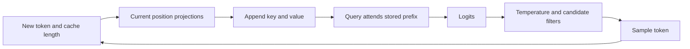

# Day 24 — Sampling, KV caches, tuning, and model limitations

## 1. Learning objectives

Implement temperature, top-k and nucleus sampling with explicit edge policies.
Explain prefill versus decode, build a caller-owned key/value cache, and verify
cached/full prediction equivalence. Distinguish inference caching, provider
prompt caching, instruction tuning and preference optimization. Required competency:
Level 3 mechanism implementation and Level 4 correctness-preserving optimization.

## 2. Required prerequisites

[Day 23](../day-05/README.md): logit probabilities and autoregressive alignment.
[Day 21](../day-03/README.md): causal attention.
[Day 9](../../week-02/day-03/README.md): concurrency and resource lifetime.
[Day 13](../../week-03/day-01/README.md): training/inference distinction.
Reproduce the causal invariance test before caching; otherwise an optimized
incorrect model can appear consistent for the wrong reason.

## 3. Problem motivation

Always choosing the largest logit can be repetitive, while unconstrained random
sampling can select low-probability symbols. Meanwhile recomputing every old
key/value at each generation step wastes work. Sampling changes the selected
sequence; caching should preserve model predictions under the same parameters
and history. Confusing these roles leads to unreliable comparisons and stale
state. A cache optimization must be verified numerically, not assumed correct
because output still looks plausible.

## 4. Intuitive explanation

Temperature changes how sharply a set of scores becomes a probability distribution.
Top-k keeps a fixed number of leading candidates; top-p keeps enough leading
candidates to reach a cumulative probability threshold. A KV cache is a notebook
of earlier attention keys and values that need not be recomputed when the prefix
is unchanged. It is not a memory of factual truths, a transcript summary, or
a reusable cross-user state store.

## 5. Deep technical explanation

For temperature T>0 use softmax(z/T). Larger T flattens relative preferences;
smaller positive T concentrates them. Define T=0 as greedy argmax rather than
dividing by zero. The reference breaks ties by smallest token index. It then
applies optional top-k in descending logit order, normalizes surviving scores,
and takes the shortest prefix whose probability sum reaches top-p. This combined
filter order is part of our contract; implementations applying different ordering
can produce different distributions. Random choice renormalizes the retained
weights. Use a local RNG for reproducibility.

At inference position i, earlier input representations in a one-block causal
decoder do not depend on token i. Store their projected keys and values and
compute only the new token's projections, then attend its query over the stored
prefix plus itself. Learned position index equals the existing cache length.
The cache belongs to one sequence and one parameter/tokenizer/position configuration.
Clear it after parameter changes or history edits. Our one-block implementation
has one key/value list pair; a multi-block decoder needs one pair per layer.

Prefill processes a prompt and builds state; decode adds new tokens incrementally.
A production cache stores numeric tensors with gradients disabled. Our pedagogical
cache stores Value nodes to expose formulas and therefore retains graph references;
it is memory-inefficient and explicitly inference-only. Context length bounds
it, but it does not implement eviction or sliding-window positional semantics.
When context is exhausted, reject rather than silently wrapping positions.

Caching avoids old projections/FFN work but each new query still compares with
eligible cached keys. KV memory grows approximately with layers times sequence
length times key/value width and element bytes. Provider prompt caching may
reuse processed prefix state under provider-specific matching, retention and
pricing rules; no current provider guarantee is inferred here. Application
response caching is different again: it reuses a complete prior answer and
needs request/authorization/freshness keys.

Pretraining fits broad next-token prediction. Instruction tuning trains on
instruction/response examples. Preference optimization uses comparative feedback
or rewards through algorithm-specific objectives. These categories do not imply
perfect instruction following, calibrated uncertainty or resistance to prompt
injection. This curriculum explains their role without implementing a costly
post-training pipeline or inventing proprietary provider details.

## 6. Mathematical foundations

For logits [0,ln2], T=1 yields [1/3,2/3]. At T=.5, exponentiated relative weights
are [1,4], yielding [.2,.8]. Greedy always selects the second. For probabilities
[.6,.3,.1] and p=.8, keep the first two because .6<.8 but .6+.3≥.8. Renormalized
retained probabilities are [2/3,1/3]. Top-k=1 retains only the first regardless
of this nucleus threshold.

With L layers, n cached positions, key/value width d each, and b bytes per
element, a simple full-head cache costs about 2Lndb bytes. For L=1,n=8,d=4,b=4,
that is 256 numerical bytes, excluding all implementation overhead. Our Python
Value objects cost much more. Do not report this tensor payload estimate as
measured Python process memory.

## 7. Architecture and execution diagrams



Cache state carries the sequence's computed projections forward. Sampling feeds
the selected token into the next step. A separate finite generation budget and
context bound must stop the loop; higher temperature is not a termination policy.

## 8. Implementation from first principles

```python
import math
from forgeagent.transformer import TinyDecoder,sample

model = TinyDecoder(3,width=4,heads=2,context=6,seed=7)
tokens = [0,1,2]
full = model(tokens)
cache = {'keys':[],'values':[]}
for position,token in enumerate(tokens):
    cached = model.cached_step(token,cache)
    assert all(math.isclose(a.data,b.data,abs_tol=1e-10) for a,b in zip(cached,full[position]))
assert sample([0,1,2],temperature=0) == 2
assert sample([0,1,2],top_k=1) == 2
print("cache equivalence and deterministic selection passed")
```

[transformer.py](../../../forgeagent/transformer.py) implements both paths with
the same parameters and a documented cache contract. Sampling inputs are finite
ordinary logits and validated configuration. Outputs are token indices. Cached
execution returns Value logits, not generated text. Combining these components
requires explicit vocabulary mapping and finite context/step budgets.

## 9. Worked execution walkthrough

Start an empty cache. Token zero uses position zero, computes one key/value,
and attends one entry. Token one uses position one, adds its key/value, and
attends two entries; token two attends three. Compare each output against the
same position in full causal execution. No parameters change between paths.
Then sample from the final logits under declared filters. Reusing the cache
with a different prefix would violate the invariant despite valid array lengths.

## 10. Independent laboratory

Implement `choose(logits,temperature=1,top_k=None,top_p=1,seed=7)` using the
[Week 4 contract](../../../labs/week-04/README.md). Specify greedy/tie behavior,
filter order, valid bounds, stable probabilities and local seeded randomness.
Deliver hand-filtered probabilities and invalid-setting tests. Run the day-6
contract. Additionally demonstrate cached/full equivalence across at least three
prefixes and failure at context exhaustion; an attractive generated string is
not an acceptance criterion.

## 11. Experiments

Hold logits fixed, sample many times at three temperatures, and report frequency
histograms with seed and sample count. Predict support restrictions under top-k/
top-p before sampling. Measure full-prefix recomputation versus incremental cache
on fixed tiny sequences, recording operation counts as well as noisy wall time.
Alter a parameter after cache creation and demonstrate staleness. Clear state,
recompute, and retain that counterexample as an ownership/versioning lesson.

## 12. Failure analysis

Different cached/full logits often indicate wrong position index, omitted prefix,
head slicing error or stale parameters. Identical-looking text can hide this,
so compare logits numerically. An off-by-one context check can access an absent
position row; test exactly at and beyond the limit. Invalid temperature should
reject rather than produce NaN. Infinite generation comes from missing step
budgets or an assumed stop token that the model never selects.

## 13. Engineering tradeoffs

Greedy is deterministic but may be repetitive; stochastic filters change diversity
and failure probability without guaranteeing correctness. KV caching improves
repeated-prefix computation while consuming sequence-sized memory and requiring
strict ownership. Long contexts raise latency/memory and can include irrelevant
or adversarial evidence. Choose context selection, caching and model routing
based on measured workload and quality, not a belief that more tokens always help.

## 14. Real-world connection

Agent services can incur repeated model-prefix computation and must account for
latency, tokens and actual provider cache behavior. They also maintain application
memory/checkpoints, which do not replace model KV state. A generated tool call
still requires schema validation, authorization, budgets and observation handling.
The next phase treats those application boundaries explicitly.

## 15. Common misconceptions

“Temperature zero proves correctness”: it changes selection, not knowledge.
“KV caching is persistent agent memory”: it stores model activations for a prefix.
“Prompt caching means the answer is reused”: provider behavior varies. “Instruction
tuning eliminates injection”: training does not establish a trusted execution boundary.

## 16. Technical examination

Explain filter order and cache ownership. Compute a nucleus support and cache
payload estimate. Implement selection. Debug stale-cache or wrong-position output.
Defend an inference optimization while preserving correctness and disclosing its
limits. Use [separate answers](../../../solutions/examinations/week-04.md) after attempting.

## 17. Daily mastery gate

Pass sampling/boundary checks and three-prefix cached/full equivalence. Score
4/5 including coding. Show context exhaustion terminates explicitly and derive
the numeric memory estimate with units. Then take the weekly and cumulative
phase examinations. No paid-model or useful-coding-agent result is claimed by
this toy decoder milestone.

## 18. Resources

[Original transformer paper](https://arxiv.org/html/1706.03762v7), decoder/inference
architecture context, 20 minutes review.
[PyTorch scaled attention](https://docs.pytorch.org/docs/2.15/generated/torch.nn.functional.scaled_dot_product_attention.html),
20 minutes optional implementation comparison. Provider-specific prompt caching,
pricing and post-training integrations require later official-source verification;
the local teaching makes no unverified current API claims.

## 19. Revision and retention

On review day reconstruct cache invariants closed book. In three days derive
sampling support for a new distribution. In one week distinguish KV, prompt,
response and application-memory caches and their invalidation keys. Connect
stale-cache failures to mutable neural checkpoints and owner-scoped database state.

## 20. Next lesson connection

[Week 4 review](../weekly-review.md) and Phase 2 defense close the internals
phase. Week 5 will use model providers as application dependencies rather than
train a useful LLM locally. Consult the [roadmap](../../../ROADMAP.md) for current
availability; later chapters must not be inferred from planned titles alone.
