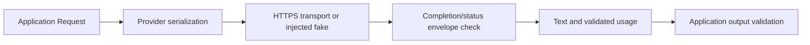

# Day 25 — Model providers and request lifecycles

## 1. Learning objectives

Define a model-provider boundary independent of one SDK. Trace serialization,
transport, provider completion, parsing and application validation. Implement
a typed request payload and distinguish complete, incomplete, refused, unsupported
and transport-uncertain outcomes. Required competency: Level 4 debugging/adaptation,
built on independent Level 3 construction.

## 2. Required prerequisites

[Day 7](../../week-02/day-01/README.md) teaches HTTP and JSON boundaries;
[Day 10](../../week-02/day-04/README.md) teaches bounded recovery;
[Day 24](../../week-04/day-06/README.md) distinguishes inference from training.
Reconstruct the request/response lifecycle and explain why a timeout cannot
prove no external effect. This chapter supplies every new interface below.

## 3. Problem motivation

An application needs model inference without exposing every caller to provider-
specific JSON and error types. Calling an SDK directly everywhere couples business
logic to one interface and makes offline tests difficult. A narrow provider
adapter centralizes translation, but must not pretend all providers support the
same capabilities. Silently dropping tool calls or refusing to record incomplete
status can turn a malformed dependency response into false application success.

## 4. Intuitive explanation

A plug adapter translates compatible electrical interfaces; it does not create
capabilities absent from the source. Similarly, our provider boundary requests
text with explicit model/messages/output allowance and returns text plus usage.
An SDK is a convenience layer that constructs HTTP requests and parses responses.
We first write those translations explicitly, then can compare an SDK implementation
without outsourcing the application's correctness contract.

## 5. Deep technical explanation

The `Provider` protocol declares async complete(Request) → Reply. A protocol
specifies expected behavior for static tools/readers; Python does not automatically
validate every collaborator. `Request` contains a nonempty model identifier,
immutable tuple of typed role/content messages, maximum output tokens and prompt
version. `Reply` contains text, usage and response ID. `Usage` rejects negative,
fractional and Boolean token counts. The boundary is intentionally narrower
than a full multimodal or tool-calling API; later agent instruction extends it.

The OpenAI Responses adapter serializes messages under input, sets max_output_tokens,
and explicitly requests no stored response via store=False. This is a request
parameter, not a universal guarantee about every data-retention system. The
adapter sends HTTPS to the fixed official endpoint. Model ID is caller configuration,
not a hardcoded assertion about the best current model. Provider availability,
access and pricing must be checked separately when opting into live execution.

Parsing requires completed status, assistant messages containing output_text,
a response ID and valid usage. Reasoning items are not displayed as text; tool
or unknown outputs reject rather than disappearing. A refusal is a controlled
provider error, not an empty successful answer. Incomplete responses remain
incomplete even when they contain plausible partial text. The application then
validates whatever text the narrow adapter returned against its own contract.

The default network transport is blocking urllib in a worker thread. Socket
timeout and bounded response bytes limit some resource use; an outer async
deadline limits caller waiting. Neither cancellation nor timeout kills the worker
or guarantees provider billing stopped. HTTP 429 and selected server errors are
classified retryable at this teaching boundary; authentication and unknown outcomes
are not automatically retried. Production policy must also consider duplicate
costs, request identity, provider-specific retry guidance and admission control.

No live request occurs on import. Constructing the default adapter requires
both allow_live=True and a key. Tests inject a synchronous transport returning
fixed JSON; the same serializer/parser runs without network. Fakes test the
application contract but cannot prove a real account/model supports the request.
Record that limitation rather than treating mocked success as live verification.

## 6. Mathematical foundations

An output allowance is an upper bound requested from the provider, not an exact
prediction of usage. Actual accounting uses reported input/output token integers.
If a request can be attempted A times, a per-attempt output allowance M alone
can permit roughly A×M output units plus input charges and provider-specific
usage categories. It is not a complete monetary budget.

Bounded parsing reads at most B+1 bytes, rejecting if length exceeds B, following
Week 1's file-bound pattern. Here B=1,000,000 for response transport. A complete
text can still be semantically wrong within that bound. Resource bounds, envelope
validity and content correctness are distinct acceptance dimensions, not one
numerical success score.

## 7. Architecture and execution diagrams



The injected fake replaces transport, not every downstream check. An SDK adapter
can replace S/H while preserving E/T/V contracts and their tests.

## 8. Implementation from first principles

```python
from forgeagent.models import Message,Request,payload,parse_response

request=Request('configured-model',(Message('user','Explain a failing test'),),64)
wire=payload(request)
assert wire['max_output_tokens']==64 and wire['store'] is False
fixture={'id':'fixture-1','status':'completed','output':[{'type':'message','role':'assistant',
    'content':[{'type':'output_text','text':'Inspect the first wrong state.'}]}],
    'usage':{'input_tokens':12,'output_tokens':7}}
reply=parse_response(fixture)
assert reply.usage.input_tokens==12
assert reply.text=='Inspect the first wrong state.'
print(reply.response_id)
```

[models.py](../../../forgeagent/models.py) contains the complete adapter. The
fixture demonstrates an envelope translation, not measured hosted-model performance.
Inputs are typed requests or parsed JSON envelopes; outputs are dictionaries,
Reply objects or explicit ProviderError. No API key is needed for this example.

## 9. Worked execution walkthrough

Create a user Message, then a bounded Request. Serialization preserves its role
and content. The fixture response declares completion, contains one assistant
text item and numeric usage. Parser validates each level and concatenates only
supported text parts. Change status to incomplete: the parser stops before
returning the plausible sentence. Change output to a tool call: the narrow text
adapter rejects because the application has not implemented that capability.

## 10. Independent laboratory

Implement `request_payload(request)` and `decode_response(value)` from the
[Week 5 lab](../../../labs/week-05/README.md). Preserve roles, model, output limit
and storage flag; validate status/content/usage using the declared text-only
contract. Run the day-1 check against your module. Deliver success, refusal,
incomplete and unexpected-output cases plus a diagram identifying where an SDK
could substitute. Do not make a paid request to satisfy an offline contract.

## 11. Experiments

Change one envelope field per trial: status, output type, content type, usage
integer type. Record accepted/rejected outcomes and expected reason. Compare
an injected transport with FakeProvider: the former tests serialization/parser,
the latter isolates application logic. Use the same application fixture for both.
Measure no network latency from fake sleep and do not label these timings as
provider inference performance.

## 12. Failure analysis

An apparently successful empty answer may mean a refusal or unsupported item was
dropped. A JSON decoding error may mean HTML or truncated bytes arrived; retain
safe status metadata, not secrets/full response bodies. An authentication error
will not be repaired by exponential retry. If cancellation is followed by a
late HTTP effect, recall worker lifetime; record the outcome as uncertain rather
than claim rollback. Reproduce parser failures using tiny local envelopes.

## 13. Engineering tradeoffs

A narrow provider interface simplifies tests but rejects unsupported capabilities.
A broad universal interface can obscure provider differences and expand maintenance.
Raw HTTP exposes mechanics but requires careful error handling; an SDK reduces
boilerplate after those mechanics are understood. Thread offload integrates blocking
libraries but lacks forceful cancellation. Choose an async transport later only
with equivalent parser, timeout and cancellation evidence.

## 14. Real-world connection

Production agent harnesses call models through application-owned interfaces so
runtime/tool policy remains separate from provider formats. This lesson uses a
public documented API without inferring provider internals. It does not implement
an agent loop yet; one model completion remains an application dependency call.

## 15. Common misconceptions

“SDK success means task success”: it establishes only an interface outcome.
“Every completed response is plain text”: tools and other content exist.
“Maximum output bounds all costs”: retries/input/provider categories still matter.
“Mocked transport proves live compatibility”: it proves only tested translations.

## 16. Technical examination

Explain five lifecycle boundaries. Trace the fixture. Implement both translations.
Debug silent refusal handling. Defend a text-only interface versus a richer
capability-aware adapter. [Answers](../../../solutions/examinations/week-05.md) are separate;
use one concrete unsupported response in your architectural justification.

## 17. Daily mastery gate

Pass envelope contracts and two original malformed cases. Score 4/5 including
independent code. Show an incomplete response cannot become success, and trace
why cancellation may leave remote work running. Record tested scope and untested
live behavior separately before proceeding.

## 18. Resources

[OpenAI Responses create reference](https://developers.openai.com/api/reference/resources/responses/methods/create),
request/response examples, free, 30 minutes targeted reading. Version-sensitive
fields were inspected for this adapter; live compatibility remains untested.
Local explanations teach the mechanism and selected limitations independently.

## 19. Revision and retention

Tomorrow reconstruct typed request versus wire payload. In three days reproduce
a malformed usage case without notes. In one week explain why an SDK upgrade
requires adapter contract regression even if business code is unchanged. Connect
the lifecycle to the earlier HTTP schema and authorization distinctions.

## 20. Next lesson connection

[Day 26](../day-02/README.md) constructs versioned prompts while preserving role
and provenance boundaries. A correct transport cannot repair an application
that accidentally grants retrieved text the authority of developer instructions.
