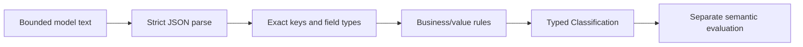

# Day 27 — JSON Schema, Pydantic, and semantic validation

## 1. Learning objectives

Separate JSON syntax, schema validity, business rules and factual correctness.
Implement a bounded strict classification parser, describe its JSON Schema, and
compare it with an optional pinned Pydantic model. Diagnose coercion, duplicate
keys and valid-but-wrong content. Required competency: Level 4 debugging and
adaptation, supported by independent validator construction.

## 2. Required prerequisites

[Day 26](../day-02/README.md) constructs versioned role-separated requests.
[Day 7](../../week-02/day-01/README.md) teaches parsing versus authorization;
[Day 5](../../week-01/day-05/README.md) distinguishes hints from runtime checks.
You must explain why valid JSON can still violate the application's intended
shape. No prior Pydantic or JSON Schema knowledge is assumed.

## 3. Problem motivation

Model output is an external value, even when generated under a schema instruction.
It can be incomplete, refused, wrongly typed, structurally unexpected or semantically
incorrect. Allowing arbitrary returned dictionaries into business logic spreads
unchecked assumptions. A strict boundary makes malformed outputs explicit and
keeps model guesses from becoming authorization. Schema libraries reduce repetitive
validation code after the actual mechanism and limitations are understood.

## 4. Intuitive explanation

A form can be readable, properly filled and still false. JSON parsing checks
readability. A schema checks which boxes exist and what kinds of values they
contain. Business rules check cross-field meaning for the application. Evidence
checks whether claims are supported. Stamping the form “valid” at the second
stage does not certify every later stage or permit actions the requester cannot take.

## 5. Deep technical explanation

The classifier requires exactly category, summary and urgent. Category is one
of bug, feature, question. Summary is a nonblank string at most 120 code points;
urgent is a genuine Boolean, not 0, 1 or a string. Unknown keys reject. The
parser first bounds UTF-8 output bytes to 4096, decodes JSON with duplicate-key
rejection, then checks exact keys/types/values before constructing an immutable
Classification record. The record itself is not the untrusted-input validator.

JSON Schema expresses an object with properties, required fields and
additionalProperties=false. Declaring properties alone does not make them required
or prohibit extras. Type, enum and length constraints express many shape rules;
a whitespace-only summary needs a specific pattern or application validator
because ordinary minimum length one still accepts spaces. Our prompt schema
specifies basic structure, while local validation additionally rejects blank
summary content. Providers support particular schema subsets; inspect official
requirements before sending a schema rather than assuming every keyword works.

The optional Pydantic model declares Literal categories, constrained string length,
a strict Boolean, forbidden extra fields and a nonblank field validator. Strict
mode avoids common coercions such as interpreting certain strings as booleans.
Pydantic type declarations cause runtime validation when its API is invoked;
ordinary dataclass hints do not. Pinning pydantic==2.12.5 and locking transitive
dependencies makes this comparison reproducible. It is an optional schemas extra,
so earlier standard-library lessons remain usable without installing it.

Duplicate JSON keys are a parser policy, not merely a field annotation. Pydantic's
JSON parser may choose a value for repeated keys; the first-principles parser
explicitly rejects them. If using Pydantic after external JSON, preserve the
required duplicate policy with a strict preparse rather than claiming these
interfaces automatically have identical semantics. Test the intended accepted
language, not just similar field definitions.

Provider-side constrained generation can improve structural conformance, but a
refusal or output-limit truncation may follow a different envelope path. Our
current text adapter requests an ordinary completion and validates locally;
it does not claim to have exercised provider constrained decoding. Semantic
quality remains an evaluation question. An urgent classification may route to
human review but must not independently grant filesystem or network permissions.

## 6. Mathematical foundations

Let J be all syntactically valid JSON values, S the subset satisfying schema,
and A the subset satisfying application rules. Usually A⊆S⊆J. Factual support
F is another property; membership in S does not imply F. Example: a structurally
valid summary claiming a test passed can be unsupported by any execution evidence.
A schema-conformance rate counts outputs in S divided by attempts; it is not
factual accuracy or task completion rate.

If 10 fixture outputs contain 8 valid shapes and only 6 correct labels, schema
conformance is .8 while correct-label fraction is .6 under the stated denominator.
Dropping invalid outputs and reporting 6/8=.75 without disclosure changes the
question. Keep denominator and failure categories explicit so malformed generations
cannot disappear from quality reporting.

## 7. Architecture and execution diagrams



The final evaluation box is not automatically provided by Pydantic. Authorization
is a separate control around any effectful consumer, not a hidden arrow from
a valid Classification to execution permission.

## 8. Implementation from first principles

```python
from forgeagent.llm_app import parse_classification

result=parse_classification('{"category":"bug","summary":"Test fails","urgent":false}')
assert result.category=='bug' and result.urgent is False
for text in ['{"category":"bug","summary":"x","urgent":1}',
             '{"category":"bug","summary":" ","urgent":false}']:
    try:parse_classification(text)
    except ValueError:pass
    else:raise AssertionError('invalid output accepted')
print(result)
```

[llm_app.py](../../../forgeagent/llm_app.py) implements the parser without a schema
framework. [pydantic_schema.py](../../../forgeagent/pydantic_schema.py) is the
optional comparison. Install with `uv sync --locked --extra schemas`, then inspect
IssueOutput.model_json_schema() and model_validate on parsed values. Ordinary
lesson examples do not require that extra, and no model call occurs here.

## 9. Worked execution walkthrough

The valid string is under the byte cap, parses into three unique keys, passes
category/string/Boolean checks and constructs a Classification. In the numeric-
urgent case JSON parsing succeeds, but exact Boolean validation fails. In the
blank-summary case type and length could appear acceptable, but the nonblank
business-value rule rejects. None of these checks determines whether the issue
really describes a bug; fixed labels and human review assess that separately.

## 10. Independent laboratory

Implement `validate_output(text)` from the [Week 5 contract](../../../labs/week-05/README.md).
Return a Classification only after bounded duplicate-rejecting parsing and all
field rules. Test scalar JSON, missing/extra keys, duplicate keys, blank summary,
wrong enum and numeric/string urgent. Run the day-3 contract. Then compare accepted/
rejected dictionaries against the optional Pydantic model and document differences
at the raw JSON parser layer. Do not replace semantic grading with schema success.

## 11. Experiments

Toggle extra-field and coercion policies in a disposable Pydantic model; record
which previously rejected values become accepted. Test duplicate-key JSON through
both raw parsers and explain the difference rather than silently normalizing it.
Create a fully valid but intentionally false summary and show the structural
validator accepts it. This establishes the validator's scope, not a defect to
solve by guessing truth inside generic type checking.

## 12. Failure analysis

Unexpected strings becoming Booleans can indicate coercion rather than strict
validation. Extra keys accepted despite declared properties indicate missing
additionalProperties/extra policy. Duplicate keys disappearing reveal parser
behavior before model validation. A valid record triggering an unauthorized action
reveals missing authorization, not an insufficient enum. Diagnose each boundary
with its own minimal fixture and verify fixes without broad exception suppression.

## 13. Engineering tradeoffs

Handwritten validation is transparent for one small shape but repetitive and
easy to drift as schemas grow. Pydantic centralizes runtime models and schema
generation but adds dependency/version semantics. Strict rejection avoids ambiguity
while making backward-compatible evolution harder. Repair prompts add latency
and cost and may produce another plausible error; evaluate them under finite
budgets rather than retry invalid output indefinitely.

## 14. Real-world connection

Typed model output is valuable for routing, extraction and tool preparation,
but model-generated values remain untrusted. Agent tools must validate arguments
and authorize resources independently. Provider structured-output features are
public interface capabilities; they do not prove semantic accuracy or eliminate
application-specific evidence checks.

## 15. Common misconceptions

“JSON mode means my exact schema”: syntax and shape differ. “Types prove truth”:
they describe value forms. “Strict mode fixes duplicate parsing”: parser policy
can occur earlier. “Validation failure means return a default answer”: fabricated
defaults can hide failures and corrupt downstream decisions.

## 16. Technical examination

Explain four validity levels. Trace numeric urgent rejection. Implement strict
output validation. Debug coercion or duplicate-key ambiguity. Defend handwritten
versus library validation with a migration strategy. Use
[separate criteria](../../../solutions/examinations/week-05.md) after saving your attempt.

## 17. Daily mastery gate

Pass all output cases and two independent boundary tests. Score 4/5 including
coding. Demonstrate a valid-but-wrong output and explain why it needs separate
grading. Record Pydantic's tested version and parser differences instead of
claiming an untested library guarantees application correctness.

## 18. Resources

[JSON Schema objects](https://json-schema.org/understanding-json-schema/reference/object),
25 minutes; [Pydantic models](https://pydantic.dev/docs/validation/latest/concepts/models/),
25 minutes; [OpenAI structured outputs](https://developers.openai.com/api/docs/guides/structured-outputs),
20 minutes on schema/refusal limits. All public primary references. The pinned
package version is a tested comparison, not a claim it is the newest release.

## 19. Revision and retention

Tomorrow classify failures by syntax, shape, business rule and unsupported claim.
In three days reconstruct exact-key validation from a blank file. In one week
compare structural conformance with held-out quality using an explicit denominator.
Connect this separation to earlier SQL injection versus owner authorization.

## 20. Next lesson connection

[Day 28](../day-04/README.md) assembles streamed fragments before validating the
complete value. A valid prefix is not a completed JSON document, and a truncated
stream must never be promoted to application success.
