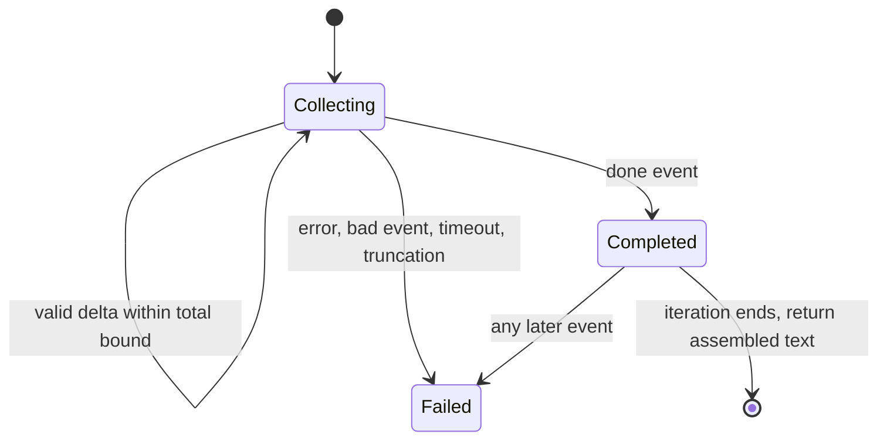

# Day 28 — Streaming, partial outputs, and cancellation

## 1. Learning objectives

Distinguish transport chunks, semantic stream events, text deltas and final
application values. Implement bounded event assembly that rejects truncation,
post-completion events and errors; demonstrate generator cleanup on cancellation.
Required competency: Level 4 failure diagnosis and adaptation with independent
stream-state implementation.

## 2. Required prerequisites

[Day 27](../day-03/README.md): strict final-value validation.
[Day 9](../../week-02/day-03/README.md): async tasks and cooperative cancellation.
[Day 10](../../week-02/day-04/README.md): timeout versus unknown effect.
Understand async iteration: an async generator yields values over time, and
`async for` awaits each next item. This chapter introduces lifecycle semantics.

## 3. Problem motivation

A user benefits from seeing output before generation finishes, but early text
is not a verified final result. A disconnect after half a JSON object must not
become an empty or partially parsed success. Stream boundaries can split words,
Unicode bytes or application objects differently. We therefore separate provider
transport decoding from a small normalized event protocol and validate only
a successfully completed assembled value.

## 4. Intuitive explanation

A parcel may arrive in several boxes, but receiving the first box does not mean
the order is complete. Deltas are fragments, a done event certifies the stream's
successful terminal state under its contract, and an error or missing terminal
means the application has no complete result. A progress display can show partial
text as provisional, while business logic waits for the validated final value.
These two consumers have different correctness needs.

## 5. Deep technical explanation

HTTP byte chunks are not semantic model events. A provider transport can use
Server-Sent Events, where framing and JSON event parsing precede extracting
text deltas. The current live adapter is nonstreaming; our streaming implementation
operates on normalized dictionaries `{'type':'delta','text':...}` and `{'type':'done'}`.
A provider-specific SSE bridge must translate documented lifecycle events and
handle provider errors/refusal before claiming live streaming support. We test
the normalized mechanism without pretending it is already a complete provider bridge.

The assembler has collecting and completed states. In collecting, a valid delta
adds UTF-8 byte length and appends text if within the cap. A done event switches
state. Any later event rejects, because the protocol promised one terminal
sequence. End-of-iteration without done is truncation. Unknown/error events
reject explicitly. The function returns only after successful stream exhaustion
with terminal state reached. This choice catches an error emitted after an
apparent done rather than returning early and ignoring it.

Counting bytes after encoding each complete string delta enforces an aggregate
text-byte bound even when Unicode occupies multiple bytes. The normalized
adapter promises string deltas already decoded correctly; splitting UTF-8 byte
sequences is the transport decoder's problem, not solved by independently decoding
each arbitrary TCP chunk. A production streaming transport needs an incremental
decoder and correctly framed events.

The assembler uses finally to call aclose when available on its input generator.
Cancellation propagates as CancelledError and triggers cleanup; it is not a
malformed-output retry signal. The caller can place an overall asyncio.timeout
around assembly. A producer suppressing cancellation or blocking the event loop
can violate responsiveness, so tests coordinate task start and verify cleanup.
Closing local iteration does not prove a remote provider stopped computation
or billing; transport and provider semantics remain separate.

Do not execute partially received tool arguments. Even if a prefix parses as
JSON, later fragments can change the intended complete object or reveal failure.
For output UI, label provisional content and avoid committing durable application
state until a completed validated result exists. Future agent runtimes will
turn complete model decisions into validated tool requests with separate budgets.

## 6. Mathematical foundations

If deltas contain byte lengths b₁,…,bₙ, aggregate size B=Σbᵢ must remain at most
limit L. Two deltas containing `é` each have two UTF-8 bytes, so B=4 even though
they contain two code points. Checking each delta individually against L is
insufficient: many small fragments can exceed the total bound.

Latency has at least first-event time, first-text time and final-completion time.
A stream can improve time-to-first-text without reducing total inference duration.
Measure these separately with monotonic timestamps. Do not call a system faster
based only on first-token display while ignoring final validation failures,
resource use or total time.

## 7. Architecture and execution diagrams



Cleanup runs on every exit path. The returned string exists only on the final
successful transition; provisional pieces are internal state rather than a
partial-success return value.

## 8. Implementation from first principles

```python
import asyncio
from forgeagent.llm_app import assemble,parse_classification

async def events():
    yield {'type':'delta','text':'{"category":"question",'}
    yield {'type':'delta','text':'"summary":"Where are tests?","urgent":false}'}
    yield {'type':'done'}

async def main():
    text=await assemble(events(),max_bytes=256)
    result=parse_classification(text)
    assert result.category=='question'
    print(result.summary)

asyncio.run(main())
```

[llm_app.py](../../../forgeagent/llm_app.py) contains the complete assembler.
Inputs are an async event iterable and positive byte cap. Output is one full
string or failure. Application parsing happens afterward, preserving the distinction
between completed transport and valid classification. No provider call occurs.

## 9. Worked execution walkthrough

Initialize empty pieces, zero bytes and done=False. First delta adds an incomplete
JSON prefix but does not parse or return it. Second completes the textual object;
state is still collecting. Done marks completion. Generator exhausts; finally
closes it, and assembly returns the concatenated text. Only then does strict
classification parsing run. Remove done: the identical text now fails stream
completion, demonstrating that plausible content cannot replace lifecycle evidence.

## 10. Independent laboratory

Implement `collect(events,max_bytes=4096)` from the
[Week 5 contract](../../../labs/week-05/README.md). Require exact normalized
event shapes, aggregate byte bound, one terminal done, no later event and visible
truncation/error. Close generators on all exits; propagate cancellation. Run
the day-4 contract. Deliver success/truncation/post-done/Unicode-limit cases and
an event-synchronized cancellation test with a producer cleanup flag. Do not
use fragile exact-duration assertions as the only evidence of cancellation.

## 11. Experiments

Split the same text into one, two and many deltas; final result should match
while intermediate display timing differs. Remove the terminal event and compare
outcome. Use multibyte text to distinguish byte versus character bounds. Simulate
a producer that waits on an event, then cancel the collector after start and
verify its finally cleanup. Record partial pieces separately from successful
return values and do not treat them as completed classifications.

## 12. Failure analysis

A returned prefix on disconnect indicates missing terminal-state enforcement.
A valid result followed by ignored error indicates early return at done without
honoring the declared remainder policy. Unicode decode errors at arbitrary chunks
belong to incremental transport decoding. Leaked generators suggest missing
finally/aclose. Swallowed cancellation can lead to retries after the caller asked
to stop; let it propagate and keep a deterministic regression fixture.

## 13. Engineering tradeoffs

Buffering the full result simplifies atomic final validation but uses memory
proportional to bounded output. Incremental display improves perceived latency
while requiring clear provisional semantics. Incremental structured parsing can
support specialized use cases but adds complexity and does not authorize partial
effects. Waiting for stream exhaustion after done detects protocol violations
but needs an overall deadline if a producer never ends.

## 14. Real-world connection

Model APIs expose provider-specific streaming lifecycle events. An agent harness
must translate them without confusing displayed text with executable decisions.
The official OpenAI guide documents delta/completion events; our normalized
protocol teaches assembly independently and does not claim a tested live SSE
integration or remote cancellation guarantee.

## 15. Common misconceptions

“A delta is one token”: boundaries need not match tokenizer units. “Valid partial
JSON means done”: lifecycle evidence still matters. “Streaming reduces total
cost”: it changes delivery behavior, not automatically billing. “Closing a generator
undoes remote work”: it only establishes local cleanup under this contract.

## 16. Technical examination

Explain four kinds of boundaries. Trace the split JSON example. Implement bounded
assembly. Debug a missing done or leaked generator. Defend buffering versus
provisional UI streaming with an atomic effect boundary. Use
[separate criteria](../../../solutions/examinations/week-05.md) afterward.

## 17. Daily mastery gate

Pass stream-state and byte-bound contracts, demonstrate cancellation cleanup,
and score 4/5 including code. Explain why removing done must fail even with
complete-looking text. Record what was tested locally and what would still
need provider-transport verification.

## 18. Resources

[OpenAI streaming responses](https://developers.openai.com/api/docs/guides/streaming-responses),
25 minutes on documented event lifecycle. [Python asyncio tasks](https://docs.python.org/3.12/library/asyncio-task.html),
20 minutes on cancellation/cleanup. Primary sources supplement the local normalized
stream mechanism; live SSE translation remains explicitly outside this implementation.

## 19. Revision and retention

Tomorrow redraw the stream state machine closed book. In three days reproduce
a post-done error and verify rejection. In one week explain first-text versus
completion latency and why provisional display needs a different contract from
durable tool execution. Connect to complete-batch file loading from Week 1.

## 20. Next lesson connection

[Day 29](../day-05/README.md) places model work within finite retries, deadlines
and rate admission. A correct stream assembler still needs an outer budget,
and retries after partial output require explicit application policy.
