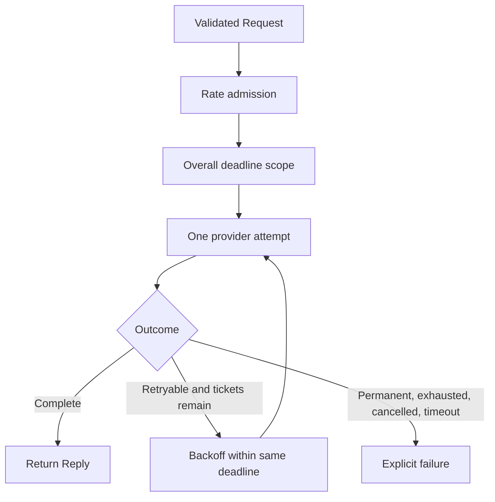

# Day 29 — Timeouts, backoff, rate limits, and model routing

## 1. Learning objectives

Apply an overall deadline to finite model attempts, retry only explicitly
classified errors, test backoff without real waiting, and implement a local
rate-admission gate. Explain routing/fallback capability and privacy constraints.
Required competency: Level 4 adaptation/debugging with independent policy code.

## 2. Required prerequisites

[Day 28](../day-04/README.md): complete versus partial streams.
[Day 10](../../week-02/day-04/README.md): timeout/cancellation/idempotency.
[Day 25](../day-01/README.md): ProviderError and request capabilities.
Reproduce the exponential delay sum and explain why an uncertain HTTP outcome
is different from a known pre-execution rejection before adding fallback logic.

## 3. Problem motivation

Unbounded recovery can turn one failed model request into a long-running cost
and load problem. Retrying an authentication failure adds no value; retrying
many rate-limited calls immediately can amplify an outage. Routing to a fallback
may improve availability while changing output quality, data handling or supported
schema features. We need explicit policies and deterministic tests rather than
an optimistic “retry everything” wrapper.

## 4. Intuitive explanation

An attempt budget is a limited number of tickets, a deadline is closing time,
and a rate gate spaces arrivals at the counter. These limits answer different
questions. A fallback counter may serve different products and have different
rules, so changing counters is an architectural decision rather than a transparent
repair. Cancellation means the caller no longer wants the process to continue;
it must not silently obtain another ticket.

## 5. Deep technical explanation

`controlled_call` validates attempts in 1..10, positive finite overall deadline,
and bounded nonnegative base delay. It enters one asyncio.timeout scope around
all attempts and backoff, so retries cannot restart the total time budget.
Each attempt calls the same provider with the same immutable Request. Only
ProviderError(retryable=True) reaches backoff; other exceptions and cancellation
propagate. Exhaustion raises the last provider error. Successful return ends
immediately with no trailing sleep.

The adapter labels selected HTTP failures retryable, but that is not a universal
exactly-once guarantee. Provider errors may occur after computation or charging.
A retry policy must be appropriate for the operation, request identity and
available billing guarantees. Our teaching interface has no automatic monetary
reservation or provider-side idempotency feature. The safe claim is finite,
explicitly classified recovery, not prevention of every duplicate charge.

A request-rate gate serializes admission timing with an async lock. Given a
configured interval, it waits until the next allowed time, then advances that
time. A monotonic clock avoids wall-clock jumps. Holding the lock while sleeping
preserves spacing among local callers. Cancellation before admission releases
the lock without consuming a new slot; the next caller recomputes timing.
Injected clock/sleep makes spacing testable without real delays.

This gate is process-local and request-based. Multiple worker processes each
running their own gate can jointly exceed an account-level limit. Token-per-
minute limits also require estimating or reserving token capacity, reconciling
actual usage and deciding what happens on unknown outcomes. Distributed admission
and quotas belong in production infrastructure, not a claim hidden in this
small local class.

Model routing chooses an allowed adapter/model based on task constraints, required
capabilities, measured quality, latency/cost and data policy. A fallback that
lacks strict schema support or sends confidential source to an unauthorized
provider is not a correct equivalent. Our implementation accepts explicit model
configuration and does not automatically switch providers. A routing exercise
must preserve provenance and re-evaluate quality rather than silently claim
transparent interoperability.

## 6. Mathematical foundations

For three attempts and base delay .1 seconds, sleeps are .1 and .2, sum .3.
An overall deadline D bounds cooperative waiting across attempts plus these
sleeps; it does not equal three independent D-second budgets. Blocking code
or cancellation suppression can still delay actual termination, so D is not
a hard real-time guarantee.

With local minimum spacing Δ=.5 seconds, ideal admission rate is at most 1/Δ=2
requests per second for one gate. This is not a completion-throughput guarantee:
requests can remain in flight for longer. If four independent processes each
use that gate, aggregate admission can approach eight requests per second.
Counting concurrent requests is a separate resource bound from spacing them.

## 7. Architecture and execution diagrams



The diagram does not add an automatic provider-switch edge. Any future fallback
must have an explicit capability/policy decision and its own recorded identity.

## 8. Implementation from first principles

```python
import asyncio
from forgeagent.models import FakeProvider,ProviderError,Reply,Usage
from forgeagent.llm_app import build_request,controlled_call

async def main():
    delays=[]
    async def sleep(seconds):delays.append(seconds)
    provider=FakeProvider([ProviderError('http_429',retryable=True),Reply('ok',Usage(5,1))])
    reply=await controlled_call(provider,build_request('issue','fixture'),base_delay=.1,sleep=sleep)
    assert reply.text=='ok' and delays==[.1] and len(provider.requests)==2
    print('bounded classified recovery passed')

asyncio.run(main())
```

[llm_app.py](../../../forgeagent/llm_app.py) contains the complete policy and
gate. Inputs are a provider/request and finite configuration. Outputs are a
Reply or explicit propagated failure. Fake outcomes test control flow; no actual
429 response or paid request is generated. Cancellation remains a separate exception.

## 9. Worked execution walkthrough

Start the overall timeout. First fake attempt records the Request and raises
a classified retryable error. One ticket is consumed; record .1 sleep. The
second returns a Reply, so the function exits before another sleep. Change
retryable to false: the first error immediately propagates. If a task waits
on an operation until deadline, timeout cancels the waiting task; it does not
convert that outcome into a newly available retry budget.

## 10. Independent laboratory

Implement `call(provider,request,attempts=3,deadline=2,base_delay=.01,sleep=...)`
from the [Week 5 lab](../../../labs/week-05/README.md). Require one overall timeout,
selective retry, bounded configuration, no sleep after success/final failure,
and cancellation propagation. Run the day-5 contract. Deliver exhaustion,
permanent error, timeout, cancellation and injected-delay tests. Also trace a
fake-clock RateGate and propose a fallback decision that rejects an incompatible
provider rather than simply changing its name.

## 11. Experiments

Vary attempts while keeping outcomes fixed and record call count/delays.
Replace real sleep with an injected recorder to separate policy from scheduler
noise. Simulate a monotonic clock advancing only on sleep and admit three
requests through one gate; then compare two independent gates and explain why
account-wide limiting fails. Change only the fallback's schema capability in
a paper routing example and predict the correct refusal behavior.

## 12. Failure analysis

Repeating all exceptions usually retries permanent errors and can hide bugs.
Fresh timeout scope per attempt can violate the intended total latency budget.
A canceled task starting another attempt indicates swallowed cancellation.
Unexpected bursts across workers indicate a local limiter mistaken for a shared
quota. An output change after fallback may be a quality/capability change, not
random transport noise. Preserve original provider identity in traces for diagnosis.

## 13. Engineering tradeoffs

More attempts can improve availability under some transient conditions while
raising latency, load and cost. Backoff reduces pressure but consumes deadline.
A local gate is simple and testable; shared quotas require coordination and
failure policy. Routing to smaller models may lower cost but needs measured
quality and capability checks. Never change grading criteria merely because
a cheaper fallback performs worse on a fixed task set.

## 14. Real-world connection

Agent runtimes can multiply model/tool calls, so application recovery is one
layer beneath future step/time/token budgets. A reliable model adapter does
not prevent an infinite agent loop. Production infrastructure later adds ownership,
queueing, aggregate quotas and observability rather than assuming this wrapper
provides them implicitly.

## 15. Common misconceptions

“Retryable means free to repeat”: side effects/billing may still matter.
“One timeout per attempt is a total deadline”: budgets add unless scoped.
“Request spacing limits tokens”: token demand varies. “A fallback is equivalent”:
capabilities, privacy and quality can differ.

## 16. Technical examination

Explain the three budget types. Trace two transient failures then success.
Implement controlled calls. Debug cancellation or local-limit bursts. Defend
a routing decision with quality/capability/data constraints. Use
[separate criteria](../../../solutions/examinations/week-05.md) after the attempt.

## 17. Daily mastery gate

Pass retry/deadline/configuration contracts and cancellation cleanup. Score
4/5 including coding. Derive delay and admission calculations and demonstrate
that a permanent error produces one call. State the known monetary/remote-effect
uncertainties instead of claiming finite retries imply free or exactly-once execution.

## 18. Resources

[Python asyncio tasks](https://docs.python.org/3.12/library/asyncio-task.html),
timeouts/cancellation, 25 minutes. [OpenAI Responses reference](https://developers.openai.com/api/reference/resources/responses/methods/create),
20 minutes on request constraints/error context. Current provider account limits
and pricing are not copied into this implementation and must be checked for
any optional live configuration.

## 19. Revision and retention

Tomorrow reconstruct total-deadline placement closed book. In three days derive
a four-attempt delay sum and a two-process limiter counterexample. In one week
explain how model routing evaluation differs from transport availability testing.
Connect shared-cause failures to Week 2's probability assumptions.

## 20. Next lesson connection

[Day 30](../day-06/README.md) accounts for measured usage and evaluates complete
application behavior. Availability alone is not quality, and a successful Reply
must still be judged against expected task outputs and explicit cost assumptions.
