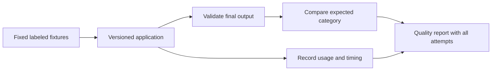

# Day 30 — Token accounting, cost, and application evaluation

## 1. Learning objectives

Separate requested output allowance, estimated input size and reported usage.
Compute hypothetical usage cost with exact decimal arithmetic and evaluate
application success without discarding invalid outputs. Report quality, latency
and cost with explicit denominators and uncertainty. Required competency: Level 4
measurement-driven adaptation and debugging.

## 2. Required prerequisites

[Day 29](../day-05/README.md): recovery and admission budgets.
[Day 27](../day-03/README.md): shape versus semantic quality.
[Day 19](../../week-04/day-01/README.md): tokenizer units versus characters.
[Day 13](../../week-03/day-01/README.md): held-out evaluation boundaries.
Arithmetic uses integers, division and decimal currency; no financial forecasting
or current provider price knowledge is assumed or supplied.

## 3. Problem motivation

An application can be structurally reliable yet classify the wrong issue or
spend too much on retries. Raw average latency can hide failed requests, and
reporting only schema-valid outputs inflates quality. A token allowance is not
a bill. We need a fixed evaluation contract, explicit accounting and honest
scope: deterministic fake-provider tests verify software, while real-model quality
requires separate, predeclared live or supplied-response evaluation.

## 4. Intuitive explanation

A restaurant order has an expected spending allowance and an actual receipt.
The allowance helps plan; the receipt records what happened. Provider usage
is closer to the receipt, though invoice rules may include additional categories.
Evaluation is a report card with every attempt included. Throwing away failed
papers before averaging scores makes the report misleading, even if the remaining
papers are all neatly formatted.

## 5. Deep technical explanation

Usage contains nonnegative integer input/output counts from a completed response.
These are different from bytes, regex words and our toy tokenizer pieces.
A provider can expose cached-input or other categories affecting billing; our
two-counter calculator is explicitly a simplified configurable model. It does
not quote current prices, interpret invoices or guarantee spend ceilings.

`cost` converts caller-supplied rates to Decimal from strings, validates finite
nonnegative values, multiplies by usage and divides by one million. Decimal
avoids binary floating-point surprises in simple displayed currency arithmetic.
Keep units in variable names: dollars per million input tokens differs from
per-token rates by a factor of one million. Rates in examples are hypothetical
and must never be described as current provider pricing.

A complete classification application builds a versioned role-separated request,
awaits a provider, validates output and returns Classification plus Usage.
Its urgent flag is content to route/review, not execution authority. A test with
FakeProvider can assert shape, failure propagation and request construction.
It cannot establish that a real model selected the correct category. A real
quality benchmark needs input issues, independently labeled expected categories,
fixed scoring, prompt/model identity and all attempt outcomes.

Measure schema conformance, exact category accuracy, valid-and-correct fraction,
and failures separately. If semantic scoring concerns summaries, define criteria
such as supported facts, omission and contradiction; string equality alone may
penalize legitimate paraphrases. Human or model-based graders require calibration
and are taught in the reliability phase. Do not introduce a grader whose criteria
change after seeing the application outputs.

Latency reporting needs start/end definitions, sample count and distribution.
Report at least median and a high percentile when sample size supports it,
including failure/timeout outcomes under a declared policy. A three-fixture run
cannot yield a robust production tail estimate. Cost per success divides total
cost over all attempts by successful tasks, not by successful attempts only.
Unknown usage on failed requests is not automatically zero; record an unknown
or upper-bound assumption separately.

## 6. Mathematical foundations

For input count I, output count O, input rate a and output rate b per million,
C=(Ia+Ob)/1,000,000. With hypothetical I=1000,O=200,a=2,b=8, cost is
(2000+1600)/1,000,000=.0036 currency units. Changing rate units to per-token
without changing the formula produces a millionfold error.

Suppose three tasks cost .01,.02,.03 and only two succeed. Total .06 divided
by two gives .03 per successful task. Averaging only successful-task costs
would ignore failed effort. If a failed call has unknown usage, .06 is not
known total cost unless an explicit accounting assumption covers it. Report
measured known cost and unknown attempts rather than silently filling zeros.

Accuracy for N tasks is correct/N under a fixed label definition. Valid-and-
correct can be lower than accuracy among valid outputs. Always state whether
invalid outputs count as incorrect or a separate category, and preserve the
original fixed denominator for the headline completion measure.

## 7. Architecture and execution diagrams



The report merges content outcomes and operational evidence without conflating
them. Fixture labels are not fed into the prompt except where an explicit
training/development policy permits it; held-out answers remain separate.

## 8. Implementation from first principles

```python
import asyncio
from decimal import Decimal
from forgeagent.models import FakeProvider,Reply,Usage,cost
from forgeagent.llm_app import classify

async def main():
    provider=FakeProvider([Reply('{"category":"bug","summary":"Test fails","urgent":false}',Usage(1000,200))])
    result,usage=await classify('A regression test fails',provider)
    assert result.category=='bug'
    assert cost(usage,'2','8')==Decimal('0.0036')
    print('offline contract evaluation passed; rates are hypothetical')

asyncio.run(main())
```

The [application](../../../forgeagent/llm_app.py) and [accounting](../../../forgeagent/models.py)
implement the full path. The fake returns a supplied answer and supplied usage,
so this is software-contract evidence only. No model generated the classification
and no actual bill was measured. Preserve that distinction in every report.

## 9. Worked execution walkthrough

Build the trusted prompt plus untrusted issue message and record request identity.
FakeProvider records the Request and returns one fixture Reply. The application
validates its JSON and produces a typed bug classification. Accounting multiplies
two supplied counts by hypothetical Decimal rates. The asserted category checks
application wiring, not predictive power. Replacing the fixture with a valid
wrong label would pass schema checks but fail a separately expected-label comparison.

## 10. Independent laboratory

Implement `estimate(usage,input_rate,output_rate)` from the
[Week 5 contract](../../../labs/week-05/README.md). Use Decimal, correct per-million
units, finite nonnegative rates and genuine integer counts. Run the day-6 contract.
Then create three fixed labeled application fixtures including invalid and wrong-
label outputs; report all denominators and known/unknown usage. Deliver the
report, a millionfold-units regression test and an explicit statement that fake
answers do not measure real-model quality.

## 11. Experiments

Hold usage fixed while varying hypothetical input/output rates to see which
component dominates. Compare one successful call with transient-failure-then-success
under an explicit assumption about failed usage. Do not assume missing means
free. Change one prompt version on supplied outputs and identify which results
are comparable. Measure local fixture timing separately from any future optional
live benchmark and do not extrapolate its tail latency.

## 12. Failure analysis

A millionfold cost error usually indicates mismatched rate units. Negative or
NaN rates must reject before arithmetic. Perfect accuracy after excluding parse
errors indicates a changed denominator. Suspiciously fast responses may be fake
or cached rather than live inference; preserve adapter identity. Unexpected bills
after timeout highlight unknown remote completion, not proof the usage calculator
is arithmetically wrong. Separate accounting-model omissions from calculation bugs.

## 13. Engineering tradeoffs

Exact deterministic grading is reproducible for categorical labels but insufficient
for all natural-language summaries. Rich graders capture nuance with calibration
cost and uncertainty. Small offline fixtures are cheap regression tests; live
repeated trials provide different evidence and require cost/consent controls.
Simplified rates teach units clearly but omit provider billing details. Report
scope honestly before choosing a more elaborate accounting system.

## 14. Real-world connection

Agent systems multiply calls across plans, tools and verification loops, making
per-task accounting more useful than one response's token count. Model selection
requires measured quality/latency/cost under actual task constraints. Production
quotas and spend admission come later; this calculator does not enforce account
budgets or provide financial advice.

## 15. Common misconceptions

“Maximum tokens equals actual usage”: it is an allowance. “No usage field means
zero charge”: the outcome may be unknown. “Schema accuracy is task accuracy”:
shape and content differ. “A fake provider proves model performance”: it proves
software behavior under supplied outcomes.

## 16. Technical examination

Explain estimated versus reported usage. Derive the .0036 example. Implement
unit-safe Decimal cost. Debug an invalid-output denominator. Defend a model
comparison report containing unknown failed-call cost. Use
[separate criteria](../../../solutions/examinations/week-05.md) after your attempt.

## 17. Daily mastery gate

Pass cost/domain tests, reproduce the arithmetic without code, and score 4/5
including implementation. Produce a three-task report retaining failures and
uncertainty. Complete [Week 5 review](../weekly-review.md) and the weekly examination;
no paid live call is necessary for these software gates.

## 18. Resources

[OpenAI Responses reference](https://developers.openai.com/api/reference/resources/responses/methods/create),
usage and completion fields, 20 minutes review. [OpenAI structured-output guide](https://developers.openai.com/api/docs/guides/structured-outputs),
15 minutes on refusal/validation boundaries. Current pricing is deliberately
not supplied; examples use labeled hypothetical rates and local arithmetic.

## 19. Revision and retention

On review day reconstruct cost units and quality denominators closed book.
In three days reproduce a valid-but-wrong fixture. In one week explain what
a real repeated-model evaluation adds beyond offline contract checks. Connect
unknown outcome accounting with Week 2's transaction and cancellation boundaries.

## 20. Next lesson connection

Week 6 adds evidence acquisition and grounded answers. A reliable request/output
pipeline cannot supply facts absent from its evidence. Retrieval will expose
candidate quality, provenance, citation validation and abstention as separate
measurable responsibilities. Follow the [roadmap](../../../ROADMAP.md) for availability.
