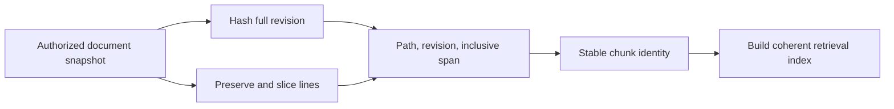

# Day 31 — Chunking, metadata, ingestion, and provenance

## 1. Learning objectives

Transform a document snapshot into bounded line chunks with explicit overlap,
source path, revision and line spans. Derive stable identifiers, reproduce
snapshot changes and explain stale-index/authorization risks. Implement chunking
independently before applying retrieval scores. Required competency: Level 4
adaptation with provenance and boundary evidence.

## 2. Required prerequisites

[Day 4](../../week-01/day-04/README.md): files, encodings and resource errors.
[Day 26](../../week-05/day-02/README.md): canonical identity and trust roles.
[Day 13](../../week-03/day-01/README.md): dataset provenance/evaluation boundaries.
Understand lists, slicing, hashes and one-based line labels. A retrieval corpus
is introduced here as a versioned collection of evidence, not assumed infrastructure.

## 3. Problem motivation

Sending every repository file to a model wastes context and can expose irrelevant
or unauthorized data. Search needs smaller evidence units, but cutting text
can separate definitions from their qualifiers. A citation to a filename alone
can become stale after edits. We therefore ingest exact snapshots and preserve
where every chunk came from. Ranking quality cannot compensate for missing,
stale or incorrectly authorized source content.

## 4. Intuitive explanation

A textbook index points to passages, not an unlabelled bag of sentences. Chunking
creates those passages; metadata is the page label; a revision digest identifies
the edition. Overlap repeats some lines so a boundary does not cut every important
relationship. Repetition has costs: duplicate evidence can crowd the answer context
or inflate retrieval metrics if one passage is counted several times.

## 5. Deep technical explanation

Our chunker accepts a trusted relative path and decoded text snapshot. It splits
with keepends=True, preserving newline characters in chunk text. A positive
window in lines and overlap satisfying 0≤overlap<window define stride=window−overlap.
Starting at zero, slice up to window lines, emit metadata and stop after the
first slice reaching the end. Empty text produces no chunks; a whitespace line
can produce a chunk with no search tokens, a distinct case.

Metadata stores identifier, path, full-source revision, inclusive start/end line
numbers and exact chunk text. Revision is SHA-256 of the full UTF-8 snapshot.
Chunk identity hashes path, revision and line span with explicit separators.
If any source text changes, all chunks receive the new full-source revision,
even if one passage's text is unchanged. This simple invalidation policy favors
correct snapshot association over maximum reuse. A more incremental scheme can
preserve unchanged passages but needs careful source mapping and consistency.

The path supplied here is already a document identifier, not a fresh permission
check. A service must select authorized documents before ingestion/retrieval and
before model-context construction. Searching a global index then filtering only
displayed results can leak unauthorized text in prompts, caches or logs. Our
local examples use an owned visible corpus and do not claim multi-tenant retrieval.

An ingestion pipeline has stages: enumerate allowed sources, bounded read/decode,
parse into text, chunk, compute representations, store metadata/index, then
publish a coherent snapshot. A failure should not silently publish a partially
updated corpus as complete. For larger systems a manifest or transactional swap
can identify active generations. Our in-memory BM25 index is built from a complete
chunk list; durable incremental ingestion is not implemented in this week.

Line chunks work well for inspectable source references but differ from model-
token chunks. Lines may be very long; this helper is not a total byte/context
limit. Upstream bounded reads and downstream context budgets remain necessary.
Structural chunking by functions/headings can preserve meaning better but needs
parsers and fallback behavior. Whatever policy is chosen, preserve source spans
and test evidence reconstruction instead of relying only on chunk count.

## 6. Mathematical foundations

With n=5 lines, window w=3 and overlap o=1, stride s=2. Emit spans 1–3 then
3–5; line three repeats. Unique source coverage is five lines while stored
line appearances total six. Counting both appearances as independent evidence
would inflate a passage-level metric.

For n>w, a useful chunk-count expression is 1+ceil((n−w)/(w−o)); for 0<n≤w
it is one, and n=0 gives zero. Our early stop follows this behavior and avoids
an extra redundant tail chunk. Work/storage scale with text plus repeated overlap;
large overlap approaches many repeated windows. Hashing the full source adds
linear work in snapshot byte length.

## 7. Architecture and execution diagrams



Authorization precedes evidence flow. Revision and spans travel with text so
later citations can be checked against the exact selected snapshot rather than
a mutable filename alone.

## 8. Implementation from first principles

```python
from forgeagent.retrieval import chunk_text

text='one\ntwo\nthree\nfour\nfive\n'
chunks=chunk_text('notes.txt',text,lines=3,overlap=1)
assert [(c.start_line,c.end_line) for c in chunks]==[(1,3),(3,5)]
assert chunks[0].text=='one\ntwo\nthree\n'
assert chunks[0].identifier==chunk_text('notes.txt',text,lines=3,overlap=1)[0].identifier
assert chunks[0].revision!=chunk_text('notes.txt',text+'six\n')[0].revision
print(len(chunks))
```

[retrieval.py](../../../forgeagent/retrieval.py) contains the complete loop and
metadata records. Inputs are a path/text snapshot and window policy; output
is a fresh Chunk list. Invalid overlap/window rejects before slicing. No files,
models, network or database are accessed by this pure function.

## 9. Worked execution walkthrough

Compute one revision digest. Split five newline-preserving rows. Start zero,
stop three, emit text rows zero through two labeled lines 1–3. Advance by two,
stop five, emit rows two through four labeled 3–5. Since stop reaches source
length, break rather than emit another mostly redundant tail. Each ID includes
same source revision but its own span. Editing source changes revision and
therefore identity, making stale citations detectable.

## 10. Independent laboratory

Implement `split_document(path,text,lines=8,overlap=1)` from the
[Week 6 lab](../../../labs/week-06/README.md), returning compatible Chunk records.
Preserve exact text/spans, stable identity and source revision. Run the day-1
contract. Deliver empty/single-line/overlap/end-boundary tests, a changed-revision
trace and a corpus authorization diagram. Explain why line count alone cannot
guarantee a model-token or byte budget. Do not import the reference chunker.

## 11. Experiments

Hold source fixed and vary window/overlap, measuring chunk count, repeated line
appearances and whether a hand-selected definition/qualifier stays together.
Then alter one distant source line and observe this policy's whole-source ID
invalidation. Compare with hypothetical content-only IDs and explain how duplicate
text in two files could become ambiguous. Record policy and corpus revision
before evaluating retrieval, so changes remain attributable.

## 12. Failure analysis

Overlap equal to window creates zero progress; reject before entering the loop.
Wrong one-based boundaries can produce citations pointing at neighboring lines.
Dropping newline characters can change exact quotes. A stale revision indicates
mixed snapshot generations rather than a scoring defect. Unauthorized source
in model context indicates missing pre-retrieval authorization. Retain minimal
span and cross-scope fixtures instead of trying to repair these bugs with prompts.

## 13. Engineering tradeoffs

Small chunks improve focused retrieval but can omit necessary context. Large
chunks preserve relationships while consuming more context and diluting matches.
Overlap reduces boundary loss while increasing redundancy. Full-source revision
IDs simplify correctness but invalidate unchanged passages after any edit.
Structural parsing improves domain alignment with implementation/maintenance cost.
Measure end-to-end evidence usefulness, not only speed or the number of chunks.

## 14. Real-world connection

Repository-aware agents need revision-aware evidence before editing. Retrieved
source is still untrusted content and may contain instructions aimed at the
model. Metadata identifies provenance; it does not grant authority. This local
pipeline teaches evidence association without claiming proprietary ingestion
or multi-tenant security behavior.

## 15. Common misconceptions

“Chunking creates facts”: it creates evidence units. “A filename is a stable
citation”: contents change. “Overlap means more independent support”: it repeats
source. “A line budget is a token budget”: representation units differ.

## 16. Technical examination

Explain snapshot/chunk/provenance. Trace five lines with overlap. Implement the
chunker. Debug a zero-stride or stale-span case. Defend line versus structural
chunking for source code. Use [separate criteria](../../../solutions/examinations/week-06.md)
after the attempt and include an authorization-before-context argument.

## 17. Daily mastery gate

Pass span/revision/empty/boundary contracts, trace an unseen window and score
4/5 including coding. Demonstrate a stale revision fails later citation matching.
Explain one line-budget limitation and one overlap-measurement bias before
marking the lesson mastered.

## 18. Resources

[Qdrant indexing documentation](https://qdrant.tech/documentation/manage-data/indexing/),
25 minutes on representation/index responsibilities. The page supplements our
original chunk/provenance design; no Qdrant server or SDK is installed. Local
code is the first-principles ingestion baseline rather than a claimed production
transactional index updater.

## 19. Revision and retention

Tomorrow reconstruct stride and inclusive spans closed book. In three days
reproduce a stale citation after a source edit. In one week design a snapshot
publication policy for a failed multi-document ingest and connect it to Week
2 transactions. Keep exact source revision with every retrieval experiment.

## 20. Next lesson connection

[Day 32](../day-02/README.md) builds an inverted index and scores chunk matches.
Stable evidence units and provenance now exist, so ranking can operate without
losing the ability to explain where a result came from.
