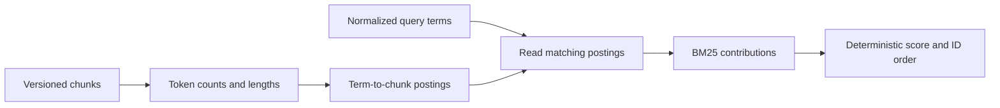

# Day 32 — Inverted indexes, TF-IDF, and BM25

## 1. Learning objectives

Build term-frequency and document-frequency statistics, explain an inverted
index, derive TF-IDF and BM25 scoring conventions, and implement deterministic
lexical ranking. Diagnose term repetition, document-length and query-normalization
effects. Required competency: Level 4 adaptation from an independent sparse
retrieval implementation.

## 2. Required prerequisites

[Day 31](../day-01/README.md): stable Chunk records.
[Week 1 Day 3](../../week-01/day-03/README.md): token frequency dictionaries.
[Day 12](../../week-02/day-06/README.md): logarithms.
[Day 11](../../week-02/day-05/README.md): vector dot products and norms.
Predict counts over a two-document corpus before adding weighting; no search
engine or information-retrieval library is assumed.

## 3. Problem motivation

The Week 1 search rescans every document for one token. Repeated queries over
a larger corpus need an index. Raw occurrence counts can overrank long or
repetitive documents and treat very common words as equally informative as
rare identifiers. Sparse weighting retains inspectable lexical evidence while
addressing some of those biases. It remains a baseline, not a guarantee of
semantic relevance or factual support.

## 4. Intuitive explanation

An inverted index resembles a book index: for each word, list passages containing
it, plus occurrence counts. Term frequency says how often it appears in one
passage; document frequency says how many passages contain it at all. Rare
terms can distinguish passages more strongly. BM25 rewards repeated matches
with diminishing returns and adjusts for document length instead of letting
repetition increase score without bound.

## 5. Deep technical explanation

Tokenize every chunk using the same casefolded Unicode-run policy as queries.
Store postings[term][chunk_id]=count and a token length per chunk. N counts
chunks in this index, not necessarily distinct source files. Overlap can alter
statistics, so corpus/chunk policy must be fixed for fair comparisons. Average
length is total token count divided by chunk count; an entirely empty-token
corpus produces no postings and no matches.

A simple TF-IDF representation uses tf(t,d)=count(t,d)/length(d) and smoothed
idf(t)=ln((N+1)/(df(t)+1))+1. Multiply these to obtain each vocabulary coordinate.
The exact formula is a convention, not the only TF-IDF variant. Query encoding
uses the fitted corpus vocabulary/IDF; unseen query terms have no coordinate.
A zero query vector needs an explicit no-evidence policy before cosine search.

Our BM25 uses positive IDF ln(1+(N−df+.5)/(df+.5)) and sums one contribution
per unique normalized query term. Term contribution is idf times
f(k1+1)/(f+k1(1−b+b·length/average_length)). k1>0 controls term-frequency
saturation; b in [0,1] controls length normalization. We use k1=1.2,b=.75 as
explicit defaults. Different implementations may omit a query-independent
factor or handle query repetition differently, so absolute scores need not
match a named engine even when ranking is similar.

The query loop reads only postings for matching terms and accumulates scores
by chunk ID. Stable descending score then ascending ID resolves ties. Empty
or unknown-term queries return no results; limit zero returns empty; invalid
limits reject. Building the in-memory index from a complete chunk list rejects
duplicate IDs. It does not implement durable incremental updates, deletions,
phrase positions or permission filters.

TF-IDF and BM25 are lexical: synonyms or paraphrases can miss if they share
no terms. Exact code symbols can be valuable, however, and a dense-only system
can lose precision on unusual identifiers. Evaluate against task labels before
assuming “semantic” means better. Keep an exact lexical baseline for debugging
query coverage and later hybrid comparisons.

## 6. Mathematical foundations

Take two equal-length chunks: d1=`agent agent`, d2=`tests tests`. For term agent,
N=2,df=1,IDF=ln(1+(1.5/1.5))=ln2. Average length=2. At f=2,k1=1.2,b=.75,
normalization denominator is 2+1.2=3.2; numerator is 2×2.2=4.4. Contribution
is ln2×1.375≈.95308. The other chunk has no posting and receives no score.

If f grows while normalized length is held fixed, the frequency factor approaches
k1+1 rather than growing indefinitely. Length also changes in real repetitions,
so vary one factor explicitly when interpreting experiments. For TF-IDF on this
corpus, smoothed IDF for each present term is ln(3/2)+1. These formulas produce
inspectable arithmetic, not calibrated probabilities.

## 7. Architecture and execution diagrams



Index construction happens once for the snapshot. Query execution reads statistics;
it does not refit them from the query or mutate source evidence.

## 8. Implementation from first principles

```python
import math
from forgeagent.retrieval import chunk_text,BM25

chunks=chunk_text('a','agent agent',lines=1,overlap=0)+chunk_text('b','tests tests',lines=1,overlap=0)
index=BM25(chunks)
ranked=index.search('AGENT',k=1)
assert len(ranked)==1 and index.chunks[ranked[0].identifier].path=='a'
assert math.isclose(ranked[0].score,math.log(2)*1.375)
assert index.search('unknown')==[]
print(ranked[0].score)
```

[retrieval.py](../../../forgeagent/retrieval.py) contains postings, TF-IDF and
BM25. Inputs are unique chunks and bounded valid parameter choices; output is
Scored records retaining chunk IDs. Memory grows with postings/vocabulary and
stored metadata. Score sorting adds hit-count-dependent work after postings
accumulation; it is not a full-corpus reread per query.

## 9. Worked execution walkthrough

Build counts agent:2 and tests:2, lengths two each, and one posting per term.
Normalize uppercase query to agent, find its posting, compute IDF and saturation,
and accumulate one score. Sort one result and return its ID. Resolve ID to
metadata only when inspecting evidence. Duplicate query agent terms are ignored
by this declared unique-term policy, not silently assumed to be a universal BM25 rule.

## 10. Independent laboratory

Implement `rank(query,chunks,k=5)` with the specified BM25 conventions from the
[Week 6 lab](../../../labs/week-06/README.md). Precompute or construct postings,
validate parameters/IDs/limits and preserve deterministic ties. Run the day-2
contract. Deliver the hand score, unknown/empty query tests, a repeated-term
query-policy test and a comparison with raw occurrence ranking. Do not import
an existing search engine as the assessed implementation.

## 11. Experiments

Hold a query fixed while varying k1 and b on a fixed corpus containing short,
long and repetitive passages. Record ranking and numeric contributions, not
just a preferred top result. Repeat after adding many common-term chunks to
observe IDF change. Keep labels/corpus version fixed when comparing variants;
changing both chunking and scoring prevents attribution. A better development
ranking is not evidence of held-out improvement without a separate test set.

## 12. Failure analysis

Wrong query casing can indicate mismatched normalization. Counting occurrences
instead of matching chunks for df inflates document frequency. Repeating overlap
as independent sources can bias both IDF and relevance labels. A division-by-zero
average signals a missing no-postings guard. An engine-score mismatch may reflect
a documented formula variant; compare conventions before declaring a numerical bug.

## 13. Engineering tradeoffs

Sparse indexes are transparent and strong on exact terms but miss zero-overlap
paraphrases. TF-IDF supports geometric comparison; BM25 adds saturation/length
heuristics without requiring learned embeddings. Larger postings and positions
support richer queries at memory/update cost. For small corpora a scan can be
simpler; an index earns its maintenance complexity when measured workload justifies it.

## 14. Real-world connection

Repository search often needs exact symbol names alongside prose meaning.
Sparse retrieval remains useful inside hybrid agent evidence systems. Its score
does not verify citations, authorize source access or prove that a matching
passage entails an answer. Those later checks must preserve the returned IDs
rather than discard provenance during context construction.

## 15. Common misconceptions

“Document frequency is total occurrences”: it counts matching indexed units.
“BM25 score is probability”: it is a ranking score. “One formula matches all
engines exactly”: conventions differ. “A vector representation must be neural”:
TF-IDF is also a numerical vector.

## 16. Technical examination

Define postings/tf/df. Derive the .95308 fixture. Implement lexical ranking.
Debug df or normalization mismatch. Defend BM25 versus raw count and dense
retrieval for identifiers. Use [separate criteria](../../../solutions/examinations/week-06.md)
after the independent attempt.

## 17. Daily mastery gate

Pass ranking/parameter/empty/tie contracts, derive one score closed book and
score 4/5 including code. Explain the chosen query-frequency convention and
why score is not confidence. Preserve corpus/chunk versions with measurements.

## 18. Resources

[Elastic similarity reference](https://www.elastic.co/docs/reference/elasticsearch/index-settings/similarity),
20 minutes on k1/b semantics; [Lucene BM25 API](https://lucene.apache.org/core/10_3_1/core/org/apache/lucene/search/similarities/BM25Similarity.html),
20 minutes on positive IDF. The versioned API page was retrieved; the ledger also records earlier
source URLs whose retrieval failed. No Lucene/Elastic service is installed.

## 19. Revision and retention

Tomorrow reconstruct postings from three tiny documents. In three days derive
how corpus additions change IDF. In one week compare lexical zero-overlap failure
with dense representation failure, recording distinct causes. Connect index
snapshot consistency to prior database transaction lessons.

## 20. Next lesson connection

[Day 33](../day-03/README.md) implements exact vector similarity and an intentionally
simple approximate candidate policy. The sparse baseline remains available
for quantitative comparison instead of disappearing behind a vector database.
