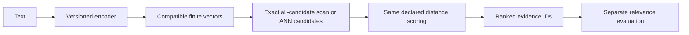

# Day 33 — Embeddings, dense search, and approximate indexes

## 1. Learning objectives

Distinguish learned semantic embeddings from lexical numerical representations
and authored vector fixtures. Implement exact cosine retrieval, enforce vector
compatibility, and demonstrate approximate candidate loss against an exact
baseline. Required competency: Level 4 adaptation with explicit measurement
scope and numerical failure diagnosis.

## 2. Required prerequisites

[Day 32](../day-02/README.md): fitted TF-IDF and lexical ranking.
[Day 11](../../week-02/day-05/README.md): cosine and zero-vector handling.
[Day 19](../../week-04/day-01/README.md): learned embedding lookup and version
compatibility. Reproduce a cosine by hand and explain why a high value is not
a truth probability. No vector database is required for this lesson.

## 3. Problem motivation

Lexical retrieval misses relevant paraphrases sharing no terms. Learned embeddings
can place some related texts near each other, depending on training and task
fit. Search over all vectors is straightforward but becomes expensive at scale,
leading to approximate indexes. Both representation errors and index approximation
can cause misses; treating them as one opaque “vector database problem” makes
debugging difficult. We keep these two boundaries separate.

## 4. Intuitive explanation

An encoder assigns a text a point in a numerical space. Nearest-neighbor search
finds nearby points; it does not decide whether the map was drawn usefully.
An approximate search follows shortcuts and may miss the true nearest point.
Our exact scan is the ruler for checking those shortcuts. Handwritten points
help test the ruler, but are not proof a learned encoder captures real language.

## 5. Deep technical explanation

A text embedding model transforms a passage/query into a fixed-width vector.
Model/version, preprocessing, dimension, normalization and distance metric form
one compatibility contract. Two models can produce equal-length vectors whose
coordinates mean different things; matching shape is necessary but insufficient.
Some retrieval encoders require different query/document prefixes or tasks.
A current production integration must verify those official model conventions
before mixing representations.

This repository implements exact cosine search over supplied vectors, plus a
TF-IDF encoder for an entirely local lexical comparison. It does not download
a pretrained semantic model or claim TF-IDF is semantic learning. Supplied
small vector fixtures test arithmetic and ranking only. Real embedding quality
would need a chosen model, compatible versions, labeled queries and controlled
inference/data handling. Keep that as a separate explicit experiment.

DenseIndex copies vectors into immutable tuples, requires equal nonzero width,
finite coordinates and nonzero norms, then scores every indexed vector by
cosine. It sorts score descending then ID ascending for stable ties. Empty
index returns no results. Zero query rejects because its direction is undefined;
an application can instead define abstention before invoking cosine. The numerical
contract targets moderate finite magnitudes, not arbitrary overflow-resistant
scientific computing.

For demonstration, approximate=True retains only vectors sharing the sign of
the first query coordinate before exact rescoring. This one-bit bucket is deliberately
crude, not HNSW. A vector just across the sign boundary may be almost parallel
and become a false negative. The point is to expose candidate-loss mechanics
with a counterexample, not present this policy as a production ANN recommendation.

Real approximate indexes include graph traversal, partitioning and quantization
families. HNSW builds a graph of neighbors and uses bounded search exploration;
more exploration can improve recall while increasing latency. Index construction,
memory, update and filtering behavior matter. Authorization filters can alter
candidate access and must be applied without leaking forbidden vectors/text.
Always compare approximate output with exact nearest neighbors on a sampled
fixed corpus before trusting a speed claim.

## 6. Mathematical foundations

Let query q=[.01,1], candidate a=[−.01,1] and b=[1,0]. Cosine(q,a) is
(.9999)/(1.0001)≈.9998, while cosine(q,b)=.01/√1.0001≈.01. Exact retrieval
selects a. The sign bucket excludes a because first coordinates have different
signs, retaining b. ANN recall@1 relative to the exact top-one set is zero,
even though exact cosine arithmetic on retained candidates is correct.

For N vectors of width d, exact query scoring costs O(Nd), plus result selection/
sorting. Storing numeric payloads costs approximately Ndb bytes with b bytes
per coordinate, excluding Python/container/index overhead. Approximation can
reduce examined candidates C≪N but does not guarantee the true neighbors lie
inside that subset. Representation relevance and exact-neighbor recall are
different evaluation targets.

## 7. Architecture and execution diagrams



The encoder can fail semantic relevance even when exact-neighbor recall is
perfect. Approximate candidates can fail despite a useful encoder. Keep both
sets of evidence when diagnosing misses.

## 8. Implementation from first principles

```python
from forgeagent.retrieval import DenseIndex

index=DenseIndex({'near':[-.01,1],'far':[1,0]})
query=[.01,1]
exact=index.search(query,k=1)
approximate=index.search(query,k=1,approximate=True)
assert exact[0].identifier=='near'
assert approximate[0].identifier=='far'
assert exact[0].score>.99
print('intentional ANN candidate-loss counterexample reproduced')
```

[retrieval.py](../../../forgeagent/retrieval.py) contains the full implementation.
Inputs are supplied vectors and query configuration; outputs are Scored IDs.
The fixture is authored geometry, not a learned semantic evaluation. The same
module exposes fitted TF-IDF vectors, whose lexical nature remains explicit.
No external model/service or GPU is needed.

## 9. Worked execution walkthrough

Copy and validate two two-dimensional nonzero vectors. Validate query. Exact
mode evaluates both cosines and selects near. Approximate mode checks first-
coordinate signs, skips near and scores only far. The resulting bad top hit
is caused by candidate selection, not the dot product. A later reranker limited
to far cannot recover the excluded near passage, establishing a candidate-
recall ceiling for subsequent stages.

## 10. Independent laboratory

Implement `nearest(vectors,query,k=5,approximate=False)` from the
[Week 6 contract](../../../labs/week-06/README.md). Validate vector domains,
compute exact cosine, deterministic ties, and reproduce the optional sign-bucket
policy. Run the day-3 check. Deliver zero/shape/non-finite cases, the cross-boundary
miss, exact-versus-approximate recall, and a note distinguishing fixture geometry
from semantic model quality. Do not import a vector database to hide arithmetic.

## 11. Experiments

Move a nearly parallel vector gradually across the sign boundary and record
exact/approximate selections. Keep coordinates and query count fixed when measuring
candidate count and elapsed time. Fit TF-IDF on a tiny corpus and test a query
with only unseen terms; handle its zero vector explicitly. For a future learned
encoder experiment, freeze model/version/task prefixes and compare relevance
labels, not only geometric closeness.

## 12. Failure analysis

Wrong cosine can indicate missing norm normalization. Equal dimensions with
nonsensical matches can indicate incompatible encoders. A zero vector should
reject or abstain by declared policy, not silently rank every document equally.
An approximate miss may be candidate loss; compare exact scan before tuning
embeddings. Filtering only final displayed text can leak unauthorized candidates
to model prompts; scope the evidence boundary earlier.

## 13. Engineering tradeoffs

Exact scan is simple and authoritative for nearest-neighbor correctness but
linear in corpus size. ANN trades recall for resource savings and needs tuning/
monitoring. Learned embeddings can capture useful paraphrases but add model,
privacy and versioning dependencies. TF-IDF is transparent and cheap but lexical.
Choose by measured tasks and corpus scale; do not add an external service solely
because “vector database” sounds more advanced.

## 14. Real-world connection

Agent retrieval often combines exact code symbols with semantic prose search.
A model upgrade can require re-embedding the corpus and invalidating stale query
or result caches. Approximate index recall alone does not measure grounded
answer accuracy. These responsibilities remain application-owned even when a
service provides storage and search kernels.

## 15. Common misconceptions

“Dense means learned”: a dense list can encode lexical features or a fixture.
“Nearest means relevant”: representation quality matters. “ANN is always correct
but faster”: it may miss candidates. “Reranking repairs every miss”: it only
sees candidates it receives.

## 16. Technical examination

Explain representation versus index errors. Derive the sign-boundary example.
Implement cosine retrieval. Debug incompatible vectors or candidate loss.
Defend exact versus approximate search for a small changing repository. Use
[separate criteria](../../../solutions/examinations/week-06.md) after your attempt.

## 17. Daily mastery gate

Pass vector-domain/ranking tests, reproduce exact top-one and approximate miss,
and score 4/5 including code. State which experiment measured geometry, ANN
recall and task relevance. Do not mark semantic retrieval validated without
an actual compatible encoder and fixed relevance evaluation.

## 18. Resources

[Qdrant indexing](https://qdrant.tech/documentation/manage-data/indexing/),
HNSW/filtering sections, free, 30 minutes; [Qdrant hybrid queries](https://qdrant.tech/documentation/search/hybrid-queries/),
15 minutes preview. These primary references explain production index concerns;
no Qdrant runtime is needed, and the local approximation is explicitly simpler.

## 19. Revision and retention

Tomorrow reconstruct the candidate-loss counterexample closed book. In three
days explain a same-width incompatible-encoder case. In one week design a
model/index migration with coherent snapshot publication and ownership filters.
Connect stale vectors to stale KV and prompt-cache state from earlier lessons.

## 20. Next lesson connection

[Day 34](../day-04/README.md) combines ranked lists and refines candidates.
Keeping lexical and vector evidence separate lets us evaluate fusion and reranking
without confusing a better score scale with better retrieval.
