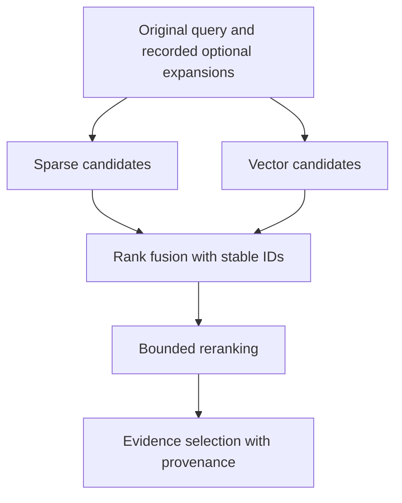

# Day 34 — Hybrid retrieval, fusion, reranking, and rewriting

## 1. Learning objectives

Fuse incompatible score systems using rank positions, implement reciprocal rank
fusion with explicit conventions, and distinguish candidate generation from
reranking. Analyze query rewriting for recall, drift and security. Required
competency: Level 4 adaptation using measured evidence and fixed query labels.

## 2. Required prerequisites

[Day 32](../day-02/README.md): sparse ranking conventions.
[Day 33](../day-03/README.md): exact/approximate vector candidates.
[Day 26](../../week-05/day-02/README.md): provenance and role boundaries.
Be able to explain why BM25 and cosine scores are not calibrated probabilities
and why a candidate absent from every input list cannot be rescued by reranking.

## 3. Problem motivation

Exact symbols and paraphrases favor different retrieval methods. Adding raw
BM25 and cosine scores mixes unrelated scales; one system can dominate simply
because its numbers are larger. Fusion can combine their ordering without that
scale assumption. Reranking spends more work on fewer candidates, while rewriting
changes what is searched. Each stage can help or hurt, so it needs a separate
contract and evaluation rather than an undifferentiated “hybrid is better” claim.

## 4. Intuitive explanation

Two judges may use incompatible grading scales but still agree which contestant
ranks first. Rank fusion combines placements. A reranker is a second inspection
of the shortlisted contestants; it cannot inspect someone absent from the shortlist.
Query rewriting is asking the question differently, which may reveal useful
passages or accidentally ask a different question. Preserve the original request
so that useful expansion does not replace user intent.

## 5. Deep technical explanation

Our reciprocal rank fusion assigns each result contribution 1/(c+r), where
r starts at one and c>0 is a configured constant. Add contributions across
rankings and sort total descending then ID ascending. Missing results contribute
zero. Each input ranking must contain an ID at most once; duplicates would
artificially count repeated evidence as independent support and are rejected.
The example default c=60 follows a common original convention, not a universal
optimal value or current service default.

Larger c flattens the difference between high and lower positions, emphasizing
agreement across lists. Smaller c makes top placements more dominant. List
depth also changes available contributions. Preserve both depth and c when
comparing fusion variants. Query repetitions and highly correlated retrievers
can effectively double-count the same signal; fusion does not automatically
create independent evidence or calibrated confidence.

A reranker scores candidate/query pairs more directly after initial retrieval.
A learned cross-encoder can jointly process text pairs but adds inference cost,
model dependence and new input limits. Our transparent reranker instead uses
fraction of unique normalized query terms present in a candidate. It is a lexical
coverage demonstration, not a learned relevance model. It may promote passages
that contain all terms in an irrelevant or adversarial context.

Reranking must preserve IDs and source metadata. Replacing an evidence list
with anonymous text loses citation linkage and can mix versions. Validate that
candidates exist in the authorized current snapshot. A maximum rerank depth
bounds work but caps recall. If the true supporting passage was never retrieved,
more sophisticated ordering cannot recover it.

Query rewriting can expand abbreviations, split multi-part requests or add
synonyms, but a model can hallucinate identifiers or follow malicious source
instructions. Retain original query, record rewrite/version and limit expansion
count/length. A deterministic alias table is an inspectable baseline; a learned
rewriter requires evaluation. This week's implementation does not silently
rewrite queries. The lab includes an explicit controlled rewriting experiment
rather than claiming a generic rewriting model is already implemented.

## 6. Mathematical foundations

Rankings A=[x,y], B=[y,z], with c=60, give x=1/61≈.01639,
y=1/62+1/61≈.03252 and z=1/62≈.01613. Fused order is y,x,z. A raw score of
100 in A does not appear in this calculation; only rank matters. If x appears
twice inside A, rejecting it prevents a spurious extra vote.

For query terms {test,timeout}, a candidate containing only test has lexical
coverage 1/2. One containing both scores one, even if it says “do not test the
timeout.” Thus coverage is not entailment. Candidate recall establishes an upper
bound: if only one of two relevant passages enters the shortlist, a perfect
reranker can recover at most half of the relevant set at that stage.

## 7. Architecture and execution diagrams



Every expansion and stage keeps a link back to original intent. Authorization
belongs before evidence exposure, not as a cosmetic final display filter.
The fusion score controls ordering, not trust or permission.

## 8. Implementation from first principles

```python
import math
from forgeagent.retrieval import fuse

ranked=fuse([['x','y'],['y','z']],constant=60,k=3)
assert [item.identifier for item in ranked]==['y','x','z']
assert math.isclose(ranked[0].score,1/62+1/61)
assert fuse([],k=3)==[]
print([(item.identifier,item.score) for item in ranked])
```

[retrieval.py](../../../forgeagent/retrieval.py) contains fusion and coverage
reranking. Inputs are ordered IDs/Scored records from compatible snapshots;
outputs are Scored IDs. Raw input scores are intentionally ignored by RRF.
Positive finite constant and nonnegative integer limit validate; duplicate
within-list IDs reject. No external model or service is involved.

## 9. Worked execution walkthrough

Read A's x at rank one and y at rank two, then B's y at one and z at two.
Accumulate y's two contributions without changing its identity. Sort totals,
resolve any exact ties by ID, and retain at most k. A later coverage reranker
reads each selected chunk from the current mapped corpus and recomputes lexical
coverage. It cannot invent an absent chunk or make a wrong citation revision valid.

## 10. Independent laboratory

Implement `combine(rankings,constant=60,k=5)` from the
[Week 6 contract](../../../labs/week-06/README.md), using one-based ranks, absent-
zero contribution, duplicate rejection and stable tie ordering. Run the day-4
contract. Deliver the hand example, conflicting score scales, empty/invalid
cases and one reranker recall-ceiling demonstration. Separately test a bounded
alias rewrite with original query retained; do not import a fusion framework.

## 11. Experiments

Vary c and input-list depth on a fixed ranking fixture and record order changes.
Multiply all raw scores in one list by a thousand; RRF should remain unchanged
when order stays fixed. Compare coverage reranking on a relevant passage and
an irrelevant all-terms passage. Try one abbreviation alias and one drifting
rewrite, judging against prewritten relevance labels. Report regressions rather
than selecting only queries where fusion helps.

## 12. Failure analysis

One retriever dominating after score rescaling indicates raw-score mixing rather
than rank fusion. An off-by-one rank changes every contribution. Duplicate IDs
can inflate scores and should fail visibly. A reranker apparently finding an
excluded result may be reading outside its declared candidate set, invalidating
latency/recall measurements. Query drift can come from rewriting away an exact
symbol; preserve and compare original-query candidates.

## 13. Engineering tradeoffs

RRF avoids calibration but discards useful score margins. Calibrated weighted
scores can use that information with training/normalization assumptions. Reranking
can improve ordering at extra latency/cost and cannot exceed candidate coverage.
Rewriting can broaden recall while increasing noise and provenance complexity.
Prefer a measured simple pipeline before adding model-based stages, and preserve
stage-level traces so regressions can be attributed.

## 14. Real-world connection

Repository/documentation agents often need lexical identifiers and semantically
related explanations. Hybrid pipelines support that combination, but evidence
quality still requires relevance labels and citation checks. A service's current
RRF defaults or weighted variants may differ from the original formula; compare
contracts rather than inferring equivalence from the shared method name.

## 15. Common misconceptions

“Fusion always improves every query”: it may add noise. “RRF score is confidence”:
it aggregates ranks. “Reranking repairs missing candidates”: it only reorders
available evidence. “Rewrite means replace user intent”: preserve provenance and
validate that expansions still ask the same question.

## 16. Technical examination

Explain score-scale mismatch. Derive the y,x,z result. Implement rank fusion.
Debug duplicated IDs or rank indexing. Defend when reranking/rewriting is worth
its latency under a fixed recall budget. Use
[separate criteria](../../../solutions/examinations/week-06.md) after your attempt.

## 17. Daily mastery gate

Pass fusion/domain/tie checks, reproduce contributions by hand, and score 4/5
including coding. Demonstrate one fusion regression or rerank ceiling instead
of claiming universal improvement. Record original query and stage configuration
with every experiment.

## 18. Resources

[Original RRF paper](https://plg.uwaterloo.ca/~gvcormac/cormacksigir09-rrf.pdf),
Cormack, Clarke and Büttcher, free, 20 minutes on the original formula and fixed
constant. [Qdrant hybrid queries](https://qdrant.tech/documentation/search/hybrid-queries/),
25 minutes comparing modern variants. Local implementation uses the explicitly
stated original unweighted convention, not an untested SDK integration.

## 19. Revision and retention

Tomorrow reconstruct one-based fusion without notes. In three days create a
score-rescaling invariance test. In one week defend a no-reranker baseline for
a small corpus using measured quality/latency. Connect duplicate evidence bias
to overlapping chunks and repeated correlated model trials.

## 20. Next lesson connection

[Day 35](../day-05/README.md) turns candidate/ranking quality into fixed numerical
metrics. Stage improvements must now be justified with explicit relevance units,
cutoffs and denominators rather than attractive examples alone.
