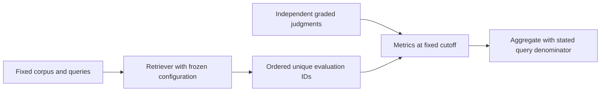

# Day 35 — Precision, recall, reciprocal rank, and nDCG

## 1. Learning objectives

Define relevance units and graded judgments, derive precision@k, recall@k,
reciprocal rank and normalized discounted cumulative gain. Implement fixed-
convention metrics, reject duplicate rankings and preserve empty-relevance cases.
Required competency: Level 4 measurement-driven debugging and adaptation.

## 2. Required prerequisites

[Day 34](../day-04/README.md): candidate/ranking stages.
[Day 13](../../week-03/day-01/README.md): split and contamination discipline.
[Day 12](../../week-02/day-06/README.md): logarithms.
[Day 30](../../week-05/day-06/README.md): honest denominators and uncertainty.
Be able to distinguish a chunk ID from its source document before choosing
what a relevance label actually refers to.

## 3. Problem motivation

A plausible top hit does not establish reliable retrieval over many queries.
Different metrics reward different outcomes: finding one useful passage early,
covering all known evidence, or ranking highly useful passages ahead of weak ones.
Unstated units and empty-query conventions can inflate reported results.
We implement small inspectable metric functions and a fixed visible benchmark
before any larger agent benchmark uses retrieval as a hidden dependency.

## 4. Intuitive explanation

Precision asks how much of the returned shortlist is useful. Recall asks how
much of all known useful evidence the shortlist recovered. Reciprocal rank
rewards the position of the first useful result. nDCG rewards graded usefulness
while discounting lower positions and comparing with an ideal ordering.
None says whether a final generated answer correctly used the evidence.

## 5. Deep technical explanation

Choose a judgment unit first: source document, chunk, supporting fact or task.
Our fixed teaching fixture labels source paths. Search returns chunk IDs, so
the benchmark resolves paths and de-duplicates them before document-level
measurement. Otherwise overlapping chunks from one source could count several
times against a one-document relevance label. This is an explicit evaluation
projection, not a claim all chunk-level judgments should collapse to documents.

At cutoff k>0, precision uses denominator k even when fewer than k results
exist; missing slots are not useful hits. Recall divides by the number of
positively judged relevant units. Reciprocal rank is 1/r for first relevant
rank r≤k, else zero. Mean reciprocal rank averages per-query reciprocal ranks
over all evaluated queries, including those with zero by policy. Other benchmarks
may exclude no-answer queries; report that different denominator explicitly.

Our graded relevance values are integers 0..10. DCG uses gain 2^grade−1 divided
by log2(rank+1), starting rank at one. Ideal DCG sorts known grades descending
at the same cutoff. nDCG divides observed by ideal, returning zero when ideal
is zero. Some libraries use linear relevance gain directly; transform inputs
or change the formula when comparing, rather than claiming every nDCG value
must match a library default. Tie ordering also changes scores and must be fixed.

Missing judgments are treated as grade zero in this teaching evaluator. In
large incomplete judgment pools, unjudged does not necessarily mean irrelevant;
that assumption can bias evaluation. Small authored fixtures have explicit
scope and can test arithmetic reproducibly without claiming broad retrieval
quality. Keep corpus, query set, judgments, normalization, chunk policy and
cutoff versioned together.

Duplicate retrieved identifiers reject instead of being counted repeatedly.
Grades outside the declared range reject. These are data-integrity errors,
not ordinary low retrieval quality. A no-relevant query has recall/nDCG/rr zero
by our convention while its correct application behavior may be abstention.
Therefore evaluate abstention separately rather than making an excellent
no-evidence response look like a retrieval failure requiring hallucinated content.

## 6. Mathematical foundations

At k=3, ranked [b,x,a] and grades {a:2,b:1}, hits=2. Precision=2/3, recall=2/2=1,
rr=1 because b is relevant at rank one. Gains are a:3,b:1. Observed DCG is
1/log2(2)+0/log2(3)+3/log2(4)=1+0+1.5=2.5. Ideal DCG is
3/log2(2)+1/log2(3)≈3.63093. nDCG≈.68853. Returning both relevant items gives
perfect recall without perfect graded order.

For ranked [x,a] at k=1, all metrics are zero under the cutoff even though a
appears later. Increasing k changes the question. For no relevant judgments,
zero denominators use declared zero values, not NaN. An all-zero query's correct
abstention is reported by a separate Boolean metric in the teaching benchmark.

## 7. Architecture and execution diagrams



Judgments are not tuned to make the current retriever pass. The output report
retains per-query rows so an average cannot conceal a specific no-answer or
security-relevant failure.

## 8. Implementation from first principles

```python
import math
from forgeagent.grounding import ranking_metrics

metrics=ranking_metrics(['b','x','a'],{'a':2,'b':1},k=3)
assert math.isclose(metrics['precision'],2/3)
assert metrics['recall']==1 and metrics['rr']==1
assert math.isclose(metrics['ndcg'],2.5/(3+1/math.log2(3)))
assert ranking_metrics([],{},k=1)['ndcg']==0
print(metrics)
```

[grounding.py](../../../forgeagent/grounding.py) contains the complete metric
function and benchmark aggregation. Inputs are ordered unique IDs, grade mapping
and cutoff. Output is a dictionary with named numeric quantities. No model,
network or judgment generation occurs. Complexity is O(k) for observed sums
plus sorting judgment grades for ideal order.

## 9. Worked execution walkthrough

Validate k, ID uniqueness and grade domains. Slice the top three IDs, form the
positive-relevance set and count two hits. Find b at rank one. Compute each
observed discounted gain, separately sort grades for the ideal denominator,
then divide. Empty relevance returns declared zeros. The benchmark later averages
rr over every fixture query, while reporting abstention correctness separately.
Those two columns answer different questions and should not be merged silently.

## 10. Independent laboratory

Implement `metrics(ranked,relevance,k=5)` from the
[Week 6 contract](../../../labs/week-06/README.md) using the specified denominators,
exponential gain, one-based ranks and empty policies. Run the day-5 contract.
Deliver hand calculations for [b,x,a], missing-slot precision, no-relevant input,
duplicate rejection and graded-order changes. Explain how document-level labels
require de-duplicating source paths before this function rather than changing
the metric mid-run.

## 11. Experiments

Keep judgments fixed and swap relevant positions, observing which metrics change.
Vary k over one, two and three without relabeling results. Compare linear and
exponential gain on the same graded fixture and document different definitions.
Add an unjudged but plausibly relevant passage to expose the closed-world
assumption. Never revise labels after inspecting scores simply to improve an
aggregate; separate genuine annotation correction from system tuning.

## 12. Failure analysis

Recall above one often signals duplicate hits counted against unique relevance.
Perfect precision with missing slots may use returned length instead of declared
k. Unexpected nDCG differences can come from gain or tie conventions. Empty
judgment NaN indicates an unspecified denominator policy. Strong development
scores can reflect test-query tuning; preserve independent splits before making
generalization claims. Check per-query rows before changing the retriever.

## 13. Engineering tradeoffs

Precision emphasizes shortlist cleanliness; recall emphasizes evidence coverage.
Reciprocal rank fits first-useful-hit tasks but ignores remaining coverage.
Graded nDCG captures ordering nuance with annotation effort and formula choices.
Visible fixtures are excellent regression checks but contaminated as held-out
quality tests. Human judgments need scope, consistency and correction policy;
more metric columns cannot repair ambiguous relevance definitions.

## 14. Real-world connection

Agent RAG quality depends on retrieval and evidence use. A retrieval benchmark
can explain whether the answer model ever received relevant context, while
answer/citation evaluation checks what it did with that context. Keep these
stages separate when debugging a coding agent's unsupported claim or failed
repository inspection.

## 15. Common misconceptions

“Recall one means the answer is correct”: evidence may be misused. “nDCG has
one universal gain formula”: conventions differ. “No relevant documents means
hallucinate a hit”: abstention is separate. “A visible fixture is held out”:
its answers are available during development.

## 16. Technical examination

Define all four metrics. Derive the graded example. Implement fixed conventions.
Debug duplicate inflation or missing-slot precision. Defend metric choice for
finding one API definition versus assembling several supporting facts. Use
[separate criteria](../../../solutions/examinations/week-06.md) after attempting.

## 17. Daily mastery gate

Pass arithmetic/domain/empty tests, reproduce a graded example closed book and
score 4/5 including coding. State evaluation unit, cutoff, gain, missing-judgment
and no-relevance policies. Preserve a fixed denominator and explain why visible
regression success cannot be called held-out model quality.

## 18. Resources

[scikit-learn nDCG reference](https://scikit-learn.org/stable/modules/generated/sklearn.metrics.ndcg_score.html),
25 minutes on graded discount/normalization; its default gain convention differs
from ours unless transformed. [Original RRF paper](https://plg.uwaterloo.ca/~gvcormac/cormacksigir09-rrf.pdf),
15 minutes review of fixed evaluation choices. No scikit-learn dependency is needed.

## 19. Revision and retention

Tomorrow reconstruct all denominators without notes. In three days compute a
new three-position nDCG fixture. In one week design relevance labels for a
multi-file coding question and distinguish document recall from supported-fact
recall. Connect metric integrity to previous classifier evaluation denominators.

## 20. Next lesson connection

[Day 36](../day-06/README.md) connects retrieved evidence to answers, validates
revision-aware quotations and abstains when support is absent. Retrieval scores
alone cannot close that final correctness boundary.
