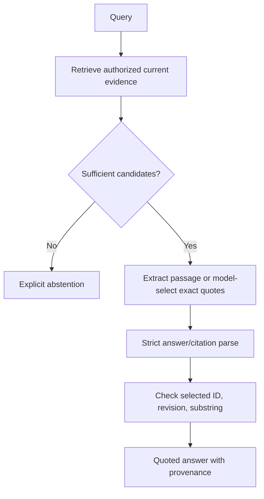

# Day 36 — Grounded answers, citations, and abstention

## 1. Learning objectives

Build an extractive RAG baseline and an optional model-assisted quote selector
using the existing provider interface. Validate citation identity/revision/quotes,
reject unsupported answer text and evaluate abstention separately from retrieval.
Required competency: Level 4 debugging/adaptation with an end-to-end evidence trace.

## 2. Required prerequisites

[Day 31](../day-01/README.md): snapshot-aware chunk provenance.
[Day 35](../day-05/README.md): fixed relevance metrics.
[Day 27](../../week-05/day-03/README.md): strict structure versus semantic truth.
[Day 26](../../week-05/day-02/README.md): untrusted evidence in data roles.
Be able to distinguish matching text from factual entailment and explain why
an unauthorized document must not enter model context.

## 3. Problem motivation

A model can generate an answer with a plausible citation that does not exist,
points to an old revision, or supports only part of the claim. A retriever can
also return no useful evidence. Fabricating a confident answer in that situation
hides system failure. We implement a deliberately narrow quote-only answer
contract that can be checked mechanically, and explain where freeform paraphrase
would require additional semantic evaluation.

## 4. Intuitive explanation

A grounded answer should carry its receipt: which current passage supports the
text. Our baseline returns an exact passage and receipt, or says insufficient
evidence. The optional model chooses exact quotations but cannot add unquoted
claims under this contract. A receipt can prove where words came from; it
cannot prove the source itself is true, trustworthy or relevant to the user's
actual question. Those limitations remain visible.

## 5. Deep technical explanation

The local extractive path searches BM25, selects a top chunk, checks a configurable
minimum count of overlapping unique query terms, then returns trimmed exact
chunk text with Citation(chunk_id,revision,quote). No hits or insufficient
coverage yields GroundedAnswer with abstained=True and no citations. Coverage
is a heuristic, not entailment; its errors must be evaluated on fixed tasks.
Source text is returned as untrusted quoted evidence, never executed.

Citation verification finds the selected chunk, matches its full-source revision,
requires a nonempty quote and exact substring membership. Wrong path/ID, stale
revision or invented quote fails. This verifies provenance/occurrence only.
A cited passage can be wrong, adversarial or unrelated. Source-authority and
answer-relevance judgments remain separate, and future security evaluation must
include misleading documents rather than only nonexistent citations.

The optional grounded_generate path retrieves at most three chunks and supplies
them as JSON evidence in a user data message. A trusted developer instruction
asks for answer plus citation objects. The provider is the Week 5 interface,
so tests use FakeProvider without paid calls. Empty retrieval abstains without
calling a model. Query bytes are bounded; production context requires additional
total evidence/token budgeting, which later context lessons implement.

Strict response parsing requires exactly answer/citations, bounded response bytes,
unique JSON keys, no more than five citations and exact citation fields/types.
Every citation must refer to the actually supplied selected chunks, not any
other corpus passage. With citations, answer must exactly equal quotes joined
by newline. With none, only the explicit insufficient-evidence string is valid.
This intentionally rejects freeform paraphrases so complete answer support is
mechanically testable under the narrow quote contract.

A more expressive RAG application may allow paraphrases and multi-source synthesis,
but a substring citation check no longer proves every claim is supported.
That extension requires claim decomposition, entailment/human evaluation, calibration
and regression tests; it is not silently implemented here. The visible fixture
benchmark reports retrieval metrics, citation validity and abstention correctness
separately. No held-out agent benchmark or learned semantic/model-quality result
is implied by deterministic fixture success.

## 6. Mathematical foundations

Let supplied evidence set be E and citations C. Structural provenance validity
requires every c∈C map to a current chunk in E with its quoted substring.
Our supported-output language further restricts answer A to concatenation of
those quote strings. Thus no extra answer characters introduce an uncited claim,
but relevance/truth of quoted content remains an independent predicate.

For no-answer cases, citation validity using all(empty citations) is vacuously
true. That does not make the task successful: separately compare abstained
against expected abstention. A system always abstaining could pass citation
validity on every query while failing useful-answer coverage. Report both
quantities and fixed task success rather than using one convenient score.

## 7. Architecture and execution diagrams



The verification edge does not turn source text into instructions. Model selection
is optional; deterministic extraction provides a reproducible baseline and
separates retrieval failures from generation failures.

## 8. Implementation from first principles

```python
from forgeagent.retrieval import chunk_text,BM25
from forgeagent.grounding import extract_answer,verify_citation,Citation

chunks=chunk_text('policy.md','Authorization checks owner access.\n',lines=1,overlap=0)
index=BM25(chunks)
answer=extract_answer('authorization owner',index)
assert not answer.abstained and verify_citation(answer.citations[0],chunks)
assert extract_answer('chlorophyll',index).abstained
bad=Citation(chunks[0].identifier,'old-revision','Authorization')
assert not verify_citation(bad,chunks)
print(answer.text)
```

[grounding.py](../../../forgeagent/grounding.py) contains deterministic extraction,
strict quote-response parsing, optional provider orchestration and benchmark.
Inputs are an authorized current index and query; output is a typed answer
or explicit failure. The example uses original authored text, not external
copyrighted source content, and makes no model request.

## 9. Worked execution walkthrough

Normalize query, retrieve the indexed passage and count two overlapping query
terms. Select its trimmed text, attach ID/revision and return quoted answer.
Verification finds the same current chunk and exact quote. The absent-term
query returns no hit and abstains. Replacing revision with an old value rejects
provenance despite identical words. In the model path, an added unsupported
sentence fails answer-equals-quotes even if all cited snippets individually exist.

## 10. Independent laboratory

Implement `supported(text,chunks)` from the [Week 6 contract](../../../labs/week-06/README.md).
Parse the bounded exact answer/citation shape, validate only supplied current
chunks and enforce quoted-answer or explicit-abstention rules. Run the day-6
contract. Deliver fabricated-ID, stale-revision, altered-quote, extra-claim and
empty-citation cases. Then run the fixed retrieval benchmark and a FakeProvider
quote-selection round trip, reporting scope instead of claiming live model quality.

## 11. Experiments

Change only source revision, then only quote bytes, and observe distinct failures.
Provide a real but irrelevant quotation and show occurrence verification can
pass while task relevance fails. Compare always-abstain, coverage-threshold and
extractive policies on the visible fixture using separate answer/abstention
columns. Insert a source instruction asking for unrelated execution; verify it
remains data and cannot invoke a command in this pipeline.

## 12. Failure analysis

An invented ID passing suggests lookup against wrong/global evidence rather than
selected context. A stale quote passing suggests revision was ignored. An extra
sentence passing under this contract means full-answer support was not checked.
Perfect citation validity with no useful answers may be vacuous abstention.
Confusing source instructions with developer policy is role promotion, not a
ranking defect. Use minimal fixtures for each boundary instead of one giant prompt.

## 13. Engineering tradeoffs

Exact extraction is easy to verify but less expressive and can return excessive
irrelevant context. Model quote selection adds cost/latency and may improve
focus without guaranteeing relevance. Paraphrasing improves readability but
requires stronger semantic grading. Abstention lowers unsupported-answer risk
while potentially losing answer coverage. Tune thresholds only on development
fixtures and retain a separate evaluation boundary.

## 14. Real-world connection

Coding agents should inspect current repository evidence before proposing changes
or claiming tests passed. Citation provenance is useful, but only actual test
execution supports a test-result claim. Retrieval output can contain prompt
injection. The next phase introduces tool execution policy and runtime state
rather than treating a grounded quote as authorization to act.

## 15. Common misconceptions

“A valid citation proves truth”: it proves occurrence under this check.
“Every abstention is failure”: no-evidence tasks should abstain. “Citation validity
alone measures usefulness”: always-empty citations can pass vacuously.
“Retrieved instructions have authority”: source content remains untrusted data.

## 16. Technical examination

Explain provenance versus entailment. Trace stale revision rejection. Implement
strict support parsing. Debug an extra-claim or vacuous-abstention metric.
Defend quote-only versus paraphrased answers under fixed evaluation resources.
Use [separate criteria](../../../solutions/examinations/week-06.md) afterward.

## 17. Daily mastery gate

Pass support/abstention/adversarial parser contracts, execute the fixed benchmark
and score 4/5 including code. Explain a true-occurrence/false-relevance counterexample.
Complete [review](../weekly-review.md) and the cumulative application phase defense;
never mark a live or held-out benchmark complete from visible fake-provider tests.

## 18. Resources

[Qdrant hybrid retrieval](https://qdrant.tech/documentation/search/hybrid-queries/),
20 minutes review of candidate stages; [OpenAI structured outputs](https://developers.openai.com/api/docs/guides/structured-outputs),
20 minutes on format versus application checks. The quote-support contract and
its original derivations are authored locally; neither external page substitutes
for the essential evidence-validation teaching.

## 19. Revision and retention

On review day reconstruct retrieval→selection→support checks closed book.
In three days reproduce a stale evidence failure. In one week distinguish
source occurrence, source authority, answer relevance and execution authorization.
Connect each to an earlier schema, transaction or role-boundary example.

## 20. Next lesson connection

Week 7 will turn complete model decisions into controlled tool actions inside
a custom runtime. The [roadmap](../../../ROADMAP.md) records availability.
Evidence, model output and executable authority are now explicit separate
interfaces; the agent loop must preserve those boundaries rather than merge them.
