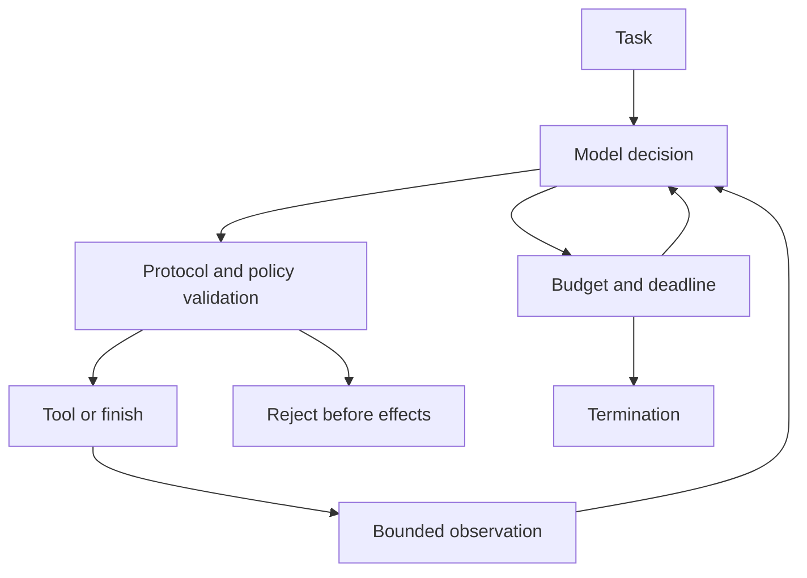

# Day 37 — Workflows, agents, and state machines

## 1. Learning objectives

By the end, distinguish workflows, agents, and state machines in an actual execution trace, implement one part without a framework, and explain a failure boundary. Required evidence is a runnable script, a trace with request, decision, validation, tool, observation, state, and termination, plus a written tradeoff. Success means another learner can reproduce your result from this page.

## 2. Required prerequisites

Know Python functions, dictionaries, exceptions, async functions and basic JSON. Week 5 established provider requests and usage; Week 6 established trust boundaries and evidence. Read the linked runtime implementation when the chapter names a behavior. The examples use FakeProvider and local functions; no live model, network, credentials or external service are involved.

## 3. Problem motivation

An LLM can choose a useful next operation, but choosing an operation is not executing it safely. A workflow has a developer-chosen route; an agent chooses among actions from observations. A finite-state machine makes the route explicit as states and guarded transitions. These are three useful descriptions, not product categories that exclude each other. ForgeAgent is a state machine whose transition choice is supplied by a model. This distinction matters because a good answer can still conceal an unauthorized effect, malformed input, a hung tool, or a duplicate action after an uncertain response. Build control flow outside the model and make each boundary observable.

## 4. Intuitive explanation

For a fixed invoice extraction, use a workflow: parse, validate, then render. For an ambiguous support question, an agent may inspect a policy, then decide whether another lookup is needed. Even then, encode a finite state graph such as START, ACT, OBSERVE, FINISH, FAIL so model flexibility cannot remove validation or termination. Picture the model as a planner that proposes a ticket; the dispatcher is the clerk who checks the ticket against a rulebook before anything happens. A handwritten ticket does not become valid merely because it is confidently phrased. Likewise valid JSON is only syntax: identity, permission, types, limits, dependencies and state all require checks.

## 5. Deep technical explanation

A fixed workflow can still contain branching, but its branch conditions are authored in code and its reachable routes are enumerable before execution. An agent instead asks a model to select a next action from currently available actions. A finite-state machine describes legal states and transitions, including for either design. A useful test is: if the model were replaced with a lookup table, would the route still be fixed? If yes, the model may be unnecessary. In ForgeAgent, state is explicit in the loop index, the completed-call map, the messages, and RunResult.status; it is not an unbounded hidden conversation. The state machine has running → completed, budget_exhausted, timed_out, failed, or caller-cancelled outcomes. Tool errors may be observations that permit a later decision; parser/provider errors fail the run. This architecture keeps authority checks deterministic while allowing the model to choose among declared actions.

## 6. Mathematical foundations

Consider a document workflow with 3 stages, each with one model call costing 0.4 seconds and one deterministic validation of 0.01 seconds. Its latency is 3×(0.4+0.01)=1.23 seconds, and it makes exactly three model calls. An adaptive agent that needs 1, 2, or 4 decisions with probabilities 0.5, 0.35, and 0.15 has expected calls 1(.5)+2(.35)+4(.15)=1.8. At 0.4 seconds per call its expected model time is 0.72 seconds, but worst case is 1.6 seconds. These averages do not establish which architecture is better: task success, branch quality, and tail latency must be measured. A state transition is δ(s,e)=s′ only when guard g(s,e) is true; otherwise the transition is rejected or routed to review. Enumerating finite workflow states makes reachability review possible; model-selected actions expand proposal choices, not authorized transitions.

## 7. Architecture and execution diagrams


The guard is outside model control. An edge to a write handler requires an additional explicit grant. A timeout or exhausted budget terminates future iterations; neither retroactively undoes an accepted external effect.

## 8. Implementation from first principles

```python
from forgeagent.runtime import Agent, Registry, Tool, Budgets
from forgeagent.models import FakeProvider, Reply, Usage
import asyncio
async def main():
    reg=Registry()
    async def lookup(key): return {'state':'paid','key':key}
    reg.register(Tool('lookup','Read an invoice state',{'type':'object','properties':{'key':{'type':'string','maxLength':16}},'required':['key'],'additionalProperties':False},lookup))
    provider=FakeProvider([Reply('{"type":"finish","answer":"Use a fixed sequence for extraction."}',Usage(10,8))])
    result=await Agent(provider,reg,['lookup'],budgets=Budgets()).run('Extract a known invoice format')
    assert result.status=='completed' and result.steps==1 and result.tool_calls==0
    print(result.status, result.answer)
asyncio.run(main())
```
Run from repository root with `python` after the project package is installed or importable. This executable uses only local deterministic fixtures. Compare the assertion with its printed output; then change one input to violate the boundary. The referenced implementation is `forgeagent/runtime.py`; the compact example deliberately exposes the API without hiding dispatch behind an agent framework.

## 9. Worked execution walkthrough

Trace a fixed invoice task. Request: user asks to extract the known three-field invoice template. Decision: the workflow state PARSE selects the parser stage; no model tool call is needed. Validation: parsed invoice identifier and amount satisfy local types and required-field rules. Tool: deterministic parser runs once. Observation: parser returns `{invoice_id: INV-7, amount_cents: 1250}`. State: PARSE→VALIDATE→RENDER. Termination: render returns the formatted answer after three fixed transitions. For an ambiguous task, state START→DECIDE permits an allowed lookup; the model may choose it, but dispatcher validates it, then the result returns to DECIDE. If confidence or classification is below a chosen threshold, state moves to REVIEW. Crucially this threshold is an application decision and must be calibrated; a model's self-reported confidence is not evidence of correctness. A workflow can use an agent subroutine without making the whole system open-ended.

## 10. Independent laboratory

Implement the day-specific contract in `labs/week-07/starter/day01.py`. Keep the public API and error semantics in the starter docstring. Do not import the solution. Demonstrate one normal path and two rejection/failure paths; write a trace table before coding. The lab’s check runner is deterministic and has no network access. A passing public check is necessary but not sufficient: explain why the rejected proposal cannot cause a side effect.

## 11. Experiments

Construct 20 fixed-format inputs and 20 ambiguous requests with expected route labels. Run a code-only router and an agent-style fake provider over the same fixtures. Measure route accuracy, number of model decisions, p50/p95 latency, and terminal state. Predict that the fixed task needs one authored route and that the uncertain task will show higher decision variance. Then inject one provider failure and one low-confidence route. A useful result table reports numerator and denominator, not only percentages: for example, 18/20 correct. Do not infer production accuracy from fabricated fixture distributions; this experiment demonstrates control-flow and measurement design. Also count unreachable states in the proposed finite-state diagram and remove or justify them.

## 12. Failure analysis

A common design defect is calling the model repeatedly to decide a branch whose inputs already determine the branch. This adds latency and a nondeterministic failure surface. The opposite defect is a rigid workflow that silently assumes every task has the same route, causing bad answers on ambiguous inputs. A state machine can expose a missing transition rather than allowing accidental fallthrough. Test terminal states explicitly: no transition should resume after completed or failed. Review the transition graph for loops and bound them with a step counter. A confidence threshold can route uncertain work to review, but careless calibration can reject too much or approve dangerous cases. Record the observed feature and threshold decision, not private model reasoning.

## 13. Engineering tradeoffs

A workflow gives predictable call count, straightforward tests and a reviewable order. It is a strong fit where the input and transformation are known. Its cost is brittleness when exceptions multiply; each branch creates authored complexity. An agent loop can handle novel sequences and stop when evidence suffices, but its path length, output quality and tool selection vary. A state machine provides a shared safety skeleton: explicit transitions and terminal states. Comparing architectures requires both expected and worst-case cost, not just a demo transcript. Use an agent only when flexible action choice adds measured value over a compact deterministic route.

## 14. Real-world connection

The same shape appears in support automation, code assistants, data analysis and operations bots. A controller owns authority and state; a model helps select from bounded capabilities. A tool description can help the model choose, but security depends on server-side identity checks and resource enforcement. A local registry demonstrates dispatch mechanics, not a production sandbox, credential vault, distributed transaction, or provider-side financial ceiling.

## 15. Common misconceptions

“Agent” does not mean unconstrained autonomy. “Schema valid” does not mean safe or authorized. “Read-only” describes intended effect, not proof that a handler has no hidden side effects. “Timeout” does not guarantee remote cancellation. “Parallel” does not mean deterministic. “Trace” does not mean store every prompt. “Evaluation passed” does not establish behavior outside the fixture distribution. Name each guarantee at its actual boundary.

## 16. Technical examination

Given the 1/2/4-step distribution in the math section, compute expected and maximum model calls. Draw a state graph with explicit `REVIEW` and terminal failure. Trace the fixed invoice and ambiguous lookup examples through request, decision, validation, action, observation, state and termination. Identify which transitions are code-owned and which action is model-proposed. Give one test for an unreachable state and one limitation of self-reported confidence.

## 17. Daily mastery gate

Mastery requires a runnable classifier with fixed, ambiguous and low-confidence cases; expected call arithmetic 1.8 and worst case 4; and a graph with no route out of a terminal status. Explain, with a concrete example, why an agent can be built from a deterministic state machine and why a model call is not inherently an agent. A wrong arithmetic result or a missing review transition requires remediation.

## 18. Resources

Primary references: [Anthropic, Building effective agents](https://www.anthropic.com/engineering/building-effective-agents) discusses workflows and agentic loops; [OpenAI function calling](https://developers.openai.com/api/docs/guides/function-calling) documents a current API tool-call interface; [Yao et al., ReAct](https://arxiv.org/abs/2210.03629) is the original 2022 paper on interleaved reasoning and acting. Vendor API details can change; this chapter’s local protocol is intentionally fixed and is not a claim of wire compatibility.

## 19. Revision and retention

Next day, reproduce the central invariant from memory and inspect the matching test. After three days, explain a counterexample where a valid-looking model proposal still must not run. After a week, rebuild the trace from event records and compare it against expected transitions. Retain the rejected input, handler count, and final state as the evidence artifact; avoid retaining sensitive task text.

## 20. Next lesson connection

Next, define the tool capability boundary used by a model-selected action: discovery metadata, a closed schema subset and deterministic rejection before handler invocation. The state graph remains the controller; schema validation constrains one transition's input.
