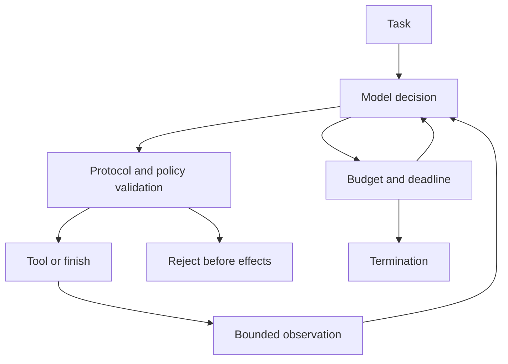

# Day 38 — Typed tools, discovery, and schema validation

## 1. Learning objectives

By the end, distinguish typed tools, discovery, and schema validation in an actual execution trace, implement one part without a framework, and explain a failure boundary. Required evidence is a runnable script, a trace with request, decision, validation, tool, observation, state, and termination, plus a written tradeoff. Success means another learner can reproduce your result from this page.

## 2. Required prerequisites

Know Python functions, dictionaries, exceptions, async functions and basic JSON. Week 5 established provider requests and usage; Week 6 established trust boundaries and evidence. Read the linked runtime implementation when the chapter names a behavior. The examples use FakeProvider and local functions; no live model, network, credentials or external service are involved.

## 3. Problem motivation

An LLM can choose a useful next operation, but choosing an operation is not executing it safely. A tool is a typed capability: a name, concise description, closed input schema, effect classification, and local handler. Discovery advertises only a caller-selected allowlist. Validation turns untrusted model text into values only after JSON syntax, exact fields, types, bounds, and policy have passed. The declaration is a contract, not an isolation boundary. This distinction matters because a good answer can still conceal an unauthorized effect, malformed input, a hung tool, or a duplicate action after an uncertain response. Build control flow outside the model and make each boundary observable.

## 4. Intuitive explanation

The runtime deliberately supports object schemas with string, integer, and boolean properties; required keys; no additional properties; string byte limits, integer ranges, and enums. It does not implement general JSON Schema, nested objects, coercion, nullable unions, or format assertions. Reject unknown tools and writes unless the caller separately grants them. The handler still needs operating-system permissions and its own resource limits. Picture the model as a planner that proposes a ticket; the dispatcher is the clerk who checks the ticket against a rulebook before anything happens. A handwritten ticket does not become valid merely because it is confidently phrased. Likewise valid JSON is only syntax: identity, permission, types, limits, dependencies and state all require checks.

## 5. Deep technical explanation

Registry.register accepts a trusted tool only when its name matches `[a-z][a-z0-9_]{0,47}`, effect is read or write, handler is callable, and schema is a closed object with a properties mapping. Required names must be declared. Each property type must be exactly string, integer or boolean. At call time, input must be a dict; unknown and missing keys reject; integer uses `type(value) is int`, so `True` is not accepted as 1; boolean likewise rejects integer 1. String byte limits use UTF-8 encoded length, while integer bounds are inclusive. An enum is membership-tested. The subset does not enforce every possible schema keyword, nested records, number, arrays, null, patterns, formats, or conditional schemas. A schema's declaration is not a sandbox: a handler may still access files, credentials, network or mutable state. Discover returns only allowlisted tools, but the dispatcher rechecks the allowlist because the model can hallucinate names.

## 6. Mathematical foundations

Suppose `code` has UTF-8 maxLength 4, integer `page` is bounded 1..9, and `dry_run` is boolean. ASCII `AB12` has four encoded bytes and passes; `ééé` has six UTF-8 bytes and fails despite three visible characters. `True` is rejected for `page` although `True == 1` in Python; exact integer semantics matter. For k supplied fields, closed-object validation is O(k+p) where p is schema property count when set membership is expected O(1). It copies the resulting dict, so memory is O(k). This small bound is useful for tool dispatch, but total argument bytes still depend on property-specific maxima and JSON overhead. The runtime caps decision text at 16,000 UTF-8 bytes, individual strings at their schema limit (default 4096), and encoded tool observation at 4096 bytes. These are independent limits; satisfying one does not imply satisfying another.

## 7. Architecture and execution diagrams


The guard is outside model control. An edge to a write handler requires an additional explicit grant. A timeout or exhausted budget terminates future iterations; neither retroactively undoes an accepted external effect.

## 8. Implementation from first principles

```python
from forgeagent.runtime import Registry, Tool, Rejected
async def fetch(code): return {'code':code}
registry=Registry(); schema={'type':'object','properties':{'code':{'type':'string','maxLength':12}},'required':['code'],'additionalProperties':False}
registry.register(Tool('fetch','Read by code',schema,fetch))
tool,args=registry.prepare(__import__('forgeagent.runtime',fromlist=['Call']).Call('c1','fetch',{'code':'A7'}),{'fetch'})
assert args=={'code':'A7'} and registry.discover({'fetch'})[0]['effect']=='read'
try: registry.prepare(__import__('forgeagent.runtime',fromlist=['Call']).Call('c2','fetch',{'code':'A7','admin':True}),{'fetch'})
except Rejected as exc: assert str(exc)=='argument_keys'
else: raise AssertionError('unknown field accepted')
print('validated exact input',args)
```
Run from repository root with `python` after the project package is installed or importable. This executable uses only local deterministic fixtures. Compare the assertion with its printed output; then change one input to violate the boundary. The referenced implementation is `forgeagent/runtime.py`; the compact example deliberately exposes the API without hiding dispatch behind an agent framework.

## 9. Worked execution walkthrough

Request: model proposes `lookup` with `{code: "ééé"}`. Decision parses as a calls envelope with unique ID `q1`. Validation at dispatch checks tool is discovered and allowed, then checks its schema; UTF-8 length is 6 > maxLength 4, so `argument_length` is raised. Tool is never called, no tool_start event is emitted, and there is no observation pretending the handler ran. If `code` were `AB12`, the handler could return `{status:"found"}`; JSON encoding then checks result size. A proposed `admin` field fails with `argument_keys`. A proposed write tool fails `write_denied` unless `allow_write=True` was supplied. Thus discovery improves selection, but each request is independently checked at execution time.

## 10. Independent laboratory

Implement the day-specific contract in `labs/week-07/starter/day02.py`. Keep the public API and error semantics in the starter docstring. Do not import the solution. Demonstrate one normal path and two rejection/failure paths; write a trace table before coding. The lab’s check runner is deterministic and has no network access. A passing public check is necessary but not sufficient: explain why the rejected proposal cannot cause a side effect.

## 11. Experiments

Build a table with values `AB12`, `ééé`, missing code, extra admin field, page values 1, 9, 0, `True`, and dry_run values `False`, 0. Predict acceptance before running each case. Instrument the handler with a counter and confirm it remains zero for every rejected input. Add an allowed tool and then remove it from the allowlist; verify the same syntactically valid request is rejected. Keep schema version and test fixture version fixed so changes are attributable. This exercise should reveal the subtle difference between Unicode code points and UTF-8 byte length, plus Python's bool/int subtype relationship.

## 12. Failure analysis

If a generic validator coerces `True` to integer 1, the handler may interpret an unintended value as a page number. If `additionalProperties` defaults open, a model can smuggle ignored or unexpected authority hints. If tool discovery and dispatch use different allowlists, a hidden tool may still execute. If the handler trusts a string path, a schema-valid path can escape an intended directory. Validation rejects shape defects; authorization and handler-level resource checks remain separate. Avoid returning raw exception text to the model: it can include secrets or internal file paths. The current runtime uses stable short rejection codes and bounded observations.

## 13. Engineering tradeoffs

A small schema language is easier to implement and audit than an incomplete claim of full JSON Schema support. It makes nested parameters and expressive constraints awkward, so complex inputs should be decomposed or parsed in trusted application code. Strict rejection forces the model to make a new proposal instead of silently changing values. That can add turns but prevents ambiguous coercion. UTF-8 byte limits are predictable for transport and storage but may surprise users thinking in characters. A read/write tag guides scheduling and grants; it does not inspect behavior, so tool authors must classify honestly and constrain handlers.

## 14. Real-world connection

The same shape appears in support automation, code assistants, data analysis and operations bots. A controller owns authority and state; a model helps select from bounded capabilities. A tool description can help the model choose, but security depends on server-side identity checks and resource enforcement. A local registry demonstrates dispatch mechanics, not a production sandbox, credential vault, distributed transaction, or provider-side financial ceiling.

## 15. Common misconceptions

“Agent” does not mean unconstrained autonomy. “Schema valid” does not mean safe or authorized. “Read-only” describes intended effect, not proof that a handler has no hidden side effects. “Timeout” does not guarantee remote cancellation. “Parallel” does not mean deterministic. “Trace” does not mean store every prompt. “Evaluation passed” does not establish behavior outside the fixture distribution. Name each guarantee at its actual boundary.

## 16. Technical examination

For the schema `{code:string maxLength 4 required, page:integer [1,9], dry_run:boolean, closed object}`, classify each experiment value above and justify exact Python type semantics. State registration checks versus call-time checks. Explain why three Unicode characters can exceed four bytes and why schema-valid file paths are not automatically safe. Show the tool counter before and after preflight failures.

## 17. Daily mastery gate

Pass only if the implementation rejects bool as integer, unknown keys, missing required keys and UTF-8 overlength before the handler counter changes. Correctly identify the supported types and at least three unsupported JSON Schema features. Explain the difference among discovery, validation, authorization and sandboxing. One coercion or unrecognized unsupported feature means revise before continuing.

## 18. Resources

Primary references: [Anthropic, Building effective agents](https://www.anthropic.com/engineering/building-effective-agents) discusses workflows and agentic loops; [OpenAI function calling](https://developers.openai.com/api/docs/guides/function-calling) documents a current API tool-call interface; [Yao et al., ReAct](https://arxiv.org/abs/2210.03629) is the original 2022 paper on interleaved reasoning and acting. Vendor API details can change; this chapter’s local protocol is intentionally fixed and is not a claim of wire compatibility.

## 19. Revision and retention

Next day, reproduce the central invariant from memory and inspect the matching test. After three days, explain a counterexample where a valid-looking model proposal still must not run. After a week, rebuild the trace from event records and compare it against expected transitions. Retain the rejected input, handler count, and final state as the evidence artifact; avoid retaining sensitive task text.

## 20. Next lesson connection

With a capability described and validated, the next lesson composes model decisions, calls, observations and terminal answers into a full loop. The schema check becomes the validation stage in that trace.
