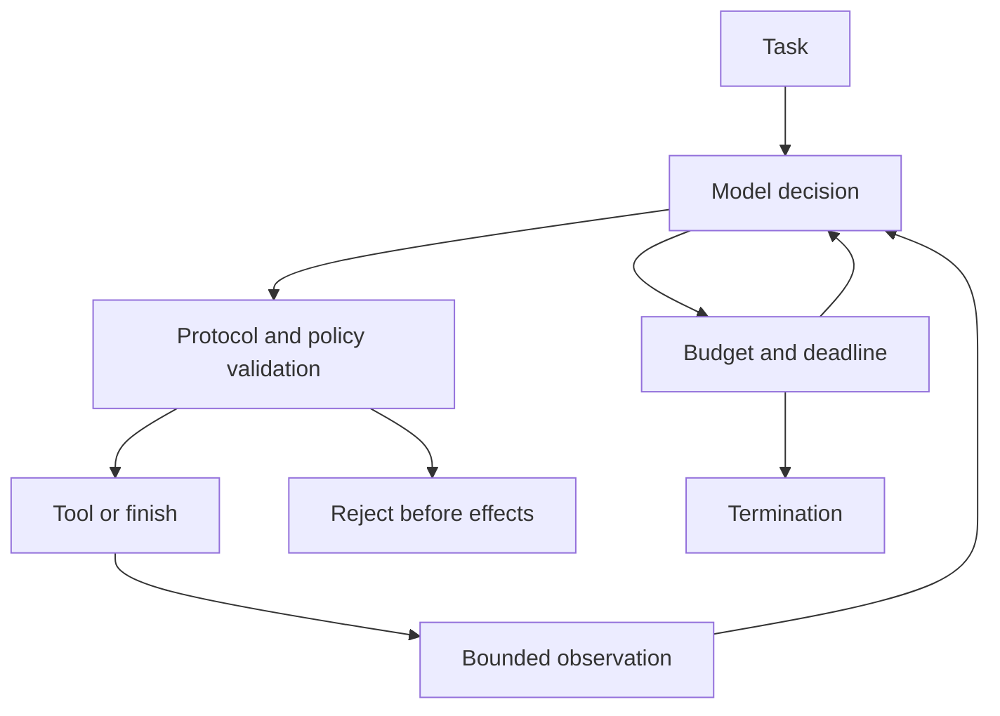

# Day 39 — Decision, observation, and the custom loop

## 1. Learning objectives

By the end, distinguish decision, observation, and the custom loop in an actual execution trace, implement one part without a framework, and explain a failure boundary. Required evidence is a runnable script, a trace with request, decision, validation, tool, observation, state, and termination, plus a written tradeoff. Success means another learner can reproduce your result from this page.

## 2. Required prerequisites

Know Python functions, dictionaries, exceptions, async functions and basic JSON. Week 5 established provider requests and usage; Week 6 established trust boundaries and evidence. Read the linked runtime implementation when the chapter names a behavior. The examples use FakeProvider and local functions; no live model, network, credentials or external service are involved.

## 3. Problem motivation

An LLM can choose a useful next operation, but choosing an operation is not executing it safely. The loop is observe, decide, validate, act, append observations, and decide again. Model output is a proposal; the dispatcher is the authority that checks the proposal. Tool observations are untrusted data placed back into the conversation. A finish decision returns an answer; a bounded loop can also end in budget exhaustion, timeout, failure, or caller cancellation. This distinction matters because a good answer can still conceal an unauthorized effect, malformed input, a hung tool, or a duplicate action after an uncertain response. Build control flow outside the model and make each boundary observable.

## 4. Intuitive explanation

ReAct research describes interleaving reasoning and actions, but a production log should record decisions and observable actions rather than private chain-of-thought. ForgeAgent requests JSON decisions: either {type:finish, answer:string} or a calls list. An observation carries call ID, tool name, success flag, and bounded result or stable error. No implicit retry or repair is performed. Picture the model as a planner that proposes a ticket; the dispatcher is the clerk who checks the ticket against a rulebook before anything happens. A handwritten ticket does not become valid merely because it is confidently phrased. Likewise valid JSON is only syntax: identity, permission, types, limits, dependencies and state all require checks.

## 5. Deep technical explanation

At each step Agent sends an immutable Request containing a developer instruction, user task, prior assistant JSON and serialized untrusted observations. `parse_decision` accepts exactly two envelope families: finish with exactly `type` and string `answer`; or calls with exactly `type` and a calls list of 1–8 entries. Each call has exactly id, name, arguments and after; IDs are unique. The loop increments the step before requesting, charges reported usage on return, then checks overshoot before parsing or dispatching. A valid finish sets completed. A calls decision is preflighted and executed; its observations are appended as untrusted user content for the next decision. A malformed proposal fails closed. No hidden reasoning is required, and the runtime instruction explicitly asks not to emit private reasoning. The model's action is a proposal; handler execution remains local code.

## 6. Mathematical foundations

For s model steps, let Ij and Oj be reported input and output tokens. Total charged tokens T=Σ(Ij+Oj); the code charges a completed provider call before checking `T > token_limit`. Let rates ri and ro be currency units per million tokens. Known cost C=Σ(Ij ri+Oj ro)/1,000,000 using Decimal. If limit is 10 and first call reports 9+2=11, T overshoots by 1; the runtime returns budget_exhausted before dispatching its otherwise-valid calls. If cost is exactly at limit, the pre-request check `known_cost >= cost_limit` prevents another model call. Tool budget is checked as current calls plus proposed batch size before dispatch. Step budget bounds model invocations; tool budget bounds proposals, including dependent calls skipped after a prerequisite failure.

## 7. Architecture and execution diagrams


The guard is outside model control. An edge to a write handler requires an additional explicit grant. A timeout or exhausted budget terminates future iterations; neither retroactively undoes an accepted external effect.

## 8. Implementation from first principles

```python
from forgeagent.runtime import Agent, Registry, Tool, Budgets
from forgeagent.models import FakeProvider, Reply, Usage
import asyncio
async def main():
    registry=Registry()
    async def read(): return 'blue'
    registry.register(Tool('read','Read a color',{'type':'object','properties':{},'required':[],'additionalProperties':False},read))
    p=FakeProvider([Reply('{"type":"calls","calls":[{"id":"r","name":"read","arguments":{},"after":[]}]}',Usage(12,9)),Reply('{"type":"finish","answer":"The color is blue."}',Usage(17,8))])
    result=await Agent(p,registry,['read']).run('What color?')
    assert result.answer=='The color is blue.' and result.tool_calls==1
    assert [e['event'] for e in result.events if e['event'] in ('model_start','tool_start','tool_end','run_end')]==['model_start','tool_start','tool_end','model_start','run_end']
    print(result.status,result.observations[0].result)
asyncio.run(main())
```
Run from repository root with `python` after the project package is installed or importable. This executable uses only local deterministic fixtures. Compare the assertion with its printed output; then change one input to violate the boundary. The referenced implementation is `forgeagent/runtime.py`; the compact example deliberately exposes the API without hiding dispatch behind an agent framework.

## 9. Worked execution walkthrough

Concrete trace uses a fake provider and one read tool. Request 1: task asks for a color; allowed schema advertises `read_color`. Decision 1: `calls` with ID `r1`, no dependencies, empty arguments. Validation: JSON shape, unique ID, allowlist, read effect and empty closed schema all pass. Tool: handler returns `blue`; events contain tool_start then tool_end. Observation: `{call_id:r1,name:read_color,ok:true,result:blue}` is encoded and appended as untrusted data. State: result remains running, messages now contain assistant proposal and observation. Request 2 includes them. Decision 2 is finish with answer `The color is blue.` State becomes completed; run_end records status and elapsed seconds. If Request 1 instead returns invalid JSON, no handler call occurs and terminal status is failed.

## 10. Independent laboratory

Implement the day-specific contract in `labs/week-07/starter/day03.py`. Keep the public API and error semantics in the starter docstring. Do not import the solution. Demonstrate one normal path and two rejection/failure paths; write a trace table before coding. The lab’s check runner is deterministic and has no network access. A passing public check is necessary but not sufficient: explain why the rejected proposal cannot cause a side effect.

## 11. Experiments

Use FakeProvider to replay (a) direct finish, (b) one call then finish, (c) invalid JSON, (d) valid call whose tool returns ValueError, and (e) a call batch above tool budget. For each, predict model request count, tool invocation count, final status, observations, and last event before running. Confirm that a tool error is represented as an observation and can be followed by another decision, while protocol rejection fails the run. Then add a hostile string to tool output and confirm it is represented as untrusted observation data, not an authority grant. Fixtures prove deterministic control flow only; they do not prove a real model will follow instructions.

## 12. Failure analysis

A frequent loop bug forgets to append observations before the next provider request; the model then repeats a call because it never sees its result. Another confuses tool failure with a protocol failure: expected handler errors can be observed, while invalid model envelopes stop before execution. Duplicate call IDs break correlation and are rejected. An unbounded loop can spend indefinitely; the step, tool, token and time budgets cap different resources. Logging a full chain-of-thought is neither necessary to reconstruct execution nor appropriate for this protocol. Keep request IDs, decision shapes, validation outcome, tool correlation, observation category and terminal status instead.

## 13. Engineering tradeoffs

A custom loop makes state and authority visible, but the application owns protocol parsing, concurrency, error categories and budget accounting. Frameworks may provide adapters and retries yet can obscure when a side effect occurs. A JSON-only protocol is easy to fixture and audit but requires strict parsing and size bounds. Feeding complete tool outputs aids decision quality but increases context and injection exposure; compact structured observations reduce both. A bounded loop may stop before solving a task, which is preferable to silently continuing past a resource limit. The caller must handle non-completed terminal states explicitly.

## 14. Real-world connection

The same shape appears in support automation, code assistants, data analysis and operations bots. A controller owns authority and state; a model helps select from bounded capabilities. A tool description can help the model choose, but security depends on server-side identity checks and resource enforcement. A local registry demonstrates dispatch mechanics, not a production sandbox, credential vault, distributed transaction, or provider-side financial ceiling.

## 15. Common misconceptions

“Agent” does not mean unconstrained autonomy. “Schema valid” does not mean safe or authorized. “Read-only” describes intended effect, not proof that a handler has no hidden side effects. “Timeout” does not guarantee remote cancellation. “Parallel” does not mean deterministic. “Trace” does not mean store every prompt. “Evaluation passed” does not establish behavior outside the fixture distribution. Name each guarantee at its actual boundary.

## 16. Technical examination

Given the two responses in the runnable example, list exact message history at Request 2 and the event order through run_end. Then replace first response with a call that has duplicate IDs and state the expected status and side effect count. Calculate usage for two replies (12+9, then 17+8): total 46 tokens. Explain why an observation is not an instruction and distinguish handler ValueError from invalid JSON.

## 17. Daily mastery gate

Reproduce a call-then-finish trace with matching call ID and exactly two provider requests. Demonstrate invalid protocol causes zero handler effects and an expected tool ValueError becomes an observation. Account for tokens and state why hidden chain-of-thought is not needed. Mastery requires each event and state in order, not merely the final answer string.

## 18. Resources

Primary references: [Anthropic, Building effective agents](https://www.anthropic.com/engineering/building-effective-agents) discusses workflows and agentic loops; [OpenAI function calling](https://developers.openai.com/api/docs/guides/function-calling) documents a current API tool-call interface; [Yao et al., ReAct](https://arxiv.org/abs/2210.03629) is the original 2022 paper on interleaved reasoning and acting. Vendor API details can change; this chapter’s local protocol is intentionally fixed and is not a claim of wire compatibility.

## 19. Revision and retention

Next day, reproduce the central invariant from memory and inspect the matching test. After three days, explain a counterexample where a valid-looking model proposal still must not run. After a week, rebuild the trace from event records and compare it against expected transitions. Retain the rejected input, handler count, and final state as the evidence artifact; avoid retaining sensitive task text.

## 20. Next lesson connection

The loop can accept several calls in one decision. Next, represent their dependency order as a DAG and execute independent read calls concurrently while preserving request-order observations.
