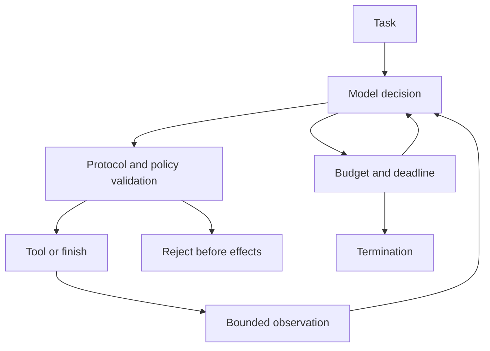

# Day 40 — Sequential, parallel, and dependent tools

## 1. Learning objectives

By the end, distinguish sequential, parallel, and dependent tools in an actual execution trace, implement one part without a framework, and explain a failure boundary. Required evidence is a runnable script, a trace with request, decision, validation, tool, observation, state, and termination, plus a written tradeoff. Success means another learner can reproduce your result from this page.

## 2. Required prerequisites

Know Python functions, dictionaries, exceptions, async functions and basic JSON. Week 5 established provider requests and usage; Week 6 established trust boundaries and evidence. Read the linked runtime implementation when the chapter names a behavior. The examples use FakeProvider and local functions; no live model, network, credentials or external service are involved.

## 3. Problem motivation

An LLM can choose a useful next operation, but choosing an operation is not executing it safely. Calls in a batch form a directed acyclic graph. An edge A→B means B must wait for A. Independent read-only calls in the same topological layer may run concurrently; any layer containing a write is serialized. This conservative rule limits races but does not make writes transactional. The scheduler validates all names, permissions, schemas, and graph structure before the first handler executes. This distinction matters because a good answer can still conceal an unauthorized effect, malformed input, a hung tool, or a duplicate action after an uncertain response. Build control flow outside the model and make each boundary observable.

## 4. Intuitive explanation

For calls a,b,c where c.after=[a], layer one contains a and b and layer two contains c. The returned observations retain request order even when completion order differs. If a prerequisite fails, its dependent receives dependency_failed without invoking its handler. A missing parent or cycle rejects the whole batch during preflight, preventing partial side effects due solely to malformed graph structure. Picture the model as a planner that proposes a ticket; the dispatcher is the clerk who checks the ticket against a rulebook before anything happens. A handwritten ticket does not become valid merely because it is confidently phrased. Likewise valid JSON is only syntax: identity, permission, types, limits, dependencies and state all require checks.

## 5. Deep technical explanation

`layers` first constructs current call IDs, rejects IDs already completed, missing dependency references and duplicate IDs (the parser already rejects duplicates). It repeatedly selects calls whose `after` set is contained in completed IDs. An empty ready set while work remains proves a directed cycle. `dispatch` computes layers and prepares every tool/argument pair before executing the first action. It keeps an observations map so a dependent call checks all parent `ok` flags. A failed parent produces dependency_failed without invoking the child handler. Calls in each layer run in input order when writes exist; an all-read layer uses TaskGroup concurrency. Results are finally projected to original request order. TaskGroup cancellation can affect sibling reads if an unexpected exception propagates. This is a scheduling policy, not a transaction or distributed lock.

## 6. Mathematical foundations

For DAG nodes A,B,C,D with edges A→C, B→C, C→D, Kahn layering yields {A,B}, {C}, {D}. If durations are 0.3, 0.5, 0.2, 0.1 seconds, serial work is 1.1 seconds; ideal layer latency is max(.3,.5)+.2+.1=.8 seconds, excluding overhead. Parallel speedup is 1.1/.8=1.375. If B is a write and policy serializes that layer, A and B take .3+.5=.8, resulting total 1.1 and no speedup. The runtime first records each node's indegree and each parent-to-child edge, then places zero-indegree nodes in a queue. Each vertex enters and leaves the queue once; each dependency edge is visited once to lower its child's indegree and compute depth. A final pass places calls into depth buckets in caller order. Total time and storage are O(V+E), including input-order preservation. A batch cap of eight bounds practical work but is not required for linear complexity.

## 7. Architecture and execution diagrams


The guard is outside model control. An edge to a write handler requires an additional explicit grant. A timeout or exhausted budget terminates future iterations; neither retroactively undoes an accepted external effect.

## 8. Implementation from first principles

```python
import asyncio
from forgeagent.runtime import Call, Registry, Tool, dispatch
async def main():
    registry=Registry(); started=[]
    async def read(value):
        started.append(value); await asyncio.sleep(.01); return value
    schema={'type':'object','properties':{'value':{'type':'string'}},'required':['value'],'additionalProperties':False}
    registry.register(Tool('read','Read only',schema,read,'read'))
    calls=[Call('a','read',{'value':'A'}),Call('b','read',{'value':'B'}),Call('c','read',{'value':'C'},('a',))]
    out=await dispatch(calls,registry,{'read'})
    assert [o.result for o in out]==['A','B','C'] and len(started)==3
    print('request order preserved; dependency c follows a')
asyncio.run(main())
```
Run from repository root with `python` after the project package is installed or importable. This executable uses only local deterministic fixtures. Compare the assertion with its printed output; then change one input to violate the boundary. The referenced implementation is `forgeagent/runtime.py`; the compact example deliberately exposes the API without hiding dispatch behind an agent framework.

## 9. Worked execution walkthrough

Proposal calls A=`lookup_customer`, B=`lookup_policy`, C=`quote` with `after:[A]`. Preflight validates all three names, permissions, schemas and graph: layer 1 is [A,B], layer 2 is [C]. A and B are read effects, so they start concurrently. Suppose A succeeds with customer tier gold and B fails with a stable tool_failed observation. C depends only on A, so it executes. If C instead depended on B, it would be skipped as dependency_failed. Results returned to caller remain ordered A,B,C regardless of finish times. Now add edge C→A: preflight discovers a cycle and rejects the batch before A or B has side effects. This is why graph validation happens before execution.

## 10. Independent laboratory

Implement the day-specific contract in `labs/week-07/starter/day04.py`. Keep the public API and error semantics in the starter docstring. Do not import the solution. Demonstrate one normal path and two rejection/failure paths; write a trace table before coding. The lab’s check runner is deterministic and has no network access. A passing public check is necessary but not sufficient: explain why the rejected proposal cannot cause a side effect.

## 11. Experiments

Use a barrier in two read handlers: each increments active count, waits until both have started, then returns. Peak active count should equal two. Repeat with two writes and verify the current policy serializes them with peak one. For the diamond graph A,B→C, inject failure into A and observe C skipped only if it names A as a parent. Record requested order, layer order, actual start/end order and returned order separately. Timing alone is a weak concurrency proof; the barrier establishes overlap. Add malformed cycle and missing-parent cases and assert zero handler calls for both.

## 12. Failure analysis

Executing as each call is parsed can produce a partial effect before discovering a later missing dependency. Preflight avoids that class of partial batch. A cycle can cause a scheduler to wait forever if no ready-node check exists. Parallel completion order can corrupt correlation if results are appended by finish time; call IDs and final request-order projection prevent that. A failed parent must block only descendants that depend on it, not unrelated work. Serializing writes controls overlap inside one batch but does not protect against another process or a retry. Use idempotency and external coordination for those cases.

## 13. Engineering tradeoffs

Read-only concurrency reduces latency but increases simultaneous load and nondeterministic completion ordering. The `read` classification is trusted metadata and can be wrong; a handler that mutates state while labeled read defeats the scheduler assumption. Serial writes reduce races but also throughput, and cannot promise atomicity. Kahn's adjacency-list scheduler gives O(V+E) validation and layer construction while retaining stable order within each layer. More elaborate systems still need cancellation, fairness, queue limits and cross-process coordination. Preserve logical dependencies explicitly rather than inferring them from names or model order.

## 14. Real-world connection

The same shape appears in support automation, code assistants, data analysis and operations bots. A controller owns authority and state; a model helps select from bounded capabilities. A tool description can help the model choose, but security depends on server-side identity checks and resource enforcement. A local registry demonstrates dispatch mechanics, not a production sandbox, credential vault, distributed transaction, or provider-side financial ceiling.

## 15. Common misconceptions

“Agent” does not mean unconstrained autonomy. “Schema valid” does not mean safe or authorized. “Read-only” describes intended effect, not proof that a handler has no hidden side effects. “Timeout” does not guarantee remote cancellation. “Parallel” does not mean deterministic. “Trace” does not mean store every prompt. “Evaluation passed” does not establish behavior outside the fixture distribution. Name each guarantee at its actual boundary.

## 16. Technical examination

For edges A→C, B→C, C→D derive layers and duration formulas from the chapter. Change B into a write and calculate the serialized result. Trace the customer/policy/quote case for both possible dependencies of C. Show how a missing parent and a cycle are rejected before any effect. Explain why returned observation order may differ from start and completion order.

## 17. Daily mastery gate

Pass when a DAG implementation yields [A,B],[C],[D], rejects cycle and missing parent before handlers run, skips a failed dependent, and preserves input-order output. Demonstrate concurrent read overlap and serialized writes with active counters. State the single-process and truthful-effect-label assumptions. Any misplaced edge or unexplained partial effect means remediate.

## 18. Resources

Primary references: [Anthropic, Building effective agents](https://www.anthropic.com/engineering/building-effective-agents) discusses workflows and agentic loops; [OpenAI function calling](https://developers.openai.com/api/docs/guides/function-calling) documents a current API tool-call interface; [Yao et al., ReAct](https://arxiv.org/abs/2210.03629) is the original 2022 paper on interleaved reasoning and acting. Vendor API details can change; this chapter’s local protocol is intentionally fixed and is not a claim of wire compatibility.

## 19. Revision and retention

Next day, reproduce the central invariant from memory and inspect the matching test. After three days, explain a counterexample where a valid-looking model proposal still must not run. After a week, rebuild the trace from event records and compare it against expected transitions. Retain the rejected input, handler count, and final state as the evidence artifact; avoid retaining sensitive task text.

## 20. Next lesson connection

The scheduler has bounded call count and duration per tool, but the overall loop also needs model, token, cost and wall-clock budgets. Next, calculate those quantities and their overshoot semantics.
