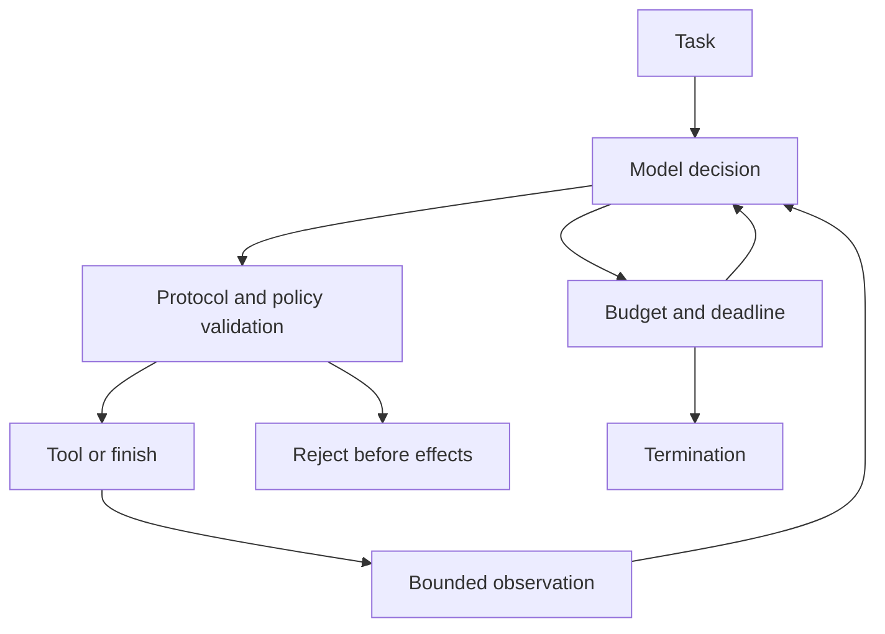

# Day 41 — Budgets, cancellation, and bounded work

## 1. Learning objectives

By the end, distinguish budgets, cancellation, and bounded work in an actual execution trace, implement one part without a framework, and explain a failure boundary. Required evidence is a runnable script, a trace with request, decision, validation, tool, observation, state, and termination, plus a written tradeoff. Success means another learner can reproduce your result from this page.

## 2. Required prerequisites

Know Python functions, dictionaries, exceptions, async functions and basic JSON. Week 5 established provider requests and usage; Week 6 established trust boundaries and evidence. Read the linked runtime implementation when the chapter names a behavior. The examples use FakeProvider and local functions; no live model, network, credentials or external service are involved.

## 3. Problem motivation

An LLM can choose a useful next operation, but choosing an operation is not executing it safely. A budget is an explicit stopping policy over model steps, planned tool calls, token usage, elapsed time, per-tool time, and known cost. These quantities differ: tokens are a usage count, cost is a rate estimate, and deadlines constrain elapsed time. The runtime checks budgets before new work and reconciles provider usage after a completed call. This distinction matters because a good answer can still conceal an unauthorized effect, malformed input, a hung tool, or a duplicate action after an uncertain response. Build control flow outside the model and make each boundary observable.

## 4. Intuitive explanation

A completed provider request may report more tokens or cost than the remaining allowance; the response is already incurred. Therefore this is not a hard spending guarantee. A hard cap needs provider-side limits, reservations, or an account control outside this loop. asyncio timeout cancels cooperative async handlers; thread workers, remote effects, and a write already accepted by a server may continue. Picture the model as a planner that proposes a ticket; the dispatcher is the clerk who checks the ticket against a rulebook before anything happens. A handwritten ticket does not become valid merely because it is confidently phrased. Likewise valid JSON is only syntax: identity, permission, types, limits, dependencies and state all require checks.

## 5. Deep technical explanation

Budgets has independent fields: positive integer steps, tools and tokens; positive finite seconds and tool_seconds; finite nonnegative Decimal cost_limit. Before each model request, the loop checks whether token usage or known cost is already at the limit. The request output allowance is min(512, remaining token count), but input tokens are not capped by that argument. On completed response it charges provider-reported input plus output usage and calculated known cost, then checks for strict overshoot before parsing or dispatch. Equality is allowed for the returned decision, but a subsequent request is prevented by the >= precheck. Tools are counted as proposed calls once dispatch occurs; a batch that would exceed tool count is rejected before any handler. Outer asyncio timeout bounds the coroutine's wait, not necessarily remote or thread-backed work.

## 6. Mathematical foundations

Take token cap 100, used 82, next provider response reports 12 input and 9 output. Charge 21, yielding 103; overshoot is 3 tokens and no tool from that response is dispatched. If rates are $2.00/M input and $8.00/M output, this response cost is (12×2+9×8)/1,000,000=$0.000096. If previous known cost were $0.00095 and cap $0.001, new total is $0.001046, overshoot $0.000046. These formulas are estimates from reported usage and caller-provided rates. The runtime cannot reverse a completed call or promise a hard spending ceiling; provider-side spend controls or pre-reserved worst-case allowances are required. With per-tool timeout 0.4 seconds and wall clock 2 seconds, multiple sequential tools may consume the entire outer deadline before all individual limits are reached.

## 7. Architecture and execution diagrams


The guard is outside model control. An edge to a write handler requires an additional explicit grant. A timeout or exhausted budget terminates future iterations; neither retroactively undoes an accepted external effect.

## 8. Implementation from first principles

```python
from forgeagent.runtime import Agent, Registry, Budgets
from forgeagent.models import FakeProvider, Reply, Usage
import asyncio
async def main():
    p=FakeProvider([Reply('{"type":"finish","answer":"Done"}',Usage(20,4))])
    result=await Agent(p,Registry(),[],budgets=Budgets(tokens=10)).run('small task')
    assert result.status=='budget_exhausted' and result.tokens==24
    assert result.answer=='' # completed call overshot; no subsequent response/effect
    print(result.status,'reported usage',result.tokens)
asyncio.run(main())
```
Run from repository root with `python` after the project package is installed or importable. This executable uses only local deterministic fixtures. Compare the assertion with its printed output; then change one input to violate the boundary. The referenced implementation is `forgeagent/runtime.py`; the compact example deliberately exposes the API without hiding dispatch behind an agent framework.

## 9. Worked execution walkthrough

Set token budget 10, tool budget 3, and fake reply usage input=9/output=2. The request advertises max output tokens 10. Provider completes and bills its request; reconciliation updates tokens to 11. The strict `>` check marks budget_exhausted before parsing the returned calls, so handler count stays zero. This is an intentional safe boundary for future effects, but it cannot undo provider spend. In a second run, budget 100 and a reply of 12+9 leaves 79; a three-call proposal passes tools=3, then usage 17+8 reaches 46 after the next model round. A third request can occur only if tokens remain below cap and cost remains below its cap. Distinguish budget values, observed usage and unspent allowance in every trace.

## 10. Independent laboratory

Implement the day-specific contract in `labs/week-07/starter/day05.py`. Keep the public API and error semantics in the starter docstring. Do not import the solution. Demonstrate one normal path and two rejection/failure paths; write a trace table before coding. The lab’s check runner is deterministic and has no network access. A passing public check is necessary but not sufficient: explain why the rejected proposal cannot cause a side effect.

## 11. Experiments

Sweep token cap 10, 11 and 12 against fixed reported usage 9+2; predict statuses `budget_exhausted`, `completed` only if the response is a finish decision, and `completed` for cap 12. For a calls decision, cap 11 passes token check and may act because equality is not overshoot; cap 10 blocks. Vary tool budget from 2 to 3 for a three-call proposal and verify handler counts 0 versus 3. Set a small tool timeout and outer deadline separately. Record provider calls and handler calls because the former may be charged even when no handler runs. Do not call this a spending cap.

## 12. Failure analysis

A budget check only before the provider call misses the completed response's reported usage. The runtime reconciles afterward and refuses effects on overshoot, but money may already be spent. Rates can be stale or exclude provider-specific fees; known_cost is an estimate. Counting tools only after execution allows an oversized batch to sneak through, so compare proposed batch length before dispatch. Per-tool timeout does not replace outer deadline; repeated tools can sum beyond the run window. Cancellation of an async task does not prove a remote operation stopped. For consequential writes, combine idempotency, server-side limits, and explicit authorization.

## 13. Engineering tradeoffs

Conservative post-call reconciliation may discard a useful answer when usage slightly overshoots, but prevents a second call or proposed effect after observing the overrun. Reserving worst-case usage before each request can reduce overshoot but may leave budget unused, especially with variable input context. Tokenizer counts differ by model; reported usage is better for accounting but arrives after completion. Decimal arithmetic avoids binary floating point drift yet does not improve rate accuracy. Multiple budgets make limits legible but require explicit terminal-status policy. Budget exhaustion is not itself a user-facing answer; callers should explain incomplete work without claiming success.

## 14. Real-world connection

The same shape appears in support automation, code assistants, data analysis and operations bots. A controller owns authority and state; a model helps select from bounded capabilities. A tool description can help the model choose, but security depends on server-side identity checks and resource enforcement. A local registry demonstrates dispatch mechanics, not a production sandbox, credential vault, distributed transaction, or provider-side financial ceiling.

## 15. Common misconceptions

“Agent” does not mean unconstrained autonomy. “Schema valid” does not mean safe or authorized. “Read-only” describes intended effect, not proof that a handler has no hidden side effects. “Timeout” does not guarantee remote cancellation. “Parallel” does not mean deterministic. “Trace” does not mean store every prompt. “Evaluation passed” does not establish behavior outside the fixture distribution. Name each guarantee at its actual boundary.

## 16. Technical examination

Calculate 21-token overshoot, $0.000096 call cost, and $0.001046 cumulative cost using the given rates. Trace token cap 10 with a calls response and prove zero tool effects. Explain equality versus strict overshoot, tool proposal counting and why max_output_tokens does not cap input tokens. Name one external control needed for a hard financial ceiling and one cancellation limitation.

## 17. Daily mastery gate

Mastery requires reproducing the token and Decimal cost arithmetic, demonstrating post-response overshoot blocks tools, and showing a too-large tool batch runs zero handlers. Explain why token budget is not a guaranteed provider spend ceiling and why tool timeout differs from total run timeout. Record provider-call and tool-call counts separately.

## 18. Resources

Primary references: [Anthropic, Building effective agents](https://www.anthropic.com/engineering/building-effective-agents) discusses workflows and agentic loops; [OpenAI function calling](https://developers.openai.com/api/docs/guides/function-calling) documents a current API tool-call interface; [Yao et al., ReAct](https://arxiv.org/abs/2210.03629) is the original 2022 paper on interleaved reasoning and acting. Vendor API details can change; this chapter’s local protocol is intentionally fixed and is not a claim of wire compatibility.

## 19. Revision and retention

Next day, reproduce the central invariant from memory and inspect the matching test. After three days, explain a counterexample where a valid-looking model proposal still must not run. After a week, rebuild the trace from event records and compare it against expected transitions. Retain the rejected input, handler count, and final state as the evidence artifact; avoid retaining sensitive task text.

## 20. Next lesson connection

Budgets specify where a run stops, but operators need evidence about why it stopped and how to recover safely. Next, define useful traces, error categories, replay and evaluation without unsafe retries.
