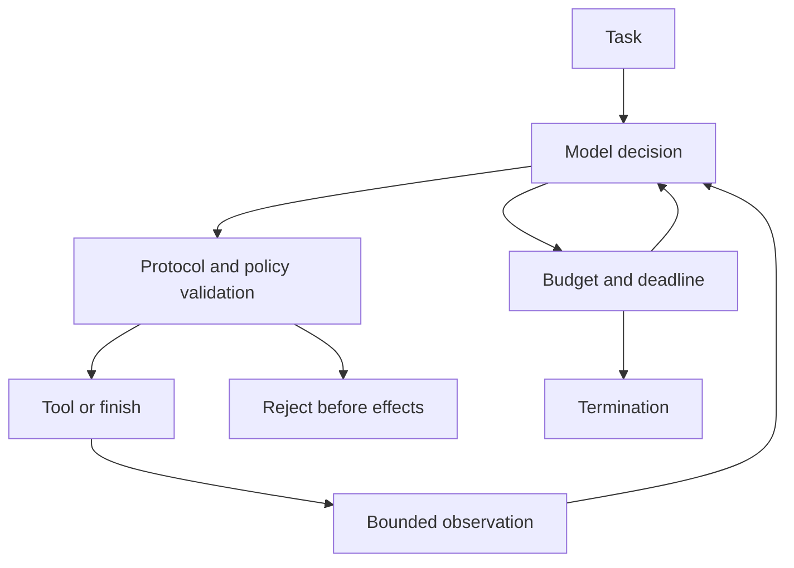

# Day 42 — Recovery, traces, and evaluation

## 1. Learning objectives

By the end, distinguish recovery, traces, and evaluation in an actual execution trace, implement one part without a framework, and explain a failure boundary. Required evidence is a runnable script, a trace with request, decision, validation, tool, observation, state, and termination, plus a written tradeoff. Success means another learner can reproduce your result from this page.

## 2. Required prerequisites

Know Python functions, dictionaries, exceptions, async functions and basic JSON. Week 5 established provider requests and usage; Week 6 established trust boundaries and evidence. Read the linked runtime implementation when the chapter names a behavior. The examples use FakeProvider and local functions; no live model, network, credentials or external service are involved.

## 3. Problem motivation

An LLM can choose a useful next operation, but choosing an operation is not executing it safely. A useful trace captures lifecycle boundaries: model_start/end, tool_start/end, failure, cancellation, and run_end. It should carry correlation IDs, bounded inputs or hashes, stable errors, timing, and usage while avoiding secrets and private reasoning. Recovery policy is chosen by operation semantics: retrying an idempotent read differs from repeating a payment whose response was lost. This distinction matters because a good answer can still conceal an unauthorized effect, malformed input, a hung tool, or a duplicate action after an uncertain response. Build control flow outside the model and make each boundary observable.

## 4. Intuitive explanation

ForgeAgent converts selected handler exceptions into tool_failed observations, timeout into tool_timeout, bad model protocol into failed status, provider errors into failed status, outer deadline into timed_out, and caller cancellation into a re-raised CancelledError after logging. Unexpected programming errors propagate. Evaluation replays deterministic FakeProvider outcomes and fake tools, then scores task success, safety invariants, resource use, and trace completeness separately. Picture the model as a planner that proposes a ticket; the dispatcher is the clerk who checks the ticket against a rulebook before anything happens. A handwritten ticket does not become valid merely because it is confidently phrased. Likewise valid JSON is only syntax: identity, permission, types, limits, dependencies and state all require checks.

## 5. Deep technical explanation

The runtime emits model_start before each provider call; model_end after a valid parsed decision; tool_start/tool_end around handlers; failure for Rejected or ProviderError; cancelled when caller cancellation propagates; and run_end in finally. Tool TimeoutError becomes `tool_timeout`; ValueError, OSError and PermissionError become a bounded `tool_failed` observation; an unexpected programming exception is deliberately allowed to propagate rather than being disguised as an ordinary tool problem. An outer deadline returns timed_out. These categories support different recovery: a retryable provider code may be retried by a caller under a duplicate-call policy, while invalid protocol should be fixed or rejected. Repeating a write after uncertain delivery is unsafe without idempotency. Trace data should correlate IDs, preserve status and durations, and redact task secrets and raw arguments by policy.

## 6. Mathematical foundations

Suppose 100 runs have 92 completed, 3 budget_exhausted, 2 timed_out, 2 failed and 1 caller-cancelled. Completion rate is 92/100=0.92; operational failure rate if only failed+timed_out count is (2+2)/100=0.04; these metrics answer different questions. For 40 tasks where 36 required a tool, tool selection recall is 34/36≈0.944 if 34 used the required tool, while precision depends on extra invocations and is computed TP/(TP+FP). For retrying an operation with independent transient failure probability p=.1, two attempts raise success probability to 1-p²=.99 only if retry is safe and independent. A side effect with uncertain outcome violates that assumption. Evaluation should also measure policy violations and duplicate effects, not only answer accuracy.

## 7. Architecture and execution diagrams


The guard is outside model control. An edge to a write handler requires an additional explicit grant. A timeout or exhausted budget terminates future iterations; neither retroactively undoes an accepted external effect.

## 8. Implementation from first principles

```python
from forgeagent.runtime import Agent, Registry
from forgeagent.models import FakeProvider, Reply, Usage
import asyncio
async def main():
    p=FakeProvider([Reply('{"type":"finish","answer":"stable"}',Usage(8,3))])
    result=await Agent(p,Registry(),[]).run('evaluate a known fixture')
    assert result.status=='completed'
    assert result.events[0]['event']=='model_start' and result.events[-1]['event']=='run_end'
    assert result.known_cost==0
    print(result.status,result.events[-1]['status'])
asyncio.run(main())
```
Run from repository root with `python` after the project package is installed or importable. This executable uses only local deterministic fixtures. Compare the assertion with its printed output; then change one input to violate the boundary. The referenced implementation is `forgeagent/runtime.py`; the compact example deliberately exposes the API without hiding dispatch behind an agent framework.

## 9. Worked execution walkthrough

Use a read tool that raises ValueError after logging `tool_start`. Dispatch records a `tool_failed` observation and `tool_end ok:false`; the loop appends it as untrusted data and can ask the provider for a recovery decision. If the next decision finishes with a cautious answer, run_end is completed while trace retains the failed attempt. If the handler instead raises RuntimeError due to a coding defect, it propagates and is not converted to `tool_failed`; that distinction prevents a deployment bug from looking like ordinary environmental data. An outer deadline produces timed_out. Caller cancellation records cancellation and reraises CancelledError so the caller's task semantics remain intact. Recovery is therefore a policy over typed events, not a blanket retry loop.

## 10. Independent laboratory

Implement the day-specific contract in `labs/week-07/starter/day06.py`. Keep the public API and error semantics in the starter docstring. Do not import the solution. Demonstrate one normal path and two rejection/failure paths; write a trace table before coding. The lab’s check runner is deterministic and has no network access. A passing public check is necessary but not sufficient: explain why the rejected proposal cannot cause a side effect.

## 11. Experiments

Build a replay set with successful finish, transient ProviderError, malformed JSON, tool ValueError, tool TimeoutError, RuntimeError, outer deadline and caller cancellation. For every fixture predict status, whether exception is returned or propagated, number of effects, and trace tail. Compute completed and timeout rates on a labeled fixture set, then separately count forbidden write attempts and repeated call IDs. Add a test where a write commits but its response is lost; demonstrate why retry without idempotency can duplicate it. Keep the fake fixture deterministic and report its small sample size; it is a regression set, not a real-world reliability estimate.

## 12. Failure analysis

A retry on every exception can repeat a payment or overwrite. Retrying malformed JSON does not repair a protocol without another model request and budget. Treating RuntimeError as a normal tool failure conceals programmer defects and damages diagnosis. Trace payloads can leak credentials or user content, so store event fields and redacted/hash inputs according to purpose and retention. Cancellation may stop local async work while a remote server continues. Finally, evaluation that scores only final text can miss an unauthorized call, a budget overshoot, or a duplicate side effect; assert invariants over the whole event trace.

## 13. Engineering tradeoffs

Detailed traces improve replay and debugging but create storage, privacy and access-control obligations. Event summaries are cheaper but can hide ordering defects. Stable error codes make dashboards useful; overly broad categories hide distinct causes. Automatic retry raises availability for safe idempotent reads but can amplify load and duplicate effects. Deterministic FakeProvider replay is cheap and repeatable, but cannot measure model distribution shifts. Combine unit-level contracts, curated behavioral fixtures, and production aggregate metrics with explicit denominators. Never treat a trace as an explanation of private cognition; it records externally observable control flow.

## 14. Real-world connection

The same shape appears in support automation, code assistants, data analysis and operations bots. A controller owns authority and state; a model helps select from bounded capabilities. A tool description can help the model choose, but security depends on server-side identity checks and resource enforcement. A local registry demonstrates dispatch mechanics, not a production sandbox, credential vault, distributed transaction, or provider-side financial ceiling.

## 15. Common misconceptions

“Agent” does not mean unconstrained autonomy. “Schema valid” does not mean safe or authorized. “Read-only” describes intended effect, not proof that a handler has no hidden side effects. “Timeout” does not guarantee remote cancellation. “Parallel” does not mean deterministic. “Trace” does not mean store every prompt. “Evaluation passed” does not establish behavior outside the fixture distribution. Name each guarantee at its actual boundary.

## 16. Technical examination

For the fault example, write events in order through `run_end`, and explain why ValueError is observed while RuntimeError propagates. Compute completion, operational failure and retry success rates from the chapter values. Propose a recovery policy for read timeout and a lost payment response; include idempotency requirements. Give a trace redaction schema and an evaluation invariant that catches a forbidden tool call despite a correct final answer.

## 17. Daily mastery gate

Pass by replaying one ordinary tool failure into recovery and one unexpected programming bug into propagation; preserve trace distinctions. Compute the stated rates correctly and identify the independence assumption behind retry math. Show how to test a side-effect invariant and describe a redacted event format. A final answer score alone is insufficient evidence of mastery.

## 18. Resources

Primary references: [Anthropic, Building effective agents](https://www.anthropic.com/engineering/building-effective-agents) discusses workflows and agentic loops; [OpenAI function calling](https://developers.openai.com/api/docs/guides/function-calling) documents a current API tool-call interface; [Yao et al., ReAct](https://arxiv.org/abs/2210.03629) is the original 2022 paper on interleaved reasoning and acting. Vendor API details can change; this chapter’s local protocol is intentionally fixed and is not a claim of wire compatibility.

## 19. Revision and retention

Next day, reproduce the central invariant from memory and inspect the matching test. After three days, explain a counterexample where a valid-looking model proposal still must not run. After a week, rebuild the trace from event records and compare it against expected transitions. Retain the rejected input, handler count, and final state as the evidence artifact; avoid retaining sensitive task text.

## 20. Next lesson connection

This week has built an explicit runtime around provider decisions: finite control flow, typed capabilities, closed protocol, DAG scheduling, resource limits, and observable recovery. The next week can checkpoint this bounded execution state and resume it under a separately reviewed persistence contract.
