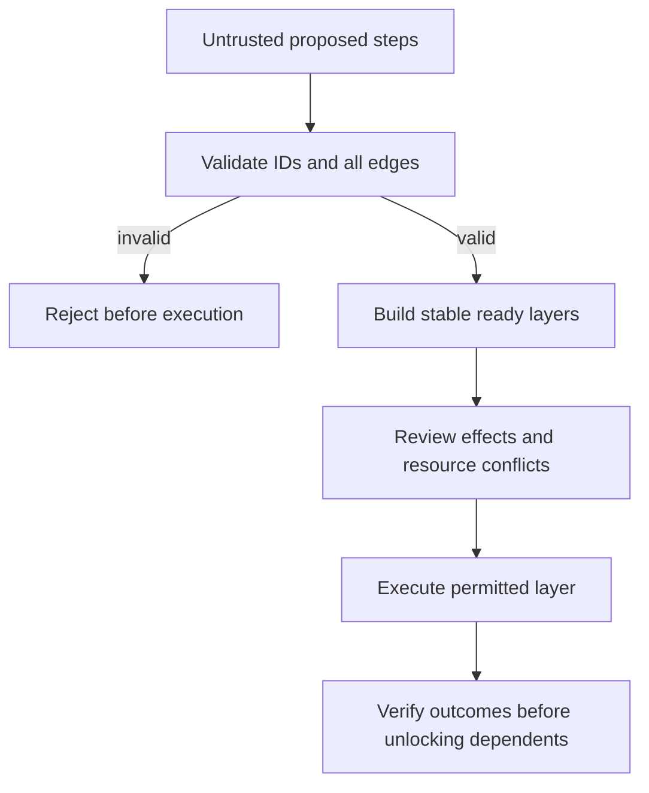

# Day 43 — Route work through DAGs and verify plans

## 1. Learning objectives

Represent work as a directed acyclic graph (DAG), distinguish a dependency from
a preferred ordering, and reject malformed plans before executing any node.
Build deterministic topological layers and verify that a proposed plan covers
each step once, includes every declared prerequisite, and preserves caller-visible
IDs. Explain why a valid plan does not itself authorize an effect or guarantee
that independent-looking steps are safe to run concurrently.

## 2. Required prerequisites

You should be comfortable with lists, sets, dictionaries, immutable dataclasses,
exceptions and loops. Week 7's tool-call `after` edges use the same dependency
shape, but a workflow DAG makes the plan an explicit durable artifact. Review
basic graph terms: vertices are steps, directed edges point from prerequisite to
dependent, and a topological ordering places every prerequisite first. A cycle
means no such ordering exists.

## 3. Problem motivation

An agent asked to inspect a repository, run a targeted check, and then edit a
configuration should not guess ordering from a prose list. A test that needs the
edited file has an explicit prerequisite; two independent reads may share a
layer. If planning is interleaved with execution, a missing edge can be found
after the first write has already happened. A planner should therefore validate
the full input graph before exposing its first ready batch.

## 4. Intuitive explanation

Imagine a cooking plan: wash vegetables before chopping them, and chop before
cooking. Plating and warming bowls may happen in either order. A DAG captures
the required edges without forcing every step into an arbitrary single queue.
Topological layers group steps whose prerequisites are already complete. The
layers show potential concurrency only; shared files, rate limits, account
permissions and nondeterministic tools may still require serialization.

## 5. Deep technical explanation

`forgeagent.durable.Step` is an immutable pair of `identifier` and `after` tuple.
`plan(steps)` checks duplicate/empty IDs, validates every predecessor against
the complete identifier set, then repeatedly finds all steps whose parents are
in `done`. Ready steps are sorted by identifier, making equal graph inputs yield
the same layers even when source order differs. If pending work remains and no
node is ready, the remaining subgraph contains a cycle. The function raises
before returning a partial plan.

The algorithm scans pending steps once per layer, which is easy to inspect and
costs O(V(V+E)) in the worst case for V steps and E edges. A queue-based Kahn
implementation can reach O(V+E), but complicates stable layer grouping. For
bounded agent plans, reviewability can be worth the repeated scans. `verify_plan` recomputes the
canonical result and compares layers exactly. It is an integrity check for this
policy, not cryptographic attestation and not a proof that step code is safe.

## 6. Mathematical foundations

Let G=(V,E), where (u,v)∈E means u must finish before v starts. A valid ordering
π satisfies π(u)<π(v) for every edge. At iteration t, the ready set Rₜ contains
pending v for which every parent is in the completed set Cₜ. If Rₜ is empty while
pending nodes remain, no topological extension exists. The layering policy emits
all of Rₜ together and updates Cₜ₊₁=Cₜ∪Rₜ. For `a→b`, `a→c`, `b→d`, the layers
are `{a}`, `{b,c}`, `{d}`; a single valid ordering could instead be a,b,c,d.

## 7. Architecture and execution diagrams



Dependencies describe data or outcome requirements. The review gate represents
policy outside the graph algorithm: a read-only pair may be parallelizable while
two writes to one document are not, despite having no dependency edge.

## 8. Implementation from first principles

```python
from forgeagent.durable import Step, plan, verify_plan
steps=[Step('read'),Step('edit',('read',)),Step('audit',('edit',)),Step('lookup')]
layers=plan(steps)
assert [[s.identifier for s in layer] for layer in layers] == [['lookup','read'],['edit'],['audit']]
assert verify_plan(steps,layers)
print('layers:', [[s.identifier for s in layer] for layer in layers])
```

Run from the repository root. The first layer's lexical order is deterministic,
not semantically meaningful. `plan` is deliberately pure: it does not call the
provider, run a shell command or mutate storage. That boundary lets a caller log
and inspect the complete schedule before dispatch.

## 9. Worked execution walkthrough

Consider `fetch_schema`, `fetch_config`, `merge`, `validate`, and `publish`.
`merge` depends on both fetches; validation depends on merge; publish depends on
validation. The first ready set is the two fetches. After both succeed, merge is
ready. If `fetch_config` fails, the workflow runner must mark merge blocked; it
must not treat “finished” as synonymous with “succeeded.” After validation,
publish still needs an explicit write policy check. A planner returns order, not
outcome state or permission.

## 10. Independent laboratory

Complete `labs/week-08/starter/workflow.py`. Add tests for a disconnected graph,
a diamond, duplicate IDs, an unknown parent and a cycle that includes three
nodes. Instrument a fake executor and prove invalid graphs cause zero handler
calls. Then modify one layer's order and make `verify` reject it. Submit a trace
showing which IDs enter `done` after every layer and explain why two no-edge
steps may still conflict on a shared resource.

## 11. Experiments

Generate chains, stars and layered diamonds of increasing size. Count inspected
pending vertices in this simple implementation and compare measured wall time
without changing the algorithm. Randomize input list order while holding edges
fixed; layer output must remain identical due to sorting. Add one edge at a time
and observe when two nodes cease being ready together. Do not interpret timing on
a laptop as a service-scale capacity guarantee; the experiment tests expected
shape and deterministic behavior.

## 12. Failure analysis

Reproduce a dangerous partial-plan bug by returning the first ready layer before
checking unknown dependencies in a later branch. A caller can execute a write
and only then discover that the rest of the plan is invalid. Move full edge
validation before the layering loop. Separately introduce `a→b→c→a`; no node is
initially ready. Raise a clear cycle error rather than returning an empty plan,
which could be mistaken for successful completion.

## 13. Engineering tradeoffs

Stable layer membership improves reviews and deterministic tests. Sorting costs
time, while preserving insertion order is cheaper but makes planning depend on
serialization order. Grouping all ready vertices exposes concurrency, but
requires executor-level resource and effect classification. This module chooses
small-input clarity and full canonical verification. A large workflow engine
would need incremental edge accounting, cancellation propagation, durable node
states and an explicit retry policy.

## 14. Real-world connection

Build systems, data pipelines and approval workflows all use dependency edges.
An agent can use the same representation for “inspect before patch,” “patch
before test,” and “test before propose merge.” Human review can inspect a plan
before an irreversible action. A DAG also provides a concise audit vocabulary:
which evidence unlocked a step, which output it consumed, and which branch was
blocked after failure.

## 15. Common misconceptions

“No edge means safe to parallelize” ignores hidden shared resources. “A valid
topological sort proves the answer is correct” confuses scheduling with semantic
verification. “Any topological ordering is the same plan” ignores reproducible
reviews and tie policies. “A cycle can be fixed by picking an arbitrary node”
breaks an asserted prerequisite; revise the graph or surface the conflict.

## 16. Technical examination

Given edges `A→C`, `B→C`, `C→D`, calculate all ready layers and give a distinct
valid total ordering. Write validation that fails before executor invocation on
a missing parent. Explain how stable sorting changes reproducibility and why it
does not make handler outputs deterministic. Diagnose a cycle and propose a
workflow change that preserves the real dependency rather than deleting it to
silence the planner. Rubric: graph correctness 40, validation 25, trace 20,
limits 15.

## 17. Daily mastery gate

Pass the public contract, produce the graph trace without code, and show zero
effects on malformed input. Score at least 4/5 on a fresh graph and explain the
difference between readiness, completion, success and authorization. A mastery
claim requires both code and a written schedule; a function that happens to
return a plausible list is insufficient if it accepts cycles or missing edges.

## 18. Resources

Python's `graphlib.TopologicalSorter` documentation is useful for comparing a
standard library interface with this tiny explicit-layer implementation:
[Python graphlib](https://docs.python.org/3/library/graphlib.html). The code
here remains independent so the validation contract and tie policy are visible.
No performance or production suitability claim follows from the comparison.

## 19. Revision and retention

Tomorrow reconstruct the ready-set condition and identify what must be validated
before effects. In three days, redraw the five-node merge example and mark the
failure propagation boundary. In one week, compare this pure plan with Week 7's
call dispatcher: both use dependency edges, while the latter also validates tool
permissions and effect class at dispatch time.

## 20. Next lesson connection

Day 44 evaluates plans and outputs. Scheduling answers “what can run next?”;
reflection and evaluator/optimizer loops answer “did the work meet a defined
criterion, and what bounded correction is justified?” A plan can be perfectly
valid and still produce a wrong result, so the next lesson separates execution
structure from quality evidence.
