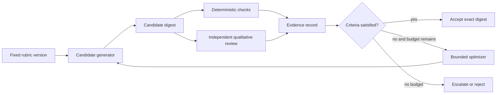

# Day 44 — Reflection, evaluators, and collaboration boundaries

## 1. Learning objectives

Design a bounded evaluator/optimizer loop with criteria stated before inspecting
the candidate. Separate a critique from evidence, a proposed revision from an
accepted result, and model confidence from correctness. Decide when independent
agents add useful evidence and when they add coordination, privacy or consistency
cost. Build a record that explains each accepted revision without exposing or
requesting private chain-of-thought.

## 2. Required prerequisites

Review Day 43's distinction between schedule and outcome. You need basic Python
functions, JSON records and test assertions. Week 5 introduced model boundaries;
Week 7 introduced tool observations as untrusted data. An evaluator consumes an
artifact and evidence. It should not silently gain permission to invoke a write
tool or redefine its success criterion after seeing an unfavorable result.

## 3. Problem motivation

A generated migration script may parse yet still omit rollback behavior. Asking
the same model “is this good?” often returns a fluent endorsement rather than a
reproducible quality check. A useful loop names criteria such as syntax-valid,
all required fields mapped, and no destructive default; then runs observable
checks. Iteration helps only when a failure signal maps to an allowed, bounded
change rather than open-ended self-critique.

## 4. Intuitive explanation

Think of an editor and a proofreader. The editor changes a draft; the proofreader
checks a checklist against the new draft. If the proofreader merely repeats the
editor's opinion, the second role adds little. A multi-agent system is useful
when roles see different evidence, use genuinely different methods, or work on
independent partitions. Duplicating prompts across agents mostly duplicates
correlated errors and creates more output to reconcile.

## 5. Deep technical explanation

An evaluator contract should contain the candidate identity, named criteria,
evidence source, result per criterion, and a bounded outcome such as `accept`,
`revise` or `reject`. A deterministic test can establish a concrete property;
a model judge can assess a qualitative rubric but should return observable
reasons tied to supplied text. Store the rubric version. Otherwise an evaluator
can appear to improve simply because the definition changed between candidate
versions.

The optimizer gets failed criteria and permitted edits, not an invitation to
change the objective. Set a maximum iteration count, time/cost budget, and
terminal behavior when no new evidence appears. Detect unchanged candidate
hashes to stop loops. The final artifact must be reevaluated after every edit;
an earlier passing report cannot be attached to a modified draft. Keep a concise
decision record (criterion, evidence pointer, result), rather than hidden
reasoning traces. This makes review useful and lowers sensitive-data retention.

Multi-agent delegation adds message boundaries, shared-state conflicts, failure
handling and aggregation. Let one agent independently inspect a security property
while another checks API compatibility, then merge evidence under explicit
ownership. Avoid parallel writers on the same file unless they use isolated
branches and a merge protocol. Agent count is not a quality metric. Compare
added evidence and elapsed cost against a single-agent baseline.

## 6. Mathematical foundations

Let C={c₁…cₘ} be fixed criteria and eᵢ∈{pass,fail,unknown} their evidence states.
An acceptance policy might require every mandatory criterion to be pass and no
criterion unknown. Define it before generating the candidate: A(e)=1 iff
∀i∈M,eᵢ=pass. A revision may target failed criteria, but does not erase prior
failures until a fresh evaluator runs. If one evaluation has false-positive
probability p, two independent checks would reduce simultaneous false positives
to p²; however model evaluators are rarely independent. Correlated agreement does
not justify that multiplication.

## 7. Architecture and execution diagrams



The digest binds evidence to the exact candidate. A review process that records
only “looks good” cannot tell whether a later edit invalidated the evaluation.

## 8. Implementation from first principles

```python
from dataclasses import dataclass
@dataclass(frozen=True)
class Check:
    name: str
    passed: bool
    evidence: str
def decide(checks, required):
    by_name={c.name:c for c in checks}
    if set(by_name)!=set(required): raise ValueError('rubric mismatch')
    return 'accept' if all(by_name[n].passed and by_name[n].evidence for n in required) else 'revise'
checks=[Check('has_rollback',True,'test:rollback_path'),Check('no_drop_default',False,'scan:line-18')]
assert decide(checks,{'has_rollback','no_drop_default'})=='revise'
print('failure evidence:', checks[1].evidence)
```

This tiny evaluator has no privileged model access; `evidence` points to a
reviewable observation. In a system, validate the schema and size of evaluator
output just like any other untrusted provider response.

## 9. Worked execution walkthrough

Version 1 of a settings converter passes parser and mapping-count checks but
fails the “unknown key preserved” criterion on fixture `legacy_theme`. The
evaluator reports the fixture ID and observed loss. The optimizer adds a fallback
mapping, producing digest v2. The system reruns parser, mapping and preservation
checks on v2; it does not copy v1's passing results. If the fallback changes
unrelated keys, a regression check can fail and the candidate is rejected after
the two-iteration limit. Every step ties result to candidate hash and rubric
version.

## 10. Independent laboratory

Create `evaluate(candidate, rubric, evidence)` with exact criterion coverage,
three-valued results and bounded outcome. Add a two-iteration optimizer around a
fake fixture evaluator. Prove a changed candidate reruns all checks and a missing
criterion cannot default to pass. Create a multi-agent thought experiment where
two workers inspect different evidence sources; state merge ownership and tie
resolution. Do not emit hidden reasoning; submit concise evidence references.

## 11. Experiments

On a fixed set of intentionally flawed configuration candidates, compare one
reviewer against two reviewers with distinct checks: parser/runtime behavior
versus preservation/privacy constraints. Count newly caught defects, duplicated
findings, unresolved disagreements, tokens and elapsed time. Keep the fixture
set unchanged during comparison. Then duplicate the same prompt and evidence to
both reviewers; observe whether agreement increases without adding distinct
coverage. Report this as a small authored experiment, not a general agent
performance result.

## 12. Failure analysis

Reproduce rubric drift by relaxing a required criterion after candidate v1 fails;
the apparent pass is invalid because the target changed. Reproduce stale approval
by editing a passing artifact but reusing its report. Bind evaluation to content
hash and rubric version. A third failure occurs when an optimizer treats “unknown”
as “pass”; preserve unknown as a terminal escalation condition unless new
evidence is collected.

## 13. Engineering tradeoffs

Deterministic checks are narrow but inspectable; qualitative reviewers can cover
ambiguity but vary with prompts and model behavior. More agents may increase
coverage and latency, privacy surface, coordination errors and duplicated false
confidence. Parallel reads are easier than parallel edits. A single coordinator
reduces merge ambiguity but becomes a bottleneck. Choose roles by evidence
independence and impact, then measure marginal value rather than agent count.

## 14. Real-world connection

Code review, clinical double checks and financial reconciliation all separate
the person producing a record from a control that evaluates it. AI does not
remove the need for a defined criterion, trustworthy evidence or a final owner.
The useful contribution of a reviewer is traceable detection or confirmation,
not a second fluent narrative. Keep reviewers within least-privilege scope and
avoid broad context that contains unrelated customer data.

## 15. Common misconceptions

“Reflection guarantees improvement” ignores noisy or vague feedback. “Two agents
agree, so the answer is true” ignores shared model, prompt and evidence bias.
“A rubric is objective because it is structured” ignores disputed thresholds and
poor tests. “The evaluator may fix the candidate” confounds measurement and
intervention. Keep roles, evidence and authorization explicit.

## 16. Technical examination

Given a candidate, three mandatory criteria and one unknown result, choose a
terminal outcome and justify it. Diagnose rubric-version drift and stale evidence
using candidate digests. Design a bounded two-agent split that contributes
independent evidence and define who resolves conflict. Explain why repeated
identical reviewers do not yield p² false-positive rates. Rubric: evaluator
contract 30, loop bounds 25, collaboration design 25, evidence integrity 20.

## 17. Daily mastery gate

Pass exact rubric coverage, candidate binding and iteration-limit checks. Show
one trace with a failed criterion corrected and reevaluated, and one disagreement
escalated rather than averaged away. Explain which data each reviewer receives
and why. Score 4/5 on a fresh scenario with no missing evidence treated as a pass.

## 18. Resources

Anthropic's primary engineering article describes practical harness patterns for
long-running agents, including explicit handoff between context windows and
preserving operational state: [Effective harnesses for long-running agents](https://www.anthropic.com/research/effective-harnesses-for-long-running-agents).
Use it as a design report, not a universal benchmark. Our evaluator loop is a
small local teaching example and does not reproduce their systems or results.

## 19. Revision and retention

Tomorrow define evaluator evidence without calling it private reasoning. In
three days, explain why candidate hash and rubric version both matter. In one
week, re-run your experiment with a different defect family, preserving criteria
before candidate inspection. Connect evaluator reports to Day 43's graph: the
evaluation step unlocks acceptance only after its prerequisites succeed.

## 20. Next lesson connection

Day 45 turns to the context delivered to a model or evaluator. An excellent
rubric cannot compensate for missing source provenance or prompt injection
mixed into trusted instructions. The next lesson treats context as a selected,
versioned evidence set with explicit roles, authority and budget accounting.
