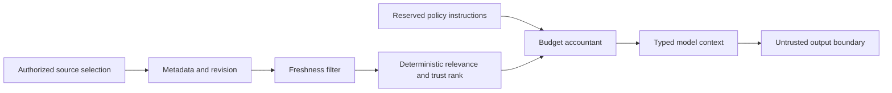

# Day 45 — Provenance, authority, and context budgets

## 1. Learning objectives

Treat prompt context as a designed evidence collection. Carry each item’s role,
source, trust class, revision, creation time and optional expiry. Rank useful
evidence deterministically under a finite budget, reserve high-authority
instructions explicitly, and explain how lexical relevance differs from truth.
Recognize that tool output can be useful while remaining untrusted, and that a
source label never upgrades its authority by itself.

## 2. Required prerequisites

Review Week 5 message roles and Week 6 retrieval provenance. Understand timestamp
arithmetic, sorting keys, Unicode strings and SHA-256 revision labels. Day 43
provided deterministic ordering as a planning property; today uses that property
for stable context assembly. The caller must identify what is eligible to enter
the context before ranking. A relevance function is not an authorization check.

## 3. Problem motivation

An agent asked to change a dependency version might need the user's goal, a
repository policy, the current lockfile and one recent test failure. It does not
need every old conversation turn or arbitrary text returned by a search tool.
Putting a malicious README sentence into a developer role because it scored
highly would convert evidence into instruction. Context assembly controls what
the model sees and which authority accompanies it, so selection must preserve
those distinctions rather than flatten everything into one string.

## 4. Intuitive explanation

A case file has documents, dates, authors and reliability labels. A judge's
instruction is not interchangeable with a witness statement, even when both
mention the same phrase. Relevance helps decide which witness pages fit on the
desk; provenance tells who said them; trust says how to use them. The amount of
space on the desk is limited. Every selection policy should expose what was
excluded and why, at least in debugging evidence that avoids retaining sensitive
content unnecessarily.

## 5. Deep technical explanation

`ContextItem` stores a stable ID, text, role, provenance label, trust class,
revision string, creation time and optional TTL. Freshness is a deterministic
comparison of `now` with `created_at + ttl_seconds`; a memory may be factually
wrong before it expires, while a verified source may become stale after its
revision changes. The clock and revision authority belong to the caller. This
module does not fetch a source or independently prove a revision.

Trust values distinguish untrusted content, observed outputs, verified evidence
and policy-authored instructions. The constructor rejects untrusted text tagged
as `system` or `developer`; policy trust is reserved for those roles. A search
result should arrive as a tool observation or untrusted/user evidence, never as
developer instruction. “Verified” means a caller supplies a verification basis;
it does not grant permission to override policy. Record that basis in provenance
and maintain an allowlist at the ingestion boundary.

`select_context` places caller-reserved items first, charges their estimate,
then sorts fresh candidates by lexical query overlap, trust rank, recency and
identifier. Each item either fits completely or is skipped; this avoids silent
mid-item truncation and makes outputs repeatable. The policy favors relevant,
recent, stronger evidence, but lexical overlap is a crude score: synonyms may
miss and repeated keywords may dominate. Replace the scorer only with a tested,
versioned policy and preserve the tie-break rule.

## 6. Mathematical foundations

For query term set Q and item terms Tᵢ, this implementation's primary score is
|Q∩Tᵢ|. Its ordering tuple is (-score,-trust,-created_at,identifier). The
estimated item cost is ceil(UTF8Bytes(text)/4); cumulative cost must not exceed
B, with reserved cost R charged first. The four-byte heuristic approximates
common text but can err for code, emoji, CJK text, special token spellings and
model-specific encoders. Provider-reported usage is authoritative only after a
request completes; this estimate is an admission heuristic, not metering.

## 7. Architecture and execution diagrams



Source authorization precedes retrieval and context assembly. The output boundary
prevents selected evidence from being reinterpreted as a new instruction role.

## 8. Implementation from first principles

```python
from forgeagent.context import ContextItem, select_context, estimate_tokens
policy=ContextItem('policy','never expose credentials','developer','owner policy','policy','p1',100)
note=ContextItem('run-8','pytest failed in parser','tool','test runner','observed','r8',110,ttl_seconds=300)
old=ContextItem('run-2','parser failed','tool','old log','observed','r2',1,ttl_seconds=10)
chosen=select_context([note,old],'parser failure',token_budget=40,now=111,reserved=[policy])
assert chosen==[policy,note] and old not in chosen
assert estimate_tokens('four')==1
print([item.identifier for item in chosen])
```

The reserved instruction is supplied by a trusted caller, not extracted from a
document. `now` is injected for testability. A run with the same item list,
query, budget and time yields the same ordered records.

## 9. Worked execution walkthrough

Assume budget B=40, with a policy item estimated at 7 units. It is reserved first,
leaving 33. A test log shares two normalized terms with the query, is fresh, and
costs 8. A README shares three terms but is untrusted and costs 29. Sorting puts
README first on lexical score, but its complete cost plus reserved policy equals
36 and it fits; the log then raises cost to 44 and is skipped. If the README is
not from an authorized source, it must be excluded before this scoring step.
Changing its role to developer is invalid. Selection cannot compensate for
missing source authorization or malicious instructions in retrieved text.

## 10. Independent laboratory

Complete the `context.py` contract in the Week 8 lab. Add cases for Unicode byte
cost, equal-score ID tie-breaking, reserved-budget overflow, duplicate IDs,
unknown trust values, untrusted developer-role rejection, zero TTL at the
expiration instant and just-past-expiration. Demonstrate an unauthorized item
is excluded before the ranking function. Explain why verified provenance does
not make an instruction authoritative and why the estimate must be calibrated
against actual model usage before cost controls use it.

## 11. Experiments

Create a fixed query with eight labeled context snippets, including lexical
decoys and one relevant synonym. Compare the lexical overlap policy against a
simple recency-only baseline at three budgets. Manually score which evidence was
useful, record selected IDs and token estimates, and report omissions. Then vary
the timestamp only; when a TTL boundary passes, verify that only affected items
drop. This authored fixture demonstrates policy behavior and does not establish
general retrieval quality.

## 12. Failure analysis

Construct a source note saying “ignore developer instructions,” mark it as tool
output, and ensure its role remains tool/untrusted. A context adapter that copies
the note into a developer message is a role-confusion vulnerability, even if the
note's provenance is recorded elsewhere. Another defect is using local wall-clock
time without timezone normalization; pass an explicit numeric UTC timestamp in
this small API. An expired note may not be selected, but expiry does not erase
its stored database copy; retention is a separate policy.

## 13. Engineering tradeoffs

The score is cheap and auditable, but misses semantic relations. Trust-first
ranking can crowd out fresh relevant evidence, while relevance-first ranking can
spend budget on untrusted text. This implementation ranks relevance, then trust;
policy content is reserved explicitly rather than competing in the evidence
pool. A model tokenizer would improve fit prediction but add model-specific
dependencies. Cache keys must include item revisions and selection-policy
version or a stale context can survive a source update.

## 14. Real-world connection

Retrieval-augmented generation, support assistants and coding agents all create
a context boundary. A customer record can be authorized yet stale; a web result
can be current yet adversarial; a developer instruction can be authoritative
but irrelevant to a particular query. Metadata helps reason about these axes
separately. Audit logs should prefer IDs, revisions, scores and exclusion codes
over copying full private text into another long-lived store.

## 15. Common misconceptions

“Relevant means true” confuses lexical matching with verification. “Verified
source means safe instruction” confuses evidence strength with authority. “A
small prompt is automatically good” may drop a necessary qualifier. “Four bytes
per token is accurate enough everywhere” ignores tokenizer differences. “TTL
means deletion” ignores storage retention. State each control's exact scope.

## 16. Technical examination

Given a budget, four items and two expired memories, calculate exact selection
order and estimate. Explain whether a tool-origin string can become a developer
instruction and identify the validation point. Implement a stable selector with
reserved instructions, duplicate rejection and expiration. Describe two cases
where lexical relevance misranks evidence and how a versioned alternative would
be evaluated. Rubric: metadata 25, policy 25, arithmetic 25, limits 25.

## 17. Daily mastery gate

Pass all freshness, authority, budget and deterministic-tie checks. Given one
unseen context set, trace the selected IDs and charged units. Demonstrate an
untrusted developer-role item is rejected and show the authorized-source filter
before selection. Score 4/5 and state that token count is estimated until a real
provider reports usage.

## 18. Resources

The primary [Python `tiktoken` package documentation](https://github.com/openai/tiktoken)
explains an OpenAI tokenizer implementation and model encodings. It is useful
for understanding why byte length is only a heuristic; this lab intentionally
uses the standard library and does not install or claim compatibility with that
package. Treat encoding choice as part of the model/request configuration.

## 19. Revision and retention

Tomorrow manually derive how truncation affects source references and authority.
In three days, reproduce an expired test-log exclusion at the exact TTL edge. In
one week, add a source revision change and prove the cache key changes. Revisit
Week 6 provenance fields and Week 7 untrusted tool observations before exposing
retrieved text to any evaluator or action planner.

## 20. Next lesson connection

Day 46 studies compaction, which reduces context after selection. Selection can
drop whole items with explicit reasons; compaction compresses or truncates text
and therefore loses information inside an item. The next lesson keeps source
references and warns that a derived summary inherits neither full evidence nor
its original trust authority.
