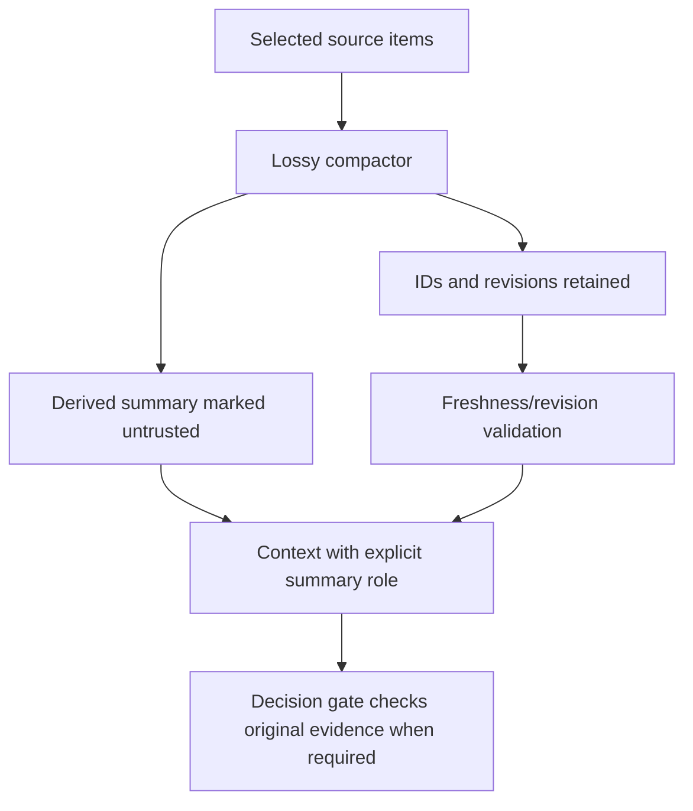

# Day 46 — Compaction, lossy summaries, and memory freshness

## 1. Learning objectives

Distinguish selecting fewer whole records from compressing the contents of a
record. Identify what information a truncation or summary can lose, retain source
identifiers and revisions for follow-up, and mark derived text as lossy. Build a
memory freshness policy using explicit timestamps, TTL and source-revision
checks. Explain why a fluent summary does not inherit source authority and why
expired memory should be filtered before use.

## 2. Required prerequisites

Review Day 45's context item fields and trust classes. You need string slicing,
hashes, timestamps and source revision concepts from Week 6. Compaction is not
the same as model-context selection: selection excludes whole items, while
compaction may delete qualifications within an item. For critical decisions,
references must resolve to the original snapshot, not just a summary sentence.

## 3. Problem motivation

Long-running work accumulates tool outputs, user preferences, intermediate
findings and outdated assumptions. Passing every turn into every request raises
cost and can bury a current instruction. Deleting old text is sometimes correct;
compressing it can preserve useful continuity. Yet a summary that says “all tests
pass” may omit the fact that only unit tests ran. Systems need to represent the
loss and maintain a path back to the exact evidence.

## 4. Intuitive explanation

Compaction resembles writing a case note from a stack of records. The note is
shorter, but it cannot contain every caveat. A good note lists the case IDs and
edition numbers so a reviewer can reopen originals. It also says it is a summary
written by an observer, not a new signed policy. Memory resembles a dated
notebook: “server is on port 8080” can go stale after deployment, while a stable
preference may need a different expiry and confirmation rule.

## 5. Deep technical explanation

`compact(items,max_chars)` joins item text in input order, takes a prefix and
appends a truncation marker when the source exceeds the limit. The marker is
included inside the returned character bound. Its result retains the ordered
source IDs and source revisions. It records `lossy=True` and an authority string
that states derived text is untrusted and does not inherit source authority. The
API makes no semantic claim about which facts survive; prefix truncation can cut
a sentence in half. For a true model-generated summary, the caller would need
additional model, prompt, output and evidence lineage fields.

Memory freshness has multiple dimensions. A TTL answers when to stop using an
item under a given clock, not whether the fact changed before then. Revision
comparison detects that a particular source snapshot differs, not that the
summary faithfully represented it. User preferences can need reconfirmation;
project facts may need retrieval from current source of truth. Store creation
time, source revision and expiry separately, and make `now` explicit in tests.
Deletion and retention policy remain distinct from in-context freshness.

An aggressive compactor can also erase negative evidence, dissent or provenance.
Prefer a structured note with `claim`, `source_refs`, `uncertainty` and `expires`
for decisions. Keep exact source quote retrieval available. Never use a summary
to authorize an action whose preconditions are absent from the retained evidence.

## 6. Mathematical foundations

If source strings have lengths n₁…nₖ and the character budget is L, the retained
prefix has at most L characters including the marker. The retained fraction is
not an information-retention score: a 20-character qualifier can change the
meaning of a 1000-character instruction. TTL freshness under the implemented
inclusive boundary is fresh(t) iff now≤created+ttl. At exact expiration the item
is fresh; one second later it is stale. If a source changes at time tₛ before
expiry, time-only freshness still incorrectly admits the old snapshot, so use
revision validation when currentness matters.

## 7. Architecture and execution diagrams



The summary is an index into evidence, not a replacement for evidence on
high-impact facts. The decision gate can request original material by reference.

## 8. Implementation from first principles

```python
from forgeagent.context import ContextItem, compact
items=[ContextItem('log-4','Only parser unit tests passed; integration suite skipped.','tool','ci run','observed','sha4',10),
       ContextItem('plan-2','Next inspect integration failure.','assistant','checkpoint','untrusted','sha2',11)]
note=compact(items,max_chars=35)
assert note.lossy and len(note.text)<=35
assert note.source_refs==('log-4','plan-2')
assert note.source_revisions==('sha4','sha2')
assert 'untrusted' in note.authority
print(note.text)
```

Run this example from the repository root. `max_chars` is a character budget,
not a UTF-8 byte or tokenizer budget. The exact text is a prefix, illustrating a
safe limitation rather than a semantic summary model.

## 9. Worked execution walkthrough

The combined input is longer than 35 characters. The implementation reserves
space for a newline and `[TRUNCATED]`, takes the remaining prefix, and returns
the source IDs `log-4`,`plan-2` with revisions `sha4`,`sha2`. The text prefix
contains the initial test result but may omit “integration suite skipped.” That
omission is material: a later assistant must not infer that the whole test suite
passed. It should resolve `log-4` or treat the claim as insufficient. If the
original run is unavailable, provenance tells us what is missing; it cannot
reconstruct lost words.

## 10. Independent laboratory

Complete the compaction contract, including the smallest accepted output bound,
exact marker placement, empty input, UTF-8 multibyte text and multiple item
references. Add a memory store fixture where a note is fresh by TTL but has an
old source revision. Require the caller to reject it for a current configuration
question. Add an expired preference and prove it is removed. Explain why
reference retention does not mean those references are still fetchable or
authorized.

## 11. Experiments

Create 10 short snippets where one contains a late negation (“not approved”) and
another contains a late scope qualifier (“staging only”). Compact at several
character limits and report which distinctions survive. Then compare prefix
truncation with a hand-authored structured note containing claim and caveat.
Evaluate exact fact preservation on the fixed fixture; do not count fluent text
as success. Repeat after changing a source revision and record whether cached
compactions invalidate correctly.

## 12. Failure analysis

Reproduce a misleading checkpoint by compacting “tests pass only on Python 3.12”
until the version qualifier disappears. The fix is not merely a longer limit:
store a structured claim and qualification, keep a reference, or fetch the
source before decisions. Reproduce stale memory that remains within TTL after a
deployment changes a config file; require revision equality for source-bound
facts. A summary authority label must survive serialization, or derived content
may be mistaken for a developer-authored instruction after resume.

## 13. Engineering tradeoffs

Prefix truncation is deterministic and cheap but semantically crude. Model
summaries can preserve salient facts but introduce omissions, hallucination and
additional cost. Hierarchical summaries reduce repeated work but create lineage
chains that need revision invalidation. Short TTLs reduce stale use but can
discard useful continuity; long TTLs improve convenience while increasing the
chance of obsolete facts. Critical facts should come from a current authoritative
source, not a tuned expiry guess.

## 14. Real-world connection

Long-running coding agents often restart across context windows. A compact
handoff can record the current branch, completed task IDs, latest test evidence
and next action. It should also include repository revision and exact file/test
references. Anthropic's long-running harness article describes setup and
handoff patterns across model windows; it motivates explicit operational state,
not the idea that summaries are lossless. See [the engineering report](https://www.anthropic.com/research/effective-harnesses-for-long-running-agents).

## 15. Common misconceptions

“A summary preserves the important parts” has no checkable meaning until a task
defines importance. “Source IDs make a summary factual” confuses traceability
with faithful representation. “An unexpired item is current” ignores source
revision. “Truncation marker makes omitted text harmless” only signals loss; it
does not tell the model what was lost. Preserve uncertainty and re-fetch when
the decision needs a qualifier.

## 16. Technical examination

For a 60-character budget and a source containing a final negation, determine
whether prefix compaction can preserve it. Propose a structured alternative
with source IDs, revision and authority. Given an item whose TTL has not elapsed
but whose source revision changed, decide whether it can answer a current-state
question. Explain how compaction should serialize across restart. Rubric: loss
analysis 30, freshness 25, lineage 25, decision boundary 20.

## 17. Daily mastery gate

Pass marker bounds, source-reference retention and expiry edge checks. Show a
case where a summary is too lossy to support a claim and the caller retrieves
original evidence. State the distinction between “fresh under TTL” and
“revision-current.” Score 4/5 on a fresh memory fixture and retain authority
metadata across a serialization round trip.

## 18. Resources

The primary [Anthropic harness article](https://www.anthropic.com/research/effective-harnesses-for-long-running-agents)
discusses context-window transitions and initializing future work with useful
state. Read it as a practical engineering report. The local `compact` function
does only truncation and metadata retention; it does not implement their
agent workflow or demonstrate the same task results.

## 19. Revision and retention

Tomorrow explain atomic checkpoint storage versus a compact conversational note.
In three days, make a note with a source revision mismatch and state the
revalidation result. In one week, measure qualifier survival on a new fixture.
Keep records needed for audit under explicit retention controls; TTL filtering
from a prompt should not be mistaken for secure deletion from SQLite or logs.

## 20. Next lesson connection

Day 47 persists events and snapshots. Compaction helps decide what state to
carry, but a durable workflow must record which events committed, under which
revision, and what a restart can safely replay. The next lesson uses SQLite
transactions and optimistic revision checks to make local state transitions
auditable and race resistant.
