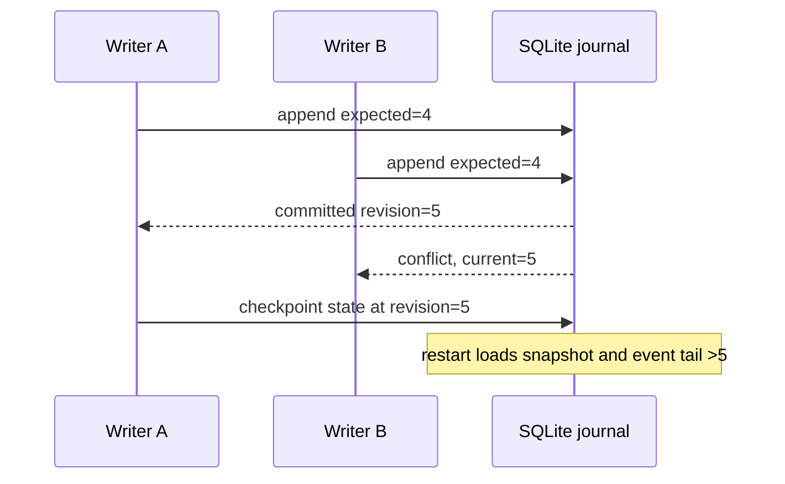

# Day 47 — Event journals, optimistic revisions, and checkpoints

## 1. Learning objectives

Design an append-only event journal scoped by owner and session. Use a monotonic
revision as a compare-and-swap token, keep local transactions short, and reject
stale writers rather than overwriting newer state. Store bounded JSON checkpoints
with a revision and resume them with their later event tail. Distinguish durable
local database atomicity from atomicity spanning external services.

## 2. Required prerequisites

Review Week 2's SQLite store and transaction boundaries, Week 5's typed JSON
records, and Day 46's lossy handoff distinction. You need primary keys, SQL
transactions, exception handling and canonical JSON. A checkpoint represents
resumable application state; it is not a transcript dump and not an external
service receipt. Use a file-backed database because separate connections to
`:memory:` would not share this simple store.

## 3. Problem motivation

Two workers may both read revision 4, calculate a new state and try to write.
Without a revision condition, the later write can erase the earlier worker's
progress. A process may also stop between “tool completed” and “state saved.”
An event journal makes local transitions reviewable; a snapshot avoids replaying
the entire history. Correct resume requires knowing which revision the snapshot
represents and which events happened afterward.

## 4. Intuitive explanation

Treat the session as a notebook with numbered entries. A writer says “I have
entry 4; append my next entry only if the latest is still 4.” If another person
has already written entry 5, the first writer rereads and reconciles. A
checkpoint is a labeled bookmark at entry 5. New entries 6 and 7 form the tail.
The bookmark makes recovery faster, while the numbered notebook remains the
source for later changes.

## 5. Deep technical explanation

`EventJournal` creates session revision, event, checkpoint and operation tables.
Events are keyed by `(owner,session,revision)` and contain a kind plus canonical
JSON payload. `append` opens a short `BEGIN IMMEDIATE`, reads the current
revision, compares it to the caller's expected value, then increments and
inserts within one transaction. This avoids a check-then-write race between
concurrent local connections. A mismatch raises `Conflict`; the caller rereads
and recomputes rather than retrying the same stale update blindly.

The design uses owner and session in the primary key and in every query. It
prevents accidental cross-scope reads through this API, but it is not a database
authorization boundary against a process that can query the file directly.
Deployments need filesystem controls, encryption/retention decisions and
possibly per-tenant databases. Event payloads must be finite JSON and should
exclude secrets or oversized tool output. The event table is append-only by API
convention, not protected against privileged SQL updates.

`checkpoint` serializes state to canonical JSON, enforces a one-megabyte bound,
then atomically checks expected session revision and upserts the named snapshot.
`resume` returns the saved state and events with revision greater than that
snapshot. A caller should validate checkpoint schema/version before passing it
to a runtime. The event tail can reconstruct known local transitions, but a
remote effect may still be ambiguous if its receipt was not durably stored.

## 6. Mathematical foundations

Let r be current revision and e the caller's expected revision. Append succeeds
only if e=r; the new revision is r+1. With two writers expecting r, transaction
serialization permits one to write r+1; the other observes mismatch and fails.
This is optimistic concurrency control: callers do work without holding a lock,
then validate the version at commit. It prevents lost updates but does not merge
them automatically. Checkpoint state S is associated with revision rₛ; resume
returns events where revision>rₛ, preserving an ordered suffix.

## 7. Architecture and execution diagrams



The database transaction covers the revision update and event insert together.
It does not cover a remote API, shell process or human approval.

## 8. Implementation from first principles

```python
from tempfile import TemporaryDirectory
from pathlib import Path
from forgeagent.durable import EventJournal, Conflict
with TemporaryDirectory() as directory:
    journal=EventJournal(Path(directory)/'events.sqlite')
    r=journal.append('owner-1','session-A',0,'started',{'task':'index'})
    journal.checkpoint('owner-1','session-A','latest',{'steps':1,'cursor':'file-2'},r)
    journal.append('owner-1','session-A',r,'read',{'file':'file-3'})
    assert journal.resume('owner-1','session-A','latest')['events'][0]['revision']==2
    try: journal.append('owner-1','session-A',r,'stale',{})
    except Conflict: print('stale writer rejected')
```

The local temporary file permits multiple short-lived SQLite connections while
the context manager guarantees cleanup after the demonstration.

## 9. Worked execution walkthrough

The new session has implicit revision 0. Appending `started` with expected 0
creates revision 1. The checkpoint stores `steps=1` and cursor `file-2` at 1.
Appending `read` with expected 1 creates revision 2. Resume returns state at 1
plus event 2, allowing the caller to load the cursor and then apply the tail.
If a second worker still expects 1, it receives a conflict because revision 2
exists. It must inspect the new event and decide whether its work remains valid.
The returned revision is not a global ordering across different sessions.

## 10. Independent laboratory

Implement append and checkpoint CAS around a file-backed database. Race two
threads behind a barrier at the same expected revision; exactly one appends and
one conflicts. Create two owners with the same session ID and prove neither can
read the other's events through the API. Reject non-finite JSON and a checkpoint
larger than the documented bound. Reopen the database after closing the journal
and show that a snapshot plus tail preserves state and event order.

## 11. Experiments

Run a two-writer race repeatedly with a fresh session and record success/conflict
counts. The expected invariant is exactly one successful append at each shared
revision, not a particular winning thread. Compare event replay from revision 0
with checkpoint plus short tail after 100 events. Measure serialization and
lookup time without assuming those timings transfer to network storage or high
contention. Test checkpoint updates racing with append: the one-megabyte payload
is validated before the transaction, while the revision is checked inside it.

## 12. Failure analysis

Reproduce a lost update with an unsafe sequence: both workers read 4, calculate,
then overwrite a state row. Add the expected revision condition and the second
writer now conflicts. Separately insert the event but crash before updating the
session revision; schema/transaction must place both operations in one commit.
Inspect the journal after a failed transaction and verify neither partial row
exists. A checkpoint schema mismatch after a software upgrade must fail closed
or migrate explicitly; do not silently reinterpret old keys.

## 13. Engineering tradeoffs

SQLite is simple, embedded and reliable for a local single-file journal. The
write lock serializes writers, so long transactions reduce throughput. This
implementation uses short transactions and a five-second lock wait; a larger
service may need a server database, migrations, backups, retention, access
controls, encryption and observability. Append-only histories aid audit but
retain data; compacted snapshots reduce replay cost but need schema evolution.

## 14. Real-world connection

Job runners, coding agents and workflow services need restartable state. A
checkpoint can preserve counters, pending work, tool observations and exact
message payloads, while events show transitions. The [Python `sqlite3`
documentation](https://docs.python.org/3/library/sqlite3.html) describes
transaction-control behavior; this code uses explicit transaction statements
with `isolation_level=None`, so its own boundaries are visible. It does not use
the newer `autocommit` API and targets Python 3.12+ as configured by this repo.

## 15. Common misconceptions

“A transaction makes remote effects atomic” is false; SQLite only controls its
own database. “Session IDs are private” is false without authorization at the
storage boundary. “A checkpoint replaces event history” loses the tail and
audit context. “Conflict means retry the same payload” can duplicate stale
logic; reread and reconcile first. “JSON means safe” ignores payload size,
sensitive data and schema changes.

## 16. Technical examination

Draw the transaction containing revision comparison, increment and event insert.
Given concurrent expected revision 5 writes, calculate outcomes. Explain how
checkpoint revision 8 and events 9–10 become resume input. Identify what the
database cannot make atomic when a tool writes to a remote system. Design an
owner-scope test and a checkpoint version migration strategy. Rubric: transaction
correctness 30, resume 25, isolation 20, limitation analysis 25.

## 17. Daily mastery gate

Pass atomic CAS race, scope separation, event ordering, bounded-state and
reopen/resume checks. Explain why conflict is a signal to reconcile rather than
automatic retry. Score 4/5 and show a database trace with snapshot revision and
tail. State one deployment control that belongs outside the Python class.

## 18. Resources

Read the [Python sqlite3 transaction-control documentation](https://docs.python.org/3/library/sqlite3.html)
and focus on explicit commit/rollback and autocommit modes. The API evolves
between Python versions; the repository supports 3.12 through 3.14. Our journal
uses standard SQLite locking and explicit `BEGIN IMMEDIATE`; it makes no claim
about distributed database behavior.

## 19. Revision and retention

Tomorrow trace the crash window between a committed external call and local
receipt. In three days, recreate the concurrent compare-and-swap race and
explain why only one writer wins. In one week, add a checkpoint schema version
and a safe migration test. Connect Week 2's owner-scoped document key to this
owner/session composite scope.

## 20. Next lesson connection

Day 48 adds operation intent, result receipts and restart behavior for long
running work. The event journal and checkpoint preserve local state, but they
cannot promise that a remote side effect ran exactly once. The final lesson
models the ambiguity explicitly and asks what an idempotency key can and cannot
guarantee.
