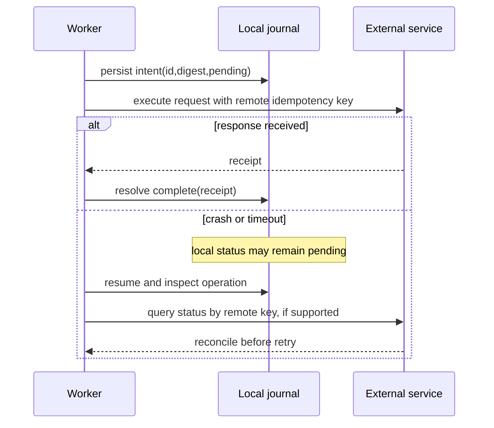

# Day 48 — Durable resume, idempotency, and ambiguous effects

## 1. Learning objectives

Resume bounded agent work from a validated snapshot while preserving messages,
tool observations, counters and deadlines. Persist an operation intent before a
side effect and bind its identifier to a canonical payload digest. Distinguish
pending, completed and unknown outcomes. Explain crash windows around external
effects and why a local journal, retry loop or idempotency label cannot claim
exactly-once execution without cooperation from the remote system.

## 2. Required prerequisites

Review Day 47's checkpoint and CAS APIs, Week 7's operation dispatch, and Week
5's canonical request identity. You need to trace a process restart from durable
state rather than in-memory variables. A long-running job may resume after a
timeout, host reboot, deployment or cancellation. Its effective budget is the
remaining budget, not a fresh allowance on every restart.

## 3. Problem motivation

Suppose an agent sends a payment request, the remote service accepts it, and the
worker loses its network connection before receiving the response. Locally the
call timed out. Retrying could charge twice; refusing to retry could leave the
job incomplete. A database transaction can atomically record local intent and
later receipt, but it cannot span the remote service's commit. Recovery needs a
stable operation identity, payload binding, and a reconciliation path for
ambiguous state.

## 4. Intuitive explanation

Before sending a registered letter, write down its tracking number and what the
envelope contains. If the courier portal later says “unknown,” checking status
is safer than mailing a second copy. If you reuse the tracking number for a
different envelope, reject the mismatch. An intent record is the local note;
the remote API may provide the deduplication/reconciliation mechanism. Without
that remote cooperation, the note cannot prove delivery or prevent duplicates.

## 5. Deep technical explanation

The Week 7 runtime snapshots a versioned run identity, typed messages, steps,
tool/token counters, known cost, observations, pending calls, status, deadline
and events. Resume validates identity and counters before continuing. The
absolute wall-clock deadline prevents a restart from resetting elapsed-time
budget. Checkpoint state is caller-owned JSON: an adapter should serialize it
through `EventJournal.checkpoint` using an expected revision, then load the
snapshot and event tail using `resume`. Validate schema before passing it to the
runtime.

For effectful work, `EventJournal.intent(owner,session,op_id,payload)` stores a
canonical JSON SHA-256 digest. The same ID with the same payload returns the
existing state; a changed payload conflicts. After the effect, `resolve` records
the receipt. A completed receipt is immutable: replay can return the same result
but cannot overwrite it. `unknown=True` stores an explicit ambiguous terminal
state. A pending row may mean the process stopped before calling out, during the
call, or after remote success but before local resolution. The journal alone
cannot tell which.

Recovery should query an external idempotency API or operation-status endpoint
when available. Otherwise require reconciliation by an owner, or use a
compensating workflow with a clearly defined safety property. Do not turn
unknown into a blind retry. A remote key is useful only if the remote service
documents its scope, retention interval and behavior for concurrent requests
with different payloads. Include tenant/account and operation type in the key's
scope as needed.

## 6. Mathematical foundations

For payload p, canonical encoding c(p) produces stable JSON with sorted keys and
no non-finite numbers. Digest d=SHA256(c(p)) binds op_id to that value. For an
existing operation, same op_id and same d is a replay; same op_id and d′≠d is a
conflict. The local state machine is pending→complete(receipt) or pending→unknown.
Terminal receipts cannot change. It does not prove remote executions N=1:
without remote deduplication N may be zero, one or greater than one while local
state remains pending/unknown. The honest invariant is one immutable local
receipt per operation identity.

## 7. Architecture and execution diagrams



Checkpoint recovery restores local control state. Operation recovery separately
resolves the external effect boundary; neither substitutes for the other.

## 8. Implementation from first principles

```python
from tempfile import TemporaryDirectory
from pathlib import Path
from forgeagent.durable import EventJournal, Conflict
with TemporaryDirectory() as directory:
    j=EventJournal(Path(directory)/'durable.db')
    intent=j.intent('acct-9','job-3','send-report-1',{'to':'ops','body':'done'})
    # A real adapter should send the same key to a service that supports it.
    # Here we persist a local fixture receipt; this does not model remote exactly-once.
    receipt={'fixture_status':'accepted','remote_id':'fixture-51'}
    j.resolve('acct-9','job-3','send-report-1',intent['digest'],result=receipt)
    assert j.intent('acct-9','job-3','send-report-1',{'to':'ops','body':'done'})['status']=='complete'
    try: j.intent('acct-9','job-3','send-report-1',{'to':'other','body':'done'})
    except Conflict: print('operation payload mismatch rejected')
```

The fixture records local state only. It proves digest binding and receipt reuse;
it is not a claim that an email was delivered.

## 9. Worked execution walkthrough

At revision 12 the agent has completed four model steps and two read-only tools.
It snapshots counters and messages, then records intent `publish-42` with digest
d. The publisher accepts the request. Before the worker records the receipt, the
host exits. On restart, the checkpoint restores counters and pending call, while
the operation table still says pending. If the service supports idempotency key
`publish-42`, query status or resend the exact same payload/key under its
documented semantics. If it does not, do not assume that a repeated call is safe;
mark unknown and request reconciliation. Once a receipt is committed, later
replay sees the immutable result and must not publish again.

## 10. Independent laboratory

Write a fake external service that records idempotency keys and payload digests.
Simulate (1) crash after intent before effect, (2) crash after effect before
local receipt, and (3) crash after completed receipt. Assert the first has no
remote effect, the second is ambiguous without a status lookup, and the third
replays the same receipt without a second effect. Test changed-payload reuse,
owner scope, cancellation before and during an async call, and deadline expiry
after resume. Keep fixtures explicit about which side of the effect boundary
they represent.

## 11. Experiments

Run the three crash points against two fake service policies: no deduplication
and remote idempotency-key deduplication. Record number of remote effects,
observable status, local state and recovery decision for each. Change payload
under the same key and verify the fake service and local journal reject it.
Repeat with a key whose simulated retention expired; show that an old key may no
longer protect against duplication. These outcomes describe the authored fixture
only, not the behavior of a real provider.

## 12. Failure analysis

The classic duplicate effect is: send request, remote commits, response is lost,
worker retries with a new identity. Reuse a stable key and reconcile. Another
bug is key collision across accounts; include scope in the operation namespace.
A local overwrite bug changes a completed receipt; immutable resolution now
rejects it. Finally, a resumed runtime might reset time/token counters; preserve
absolute deadline and accumulated counters or restarts become a way to evade
budgets. Budget exhaustion after a call cannot retroactively undo the effect.

## 13. Engineering tradeoffs

At-most-once local dispatch can lose an effect after intent if the process dies
before sending. At-least-once retries can duplicate if the remote lacks dedupe.
Remote idempotency narrows the gap but is bounded by provider semantics and key
retention. Reconciliation is slower and may need a human, but is safer for
irreversible operations. Compensation can restore business state without
erasing history; it is a new effect with its own failure modes. Choose based on
the operation's reversibility and harm, not a generic retry count.

## 14. Real-world connection

Payment, email, deployment and ticket APIs have different idempotency contracts.
An email provider may accept a message before the client sees a response; a
deployment tool may expose release status by commit ID. A long-running coding
agent can resume model work safely while still needing explicit recovery for a
write tool. The [Anthropic long-running harness report](https://www.anthropic.com/research/effective-harnesses-for-long-running-agents)
describes context handoffs; durable side-effect reconciliation is an additional
systems concern that this local journal illustrates.

## 15. Common misconceptions

“Exactly once” is usually an end-to-end claim requiring cooperation from the
effecting system. “A UUID makes retries safe” lacks payload binding and remote
dedupe semantics. “Pending means not executed” ignores the crash-after-effect
window. “Timeout means failure” ignores lost responses. “Checkpoint restored”
does not imply the remote world matches the snapshot. Keep unknown explicit.

## 16. Technical examination

Draw the crash timeline for intent, remote commit, response and local receipt.
Classify local status at each crash point. Explain what a stable idempotency key
must bind and what happens if the same key carries a different digest. Design a
recovery rule for a service with status lookup and one without it. Prove why
SQLite cannot provide exactly-once remote execution. Rubric: timeline 30,
identity 25, recovery 25, claims/limits 20.

## 17. Daily mastery gate

Pass immutable receipt, digest mismatch, pending recovery, unknown outcome,
scope isolation and checkpoint-resume tests. Show preserved counters and
deadline across restart. Explain the status lookup or human action required
before replaying an ambiguous irreversible operation. Score 4/5 on a fresh
scenario; a retry policy that says “repeat on timeout” fails the gate.

## 18. Resources

Read [Anthropic's report on long-running agent harnesses](https://www.anthropic.com/research/effective-harnesses-for-long-running-agents)
for context-window handoff practices. Also consult the primary documentation of
the particular external API before relying on idempotency semantics; those
contracts vary and change. This curriculum's `EventJournal` is a local SQLite
fixture and does not implement any remote provider's key protocol. The [Python
`asyncio` task and timeout documentation](https://docs.python.org/3/library/asyncio-task.html)
is relevant to cancellation behavior; cancellation of a coroutine does not
reverse a side effect that already reached an external system.

## 19. Revision and retention

After three days, reproduce all three crash states and state whether retry is
safe. After one week, add a fake key-retention expiry and test old-key behavior.
Review Day 47's transaction boundaries and Week 7's cancellation behavior. Keep
operation receipts only as long as the system's reconciliation and audit needs
require, and define deletion policy without losing active unknown operations.

## 20. Next lesson connection

Week 9 moves into agent service architecture. Its workers and job stores need
the boundaries from this week: explicit owner/session scope, revisions,
checkpoints, bounded context and effect recovery. Local durability is one layer
of a service; authentication, queue leases, monitoring and deployment semantics
must be designed around it rather than inferred from a SQLite commit.
