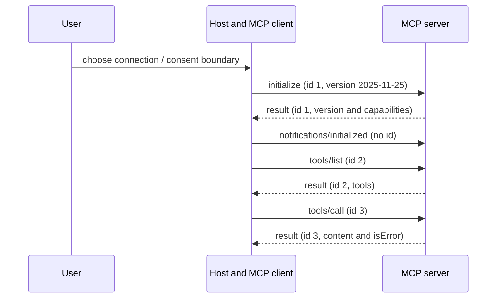

# Day 49 — MCP roles, JSON-RPC, and lifecycle

## 1. Learning objectives

At the end of this lesson, draw the MCP participants and correctly trace an `initialize` request, its response, `notifications/initialized`, and a later feature call. Explain what the protocol version and capability objects let the peers agree upon. For each claim, label it as a protocol property, an implementation property, or an application authorization decision. That distinction prevents treating a successful handshake as user consent.

## 2. Required prerequisites

You should know JSON objects, UTF-8 text, function calls, and the Week 7 distinction between agent planning and tool dispatch. Review request/response correlation IDs and the difference between an operation result and an error. This lesson uses the pinned MCP specification dated 2025-11-25, as well as a small Python implementation. It is not based on remembered names from a different MCP release.

## 3. Problem motivation

A host may connect to tools implemented by separate programs. If every integration invents its own message names, lifecycle and argument shape, each host needs custom glue, and a server cannot reliably say which capabilities it supports. MCP supplies common message contracts. A common contract only improves interoperability: it does not verify that a server is benign, that its description is true, or that a requested action is appropriate for this user.

## 4. Intuitive explanation

Think of a connection as a visitor entering a building. The visitor first identifies the protocol language it speaks and the services it can use. The building replies with its supported language and services. The visitor acknowledges readiness; only then do ordinary requests begin. The sign showing “copy room” does not authorize copying confidential pages. In MCP terms, capability discovery informs the host; host policy and user consent still decide whether to expose or invoke a tool.

## 5. Deep technical explanation

MCP defines host, client, and server roles: the host is the user-facing LLM application, the client is its protocol connector, and the server supplies context or tools. JSON-RPC 2.0 provides `jsonrpc`, `id`, `method`, `params`, `result`, and `error` structure. MCP adds session lifecycle and negotiated version/capability semantics. A request has an ID and must receive a matching response; a notification has no ID and expects no response. For this lesson the supported version is exactly `2025-11-25`.

The server advertises a `tools` capability; it does not advertise resources because this implementation has no resource methods. The client asks `initialize` with `protocolVersion`, `capabilities`, and `clientInfo`. The server returns `protocolVersion`, `capabilities`, and `serverInfo`. The client then sends `notifications/initialized`. Capability maps are not permission tokens: they describe protocol support. A host may implement only part of an advertised capability and can further filter tools by per-session policy.

## 6. Mathematical foundations

Let C be the client’s supported version set and S the server’s supported set. Negotiation can proceed only if C∩S is nonempty. This demo fixes C=S={2025-11-25}; it does not demonstrate a multi-version chooser. If the server responds with a version outside C, this client closes. Version equality is not enough to prove semantic equivalence across releases; schema and behavior tests are still needed.

There are two message classes relevant to the trace: request count R and notification count N. A trace with initialize, initialized, tools/list, and tools/call has R=3 and N=1. The notification consumes no response ID. If a client waits for a response to it, it will misalign its read stream and may assign the next response to the wrong operation.

## 7. Architecture and execution diagrams



The diagram deliberately puts consent outside the server’s capability response. In a complete application, UI, policy and audit components would sit between model intent and dispatch.

## 8. Implementation from first principles

MCP is not a custom method called `mcp/tool`. Start with the canonical JSON-RPC shape, for example `{"jsonrpc":"2.0","id":1,"method":"initialize","params":{...}}`. The server is stateful: `new` accepts initialization, `await_initialized` accepts the readiness notification, and `ready` accepts tools operations. The demo server in `forgeagent/mcp_server.py` implements these transitions and emits one compact JSON object per line. The client in `forgeagent/mcp.py` verifies response IDs.

```python
from forgeagent.mcp import StdioClient
with StdioClient(["python3", "-m", "forgeagent.mcp_server"]) as client:
    names = {tool["name"] for tool in client.list_tools()}
    assert names == {"echo", "add"}
    result = client.call_tool("echo", {"text": "hello"})
    assert result["content"][0]["text"] == "hello"
```

## 9. Worked execution walkthrough

The client starts request ID 1 and sends `initialize` with version `2025-11-25`, empty client capabilities, and a client identity. The server checks its state is `new`, checks the message envelope, and returns ID 1 plus `tools: {}` and server identity. The client checks the negotiated version. Then the client writes the readiness notification without an ID. When it asks for tools, the server is `ready` and returns a list. A repeated `initialize` after readiness is not a second session; it is rejected as an invalid state transition.

## 10. Independent laboratory

In `labs/week-09`, implement `parse_tool_result`. Require a dictionary containing a list-valued `content` and a boolean `isError`; join only text parts on success and return no successful text for an error result. Use `python3 labs/week-09/checks.py --day 1 --module labs/week-09/starter/tasks.py`. Then add a test that rejects a missing `isError`, an integer in its place, and a content field that is a string. This is a result-contract exercise, not a full JSON-RPC validator.

## 11. Experiments

Build a small transcript table with columns message direction, method, ID, state before, state after, and expected output. Change the requested version to an unsupported date and observe that the demo server returns its only supported version; the client declines to proceed. Send tools/list before initialized and verify that the server returns a JSON-RPC error. Send initialized twice and note that the server’s strict state machine rejects the second notification by closing the session.

## 12. Failure analysis

A malformed JSON line has no safely correlated request ID, so this demo terminates rather than guessing a repair. A duplicate JSON key is rejected because choosing “first wins” or “last wins” can make a policy check parse different data than another component. A valid `tools/call` result with `isError: true` is still a protocol result, but it is not successful tool execution. Keep transport parse errors, JSON-RPC errors and tool-level errors distinct in logs.

## 13. Engineering tradeoffs

One pinned protocol version makes the code and fixtures easy to audit. Supporting a set of versions would require separate schema/behavior compatibility tests and explicit negotiation tests. A strict lifecycle rejects out-of-order traffic, which is predictable but can be less tolerant of client bugs. This implementation leaves many core features absent. Capability honesty is part of engineering: do not advertise resources, prompts or sampling when no handler exists.

## 14. Real-world connection

An IDE host might launch a filesystem MCP server and a database MCP server. The host’s client connector can negotiate protocol support, list tools, and present selected actions to a model. The filesystem server being correctly initialized does not mean every repository file may be sent to it; document visibility is a host-side policy question. Likewise, a database tool’s advertised read-only description is untrusted metadata unless the host has independent reason to trust the server.

## 15. Common misconceptions

JSON-RPC is the base message format, not the entire MCP protocol. A connection is not stateless merely because each frame is JSON. A capability is not an authorization grant. `notifications/initialized` is not an ordinary request and has no response ID. Returning a JSON object from a Python function does not make a program MCP-compatible. Compatibility requires correct transport framing, method schemas, lifecycle and negotiated version behavior.

## 16. Technical examination

Explain this trace: the client sends initialize ID 4, receives ID 5, then invokes tools/list. Identify the first protocol failure and describe the safe response. Next, the server advertises tools and resources, but the host implements only tools. State which capabilities the host should claim and whether the resource claim authorizes the model to read data. Finally, explain why a tool’s `isError` result differs from a JSON-RPC `error` response.

## 17. Daily mastery gate

Pass only if you can draw the three roles, write the lifecycle trace with the notification having no ID, and explain version mismatch without pretending that the demo implements an arbitrary negotiation matrix. In a test, demonstrate that no handler runs before `initialized`. Your explanation must say that host consent and authorization remain outside the protocol handshake.

## 18. Resources

Use the [official MCP 2025-11-25 specification](https://modelcontextprotocol.io/specification/2025-11-25), its [lifecycle section](https://modelcontextprotocol.io/specification/2025-11-25/basic/lifecycle), and the linked JSON-RPC 2.0 specification. In this repository, compare the state transition code in `forgeagent/mcp_server.py` with the subprocess transcript test. The official spec is normative; this small implementation is evidence only for the subset it exercises.

## 19. Revision and retention

Close the lesson and draw the four-message trace from memory. Then answer: who sends initialize, which direction has the readiness notification, and who decides whether a tool is allowed? A week later, reconstruct one malformed trace and state whether the failure belongs to JSON parsing, JSON-RPC correlation, MCP lifecycle, or application authorization. Recalling these categories helps debug later transport failures.

## 20. Next lesson connection

Lifecycle identifies which calls are legal; transport defines how messages become bytes and how the server process is owned. Day 50 examines stdio framing and the MCP tools contract. Keep the same role distinctions, but add subprocess pipes, bounded line reads, content parts and process cleanup. A correct protocol exchange still does not grant permission to perform a side effect.
