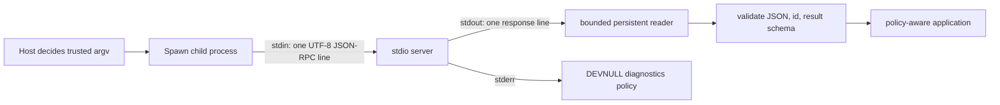

# Day 50 — MCP stdio transport and tools

## 1. Learning objectives

Implement the shape of a stdio session and explain what its framing guarantees. Read tool definitions from `tools/list`, send a `tools/call`, validate a content array and distinguish a successful content result from `isError: true`. Be able to explain who launches the process, which stream contains protocol messages, how a timeout affects session reuse, and why a subprocess that speaks MCP is not automatically an isolated process.

## 2. Required prerequisites

Complete Day 49’s lifecycle trace. You should understand subprocess stdin/stdout, UTF-8, JSON-RPC IDs and exception handling. This lesson uses only Python’s standard library and a local test process. It does not open a network connection. The selected MCP snapshot defines both stdio and Streamable HTTP; this chapter implements only stdio, so HTTP headers, Origin checks, OAuth and SSE behavior are not silently approximated.

## 3. Problem motivation

Passing Python objects across a function call is easy, but independently written clients and servers do not share a Python address space. A standard transport lets the host launch another executable while preserving a clear message boundary. Framing errors can cause one response to be parsed as another; stdout log text can poison the protocol stream; unbounded reads let a child consume arbitrary host memory. These are reliability and security bugs even when the JSON payload is otherwise legitimate.

## 4. Intuitive explanation

Imagine stdin and stdout are a one-lane radio channel. The newline terminates each transmission. A transmission can contain one JSON-RPC request or notification; embedded newlines are not allowed. The client speaks into child stdin and listens on child stdout. The child may talk about diagnostics on stderr, like a separate maintenance channel. Any unstructured stdout sentence becomes a malformed frame, not a harmless log message.

## 5. Deep technical explanation

MCP stdio specifies UTF-8 JSON-RPC messages separated by newline, without embedded newlines. The client starts the server as a subprocess. The server reads stdin and writes protocol messages to stdout; diagnostics may be sent to stderr. Our client starts argv directly rather than invoking a shell string, which avoids an extra shell parser. It caps each serialized message at one megabyte and sets a response deadline. Its stderr is explicitly sent to `DEVNULL`; there is no unbounded stderr pipe that a verbose child could fill and block on.

The response reader maintains one byte buffer and uses readiness polling rather than spawning a daemon reader thread per request. A timeout poisons and closes the session because a late response can no longer be safely assigned to a future request. It validates JSON-RPC version and matching ID. The server offers two closed-schema tools: `echo(text: string)` and `add(a: integer, b: integer)`. Results use `content: [{type: "text", text: ...}]` and boolean `isError`. The `resources/list` method is intentionally not implemented.

## 6. Mathematical foundations

Let L be the maximum encoded frame size and T the response timeout. The implementation reads at most L bytes per frame and waits at most T seconds for a response after it sends a request. These are input and wait bounds; they do not limit a server’s CPU, memory, file access, network access or descendant processes. The client may kill an unresponsive process after timeout, but process termination is not a containment boundary.

If calls are sequential with a round-trip delay d_i, total elapsed time is approximately Σd_i plus process setup. A persistent session avoids paying process-startup cost per call, but requires correct ID correlation and cleanup. For this demo each outstanding client request is synchronous and unique; multiplexed concurrent requests would need a response dispatcher keyed by IDs, not a second reader competing for stdout.

## 7. Architecture and execution diagrams



The demo chooses to discard stderr so it cannot deadlock on an unread pipe and is not mixed into protocol output. Production software may capture stderr, but then it must drain and bound it.

## 8. Implementation from first principles

A call is an ordinary JSON-RPC request whose method is `tools/call` and whose parameters contain a tool name and object-valued arguments. The result is the tool result object, not the raw handler return value. The server validates exact argument keys and primitive types, then returns one text content block. Unknown tool names and invalid arguments produce a tool-level result with `isError: true`. A protocol-level request to an unsupported method instead receives a JSON-RPC error.

```python
from forgeagent.mcp import StdioClient
with StdioClient(["python3", "-m", "forgeagent.mcp_server"], timeout=2.0) as c:
    tool_names = {item["name"] for item in c.list_tools()}
    assert "echo" in tool_names
    value = c.call_tool("add", {"a": 8, "b": 5})
    assert value == {"content": [{"type": "text", "text": "13"}], "isError": False}
```

## 9. Worked execution walkthrough

The client launches the module; the process inherits the client’s user and filesystem permissions. Initialize is request ID 1, then initialized is a notification. `tools/list` is ID 2 and returns both schema objects. `tools/call` for add is ID 3. The server checks that both values have exact type `int`; Python booleans are deliberately rejected even though `bool` subclasses `int`. The response is one line; the client checks ID 3, extracts `result`, then validates the presence of content and boolean `isError`.

## 10. Independent laboratory

Run the full subprocess integration test with `python3 -m unittest tests.integration.test_mcp -v`. Add a negative case for an oversized line, duplicate `id` JSON members, a response with a mismatched ID, and a child that sleeps past the timeout. In each case, assert that the client fails closed and the child is reaped. Do not check only that an exception was raised: inspect `proc.poll()` to make sure no process was left behind.

## 11. Experiments

Replace the server’s JSON response with a debug print on stdout. The client must reject that line as invalid JSON. Repeat by writing the diagnostic to stderr; protocol parsing should still work because stderr is separate. Try calling `echo` with an extra argument key and `add` with `True`; verify that neither is silently coerced. Ask for `resources/list`; the server returns an unsupported-method JSON-RPC error, confirming that it does not claim resource support.

## 12. Failure analysis

A `readline()` call with no size bound can allocate memory until newline or EOF. A fresh helper thread on every timeout can leave a blocked reader behind; on a later request, multiple readers may race to consume one response. The implementation therefore owns a single buffer and closes the session after a timeout. If a response is malformed, duplicated-key JSON is rejected rather than parsed with ambiguous precedence. A successful JSON-RPC result can still carry `isError: true`, so callers must inspect both layers.

## 13. Engineering tradeoffs

The one-megabyte message cap is a teaching bound, not a universal MCP limit. A different deployment should choose a cap from expected tool schemas and content sizes. Sending stderr to DEVNULL avoids pipe backpressure but loses diagnostics. Capturing it requires a drain thread or selector and a bounded ring buffer. Process startup per client is simple and ownership is clear; a production host may pool long-lived children, increasing state and cleanup complexity.

## 14. Real-world connection

A desktop IDE might launch a source-control server and inspect its advertised tool schemas before exposing them to a model. The process may have the same repository and credential access as the IDE. The host therefore must choose a trusted executable and constrain the tools separately. On HTTP, the process is independently deployed and security includes endpoint authentication and origin validation; those concerns do not transfer automatically from local stdio.

## 15. Common misconceptions

Stdio does not mean arbitrary text on stdout. Newline is a protocol frame boundary. A timeout does not justify reusing a stream whose delayed response may still arrive. Tool result `isError` is distinct from a JSON-RPC envelope error. A subprocess does not make code safe: it commonly runs with the parent’s identity. Streamable HTTP is a separate transport with its own headers and threat model, not “stdio over a URL.”

## 16. Technical examination

Suppose request ID 11 times out, the server then writes a late response for ID 11, and the client tries ID 12 on the same stream. Explain why blindly reading the next line is unsafe. Next, explain whether a valid tools/list response means that calling every listed tool is authorized. Finally, a server writes a progress message to stdout before the result; state why this server violates the stdio framing contract and which stream is intended for diagnostics.

## 17. Daily mastery gate

Pass when the integration test crosses an actual process boundary and verifies initialize, list, call, malformed/negative call behavior and cleanup. Explain the exact properties bounded by the client (message bytes, response wait) and what is not bounded (server authority and resource use). Correctly name the implemented feature subset and excluded transports/features.

## 18. Resources

Consult the official [MCP stdio transport specification](https://modelcontextprotocol.io/specification/2025-11-25/basic/transports) and [tools specification](https://modelcontextprotocol.io/specification/2025-11-25/server/tools). Read `forgeagent/mcp.py`, `forgeagent/mcp_server.py`, and `tests/integration/test_mcp.py` together. The official specification defines interoperability; the repository demonstrates only the methods and error cases asserted by these local tests.

## 19. Revision and retention

From memory, draw client stdin, server stdout, server stderr, and the one-line boundary. List the fields of a tool definition and the two required result fields. Then state what the client does after timeout and why. Review your answers by running the duplicate-key and sleeping-child tests. These details are easy to forget because the happy path makes pipes look like function calls.

## 20. Next lesson connection

A correct transport can still carry a dangerous write. Day 51 applies an application policy to a stable owned workspace, proposes an exact content change, and requires one-time human approval. Keep process management separate from filesystem authorization: an MCP server’s ability to receive a path does not authorize it to read or modify that path.
